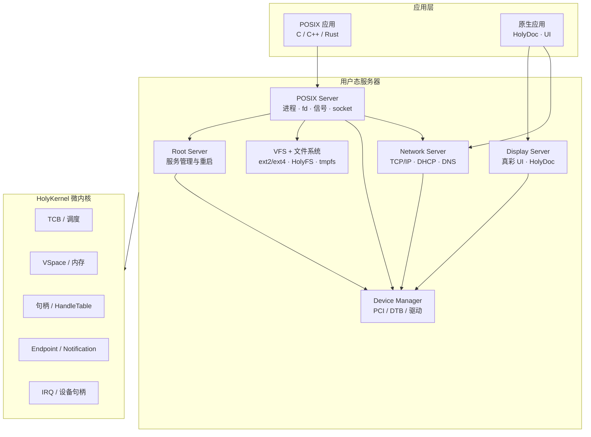

# HolyKernel

> 句柄型微内核 · 用户态服务器 · POSIX.1 兼容层

HolyKernel（缩写 **HK**）是一个句柄型微内核，内核只提供线程、地址空间、句柄、IPC、内存与中断机制；驱动、文件系统、POSIX 兼容层、网络与原生服务运行在用户态。

系统提供 **HolyShell + Holy 命令**作为默认命令行；原生命令通过 Handle/Endpoint 与结构化输出工作。**POSIX.1 + musl** 作为兼容环境：C/C++/Rust 应用针对 musl 与 `hk-abi` 重新编译即可运行，`/bin/sh` 与 POSIX 工具通过 `posix` 入口使用。VFS Server统一管理挂载表与文件句柄；HolyFS 文件系统可作主根或 `H:` 盘符；HolyDoc 与真彩 UI 作为可选原生服务。

当前状态：**v0.1.0**。M0 脚手架与 M1 Hosted 微内核已落地：Cargo workspace、`xtask`、CI、HAL、句柄表、Untyped/Frame/VSpace 与 COW、Endpoint/Notification、TCB 与调度、Root Server stub、确定性仿真。x86_64 启动从 M2 开始。

---

## 系统全景



内核机制与策略分离；服务器之间通过句柄与 IPC 协作。

---

## 设计支柱

| 支柱                  | 含义                                                                           |
| ------------------- | ---------------------------------------------------------------------------- |
| **最小内核**            | 内核提供 TCB、VSpace、HandleTable、Endpoint、Notification、Frame、IRQ 等机制                    |
| **句柄模型**            | 所有资源通过 Handle 访问；duplicate 收窄、close 失效、IPC TRANSFER、epoch 撤销、配额                        |
| **用户态服务器**          | 驱动、文件系统、POSIX 兼容层、显示服务运行在用户态                                                 |
| **POSIX.1 兼容**      | POSIX Server实现进程、文件、信号、线程、管道、套接字                                                |
| **musl + ABI shim** | musl 作为 C libc；`hk-abi`/`hk-crt` 提供 syscall shim、启动与 TLS                     |
| **故障隔离**            | 服务器崩溃后由 Root Server 重启；内核保持最小可信基                                             |
| **Native Task**     | VSpace + HandleTable + TCB(s) + Arena + 父子关系；Task 拥有堆与生命周期；窗口由 Display Server 独立管理 |
| **主流硬件**            | x86_64/AArch64 UEFI、ACPI、PCIe、AHCI/NVMe、USB HID、virtio、帧缓冲                   |
| **权限模型**           | HandleTable + 5 rights + 对象 epoch 撤销 + 配额 + 审计                                      |
| **网络**             | 用户态 Network Server；IPv4/IPv6、TCP/UDP、DHCP、DNS、POSIX socket                          |
| **Holy 命令**          | HolyShell 与 Holy 命令是主路径；POSIX 工具通过兼容环境使用                                  |
| **Holy 原生体验**        | HolyDoc UI、Workbench、系统内 Toolchain、Checkpoint、符号化调试                        |
| **原生服务可选**          | HolyDoc、真彩 UI 作为用户态服务；HolyFS 文件系统可作主根或 `H:` 盘符                |
| **多架构**             | x86_64 / AArch64 / RISC-V / Hosted 共享同一套内核与服务器                               |
| **现代工程**            | Rust、CI、确定性模拟、故障注入、可观测性                                                      |

---

## 文档

| 文档 | 内容 |
| --- | --- |
| [章程](docs/charter.md) | 微内核模型、Native Task、句柄、POSIX 兼容层、工程承诺 |
| [文档索引](docs/README.md) | 阅读顺序与全部文档地图 |
| [总体架构](docs/architecture.md) | 内核对象、IPC、服务器、启动、安全模型 |
| [内存模型](docs/memory.md) | Untyped、Frame、VSpace、COW、DMA |
| [执行模型](docs/execution.md) | TCB、调度、Endpoint、Notification、句柄 IPC |
| [权限模型](docs/permissions.md) | HandleTable、rights、epoch 撤销、配额、审计 |
| [POSIX 与 libc](docs/posix.md) | POSIX Server、musl 移植、ABI shim、进程/线程/信号、ELF |
| [服务器](docs/servers.md) | Root Server、设备管理、驱动、VFS、POSIX、网络、重启 |
| [网络](docs/network.md) | Network Server、TCP/IP、DHCP、DNS、POSIX socket |
| [HolyShell 与 Holy 命令](docs/shell.md) | 原生命令、结构化管道、POSIX 兼容入口 |
| [VFS](docs/vfs.md) | 挂载表、路径解析、文件句柄、页缓存 |
| [HolyFS 文件系统](docs/holyfs.md) | 可作主根、POSIX + 整文档、COW、checksum、快照 |
| [HolyDoc 与 UI](docs/ui.md) | 可选原生显示服务与真彩界面 |
| [Holy 原生体验](docs/experience.md) | Workbench、Toolchain、Checkpoint、符号化调试 |
| [平台与启动](docs/platforms.md) | HAL、BootInfo、各架构启动、用户态驱动 |
| [工程策略](docs/engineering.md) | Rust、构建、CI、测试、可观测性、`unsafe` |
| [路线图](docs/roadmap.md) | M0–M9 里程碑、退出标准、风险 |
| [术语表](docs/glossary.md) | 微内核与 POSIX 术语 |
| [ADR](docs/adr/) | 已接受的架构决策 |

建议阅读顺序：**章程 → 总体架构 → 执行模型 → 内存模型 → 服务器 → POSIX/libc → 平台 → 工程 → 路线图**。

---

## 平台策略

| 层级 | 目标 | 状态 |
| --- | --- | --- |
| Tier 1 | x86_64 QEMU（Limine, BIOS/UEFI） | 启动路径完成，M2 收尾中 |
| Tier 1 | Hosted 模拟器（Linux/macOS/Windows 进程） | 已完成（M1） |
| Tier 2 | AArch64 QEMU `virt`（U-Boot / 直接 `-kernel` + DTB） | 设计完成，待 M8 |
| Tier 2 | RISC-V 64 QEMU `virt`（OpenSBI） | 设计完成，待 M8 |
| Tier 3 | 主流 x86_64 UEFI 真机 | M9 后 |

Hosted 平台是确定性模拟器，服务于单元测试、CI、故障注入与回放。

---

## 快速开始

```sh
cargo xtask build --target hosted
cargo xtask run   --target hosted
cargo xtask image --target x86_64-qemu
cargo xtask run   --target x86_64-qemu
cargo xtask smoke --target x86_64-qemu
cargo xtask test  --target hosted
cargo xtask lint
cargo xtask docs
cargo xtask budget
```

Hosted 目标直接运行：打印启动信息、校验 BootInfo、运行微内核演示（Root Server 启动两个服务，客户端完成两轮 call/reply），再运行 COW fork 原型（父页只读共享、子页写时复制），最后按退出协议结束进程。

x86_64 QEMU 目标由 Limine 载入：内核初始化 COM1 串口、建立 GDT/TSS/IDT，读取 Limine 响应构造并校验 BootInfo，在串口与帧缓冲文本控制台（16 px eFont CN 点阵字体，GB2312 常用汉字 + ASCII，按字形宽度排版：ASCII 半宽、汉字全宽，80 个全角列 × 36 行）输出内存 map、内核镜像、帧缓冲与 direct map；随后用内核页表把 LAPIC 寄存器页映射进 HHDM 窗口，启用本地 APIC 定时器，再从 RSDP 解析 ACPI MADT，枚举本地 APIC 与 I/O APIC，映射 IOAPIC 页、屏蔽全部重定向表项，并把 GSI 1 路由到向量 33 后初始化 i8042 键盘；随后通过 Limine MP 协议启动其余 CPU，让 AP 建立 per-CPU TSS/GDT、加载共享 IDT、启用本地 APIC 接收跨核 IPI，并参与用户任务调度（任务可在 CPU 间迁移，AP 使用本地 APIC 定时抢占，`stats` 显示各 CPU 调度次数；空闲 AP 关闭本地 tick 并 `hlt`，由调度唤醒 IPI 恢复；COW fork 修改父页表后向其他 CPU 发送 TLB shootdown 并等待确认）；启动期用 PIT 校准 TSC，输出 TSC 频率、内核初始化耗时与启动耗时。接着从 Limine 模块逐个加载 `hk-server-demo`、`hk-server-echo`、`hk-server-device`、`hk-server-spin`、`hk-server-virtio`、`hk-server-vfs` 与 `hk-server-block` 服务 ELF，为每个服务创建独立用户页表（复制内核高半区、低半区私有）并映射独立用户栈与 Arena，调度时切换 CR3 并按模块顺序分配端点。内核把服务登记为任务，保存与恢复用户中断帧完成任务切换，并用校准到 10 ms 的 APIC tick 抢占用户态任务，`iretq` 进入 ring 3；服务通过 `int 0x80` 完成 `write`、`send`、`send_data`、`recv`、`recv_data`、`send_handle`、`call`、`reply`、`notify`、`wait_notify`、`fork`、`tsc`、`tsc_frequency`、`pci_read`、`ticks`、`civil_time`、`alloc`、`handle_count`、`close_handle` 与 `exit` 系统调用，demo 通过 call/reply 向 echo 请求并等待回复，通过通知等待验证阻塞唤醒，随后把 echo 端点句柄转移给 echo 并校验计数，device 按桥递归枚举 PCI 配置空间并打印设备清单，spin 忙等 10 个 tick 验证抢占并关闭一个端点句柄；demo 在任务 Arena 内分配 4 KiB 并校验后将 `4/1024K` 记入任务视图，demo、device 与 spin 退出，echo、virtio 驱动、VFS 与 Block 服务继续等待请求，七个服务登记进服务表；demo 通过 VFS 协议写入并读回 `/tmp/hello`；独立 `hk-server-virtio` 接收 Device Manager 移交的 virtio DeviceGrant，复用 DMA 页完成块读写并暴露 Block Endpoint，VFS 经该端点把 rsext4 ext4 挂载到 `/disk`，ext4 时间戳取自平台启动时读取、由单调 tick 推进的民用时间；demo 经 VFS 写入并读回标记文件、用 `OP_SYNC` 刷写，宿主侧重新挂载磁盘镜像验证落盘。内核随后可执行 HolyShell 基础命令（`help`、`tasks`、`handles`、`services`、`mounts`、`trace`、`stats`、`focus`、`start`、`restart`、`use`、`load`、`echo`、`clear`、`exit`），其中 `tasks` 输出 TCB、任务名、父任务、端点、状态、挂起调用、句柄计数、Arena 用量与 VSpace 根，`handles` 单独列出每个任务的句柄数，`trace` 输出最近内核事件（含句柄授予、关闭、转移与释放），`stats` 输出上下文切换与 IPC call/reply 的平均/最大时延，`services` 展示状态、重启次数与退出码，`focus` 选择会话当前任务，`start` 按需重新装载并启动服务模块，`restart` 重新装载已退出的服务并递增重启次数，`use`/`load` 从启动模块求值 `.hsh` 会话脚本（可省略后缀、支持注释与 4 层嵌套）；命令行带 `shell-interactive` 时进入交互模式，从键盘或串口读取命令行。Root Server 按重启策略监督服务：`hk-server-device` 常驻并响应驱动的设备授权申请，`hk-server-virtio` 退出后自动重启并重新获取 DeviceGrant；VFS 的块客户端按服务名重新解析端点，新请求在驱动重启后恢复。启动参数可配置 VFS 的 ext4 挂载点（`vfs.root=ext4` 作为主根，默认挂载 `/disk`）。demo 会测量 ext4 顺序读并输出吞吐（64 KiB 消息与 VFS 大块路径，debug 约 8.6 MiB/s，release 约 63 MiB/s）。另有 `hk-server-fault`、`hk-server-fork` 与 `hk-server-latency` 可按需启动：分别验证用户态页错误只终止故障任务、COW fork 父子写入同一栈页后各自独立、IPC call/reply 往返时延。最后按 `isa-debug-exit` 结束 QEMU。`image` 产出 `build/holy-x86_64.iso`，`smoke` 启动 QEMU 并断言串口输出；`smoke --mode boot|ud2|page|timer|fb|shell|input|preempt|smp|restart|ext4root` 覆盖正常启动、非法指令、页错误、APIC 定时器、帧缓冲文本、HolyShell 脚本、键盘输入、定时抢占顺序、`-smp 4` 本地 APIC 枚举、驱动退出后的监督重启与 ext4 主根挂载。`run` 以 `shell-interactive` 启动，串口终端可直接输入。AArch64 目标当前产出内核 crate，启动路径在 M8 提供。

---

## 范围

**1.0 聚焦**

- 句柄型微内核：TCB、VSpace、HandleTable、Endpoint、Notification、Frame、IRQ
- 用户态 Root Server、Device Manager、virtio 驱动
- ext2/ext4 与 HolyFS 文件系统服务器；HolyFS 可作主根
- HolyShell 与 Holy 命令
- POSIX.1 兼容环境 + musl + `hk-abi`/`hk-crt` 薄兼容层
- `fork`/`exec`/`wait`、信号、pthreads、管道、`mmap`、Unix 套接字
- 网络：IPv4/IPv6、TCP/UDP、DHCP、DNS、POSIX socket、virtio-net
- HolyFS 文件系统：可作 `/` 主根或 `H:` 盘符；POSIX + 整文档、COW、checksum、快照
- 可选原生服务：HolyDoc、真彩 UI
- x86_64 / AArch64 / RISC-V QEMU 与 Hosted 模拟器

**后续版本评估**

- Linux 二进制 ABI
- ext4、TLS/Wi-Fi、更多设备类别
- 多用户与完整 POSIX 凭证模型
- 实时调度、形式化验证、服务器热升级

---

## 许可

`MIT OR Apache-2.0`。
