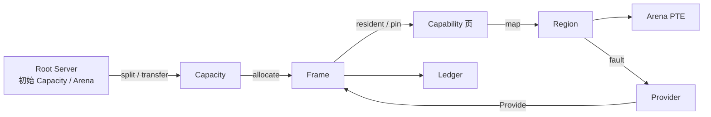

# ADR-0016：Holy Memory Plane 作为唯一内存面

- 状态：**已接受**
- 日期：2026-11-07
- 关联：[Holy Memory Plane](../hmp.md)、[Handle 与 IPC](0005-handles.md)、[权限模型](../permissions.md)、[平台 HAL](0004-platform-hal.md)

## 背景

内存需要一套 Holy 原生对象模型：任务内存、物理容量、物理页、映射视图、类型化能力、缺页服务与记账都在同一张对象图上。内核、Root Server、Memory Server、驱动与服务共享这套对象与 Rights。

本 ADR 定义唯一的 HMP 对象面与 ABI 面。实现由这些对象直接构成；页表、帧库、映射标志与固件解析作为机制存在于包装 crate 内部。

## 决策

### 1. 原生对象面

对外只使用：

`Arena`、`Capacity`、`Frame`、`Region`、`Capability`、`Provider`、`Ledger`、`Mappable`、`Handle`、`Rights`。

- `Arena`：任务的内存根；持有 Region 表、栈、堆与工作区；绑定任务地址空间。
- `Capacity`：物理容量能力；声明用途、页大小/order、配额与 Ledger。
- `Frame`：连续物理页对象；带 `FrameId`、所属 Capacity、引用与 pin。
- `Region`：类型化能力在 Arena 中的唯一映射视图；承载 offset、len、rights、flags。
- `Capability`：Revision、Surface、TaskImage、DeviceAllocation、Anonymous、Frame 的类型化能力。
- `Provider`：按能力种类提供 fault、writeback、evict、commit、scanout、pin、export、swap。
- `Ledger`：容量、常驻、提交、峰值、配额与压力的显式记账。
- `Mappable`：Region 可引用的统一能力接口。

### 2. 铸造链

- Capacity 从 Root Server 持有的初始 Capacity 派生；Frame 由 Capacity 生成；Region 由 Capability 或 Frame 生成。
- 每一步只收窄 Rights；Handle 转移是唯一授权方式。
- 内核持有 System Capacity 与 System Arena；内核页表、栈与对象元数据都是 Arena 中的 Region。
- 内核与用户态服务共享同一对象图、Rights、错误面与 Ledger 规则。

### 3. 统一 ABI 面与授予面

ABI 对所有持权服务统一开放 `Arena`、`Capacity`、`Frame`、`Region`：

- `Arena`：`query`、`map`、`unmap`、`grow`、`checkpoint`、`restore`、`destroy`。
- `Capacity`：`query`、`allocate`、`release`、`split`、`merge`、`transfer`。
- `Frame`：`map`、`phys`、`pin/unpin`、`export/import`、`transfer`。
- `Region`：`map`、`unmap`、`protect`、`query`、`fault`、`grow`。
- 所有调用校验 `Handle + Rights + ObjectKind`；内存策略由这些对象表达。

初始授予由 Root Server 的服务清单决定：

| 持有者 | 初始授予 |
| --- | --- |
| Root Server | System / User / Dma / Gpu 顶层 Capacity；初始 Arena |
| Memory Server | System Capacity 共享视图；Anonymous Provider 绑定权 |
| 驱动服务 | Dma/Gpu Capacity 子集；DeviceGrant；Frame 的 pin/export |
| VFS / HolyFS | User Capacity 子集或 Memory Server 的 Capability；Revision Provider |
| Display / UI | Framebuffer/Surface Capability；Frame 的 map/pin |
| 普通服务 | 自己的 Arena；TaskImage/Anonymous/栈 Region；共享时取 Capability 或经 IPC 接收 Frame |
| Debug / Checkpoint | Arena/Capacity/Frame/Region/Ledger 的只读枚举 Handle |

普通服务只持有 Region 是授予策略；任何服务收到 Arena/Capacity/Frame Handle 后使用同一组对象操作。

### 4. Rights

| 对象 | READ | WRITE | EXECUTE | TRANSFER | ADMIN |
| --- | --- | --- | --- | --- | --- |
| `Arena` | 查询 Region 与 Ledger | map/grow/unmap | 执行 TaskImage | — | checkpoint、restore、destroy |
| `Capacity` | 查询容量与 Ledger | 分配/归还 Frame | — | 转移 Capacity | 拆分、配置、绑定 Provider |
| `Frame` | 映射只读 | 映射可写、pin/unpin | 映射可执行 | 转移、export/import | 配置导出与驻留 |
| `Region` | 映射只读 | 映射可写 | 映射可执行 | — | protect、unmap |
| `Capability` | 只读映射、查询 | 可写映射 | 可执行映射 | 转移 Capability | 绑定 Provider、scanout、pin |

- Region 属于单个 Arena；跨任务共享使用 Capacity、Frame 或 Capability。
- W^X 在 Region 创建与 protect 时检查；设备页默认按 NX 映射。

### 5. Mappable 边界

`Mappable` 向内核提供能力身份与页获取入口：

- 身份：`kind`、`size`、`page_size`、`provider`。
- 页获取：按 offset/len/rights 请求页；返回 Frame 或错误。
- Region 持有 `Mappable` 引用、offset、len、rights 与 flags；内核负责页表安装、权限检查与快速缺页。

内核快速路径只服务：

1. 已常驻页：查页表并返回。
2. 默认 Provider 为空的 Anonymous：安装零页；匿名 COW 由内核复制 Frame。
3. 已绑定 Provider 的能力：缺页一律转发 Provider；Provider 失败按缺页故障处理。

文件缓存、压缩、swap、GPU 驻留与镜像装载策略属于 Provider。

### 6. Handle 表示

ABI 使用单一 `Handle` 值加 `ObjectKind`：

- 内核用 `Handle + ObjectKind + Rights` 校验类型与权限；HandleTable 保持 duplicate、close、transfer、epoch 撤销与配额。
- Rust 客户端库提供 `Handle<Revision>`、`Handle<Surface>`、`Handle<Capability>` 等零成本类型包装；ABI 保持单一 Handle 表示。
- 类型化操作在能力层校验：`commit` 接受 Revision，`scanout` 接受 Surface，`execute` 接受 TaskImage，`pin/export` 接受 Frame/Surface/DeviceAllocation，`grow/swap` 接受 Anonymous。

### 7. COW、页大小、GPU、Arena、MMIO

- `RegionFlags::COW` 是 COW 的唯一契约状态；默认 Provider 为空的 Anonymous 走内核快速路径，绑定 Provider 的能力交给 Provider。页表表达只读/可写权限与 Frame 安装。
- 页大小与 order 由 Capacity/Frame 声明；4 KiB 为起始档位，16 KiB、64 KiB、2 MiB、1 GiB 由 Capacity 拓扑与 Frame order 表达。
- GPU 与系统内存共用 Capacity，以 `CapacityKind::Gpu` 与 NUMA/VRAM 拓扑区分；DeviceAllocation 承载显存与 DMA 内存。
- 任务栈、堆与工作区属于 Arena；它们在 Arena 内以 Region 表达。
- MMIO 由 DeviceGrant 与 DeviceAllocation 处理；CPU 侧映射以 Region 为视图，设备与缓存属性属于设备能力与 Region 的内部属性。

### 8. Ledger

- Capacity 授予时记账转到接收方；Frame 转移时记账随 Handle 转移；Region 创建时记到 Arena/Task Ledger；超配额拒绝。
- 内核 System Capacity 与 System Arena 同样记账，Debug/Checkpoint 可枚举。
- 统一错误面：`WxConflict`、`ReadOnly`、`PermissionDenied`、`WrongCapability`、`OutOfCapacity`、`AlreadyMapped`、`NotMapped`、`LedgerLimit`。

### 9. 机制层边界

以下库作为机制保留在包装 crate 内部，类型保持在包装边界内：

- `page_table_multiarch` / `page_table_entry`：页表机制。
- `acpi` / `hermit-dtb`：固件描述解析。
- `uefi`：UEFI loader。
- `x86_64` / `aarch64-cpu`：架构原语。
- `volatile-register`：寄存器块。

公开内存契约只出现第 1 节的对象面。

### 10. 实现结构

- `hk-hmp`：共享契约 crate；定义 Arena、Capacity、Frame、Region、Capability、Provider、Ledger、Mappable、Handle 与 Rights。
- `hk-mem`：内核侧实现；持有 Capacity/Frame/Region 状态与 Ledger。
- `hk-paging`：把 Region 物化为页表；页表格式与遍历位于 crate 内部。
- `hk-fw`：解析 ACPI/DTB，产出 Arena/Capacity/设备描述。
- `hk-boot`：产出 BootInfo；`hk-platform-*` 提供架构与硬件适配。
- 消费者：Root Server、Memory Server、Device Manager、驱动、VFS、HolyFS、Display 与客户端使用同一组 HMP 对象。

## 后果

**收益**

- 内存只有一套对象面与一套 Rights；内核、服务、Debug、Checkpoint 与 ABI 共享同一张图。
- 任务内存由 Arena 统一承载；物理容量、物理页、映射视图与类型化能力边界清晰。
- 内核快速路径保持很小；其余策略在 Provider。
- 第二架构与第二类设备复用同一套 HMP 契约。

**成本与取舍**

- Provider 缺页带来 IPC；匿名快速路径需要长期维护。
- 类型化 Handle 包装需要在客户端库补一层零成本新类型。
- Capacity 拆分、热插拔与按用途拓扑需要新的内核对象操作。
- 页大小档位增加页表与 Frame 的测试面。
- 所有消费者共享同一对象面，契约演进需要同步更新各服务的客户端。

## 备选方案

| 方案 | 取舍 |
| --- | --- |
| 集中式内核分配器 | 实现集中；任务内存、设备内存与记账需要额外分层。 |
| 通用映射标志/帧分配器/地址空间接口作为对外契约 | 机制名称进入原生契约；每类设备与架构各自解释一套。 |
| 独立 `Handle<Revision>` 等 ABI 类型 | 类型清晰；HandleTable 与 IPC 需要成倍类型分支。 |
| 全部 COW 交给 Provider | 语义统一；匿名 fork、栈、堆的快速路径变慢。 |
| GPU 使用独立双容量 API | GPU 策略集中；系统内存与显存两套记账与流动。 |

## 架构一致性检查

- HandleTable 是唯一访问凭据；HMP 的类型化操作在能力层校验。
- Arena 是任务内存根；Region 是唯一映射视图；Provider 是 Endpoint 服务。
- Frame 来自 Capacity，每次分配计入 Ledger；pinned Frame 保持驻留。
- 内核持有 System Capacity 与 System Arena，内核页表与对象元数据使用 Frame。
- Debug 与 Checkpoint 通过 Handle 图枚举 Arena、Capacity、Frame、Capability、Region、Provider 与 Ledger。
- 内核与用户态服务共享同一组 HMP 对象、Rights 与错误面。

## 相关

- [Holy Memory Plane](../hmp.md)
- [Handle 与 IPC](0005-handles.md)
- [权限模型](../permissions.md)
- [平台 HAL 与 Hosted 模拟器](0004-platform-hal.md)
