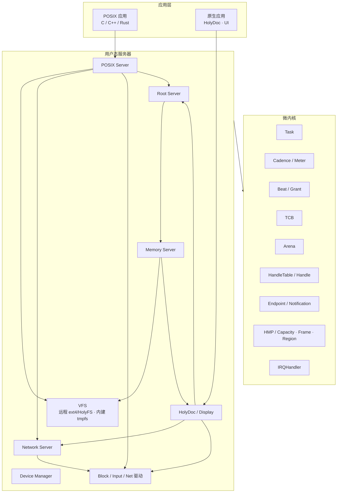
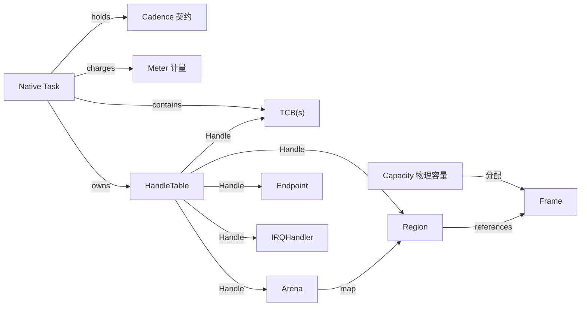
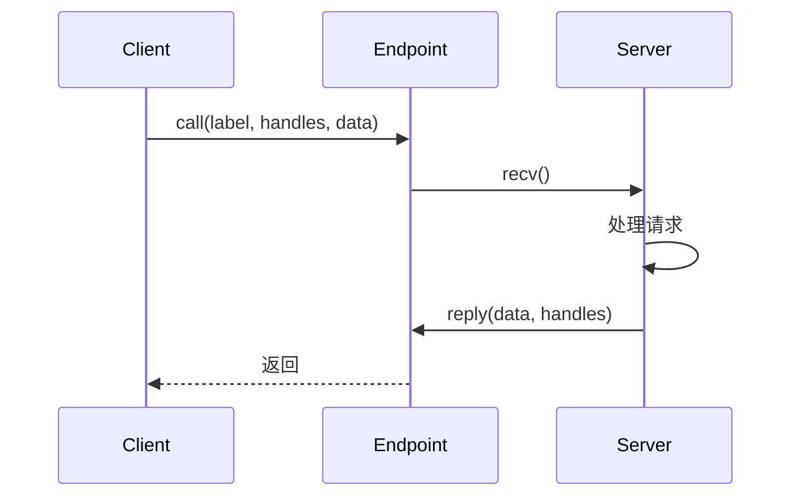
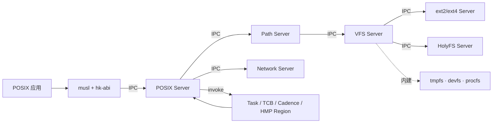
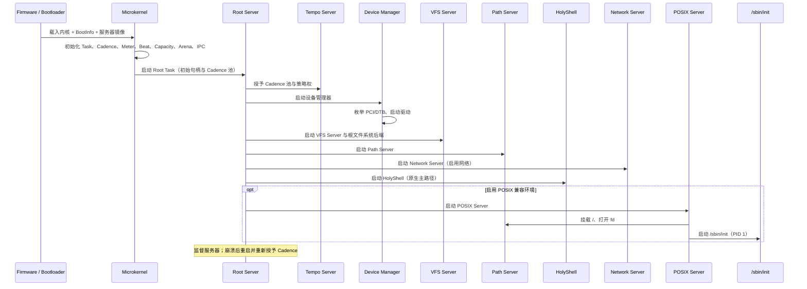

# HolyKernel 总体架构

状态：**设计中**

本文描述 HolyKernel 的微内核模型、句柄与 IPC、服务器划分、POSIX 兼容层与启动流程。细节分别见 [内存（HMP）](hmp.md)、[执行](execution.md)、[调度（HCM）](scheduling.md)、[服务器](servers.md)、[POSIX 与 libc](posix.md)、[VFS 与 Path Server](vfs.md)、[UI](ui.md)、[平台](platforms.md)。

---

## 1. 一句话架构

> HolyKernel 是一个句柄型微内核：内核提供 TCB、Arena、HandleTable、Endpoint、Notification、HMP（Capacity/Frame/Region）与 IRQ；驱动、文件系统、POSIX 兼容层与原生服务运行在用户态；POSIX.1 应用通过 musl + `hk-abi` 与 POSIX Server获得完整接口。



内核提供机制；服务器提供策略。

---

## 2. 目标与范围

### 2.1 目标

1. **最小内核**：内核包含线程、地址空间、句柄、IPC、内存与中断机制。
2. **句柄安全**：资源通过 Handle 访问；duplicate 收窄、close 失效、IPC 通过 TRANSFER 转移、epoch 撤销、Task/服务器配额。
3. **用户态服务器**：驱动、文件系统、兼容层、显示服务运行在用户态。
4. **多 personality 兼容**：Compatibility Server 按 POSIX/Linux/Harmony personality 运行应用；musl 与 glibc 分域隔离。
5. **多来源 UI**：原生 surface、Wayland/XWayland 与 Harmony HDI 表面进入同一合成器。
6. **故障隔离**：服务器崩溃后由 Root Server 重启；内核保持最小可信基。
7. **多架构**：x86_64、AArch64、RISC-V、Hosted 共享同一套内核与服务器语义。
8. **可观察**：trace、性能计数、句柄审计、服务器重启记录。
9. **可测试**：确定性模拟、故障注入、POSIX 测试套件。

### 2.2 范围

**1.0 聚焦**

- 微内核：TCB、Arena、HandleTable、Endpoint、Notification、Capacity、Frame、Region、IRQHandler
- Root Server、Device Manager、virtio-blk/input/net 驱动
- VFS Server 聚合独立 ext4/HolyFS 服务，并内建 tmpfs/devfs/procfs 后端
- POSIX.1 服务器 + musl + `hk-abi`/`hk-crt`
- `fork`/`exec`/`wait`、信号、pthreads、管道、`mmap`、Unix 套接字
- 可选服务：HolyFS 卷（盘符、文档、修订、快照）、HolyDoc、真彩 Display Server
- x86_64 / AArch64 / RISC-V QEMU 与 Hosted 模拟器

**后续版本评估**

- Linux 二进制 ABI
- ext4、TCP/IP、更多设备类别
- 多用户与完整 POSIX 凭证模型
- Realtime 准入与硬实时保证、形式化验证、服务器热升级

---

## 3. 设计原则

1. **最小内核**：机制在内核，策略在服务器。
2. **句柄即权限**：资源访问通过 Handle；对象命名由服务器提供。
3. **隔离优先**：每个 Task 独立 Arena；内核与用户态分离。
4. **显式 IPC**：Endpoint 同步通信，Notification 异步事件，Frame 共享数据。
5. **服务器可重启**：Root Server 监督生命周期与句柄分配。
6. **POSIX 在边缘**：POSIX.1 语义由用户态 POSIX Server实现。
7. **最小可信基**：内核、Root Server、VFS Server、根文件系统后端（ext4/HolyFS）构成可信基；POSIX Server 在启用兼容环境时加入。
8. **多架构抽象**：架构差异止步于 `hk-hal` 与 platform crate。
9. **可观察、可复现**：trace 与确定性模拟覆盖 IPC、调度、句柄、服务器重启。
10. **小步交付**：每个里程碑形成可演示的纵向切片。

---

## 4. 内核对象模型

| 对象 | 职责 | 关键操作 |
| --- | --- | --- |
| **Task** | 调度主体；持有 Cadence、Meter、TCB(s) 与父子关系 | 附加契约、挂起、恢复、快照 |
| **Cadence** | 时间契约；类别、权重、预算、周期、截止期、延迟目标、亲和性、lending | 创建、拆分、调整、撤销 |
| **Meter** | 调度计量；消耗、等待、节流、迁移、切换、虚拟进度 | 查询、重置 |
| **TCB** | 执行单元；引用 Task 的 HandleTable | 配置、启动、挂起、恢复、绑定 Arena |
| **Arena** | 任务内存根；持有地址空间与 Region 表 | map、unmap、grow、checkpoint、destroy |
| **HandleTable** | 每 Task 的句柄表 | 查找、duplicate、close、转移 |
| **Endpoint** | 同步 IPC | send、recv、call、reply、句柄传递 |
| **Notification** | 异步事件 | signal、wait、poll、clear |
| **HMP** | 内存对象图；统一能力面 | Capacity、Frame、Region、Capability、Provider、Ledger |
| **Capacity** | Root Server 授予的物理容量能力；页大小、配额与用途 | 分配 Frame、拆分、转移 |
| **Frame** | 连续物理页；共享引用与 pin | 映射、共享、DMA、缓存维护 |
| **Region** | 类型化能力在任务地址空间中的唯一映射 | map、unmap、protect、COW、grow |
| **IRQHandler** | 中断句柄 | 平台路由、Notification 唤醒、ack/EOI |
| **DeviceGrant** | 设备句柄集合；内核对象、镜像角色元数据、设备授权工厂、MMIO 映射、DMA 窗口子分配与 IRQ 通知绑定已建立 | 独立 virtio 驱动服务使用 |

内核对象由内核堆分配；HMP 是唯一内存面，Capacity 管理物理容量，Frame 是物理页能力，Region 是类型化能力的唯一映射。ABI 面对所有持权服务统一开放 Capacity/Frame/Region，调用只校验 `Handle + Rights + ObjectKind`；Root Server 通过服务清单决定初始授予。内核与用户态服务共享同一对象图，内核页表、栈与对象元数据同样使用 Frame 与 Region。每个对象有类型、大小与引用计数。Native Task 持有 HandleTable，表项记录 `index/generation/rights`；TCB 引用同一张表。对象生命周期由 Handle 与内核引用共同管理。

### 4.1 Native Task

内核的 TCB 是执行机制；**Native Task** 是跨内核与用户态的一等对象：Arena + HandleTable + TCB(s) + 父子关系 + Cadence + Meter + 元数据。Arena 是任务内存根，持有地址空间、栈、堆与 Region 表；Cadence 与 Meter 由内核调度层持有，用户态通过 Handle 访问。Root Server 用 Native Task 管理服务，POSIX Server 用 Native Task 承载 POSIX 进程。Task 退出时整体回收 Arena、Handle 与调度状态；窗口由 Display Server 独立管理。



---

## 5. 句柄与 IPC

### 5.1 Handle

```rust
pub struct Handle {
    index: u32,
    generation: u32,
}

pub struct Rights(u32); // READ | WRITE | EXECUTE | TRANSFER | ADMIN
```

- Handle 存放在 TCB 的 HandleTable 槽位中；进程通过 `invoke` 调用对象方法。
- `duplicate` 需要 `ADMIN`，保持或收窄 rights；`close` 使旧 generation 失效。
- Handle 可随 IPC 消息传递；发送方需要 `TRANSFER` 权限。
- 每个对象有 `epoch`；owner 的 `revoke_all` 递增 epoch，使该对象所有旧 Handle 失效。
- 每 Task/服务器有 Handle 配额；`duplicate`/`transfer` 前检查。
- 权限模型采用线性 HandleTable；服务器重启时关闭旧 Handle。
- 对象命名由服务器 Endpoint 提供；内核 Handle 保持匿名。
- badge 用于 Endpoint 标识客户端；权限由 Handle 决定。

### 5.2 IPC



- **Endpoint**：同步 IPC；支持 call/reply、阻塞/超时、句柄传递。
- **Notification**：异步位通知；用于中断下半部、事件完成、服务器唤醒。
- **Frame**：共享内存；大块数据零拷贝传递。
- 消息长度小（寄存器 + 少量字）；大消息使用共享 Frame。
- IPC 是跨服务器调用与 POSIX syscall 的统一路径。

---

## 6. 执行与内存

- **Task**：调度主体，持有 Cadence 与 Meter；同一 Task 的 TCB 共享契约与计量。
- **TCB**：执行单元；寄存器上下文、所属 Task、状态；绑定 Arena，并引用 Task 的 HandleTable。
- **调度**：Holy Cadence Model（Task 级 Cadence 契约 + TCB 级轮转、每 CPU Beat、SMP、Tickless、Lending）；见 [Holy Cadence Model](scheduling.md)。
- **Arena**：每任务内存根；持有地址空间、页表、Region 表、栈与堆。堆与工作区由惰性匿名 Region 承载，按页缺页装入。
- **HMP**：Capacity 管物理容量，Frame 管物理页；Revision/Surface/TaskImage/DeviceAllocation/Anonymous 以类型化能力暴露，Mappable 是统一能力接口，Region 是唯一映射；Provider 按类型提供契约，Ledger 记账。内核与用户态服务使用同一对象图、Rights 与错误面。
- **铸造链**：Root Server → Capacity → Frame → Capability → Region → PTE；每一步只收窄 Rights。
- **COW**：`fork` 复制 Region 表并标 `RegionFlags::COW`；未绑定 Provider 的 Anonymous 走内核快速路径，绑定 Provider 的能力由 Provider 处理。
- **Arena**：任务栈、堆与工作区都是 Arena 内的 Region；`SYS_ALLOC` 在惰性 Arena Region 内按页推进分配并计入任务 Ledger，首次访问才装入零页。
- **DMA**：用户态驱动获得 Frame、DeviceAllocation 与 DeviceGrant；IOMMU 可选。

详见 [HMP 内存模型](hmp.md)、[执行模型](execution.md)。

---

## 7. 用户态服务器

| 服务器 | 职责 | 关键句柄 |
| --- | --- | --- |
| **Root Server** | 启动、监督、重启、初始授予 | 初始 Capacity、Cadence、HandleTable、Endpoint |
| **Tempo Server** | 调度策略；创建、拆分、调整、准入与撤销 Cadence | Cadence Pool、Meter |
| **Memory Server** | Anonymous Provider、System Capacity 共享视图、Capability 分配 | System Capacity 共享视图、Capability、Frame |
| **Device Manager** | 枚举 PCI/DTB、创建 DeviceGrant、启动驱动 | PCI ECAM、DTB、IRQ |
| **Block Server** | RAM disk 与块协议服务 | Block Endpoint |
| **Block Driver** | virtio-blk 等 virtio 设备类别 / AHCI | DeviceGrant（MMIO/DMA/IRQ） |
| **Network Driver** | virtio-net / e1000 | DeviceGrant（MMIO/DMA/IRQ） |
| **VFS Server** | Holy 原生命名空间：盘符、DocId、集合、修订、文档令牌；聚合远程 FS 服务 | FS Backend Endpoint、Revision Region |
| **Path Server** | 路径解析、dentry/inode、文件句柄、页缓存、POSIX 路径投影 | VFS Endpoint、Shared Frame |
| **ext2/ext4 / HolyFS** | 独立文件系统服务；VFS 经 Holy 远程后端访问 | Block Endpoint |
| **tmpfs / devfs / procfs** | VFS 进程内建的合成后端 | VFS 内部 |
| **Compatibility Server** | 按应用选择 POSIX/Linux/Harmony personality，管理 rootfs、命名空间与配额 | POSIX/Linux/Harmony 实现 Endpoint、VFS/Display Handle |
| **POSIX Server** | 进程、fd、信号、pthreads、管道、socket | Task/TCB/Cadence、Path/Network Endpoint |
| **Wayland Server / XWayland** | Linux Wayland/X11 客户端表面与 seat 适配 | Surface/Seat、POSIX Endpoint |
| **Harmony Server** | OpenHarmony 用户态、KAL/HDI 适配 | Surface/Seat、VFS/Network Handle |
| **Network Server** | TCP/IP、UDP、DHCP、DNS、socket、策略 | Net Endpoint、Socket Handle |
| **HolyFS Server** | HolyKernel 原生文件系统；`H:` 盘符、文档、修订、快照 | Block Endpoint、Holy 远程后端、Document Handle |
| **Display Server** | 帧缓冲、窗口、输入、真彩 UI | Framebuffer、Input |
| **HolyDoc Server** | 可选活文档渲染 | Display Endpoint、HolyFS Endpoint |
| **Workbench** | 编辑/浏览/构建/运行/调试 | HolyDoc、Toolchain、Debug、Display |
| **Toolchain Server** | 系统内编译/链接/打包/缓存 | VFS、Task |
| **Checkpoint Server** | Task/Server 快照与恢复 | Arena/HandleTable/TCB/Cadence/Meter、VFS |
| **Debug Server** | 符号、栈回溯、Task/Cadence/Meter 视图 | Task、Checkpoint、trace |
| **HolyShell** | 原生命令行、结构化管道、脚本 | Command Registry、服务 Endpoint |
| **POSIX Bridge** | `posix` 入口；启动 POSIX session 或执行 POSIX 命令 | POSIX Server |

服务器通过 Endpoint 暴露接口；Root Server 维护服务清单与重启策略。详见 [服务器](servers.md)。

---

## 8. POSIX 兼容层

- 兼容层由 **Compatibility Server** 统一编排：POSIX、Linux 与 Harmony 是独立 personality，各自运行在独立 Native Task/Arena。
- glibc 通过 Linux ABI 运行；musl 提供源码移植与动态 ABI；每个进程归属一个 libc 域。详见 [应用兼容](compat.md) 与 [ADR-0015](adr/0015-compatibility-server.md)。
- 图形应用通过 surface/seat 接入 Display；Linux GUI 使用 Wayland + XWayland，鸿蒙使用 OpenHarmony HDI 适配，X11 经 XWayland 接入。



- **HolyShell**：默认命令行；原生命令通过 Command Registry 与 Handle 调用；结构化管道。
- **POSIX Server**：兼容环境；PID 表、fd 表、信号、进程组、会话、管道、Unix 套接字。
- **musl + `hk-abi`**：musl 提供 C 运行时与 pthreads；`hk-abi` 提供 syscall shim 与头文件；`hk-crt` 提供启动、TLS、signal trampoline 与 ELF 加载。
- **进程**：`fork` 复制 Arena 的 Region 表（COW）；`exec` 装载 TaskImage；`wait` 通过 Endpoint 通知。
- **线程**：pthreads 映射到 TCB；libc 管理栈、TLS、join、取消。
- **文件**：Path Server 提供路径解析与文件句柄；VFS 聚合盘符与后端；ext2/ext4、HolyFS 作为独立服务分别提供 POSIX 目录与 Holy 文档。
- **网络**：socket 通过 POSIX Server 转发到用户态 Network Server；IPv4/IPv6、TCP/UDP、DHCP、DNS、POSIX socket。

详见 [POSIX 与 libc](posix.md)。

---

## 9. 原生服务

HolyFS 文件系统与 HolyDoc、真彩 UI 作为可选服务：

- **HolyDoc**：活文档渲染、链接、代码块、表单；通过 Display Endpoint 呈现。
- **HolyFS**：HolyKernel 原生文件系统；`H:` 盘符；文档、修订、集合、标签、快照、压缩、COW、checksum。
- **Display Server**：帧缓冲、可缩放字体（8×16 位图回退）、sRGB 真彩色 + 主题、多窗口客户端与合成器；POSIX 应用通过终端/控制台接口使用文本界面。
- 原生服务按最小权限运行；每个服务获得独立的 Capacity/Frame/Region、DeviceGrant 与 Endpoint Handle。

详见 [HolyShell](shell.md)、[VFS](vfs.md)、[HolyFS](holyfs.md)、[HolyDoc 与 UI](ui.md)、[Holy 原生体验](experience.md)。

---

## 10. 启动流程



关键点：

- 内核只创建 Root Task，并把初始 Capacity、Cadence、Endpoint 句柄与 HandleTable 交给它。
- Root Server 启动 Tempo、设备管理器、VFS、Path、Network Server、HolyShell 与可选原生服务。
- POSIX 兼容环境的根文件系统为 ext2/ext4；HolyFS 卷作为数据卷接入。
- HolyShell 是默认命令行；POSIX Server 是可选兼容环境。
- 启用 POSIX 兼容环境时，POSIX Server 通过 Path Server 挂载根文件系统并启动 `/sbin/init`。
- 服务器镜像由 bootloader 作为模块提供；Root Server 从模块加载原生任务镜像（HKX），Task/Cadence/Capability/Symbol 记录分别驱动入口与调度、设备授权和调试符号。
- 服务器崩溃时，Root Server 按服务清单重启，Tempo 重新授予 Cadence 并重置 Meter。

---

## 11. 安全与信任模型

- **隔离**：每个 Task 独立 Arena；内核与用户态分离。
- **最小权限**：服务器只获得完成职责所需的 Handle；HMP 的 Capacity/Frame/Region 由 Rights 约束，内存授权由 Handle 与 Rights 决定。
- **内存授权**：Root Server 持有初始 Capacity 并通过 Handle 转移；Memory Server 持有 System Capacity 共享视图，驱动持有 Dma/Gpu Capacity，内核持有 System Capacity。
- **句柄回收**：close + 任务退出 + 服务器重启；服务器重启时回收旧句柄。
- **DMA 隔离**：IOMMU 可用时绑定 DeviceGrant；当前 x86 使用软件 IOMMU 域表，硬件 VT-d 后端待接入；关闭时依赖驱动审计。
- **可信基**：内核、Root Server、VFS Server、根文件系统 Server（ext2/ext4）与 HolyFS 卷服务；POSIX Server 在启用兼容环境时加入。
- **验证**：Rust 内存安全、`unsafe` 审计、fuzz、确定性模拟、POSIX 测试套件。
- **服务器监督**：Root Server 记录崩溃、重启次数与句柄重新分配。

---

## 12. 平台矩阵

| 平台 | 引导 | 中断/定时器 | 控制台 | 块设备 | 状态 |
| --- | --- | --- | --- | --- | --- |
| x86_64 QEMU | Limine（BIOS/UEFI） | APIC / IOAPIC / TSC deadline | 16550 UART + 帧缓冲 | virtio-blk | Tier 1 |
| Hosted 模拟器 | 普通进程 | 虚拟时钟 + 事件循环 | stdin/stdout | 镜像块设备 | Tier 1 |
| AArch64 QEMU `virt` | 直接 `-kernel` + DTB，后续 UEFI stub | GICv3 / Generic Timer / PSCI | PL011 + 帧缓冲 | virtio-blk | Tier 2 |
| RISC-V 64 QEMU `virt` | OpenSBI + `-kernel` | PLIC / ACLINT / SBI timer | 16550 + 帧缓冲 | virtio-blk | Tier 2 |
| 主流 x86_64 UEFI PC | UEFI + Limine | 同上 | 同上 | AHCI/NVMe | Tier 3 |

Hosted 平台是确定性模拟器，使用虚拟时间、虚拟 CPU、模拟设备与故障注入。

---

## 13. 性能预算

| 指标 | 预算 | 测量方式 |
| --- | --- | --- |
| QEMU x86_64 启动到 HolyShell | ≤ 2.0 s | `hk-bench boot` |
| 上下文切换（同 CPU） | ≤ 1 µs | `hk-bench ctx` |
| IPC call/reply（小消息） | ≤ 2 µs | `hk-bench ipc` |
| 中断到 Notification | ≤ 10 µs | APIC 定时器压力测试 |
| ext2/ext4 1 MiB 顺序读 | ≥ 100 MiB/s | `hk-bench fs` |
| HolyFS 1 MiB 顺序读 | ≥ 500 MiB/s | `hk-bench holyfs` |
| `fork` + `exec` `/bin/true` | ≤ 5 ms | `hk-bench posix` |
| 帧缓冲全屏重绘 1920×1080×32 位 RGBA | ≤ 8 ms | `hk-bench ui` |

预算用基准测试锁定；里程碑退出以预算达标为依据，例外记录在 ADR。

---

## 14. 关键保证

1. 内核只包含机制：Task、Cadence、Meter、TCB、Arena、HandleTable、Endpoint、Notification、Capacity、Frame、Region、IRQHandler。
2. 所有资源访问通过 Handle；内核维护对象引用与句柄复制树。
3. 每个 Task 独立 Arena；内核地址空间与用户地址空间分离。
4. 跨服务器调用通过 Endpoint；异步事件通过 Notification。
5. 服务器崩溃由 Root Server 重启；Root Server 关闭旧句柄。
6. POSIX 语义由用户态 POSIX Server 实现；内核提供机制。
7. 文件系统通过 VFS Server 与独立的 ext2/ext4、HolyFS 服务通信，tmpfs/devfs/procfs 内建在 VFS；块设备通过 Block Driver。
8. 驱动运行在用户态，使用 DeviceGrant 访问 MMIO/DMA/IRQ。
9. 内核 panic 路径使用静态缓冲与自旋锁，独立于调度器与堆。
10. 每个服务器拥有最小权限集合与独立 Arena。

---

## 15. 子系统模板

新增子系统时，文档包含：

1. **职责**：它拥有什么状态，与哪些服务器/内核对象交互。
2. **句柄**：它需要哪些 Handle，授予哪些 Endpoint。
3. **接口草图**：Rust trait、IPC 消息或 POSIX 函数签名。
4. **保证**：必须始终成立的条件。
5. **失败模式**：OOM、超时、IPC 断开、设备错误、服务器崩溃。
6. **测试策略**：Hosted 单元、模拟器、QEMU、POSIX 测试、fuzz。
7. **架构一致性检查**：变更如何与 [章程](charter.md) 的微内核模型协作。

---

## 16. 相关文档

- [章程](charter.md)
- [内存模型（HMP）](hmp.md)
- [执行模型](execution.md)
- [权限模型](permissions.md)
- [网络](network.md)
- [POSIX 与 libc](posix.md)
- [应用兼容与 Linux ABI](compat.md)
- [ADR-0015：Compatibility Server 与多来源 UI](adr/0015-compatibility-server.md)
- [服务器](servers.md)
- [VFS](vfs.md)
- [HolyFS 文件系统](holyfs.md)
- [HolyDoc 与 UI](ui.md)
- [平台与启动](platforms.md)
- [工程策略](engineering.md)
- [路线图](roadmap.md)
- [术语表](glossary.md)
