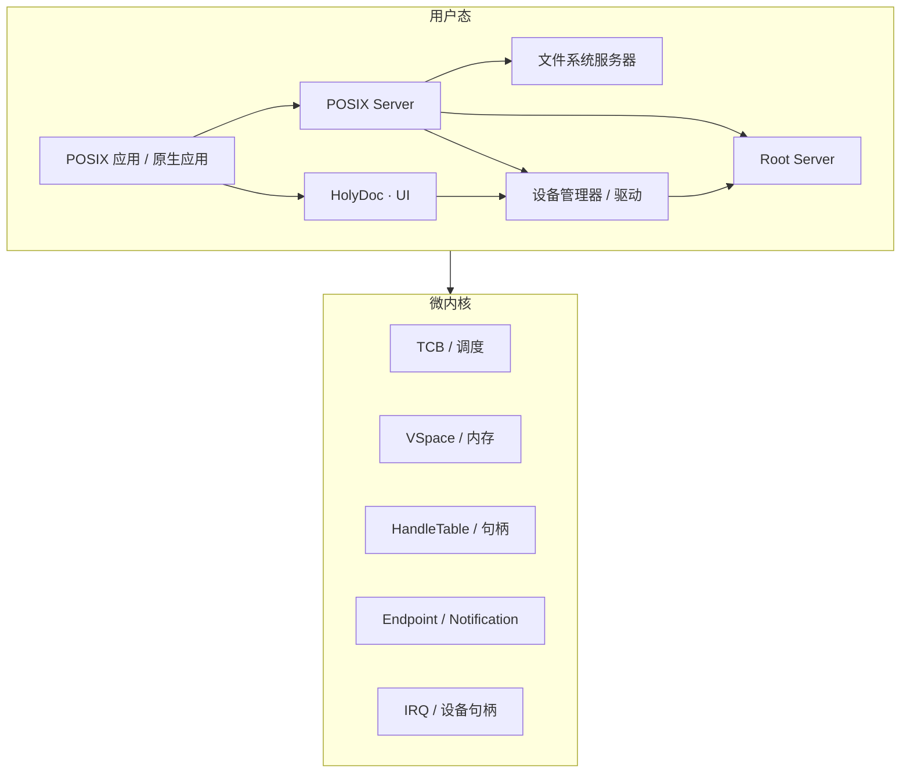

# HolyKernel 章程

> 句柄型微内核 · 用户态服务器 · POSIX.1 兼容层

本文是 HolyKernel 的最高设计约束。任何代码、接口、文档或提案，都以本文描述的微内核模型为准。出现新的架构构件时，通过 [ADR](adr/) 记录决策，并说明它如何与现有构件协作。

---

## 1. 系统模型

**内核提供机制，服务器提供策略。** 驱动、文件系统、POSIX 兼容层与原生服务运行在用户态。

核心抽象是 **Native Task**：VSpace + HandleTable + TCB(s) + Arena + 父子关系 + 元数据。Task 拥有自己的堆与生命周期；Root Server 管理服务树，POSIX Server 管理进程树；调度保持固定优先级与同优先级轮转；IPC 保持快速路径；Debug Server 提供 Task/资源视图；Display Server 提供多窗口客户端与合成器。

---

## 2. 设计原则

### 法则一：最小内核

内核提供 TCB、VSpace、HandleTable、Endpoint、Notification、Frame、IRQ 与调度。文件系统、网络、设备策略、POSIX 语义运行在用户态。

### 法则二：句柄即权限

所有资源通过 **Handle** 访问。Handle 携带 index、generation 与 rights（READ/WRITE/EXECUTE/TRANSFER/ADMIN）；`duplicate` 收窄权限，`close` 使旧 generation 失效，IPC 通过 `TRANSFER` 显式转移。对象 epoch 支持 `revoke_all`，每 Task/服务器有 Handle 配额。对象命名由服务器提供；内核 Handle 保持匿名。细节见 [权限模型](permissions.md)。

### 法则三：隔离优先

每个进程拥有独立 VSpace；内核地址空间与用户地址空间分离。服务器之间通过句柄与 IPC 协作；权限来自显式 Handle。

### 法则四：服务器可重启

Root Server 监督服务器生命周期。驱动、文件系统、POSIX Server崩溃后按策略重启；内核保持最小可信基。

### 法则五：POSIX 在边缘

**HolyShell 与 Holy 命令是默认命令行**；原生命令通过 Handle/Endpoint 访问服务，使用结构化输出与类型化管道。POSIX.1 是**兼容环境**：由用户态 POSIX Server提供，应用通过 musl + `hk-abi` 使用 `/bin/sh`、coreutils、fd/pipe/signal。POSIX 语义位于用户态 POSIX Server。

### 法则六：显式 IPC

线程通过 Endpoint 同步通信，通过 Notification 接收异步事件；大块数据通过共享 Frame 传递。IPC 是唯一的跨服务器调用路径。

### 法则七：最小可信基

内核、Root Server、POSIX Server与文件系统服务器构成可信基。驱动与可选原生服务按最小权限运行。

### 法则八：多架构

HAL 之上只有一套内核。x86_64、AArch64、RISC-V 与 Hosted 模拟器共享同一套对象、IPC 与句柄语义。

### 法则九：可观察

启动、IPC、调度、内存、句柄、服务器重启都有 trace。异常记录线程、句柄、Endpoint 与服务器状态。

### 法则十：确定性测试

Hosted 模拟器提供种子化、可回放的调度、IPC、故障注入与服务器重启测试。QEMU 验证硬件路径。

### 法则十一：小步演进

每个里程碑形成可演示的纵向切片：内核机制、服务器、POSIX 接口与测试一起完成。

### 法则十二：文档与代码同步

架构变更先写 ADR；代码与文档同 PR 更新；冲突时以本文与已接受的 ADR 为准。

---

## 3. 内核构件

| 构件 | 职责 |
| --- | --- |
| **TCB** | 线程控制块；寄存器上下文、优先级、亲和性、状态 |
| **VSpace** | 进程地址空间；页表根、映射、权限 |
| **HandleTable** | 每 Task 的句柄表；槽位、generation、rights |
| **Endpoint** | 同步 IPC；发送/接收、阻塞、句柄传递 |
| **Notification** | 异步事件；位信号、等待、清除 |
| **Frame** | 物理内存帧；映射、共享、DMA |
| **Untyped** | 未类型化内存；retype 为内核对象 |
| **IRQHandler** | 中断句柄；绑定 Endpoint、EOI |
| **DeviceGrant** | 设备 MMIO / DMA / IRQ 句柄集合 |

内核范围：TCB、VSpace、HandleTable、Endpoint、Notification、Frame、IRQ 机制；文件系统、网络协议栈、POSIX syscall、设备类驱动与 shell 位于用户态服务。

---

## 4. 用户态服务器

| 服务器 | 职责 |
| --- | --- |
| **Root Server** | 启动服务器、分配初始句柄、监督与重启 |
| **Device Manager** | 枚举 PCI/DTB、创建 DeviceGrant、启动驱动 |
| **Network Driver** | virtio-net / e1000；持有 DeviceGrant，向 Network Server 提供 Net Endpoint |
| **Block Driver** | virtio-blk / AHCI；向文件系统服务器提供块设备 Endpoint |
| **ext2/ext4 Server** | POSIX 文件系统；目录、inode、权限位、挂载点 |
| **POSIX Server** | 进程、fd、信号、pthreads、管道、Unix 套接字、`fork`/`exec` |
| **Network Server** | TCP/IP、UDP、DHCP、DNS、socket、策略；向 POSIX Server提供 socket 后端 |
| **Display Server** | 帧缓冲、窗口、输入、真彩 UI |
| **VFS Server** | 挂载表、路径解析、文件句柄、页缓存 |
| **HolyFS Server** | HolyKernel 原生文件系统；`H:` 盘符、文档、修订、集合、标签、快照 |
| **HolyDoc Server** | 可选活文档渲染与链接 |

服务器通过句柄与 IPC 组合；每个服务器拥有自己的 VSpace 与最小权限集合。

---

## 5. POSIX 兼容层

- **API**：POSIX.1-2017 应用接口；应用针对 musl + `hk-abi` 重新编译。
- **libc**：musl 作为主 C libc；`hk-abi` 提供 syscall shim 协议与头文件；`hk-crt` 提供启动、TLS、signal trampoline 与 ELF 加载；`hk-libc` 作为薄兼容层。
- **POSIX Server**：维护 PID 表、父子关系、fd 表、信号状态、管道、套接字、进程组与会话。
- **文件系统**：POSIX Server 通过 ext2/ext4 Server 提供 `/`、目录、inode、权限位、`stat`、`open`/`read`/`write`；HolyFS 经适配层提供 Holy 文档。
- **进程**：`fork` 通过 VSpace 复制与 COW；`exec` 通过 ELF 加载器映射新 VSpace；`wait` 通过 Endpoint 通知。
- **线程**：pthreads 映射到 TCB；TLS、栈、join、取消由 libc 与 POSIX Server协作。
- **信号**：POSIX Server维护 pending/blocked 集合；libc 在安全点调用 handler。
- **IPC**：pipe、FIFO、Unix 域套接字、共享内存、POSIX 信号量由 POSIX Server管理。
- **网络**：socket 通过 POSIX Server转发到用户态 Network Server；IPv4/IPv6、TCP/UDP、DHCP、DNS、POSIX socket；详见 [网络](network.md)。

兼容范围与测试矩阵见 [POSIX 与 libc](posix.md)。

---

## 6. 原生服务

HolyDoc 与真彩 UI 作为可选原生服务；HolyFS 以 `H:` 盘符提供 Holy 卷，与 POSIX 兼容环境并存：

- **HolyDoc**：活文档；链接、代码块、表单、嵌入执行结果。
- **HolyFS**：HolyKernel 原生文件系统；`H:` 盘符、文档、修订、集合、标签、快照、压缩、COW、checksum。
- **Display Server**：帧缓冲、可缩放字体（8×16 位图回退）、sRGB 真彩色 + 主题、多窗口客户端与合成器。
- **原生应用**通过 HK 服务 API 使用这些句柄；POSIX 应用通过 Display Server 的终端/控制台接口使用文本界面。

原生服务遵循最小权限：每个服务只获得必要的 Frame、DeviceGrant 与 Endpoint。

---

## 7. 实现语言

| 层 | 语言 |
| --- | --- |
| 内核 | Rust `no_std`；平台层使用最小内联汇编 |
| 核心服务器 | Rust；Hosted 服务器可使用 `std` |
| POSIX libc | musl 移植 + Rust `hk-abi`/`hk-crt`；C 头文件与启动代码 |
| POSIX 应用 | C / C++ / Rust；链接 musl + `hk-abi`，薄 `hk-libc` 兼容层 |
| 原生服务 | Rust；HolyDoc 渲染器与 UI 可使用 Rust 图形库 |

系统提供 POSIX C ABI；Rust 是内核与服务器的实现语言。

---

## 8. 架构承诺

1. **微内核**：内核只包含机制；服务器承载策略。
2. **句柄模型**：资源通过 Handle 访问；`duplicate` 需要 ADMIN 并收窄，`close` 失效，IPC 通过 TRANSFER 转移，对象 epoch 支持 `revoke_all`，Task/服务器有配额。
3. **隔离**：每个进程独立 VSpace；内核与用户态分离。
4. **用户态驱动**：设备驱动运行在用户态；DeviceGrant 管理 MMIO/DMA/IRQ。
5. **POSIX 兼容**：POSIX.1 服务器 + musl + `hk-abi` 提供应用接口。
6. **服务器监督**：Root Server 负责启动、重启与句柄分配。
7. **Rust 优先**：内核与核心服务器使用 Rust；POSIX 边界提供 C ABI。
8. **多架构**：HAL 之上共享一套内核与服务器语义。
9. **可观察与可测试**：trace、确定性模拟、故障注入、POSIX 测试套件。
10. **小步交付**：每个里程碑形成可演示的纵向切片。
11. **Native Task**：VSpace + HandleTable + TCB(s) + Arena + 父子关系；Task 拥有堆与生命周期；Root/POSIX Server 管理 Task 树；窗口由 Display Server 独立管理。
12. **Holy 原生体验**：HolyDoc 作为 UI 基底；Workbench 一体化编辑/浏览/构建/运行；Toolchain Server 系统内构建；Checkpoint 快照/恢复；Debug Server 符号化调试；Home/Once 可执行启动文档；Sprite/Font 编辑器；文本回退；可增长栈；Task 消息。

---

## 9. 变更程序

1. 触及内核对象、句柄、IPC、VSpace、POSIX 兼容层、服务器边界或 ABI 的变更，先写 ADR。
2. ADR 说明变更如何与微内核模型协作：TCB、VSpace、HandleTable、Endpoint、Notification、Frame、服务器。
3. 新增依赖通过 [工程策略](engineering.md) 的依赖审查：`no_std` 可用、许可证兼容、可审计。
4. 内核代码行数由 CI 统计，用于跟踪规模。
5. 文档与代码冲突时，以本文与已接受的 ADR 为准；代码与文档在同一个 PR 中收敛。

---

## 10. 一句话版本

> HolyKernel 是一个句柄型微内核：内核提供线程、地址空间、句柄与 IPC；驱动、文件系统、POSIX 兼容层与原生服务运行在用户态；POSIX.1 应用通过 musl + `hk-abi` 与 POSIX Server获得完整兼容接口。
