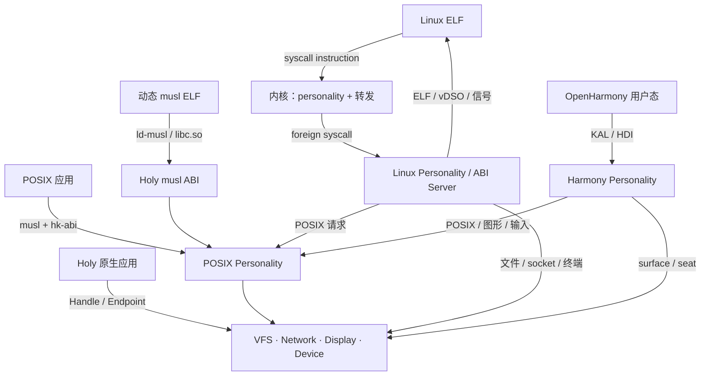

# 应用兼容、Linux ABI 与 Compatibility Server

状态：**设计中** · 上级：[总体架构](architecture.md)

目标：让 POSIX 应用**源码基本不改**即可重编译运行；让常见 Linux ELF（含 glibc/musl 动态库）**二进制直接运行**；复用 OpenHarmony 用户态代码承载鸿蒙应用；对依赖 Linux 内核的系统级软件提供 VM/容器兜底。兼容层位于用户态，由 **Compatibility Server** 按 personality 组织，内核只提供通用的 ABI 转发机制。

---

## 1. 目标与非目标

### 目标

1. **L1 源码兼容**：应用源码零修改或极少修改，使用 `hk-abi` + musl 重新编译。
2. **L2 二进制兼容**：未修改的 Linux x86_64 ELF 可直接执行，包括静态与动态 glibc/musl 程序。
3. **L3 鸿蒙源码移植**：复用 OpenHarmony standard-system 用户态，通过 Holy KAL/HDI 适配承载 ArkUI 应用。
4. **L4 兜底**：systemd、Docker、内核模块、GPU/专有驱动等通过轻量 VM 或容器运行。
5. **可移植工具链**：sysroot、头文件、CMake/Meson/Autotools toolchain、打包工具。
6. **动态 libc**：同一桌面可同时托管 musl 与 glibc 应用，每个进程归属一个 libc 域。
7. **可测试**：兼容性矩阵覆盖 syscall、真实应用与回归。

### 非目标（1.0）

- 不承诺所有 Linux 二进制、内核模块、专有驱动与容器编排工具原生运行。
- 不在内核中实现 Linux 语义。
- 不兼容 Linux 内核内部接口（`io_uring` 高级特性、netfilter 内核模块、eBPF 等）的完整面。
- 不保证 glibc 私有 ABI、调试器 `ptrace` 全量语义与安全沙箱逃逸面。

---

## 2. 兼容层级

| 层级   | 形态          | 应用改动               | 机制                                                |
| ---- | ----------- | ------------------ | ------------------------------------------------- |
| L0   | Holy 原生应用   | 使用 Handle/Endpoint | 原生 API                                            |
| L1   | POSIX 源码    | 重新编译               | musl + `hk-abi` + POSIX Server                    |
| L1.5 | 动态 musl ELF | 无需重新编译             | 上游 musl ABI + Holy `ld-musl`/`libc.so` + `hk-abi` |
| L2   | Linux ELF   | 无需重新编译             | Linux ABI Server + Linux personality              |
| L3   | 鸿蒙应用        | OpenHarmony 用户态    | Harmony personality + KAL/HDI 适配                  |
| L4   | 强 Linux 依赖  | 无需修改               | 轻量 VM/容器兜底                                        |

优先级：L1 覆盖大多数 POSIX CLI、语言运行时与服务端程序；L1.5 覆盖动态 musl 生态（Alpine 等）；L2 覆盖 glibc 与静态/动态 Linux 二进制；L3 复用 OpenHarmony 承载鸿蒙应用；L4 只处理必须依赖 Linux 内核的软件。

---

## 3. 架构

- **内核**：每任务维护 `Personality { Native, Posix, Linux }`；Native 走现有 `int 0x80`，Linux 走 `syscall` 指令；Harmony 用户态通过 POSIX/Linux personality 启动。内核保存上下文并把 Linux syscall 转发给 Linux personality。
- **Compatibility Server**：用户态 supervisor，按应用声明选择 personality；负责命名空间、rootfs、启动与资源配额，运行在内核可信基之外。
- **Linux Personality**：实现 Linux syscall 语义、ELF/动态加载器辅助、信号帧、`/proc`/`/sys` 视图与设备 ioctl；通过 POSIX Server、VFS、Network、Display、Device 完成实际工作。
- **POSIX Personality**：既服务 L1/L1.5 应用，也作为 L2/L3 的内部后端；进程、fd、信号、cwd 等状态集中管理。
- **Harmony Personality**：复用 OpenHarmony standard-system 用户态（ArkUI、Render Service、Window Manager、`samgr`、`appexecfwk`、`dsoftbus`），通过 KAL/HDI 适配到 Holy 的 POSIX、surface/seat、VFS 与 Network。
- **L4**：独立 VM/容器服务承载强 Linux 依赖软件；Linux ABI Server 聚焦用户态 ABI。

### 3.1 Compatibility Server 与 libc 域

- 一个桌面可以同时运行多个 personality，但每个应用只属于一个 libc 域：
  - `musl`：`hk-abi`/`hk-crt` 源码移植，或 L1.5 动态 ABI；
  - `glibc`：未修改二进制，通过 Linux personality 的 `ld-linux` 与 Linux syscall；
  - `Harmony`：OpenHarmony 用户态及其 libc/runtime。
- **libc 域隔离**：musl 与 glibc 各自维护 TLS、allocator、符号版本与 `dlopen` 命名空间；glibc `.so` 由 glibc 进程加载，musl `.so` 由 musl 进程加载。
- Compatibility Server 按 ELF `PT_INTERP`/manifest 选择 personality；未知类型返回明确错误。
- 所有 personality 通过 Handle 访问 VFS/Network/Display/Device；Framebuffer 与设备 MMIO 由对应服务持有授权。

### 3.2 Harmony / OpenHarmony

- 基线选择 OpenHarmony standard-system 用户态；ArkUI、Render Service、Window Manager 与 `appexecfwk` 可直接复用。LiteOS-M/LiteOS-A 小系统作为轻量设备参考。
- 需要补齐的适配层：`init`/`samgr` 启动、POSIX/Linux 兼容 syscall、musl 运行时、HDF/HDI 的 display/input/storage/network 后端、`dsoftbus`/socket、权限与包安装。
- 图形路径：OpenHarmony Render Service → HDI display → Holy surface；输入 HDI → Holy seat。Harmony 表面通过 HDI 进入合成器，与 Wayland/X11 表面并列。
- 这是**源码级移植**：`.hap` 由 Harmony personality 承载，ArkUI 复用 OpenHarmony 实现；商业 HarmonyOS 闭源组件按可获得的 OpenHarmony 代码范围复用。

---

## 4. 内核机制

HMP 是兼容 personality 的内存底座：地址空间视图由 Region 表达，内存身份由 Revision/Anonymous/DeviceAllocation 承载；兼容层只创建 Region 并转换调用语义。

### 4.1 Personality 与入口

- 任务创建时指定 personality；`exec` 根据 ELF 类型切换。
- Native / POSIX 应用继续使用 `int 0x80` 与现有 HK syscall 编号。
- Linux 应用使用 x86_64 `syscall` 指令；内核设置 `LSTAR` 入口，保存 `rcx`/`r11` 与用户栈。
- 内核对 Linux personality 的任务执行 `SYS_FOREIGN_SYSCALL` 路径：打包 syscall 号、6 个参数、返回地址与栈指针，发送到已注册的 ABI Server Endpoint，阻塞线程等待回复。
- ABI Server 返回 `rax`；负值按 Linux `-errno` 约定返回。信号、重启与 `ERESTART*` 由 ABI Server 与 POSIX Server 协作处理。

### 4.2 线程与 TLS

- TCB 保存用户 FS/GS base；`arch_prctl(ARCH_SET_FS)` 等请求经 ABI Server 落到内核机制。
- 支持 pthread TLS、`set_tid_address`、`rseq` 的最小语义；能力缺失时返回明确错误。
- `clone`/`clone3` 创建 Linux 线程；与 HK TCB、信号投递、COW 栈协同。

### 4.3 信号与异常

- Linux signal frame、`rt_sigaction`、`rt_sigprocmask`、`rt_sigreturn`、altstack 由 ABI Server 构造，POSIX Server 维护 pending/blocked。
- 用户态异常先进入内核，再由 personality 路由到 POSIX/Linux ABI Server。
- 页错误、COW、栈 guard 与 Linux `SIGSEGV`/`SIGBUS` 映射由 ABI Server 完成。

### 4.4 vDSO 与时间

- 映射只读 vDSO 页，提供 `clock_gettime`、`gettimeofday`、`time`、`getcpu` 的快速路径。
- 时间仍来自 Holy 民用时间/单调 tick；vDSO 数据页由内核或时间服务更新。
- 避免每次时间查询都触发完整 IPC。

---

## 5. Linux ABI Server

### 5.1 职责

- ELF 加载配合：`PT_INTERP`、`AT_PHDR`/`AT_BASE`/`AT_ENTRY`、auxv、动态加载器搜索路径。
- syscall 分派与参数校验；错误码转换为 Linux `errno`。
- `/proc`、`/sys`、`/dev` 的 Linux 兼容子集；`/etc/ld.so.cache`、`/etc/ld.so.conf`。
- `ioctl` 子集、`epoll`、`eventfd`、`timerfd`、`signalfd`、`memfd`、`pidfd` 的渐进实现。
- socket 映射到 Network Server 的 Socket Handle；fd 映射到 POSIX Server。
- 进程、线程、信号、cwd、umask、rlimit 等与 POSIX Server 对齐。

### 5.2 syscall 分阶段

| 阶段 | 范围 | 典型调用 |
| --- | --- | --- |
| P1 | 启动、文件、内存、进程基础 | `read`/`write`/`openat`/`close`/`fstat`/`mmap`/`mprotect`/`brk`/`execve`/`exit`/`wait4` |
| P2 | 线程、信号、事件、终端 | `clone`/`futex`/`rt_sigaction`/`rt_sigreturn`/`epoll_*`/`ioctl`/`poll` |
| P3 | 运行时与桌面常见扩展 | `clone3`/`rseq`/`prlimit64`/`getrandom`/`memfd_create`/`pidfd_*`/`inotify` |
| P4 | 高级/可选 | `io_uring`、netlink 子集、`bpf` 查询、命名空间与 cgroup 视图 |

每一阶段以真实应用为门禁，同时覆盖 syscall 数量。

### 5.3 glibc 关键点

- `ld-linux-x86-64.so.2` 的 `PT_INTERP` 映射与 `/etc/ld.so.cache`。
- TLS/`arch_prctl`、`set_tid_address`、`set_robust_list`、`rseq`。
- `/proc/self/maps`、`/proc/self/stat`、`/proc/self/auxv`、`/proc/cpuinfo`、`/proc/meminfo`。
- `mmap` 地址布局、`mremap`、`MAP_FIXED_NOREPLACE`、`PROT_*`、`MADV_*` 子集。
- 信号栈、`SA_RESTORER`、`ucontext`、`sigaltstack`。
- `prctl`、`prlimit64`、`getrandom`、`clock_gettime` 与 vDSO。

---

## 6. 源码兼容与移植工具

### 6.1 L1 工具链

- `hk-abi` 头文件与 syscall shim。
- musl sysroot：`/usr/include`、`/usr/lib`、启动对象与动态加载器。
- 交叉工具链：clang/zig 目标、CMake toolchain、Meson cross file、Autotools `--host`。
- `holybuild`：依赖解析、编译、打包、安装到 VFS。
- FHS 目录：`/bin`、`/lib`、`/usr/lib`、`/etc`、`/dev`、`/proc`、`/sys`、`/run`、`/tmp`。

### 6.2 应用自带 libc

- 允许静态链接自有 libc，但必须实现 `hk-abi` 后端；musl 为一等支持，其他 libc 为 best-effort。详见 [POSIX 与 libc](posix.md#44-应用自带-libc)。
- 动态链接按 personality 选择：musl 应用使用系统 `ld-musl`/`libc.so`；glibc 应用使用 Linux personality 的 `ld-linux` 与 glibc 库。每个进程归属一个 libc 域。
- 同一应用链接一种 libc；glibc `.so` 由 glibc 进程加载，musl `.so` 由 musl 进程加载。

### 6.3 动态 musl ABI 兼容（L1.5）

目标：未修改的动态 musl ELF 直接使用系统提供的 `ld-musl-x86_64.so.1` 与 `libc.so`，不经过 Linux ABI Server。syscall 仍由我们的 musl 后端翻译成 `hk-abi`。

ABI 契约：

- **加载器与 soname**：兼容上游 musl 的 `PT_INTERP` 路径（`/lib/ld-musl-x86_64.so.1`）、`libc.so` soname 与 Alpine 常见的 `libc.musl-x86_64.so.1` 别名。
- **公共布局**：保持 musl 1.2.x 的公开 ABI：`struct stat`/`statfs`、`termios`、`sigaction`/`siginfo`/`ucontext`、`sockaddr`/`msghdr`、`iovec`、`epoll_event`、`DIR`、`glob_t`、`locale_t`、`pthread_*` 类型、`FILE` 不透明句柄。
- **启动**：Loader 完成 Linux 风格初始栈、`AT_*` auxv、`AT_PHDR`/`AT_BASE`/`AT_ENTRY`、`AT_RANDOM`、TLS；动态二进制的 `_start` 调用 `__libc_start_main`。
- **TLS**：保持 musl 的 `%fs` 变体 I TLS 布局与初始 TLS 分配；pthread/TLS 析构语义一致。
- **符号**：musl 无 glibc 式符号版本；保持无版本符号、`__libc_*`/`__dls*` 等动态加载器内部符号。
- **直接 syscall**：应用若通过 `syscall()` 传 Linux syscall 号，musl shim 需要做有限翻译；不支持的号返回 `ENOSYS`，并记录覆盖缺口。
- **dlopen**：只加载 musl ABI 的 `.so`；glibc `.so` 不兼容。系统库与 `/etc/ld-musl-*` 搜索路径保持 musl 约定。
- **系统文件**：`/etc/resolv.conf`、`/etc/hosts`、`/etc/passwd`、`/etc/group`、`/proc/self/*` 提供 musl/运行时需要的最小视图。

边界：

- 仅适用于**动态链接且不绕过 libc 直接发 Linux syscall** 的 musl 程序。
- 静态 musl 二进制仍包含 Linux syscall 代码，走 L2 或重新编译。
- glibc 动态/静态二进制仍走 L2。
- `io_uring`、netlink、`ptrace` 等直接内核接口需要 L2 或明确降级。

验收：

1. 上游 musl 工具链构建的动态 hello、BusyBox、Alpine `sh`/`ls`/`cat` 直接运行。
2. pthread、TLS、信号、`dlopen`、`getaddrinfo`、`termios` 通过 ABI 测试。
3. `ldd` 显示的 loader/依赖与实际系统一致；无需重新编译。
4. 直接 `syscall()` 覆盖表与 `ENOSYS` 行为有测试。

### 6.4 常见移植工作

- 构建系统：提供 toolchain 文件与 sysroot，减少手工改 `Makefile`。
- 依赖：优先使用 musl 兼容库；必要时提供 `hk-abi` 适配层。
- 运行时：Python/Node/Go 等语言运行时按 syscall 覆盖逐步接入；Go 需重点验证 raw syscall、`clone`、信号与 `/proc`。
- 服务端软件：优先支持 nginx、sqlite、Redis 等可作为 L2 验证目标。

### 6.5 glibc 动态库兼容（L2）

目标：未修改的 glibc 动态 ELF 直接运行其自带 `ld-linux-x86-64.so.2`，由 Linux personality 提供 syscall 与内核视图；glibc 通过 Linux ABI 运行（ADR-0015）。

- **加载器**：`PT_INTERP`、`AT_PHDR`/`AT_BASE`/`AT_ENTRY`/`AT_RANDOM`、`/etc/ld.so.cache`、`/etc/ld.so.conf`、`RPATH`/`RUNPATH`、`LD_LIBRARY_PATH`/`LD_PRELOAD`。
- **符号**：glibc 符号版本（`.gnu.version`）、默认/兼容版本、IFUNC 解析、弱符号、`__libc_start_main`。
- **TLS**：`arch_prctl(ARCH_SET_FS)`、TCB、静态 TLS、动态 TLS、`dlopen` 后的 TLS 分配。
- **动态加载**：`dlopen`/`dlclose`/`dlsym`/`dladdr`、依赖图、命名空间隔离、`RTLD_LOCAL`/`RTLD_GLOBAL`。
- **运行时服务**：NSS（`/etc/nsswitch.conf`、`libnss_*`）、locale、iconv、resolver、`/proc/self/*`、`/sys` 最小视图。
- **内存与线程**：`mmap` 布局、`brk`、`mremap`、`clone`/`clone3`、futex、`rseq`、信号栈与 `ucontext`。
- **边界**：glibc `.so` 由 glibc personality 加载，musl personality 加载 musl 库。静态 glibc 走同一 Linux ABI，并使用 Linux syscall。

验收：glibc 版 `hello`、`ls`、`cat`、`sh`、`python` 动态运行；`ldd`、`dlopen`、NSS、TLS、信号与 pthread 回归通过。

---

## 7. 安全模型

- Compatibility Server 是用户态 supervisor，按 personality 启动应用；各 ABI 实现运行在内核可信基之外，崩溃可重启。
- 每个兼容应用运行在独立 Native Task/Arena；fd、Socket、Frame 权限由 Handle 管理。musl/glibc/Harmony 的 libc 域彼此隔离。
- `/proc`、`/sys` 只暴露兼容所需的最小视图，不泄露宿主服务内部句柄。
- 监听端口、raw socket、设备访问与 `ptrace` 需要显式 ADMIN 权限。
- 对 syscall 参数做边界与类型校验；解析器与 ELF 加载器有 fuzz 目标。
- L2 兼容层不默认允许访问宿主 VFS 根；通过命名空间/挂载视图隔离。

---

## 8. 性能

- 常见 syscall（时间、`getpid`、`getuid`、`errno`）走 vDSO 或 libc/shim 缓存。
- 批量与共享 Frame：`readv`/`writev`、socket 收发、文件大块 IO 不按字节复制。
- 热路径在 ABI Server 内缓存；避免每次都完整路径解析。
- 基准门禁：syscall 往返、`fork+exec`、文件 IO、socket 吞吐、动态加载时间。

---

## 9. 测试矩阵

| 层级 | 内容 |
| --- | --- |
| 单元 | syscall 参数/错误码、ELF 解析、auxv、信号帧、`/proc` 格式 |
| 静态二进制 | BusyBox、coreutils、hello（musl/glibc） |
| 动态二进制 | glibc `ls`/`cat`/`sh`、`ld-linux`、`ld-musl`、符号版本、IFUNC、库搜索 |
| 鸿蒙移植 | OpenHarmony `init`/`samgr`/`appexecfwk`、最小 ArkUI 应用、HDI display/input |
| 语言运行时 | Lua、Python、Node、Go（分批） |
| 服务端 | sqlite、Redis、nginx（按优先级） |
| 系统调用 | Linux syscall 覆盖表与回归；LTP 子集 |
| 故障 | ABI Server/POSIX/VFS 重启、EIO、信号中断、OOM |
| 性能 | syscall、fork+exec、文件、socket、动态加载 |

### 验收口径

1. L1：目标 POSIX 应用源码零修改重编译通过。
2. L2：静态 musl/glibc BusyBox 运行；动态 glibc coreutils 运行；`/proc/self/maps` 等基础视图正确。
3. L2：`hk-compat` syscall 覆盖与真实应用回归通过。
4. L3：至少一个强 Linux 依赖场景通过 VM/容器兜底。

---

## 10. 路线图

兼容层随 [路线图](roadmap.md) 的 M6–M11 推进；里程碑、退出标准与风险以路线图为准。

---

## 11. 风险与应对

| 风险 | 影响 | 应对 |
| --- | --- | --- |
| Linux syscall 面过大 | M10 拖延 | P1 真实应用门禁；P2/P3 增量；高级特性明确降级 |
| glibc 假设复杂 | 动态二进制失败 | 静态 glibc 先行；逐项补齐 `/proc`/TLS/信号/auxv |
| ABI Server 高权限 | 安全风险 | 用户态隔离、最小视图、ADMIN 权限、审计与 fuzz |
| 每次 syscall IPC 开销 | 性能下降 | vDSO、缓存、批量、共享 Frame、热路径 |
| 系统级软件依赖内核 | 无法原生运行 | L3 VM/容器兜底，明确支持边界 |
| 多架构 ABI 差异 | 移植成本 | x86_64 先行；AArch64/RISC-V 在 M11 增量接入 |

---

## 12. 相关文档

- [POSIX 与 libc](posix.md)
- [服务器](servers.md)
- [VFS](vfs.md)
- [网络](network.md)
- [平台与启动](platforms.md)
- [路线图](roadmap.md)
- [ADR-0011：Linux 二进制 ABI 兼容层](adr/0011-linux-abi.md)
- [ADR-0012：musl 动态 ABI 兼容](adr/0012-musl-dynamic-abi.md)
- [ADR-0015：Compatibility Server 与多来源 UI](adr/0015-compatibility-server.md)
