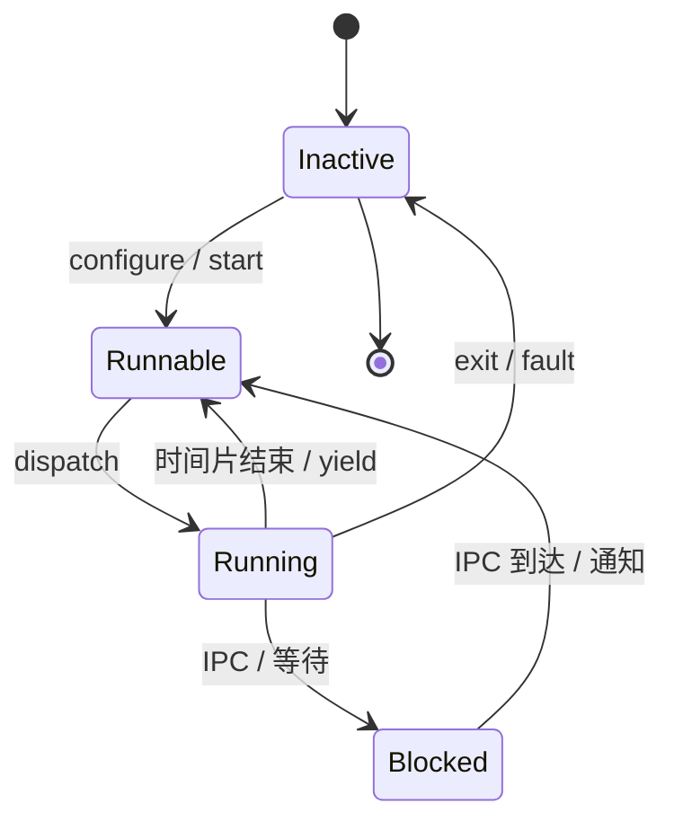
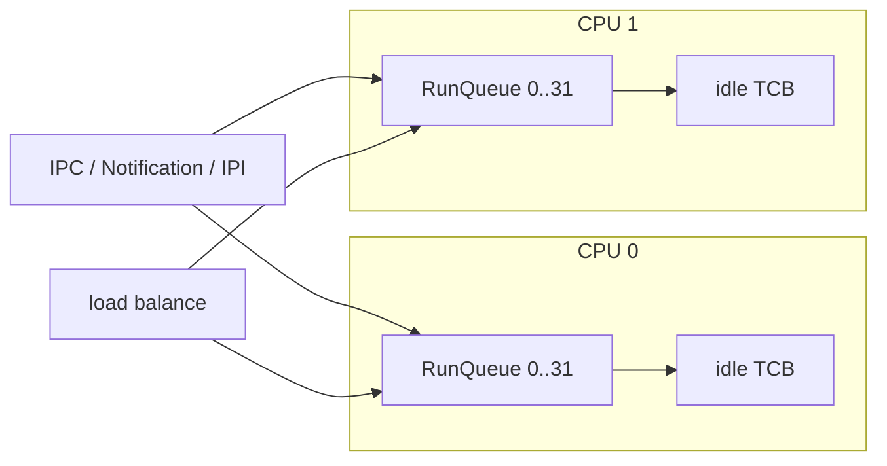
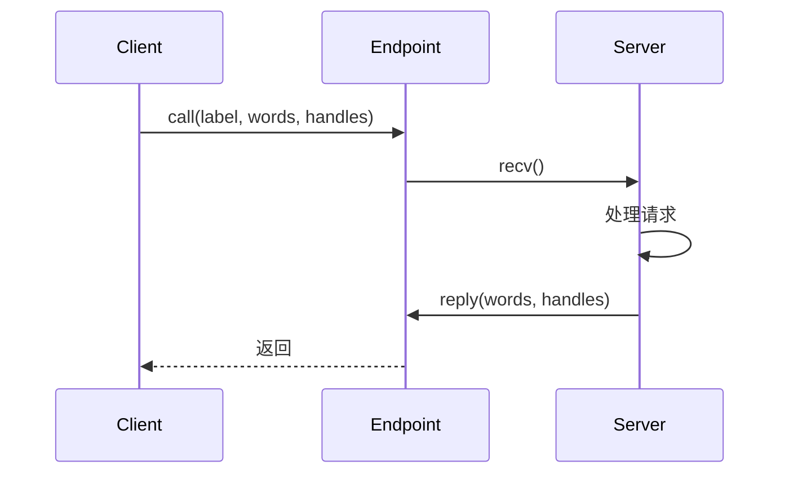

# 执行模型

状态：**设计中** · 上级：[总体架构](architecture.md)

本文描述 TCB、调度、Handle、Endpoint/Notification IPC 与故障处理。内核只提供线程与通信机制；POSIX 进程、线程、信号与 fd 由用户态 POSIX Server实现。

---

## 1. TCB 模型

```rust
pub struct Tcb {
    id: TcbId,
    state: AtomicU8,
    priority: Priority,
    affinity: CpuMask,
    context: UnsafeCell<Context>,
    kernel_stack: Stack,
    vspace: Handle<VSpace>,
    handle_table: Handle<HandleTable>,
    fault_endpoint: Option<Handle<Endpoint>>,
    ipc_state: IpcState,
    stats: TcbStats,
}
```

- **TCB** 是唯一的内核执行体。
- 每个 TCB 绑定一个 VSpace，并引用所属 Task 的 HandleTable。
- 线程入口、栈、TLS 由用户态服务器与 libc 配置。
- 内核以 TCB 为调度单位；POSIX 进程是共享 VSpace 的 TCB 集合。

### 状态机



- **Inactive**：已创建，待配置或已退出。
- **Runnable**：在 run queue 中。
- **Running**：正在 CPU 上执行。
- **Blocked**：等待 Endpoint、Notification 或定时器。
- **Suspended**：由调试器或 Root Server 暂停。

---

## 2. 调度

- **抢占式**：中断返回、时间片耗尽、IPC 阻塞触发切换。
- **固定优先级 + 同优先级轮转**：32 个优先级，0 最高，31 为 idle。
- **每 CPU 一个 run queue**：优先级位图 + FIFO。
- **Tickless**：一次性定时器编程到“时间片结束/下一唤醒”的较早者。
- **SMP**：所有 CPU 同等参与；BSP 启动 AP。
- **亲和性**：`CpuMask` 限制可运行 CPU。
- **负载均衡**：idle CPU 拉取 Runnable TCB。



- 默认时间片 4 ms。
- 上下文切换保存 callee-saved 寄存器、栈指针、FPU/向量状态。
- 目标：热切换 ≤ 1 µs（QEMU 基准）。

---

## 3. Handle

```rust
pub struct Handle {
    index: u32,
    generation: u32,
}

pub struct Rights(u32); // READ | WRITE | EXECUTE | TRANSFER | ADMIN
```

- HandleTable 由 Native Task 持有；同一 Task 的 TCB 共享这张表。
- Handle 存放在 HandleTable 槽位；进程通过 `invoke` 调用对象方法。
- `duplicate` 需要 `ADMIN`，保持或收窄 rights；`close` 使旧 generation 失效。
- Handle 可随 IPC 消息传递；发送方需要 `TRANSFER` 权限。
- 每个对象有 `epoch`；owner 的 `revoke_all` 递增 epoch，使该对象所有旧 Handle 失效。
- 每 Task/服务器有 Handle 配额；`duplicate`/`transfer` 前检查。
- 权限模型采用线性 HandleTable；服务器重启时关闭旧 Handle。
- 对象命名由服务器 Endpoint 提供；内核 Handle 保持匿名。
- badge 用于 Endpoint 标识客户端；权限由 Handle 决定。

| right | 用途 |
| --- | --- |
| `READ` | 读取对象、接收消息、等待通知、查询状态 |
| `WRITE` | 修改对象、发送消息、映射可写 Frame |
| `EXECUTE` | 执行代码、映射可执行 Frame |
| `TRANSFER` | 通过 IPC 转移 Handle |
| `ADMIN` | 配置对象、duplicate、revoke_all |

- 失败返回 `BadHandle`、`Revoked`、`NoHandles`、`PermissionDenied` 或 `WrongType`。
- 对象引用归零时析构。

---

## 4. IPC

### 4.1 Endpoint

```rust
pub struct Message {
    pub label: u64,
    pub words: [u64; 8],
    pub handles: [Option<Handle>; 4],
}
```

- **Endpoint** 是同步 IPC 通道；内核暴露 `send`、`recv`、`call`、`reply`。
- 消息携带 label、最多 8 个字与 4 个 Handle；发送方需要 `TRANSFER` 权限。
- 大块数据通过共享 Frame 传递；消息只携带 Frame Handle。
- 阻塞、超时与取消由内核管理；等待队列按优先级排序。
- Endpoint 可绑定 badge；服务端区分客户端。



### 4.2 Notification

```rust
pub struct Notification {
    bits: AtomicU64,
}

impl Notification {
    fn signal(&self, bits: u64);
    fn wait(&self, mask: u64, timeout: Option<Duration>) -> u64;
    fn poll(&self, mask: u64) -> u64;
    fn clear(&self, bits: u64);
}
```

- 异步事件：中断下半部、DMA 完成、定时器、进程退出。
- Notification 可绑定 TCB；`signal` 唤醒等待线程。
- 与 Endpoint 配合：服务器通过 Notification 等待设备事件。

### 4.3 共享 Frame

- 大消息通过 Frame Handle 传递；接收方映射到自己的 VSpace。
- 只读/可写权限由 Frame Handle 决定。
- 共享 Frame 的引用计数归零后回收。

---

## 5. 线程与 POSIX 映射

| POSIX 概念 | HK 实现 |
| --- | --- |
| 进程 | 共享 VSpace 的 TCB 集合 + POSIX Server 的进程表 |
| 线程 | 一个 TCB；libc 管理栈/TLS |
| `fork` | POSIX Server 创建新 VSpace、复制映射、创建 TCB |
| `clone` | POSIX Server 按标志共享 VSpace/fd/信号 |
| `exec` | 加载 ELF、创建新 VSpace、启动主 TCB |
| `wait` | 父进程 Endpoint 接收子进程退出事件 |
| 信号 | POSIX Server 维护 pending/blocked；libc 调用 handler |

内核只提供 TCB、VSpace、Endpoint、Notification、Frame 与 Handle；POSIX 语义在用户态完成。

---

## 6. 同步

### 6.1 内核同步

- `SpinLock`：短临界区；禁用抢占。
- `IrqSpinLock`：自旋 + 关本地中断。
- `Mutex`：可睡眠；用于服务器内核态路径。
- `WaitQueue`：FIFO；IPC 阻塞与唤醒。
- `Once`、`Lazy`：初始化。

规则：

- `SpinLock` 持有期间使用固定分配与自旋等待。
- 中断上半部使用 `IrqSpinLock`。
- 锁顺序全局文档化；Hosted 调试构建启用 lockdep 式环检测。

### 6.2 用户态同步

- POSIX 互斥量、条件变量、信号量、futex 由 musl + `hk-abi` 与 POSIX Server 实现。
- futex 通过共享 Frame + Notification 实现等待/唤醒。
- 文件锁由 POSIX Server 管理。

---

## 7. 故障与退出

### 7.1 线程故障

| 故障 | 处理 |
| --- | --- |
| 页错误 | 发送到 Fault Endpoint；POSIX Server 处理 COW/映射/终止 |
| 非法指令 | 发送到 Fault Endpoint；POSIX Server 终止进程 |
| 除零/溢出 | 发送到 Fault Endpoint；默认终止进程 |
| 栈 guard | 发送到 Fault Endpoint；终止线程并回收栈 |
| IPC 超时 | 返回 `Timeout`；服务器决定重试 |
| 服务器崩溃 | Root Server 重启；句柄回收并重新分配 |

### 7.2 内核故障

- 内核保证失效、页表损坏、调度器死锁、中断风暴 → panic。
- panic：停世界、dump CPU 寄存器、栈回溯、当前 TCB、最近 trace。
- panic 路径使用静态缓冲与自旋锁，独立于堆与调度器。

### 7.3 退出

- TCB 退出后释放内核栈、TCB 对象与 Handle。
- POSIX 进程退出通过 Endpoint 通知父进程与 POSIX Server。
- Root Server 记录服务器退出状态并按策略重启。

---

## 8. 时间

```rust
pub struct Moment(u64);      // 单调 tick
pub struct Duration(u64);
pub struct CivilTime { ... }
```

- 每 CPU 一个时钟源；选择全局最稳定的作为单调时间。
- 定时器轮处理 IPC 超时、时间片、Notification 等待。
- 平台通过 `SYS_CIVIL_TIME` 读取 RTC 民用时间（年/月/日/时/分/秒/纳秒）；RTC 缺失时返回空值。
- 民用时间交给需要日历语义的服务；ext4 后端只在磁盘格式边界换算为 ext4 时间戳。
- POSIX 时间通过 POSIX Server 与 libc 暴露。

---

## 9. 保证

1. 任意时刻，一个 TCB 最多在一个 CPU 上运行。
2. 每个 TCB 绑定一个 VSpace，并引用 Task 的 HandleTable。
3. Handle 只能由持有 `TRANSFER` 权限的线程传递。
4. IPC 消息中的 Handle 在接收方 HandleTable 中获得新槽位。
5. Endpoint 的发送/接收按优先级与 FIFO 规则调度。
6. 页错误通过 Fault Endpoint 交付；POSIX Server 处理语义。
7. POSIX PID 表、fd 表与信号状态由 POSIX Server 维护；内核提供 TCB 与 Handle。
8. 服务器崩溃后，Root Server 关闭旧句柄并重启服务。
9. 中断上半部使用固定分配与自旋锁。
10. panic 路径独立于调度器与堆。

---

## 10. 测试策略

| 层级 | 测试 |
| --- | --- |
| Hosted 单元 | run queue、优先级、Endpoint、Notification、Handle duplicate/close |
| Hosted 模拟 | 确定性调度、IPC 超时、句柄传递、服务器重启 |
| QEMU x86_64 | SMP 2/4 核、IPI、上下文切换、IPC 基准、故障注入 |
| QEMU AArch64/RISC-V | 同上，验证 PSCI/SBI、GIC/PLIC |
| POSIX 集成 | `fork`、`exec`、pthreads、信号、pipe、socket |
| fuzz | IPC 消息序列、Handle 操作序列、调度器随机种子 |
| 基准 | 上下文切换、IPC call/reply、Notification 唤醒、服务器重启时间 |

---

## 11. 相关文档

- [总体架构](architecture.md)
- [权限模型](permissions.md)
- [内存模型](memory.md)
- [POSIX 与 libc](posix.md)
- [服务器](servers.md)
- [平台与启动](platforms.md)
- [工程策略](engineering.md)
