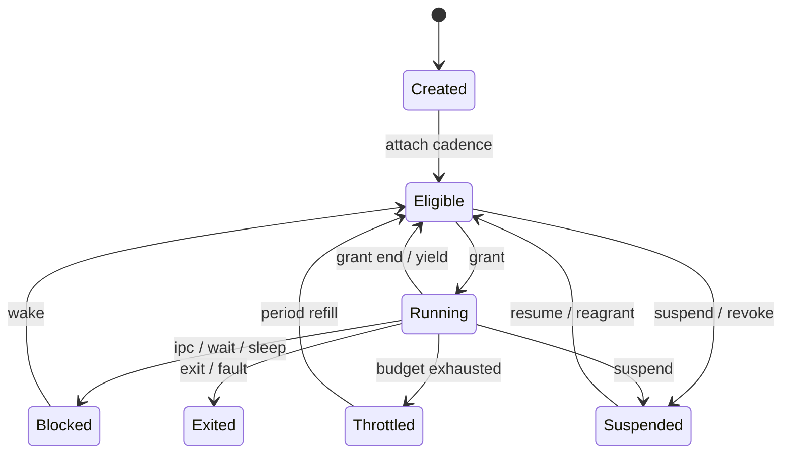
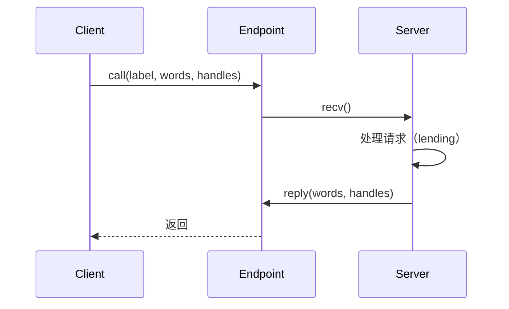

# 执行模型

状态：**设计中** · 上级：[总体架构](architecture.md) · 关联：[Holy Cadence Model](scheduling.md)

本文描述 Task、TCB、调度、Handle、Endpoint/Notification IPC、时间与故障处理。内核提供执行与通信机制；POSIX 进程、线程、信号与 fd 由用户态 POSIX Server 实现。

---

## 1. Task 与 TCB

### 1.1 内核调度 Task

内核的调度对象是 **Task**：

```rust
pub struct Task {
    id: TaskId,
    cadence: Handle,          // Cadence 契约
    meter: Handle,            // Meter 计量
    tcbs: Vec<TcbId>,         // 执行单元
    parent: Option<TaskId>,
    state: TaskState,
    class: Class,             // 由 Cadence 派生
    virtual_pass: u64,        // 同类公平进度
    period_start: Moment,     // Realtime 预算周期
    budget_left: Duration,    // 当前周期剩余预算
}
```

- Task 持有 Cadence 与 Meter；公平、预算、计量与快照都以 Task 为单位。
- Task 状态：`Created / Eligible / Running / Blocked / Throttled / Suspended / Exited`。
- Task 由 Root Server 或 Tempo Server 附加 Cadence；子 Task 默认继承父契约的收窄份额。
- Task 的调度归属由 [Holy Cadence Model](scheduling.md) 定义。

### 1.2 TCB

```rust
pub struct Tcb {
    id: TcbId,
    task: TaskId,
    context: UnsafeCell<Context>,
    kernel_stack: Stack,
    state: TcbState,
    block: Option<BlockReason>,
    ipc_state: IpcState,
    tls: u64,
}
```

- **TCB** 是唯一的执行单元；同一 Task 的 TCB 共享 Cadence、Meter、Arena 与 HandleTable。
- TCB 状态：`Created / Eligible / Running / Blocked / Exited`。
- 线程入口、栈与 TLS 由用户态服务器与 libc 配置。
- Task 获得 Grant 后，其可运行 TCB 轮转使用该 Grant。

### 1.3 Native Task

Native Task 是调度 Task 的完整视图，跨内核与用户态：

```text
Native Task = Arena + HandleTable + TCB(s) + 父子关系 + Cadence + Meter + 元数据
```

- 内核 Task 负责调度与计量；Arena 与 HandleTable 由运行时和用户态服务持有。
- Root Server 用 Native Task 管理服务；POSIX Server 用 Native Task 承载 POSIX 进程。
- Task 退出时整体回收 Arena、HandleTable、TCB、Cadence 与 Meter。

### 1.4 状态机



- `Blocked` 覆盖 Endpoint、Notification、futex、sleep 与 IPC 超时。
- `Throttled` 表示当前周期预算耗尽；下一周期由 Beat 重新入队。
- `Suspended` 由 Root/Tempo 或调试器设置；恢复时重新检查 Cadence 有效性。

---

## 2. 调度

调度契约、对象面、算法与验收标准见 [Holy Cadence Model](scheduling.md)。本节描述执行模型中的调度边界。

### 2.1 两级调度

- **Task 级**：Beat 在 Eligible Task 之间按类别与虚拟时间选择。
- **TCB 级**：Task 获得 Grant 后，可运行 TCB 轮转分享 Grant。

选择顺序：`Realtime` → `Latency` → `Throughput` → `Idle`。

### 2.2 Beat

每 CPU 一个 Beat：

- 类别队列：`realtime`、`latency`、`throughput` 与 idle TCB；
- 当前 Grant：Task、TCB、结束时间与剩余预算；
- 一次性定时器：Grant 结束、下一个虚拟截止期、周期补充、sleep 与 IPC 超时；
- `need_resched` 标志与 reschedule IPI；
- 亲和性、可迁移性与负载均衡。

### 2.3 抢占与空闲

- 唤醒与激活完成后执行 `resched` 判定；更高优先类别或更早虚拟键值的 Task 抢占当前 Task。
- 跨 CPU 抢占发送 reschedule IPI。
- 抢占检查点：系统调用返回、定时器中断返回、IPI 返回。
- 空闲 CPU 运行 idle TCB 并执行 `hlt`；IPI 与定时器中断负责唤醒。
- 上下文切换保存 callee-saved 寄存器、栈指针、FPU/向量状态；目标热切换 ≤ 1µs（QEMU 基准）。

---

## 3. Handle

```rust
pub struct Handle {
    index: u32,
    generation: u32,
}

pub struct Rights(u32); // READ | WRITE | EXECUTE | TRANSFER | ADMIN
```

- HandleTable 由 Native Task 持有；同一 Task 的 TCB 共享这张表。
- Handle 存放在 HandleTable 槽位；进程通过 `invoke` 调用对象方法。
- `duplicate` 需要 `ADMIN`，保持或收窄 rights；`close` 使旧 generation 失效。
- Handle 可随 IPC 消息传递；发送方需要 `TRANSFER` 权限。
- 每个对象有 `epoch`；owner 的 `revoke_all` 递增 epoch，使该对象所有旧 Handle 失效。
- 每 Task/服务器有 Handle 配额；`duplicate`/`transfer` 前检查。
- 权限模型采用线性 HandleTable；服务器重启时关闭旧 Handle。
- 对象命名由服务器 Endpoint 提供；内核 Handle 保持匿名。
- badge 用于 Endpoint 标识客户端；权限由 Handle 决定。

| right | 用途 |
| --- | --- |
| `READ` | 读取对象、接收消息、等待通知、查询状态 |
| `WRITE` | 修改对象、发送消息、映射可写 Frame |
| `EXECUTE` | 执行代码、映射可执行 Frame |
| `TRANSFER` | 通过 IPC 转移 Handle |
| `ADMIN` | 配置对象、duplicate、revoke_all |

- `Cadence` 与 `Meter` 是 Handle 对象；Rights 与 epoch 规则与其它对象一致。
- 失败返回 `BadHandle`、`Revoked`、`NoHandles`、`PermissionDenied` 或 `WrongType`。
- 对象引用归零时析构。

---

## 4. IPC

### 4.1 Endpoint

```rust
pub struct Message {
    pub label: u64,
    pub words: [u64; 8],
    pub handles: [Option<Handle>; 4],
}
```

- **Endpoint** 提供 `send`、`recv`、`call`、`reply`。`send` 为异步：消息入队后立即返回，队列有界（每个 Endpoint 最多缓存 64 条），满时返回 `QueueFull`；同步请求/应答使用 `call`/`reply`。
- 消息携带 label、最多 8 个字与 4 个 Handle；发送方需要 `TRANSFER` 权限。
- 大块数据通过共享 Frame 传递；消息只携带 Frame Handle。
- 阻塞、超时与取消由内核管理；等待队列按 Cadence 类别与虚拟键值排序，同类别内保持 FIFO。
- Endpoint 可绑定 badge；服务端区分客户端。
- `call` 期间建立 lending frame：服务端取得调用方与服务端中更强的有效契约，执行时间记入调用方 Meter；`reply`、超时或退出时恢复。细节见 [Holy Cadence Model](scheduling.md)。



### 4.2 Notification

```rust
pub struct Notification {
    bits: AtomicU64,
}

impl Notification {
    fn signal(&self, bits: u64);
    fn wait(&self, mask: u64, timeout: Option<Duration>) -> u64;
    fn poll(&self, mask: u64) -> u64;
    fn clear(&self, bits: u64);
}
```

- 异步事件：中断下半部、DMA 完成、定时器、进程退出。
- Notification 可绑定 TCB；`signal` 唤醒等待线程。
- `timeout` 进入 Beat 的 deadline 队列；到期返回超时结果。

### 4.3 HMP 能力与 Region

- `Capacity`、`Frame`、`Region` 与类型化能力构成 HMP 对象图；内核与用户态服务使用同一组对象、Rights 与错误面。
- `Frame` 是 HMP 物理页能力，带 `FrameId`、所属 Capacity、pin 与共享引用；通过 Handle 访问。
- 大消息通过 Frame Handle 传递；接收方创建自己的 Region，句柄权限决定只读/可写/可转移。
- `SYS_RECV_DATA*` 返回实际写入缓冲区的字节数；载荷超过缓冲区时截断，调用方按返回长度切片。
- 内核提供 `SYS_CAPACITY_*`、`SYS_FRAME_*`、`SYS_CAPABILITY_CREATE`、`SYS_REGION_MAP`、`SYS_REGION_INFO`、`SYS_REGION_UNMAP`、`SYS_CAPABILITY_PHYS`、`SYS_HANDLE_DUPLICATE` 与 `SYS_DMA_MAP_CAPABILITY`。
- `SYS_CAPACITY_INFO` 返回 64 字节：区间起点/长度、用途、页大小、硬上限、已用、峰值与软上限；`SYS_LEDGER_INFO` 返回 48 字节：提交、硬上限、峰值、压力、常驻与软上限。
- Memory Server 的 `MEMORY_ALLOC`、`MEMORY_FRAME` 与 Provider 页都从它持有的 System Capacity 共享视图出页，与 `SYS_CAPABILITY_CREATE` 的默认出页路径落在同一个容量上；用户内存因此只有一份归因。
- `SYS_CAPABILITY_CREATE(kind, length)` 创建类型化能力并分配常驻物理页，返回能力句柄。`SYS_REGION_MAP(capability, offset, len, rights_flags)` 把能力的一段映射进任务地址空间，返回 Region 句柄；`SYS_REGION_INFO` 返回虚拟地址与长度，`SYS_REGION_UNMAP` 解除映射并归还窗口区间。`SYS_CAPABILITY_PHYS` 返回物理地址与长度，供驱动建立 DMA。
- 调用校验 `Handle + Rights + ObjectKind`；内存授权由这些对象决定。
- 客户端保留原句柄，用 `SYS_HANDLE_DUPLICATE` 复制一份后通过 `SYS_SEND_HANDLE` 转移给服务；服务用 `SYS_REGION_MAP` 映射同一能力。
- 块协议：客户端通过 `BLOCK_ATTACH` 按槽位附加共享缓冲区 Frame，消息字高 32 位为槽位、低 32 位为长度；每个请求携带 `{op, sector, length, tag}`，响应回显 `tag` 并按发送者与槽位定位对应映射。同一连接可以同时有多个未完成请求：服务端收下请求后交给设备异步队列，完成回收时再回复；驱动通过 `SYS_DMA_MAP_FRAME` 把 Frame 绑定到 IOMMU，设备 DMA 直接读写缓冲区。`BLOCK_DETACH` 按槽位或整体解除 Region；Region 关闭 Frame 句柄并归还 Capacity。
- VFS 协议：客户端发送 `VFS_ATTACH` 后，`OP_READ_BUFFER`/`OP_WRITE_BUFFER` 用 8 字节参数携带长度，文件内容直接读写客户端缓冲区映射；服务端按发送者维护 Region 映射，重连时解除旧映射，`VFS_DETACH` 清理映射与会话文件句柄。
- 块客户端登记 VFS 客户端缓冲区映射；当后端把该映射作为缓冲区时，块客户端临时 attach 同一个 Frame 并让驱动 DMA 直达，实现 HolyFS 文档路径的零拷贝。HolyFS inode 缓存避免元数据读把数据缓冲区切回自有映射。
- 块驱动在 attach 后用 `SYS_DMA_MAP_FRAME` 把 Frame 映射进 DeviceGrant 的 IOMMU 域，并使用该物理地址作为 virtio DMA 缓冲；`SYS_DMA_SYNC` 接受本任务持有的 Frame 区间。
- Frame 的最后一个句柄释放时归还所属 Capacity；任务退出关闭句柄、客户端 detach 后回收。类型化能力与 Provider 页遵循同一套 Frame 归属。
- x86_64 平台启动时先预留 64 MiB 连续 DMA 窗口，再从其余可用内存建立 System Capacity；DeviceGrant 的 DMA 缓冲与驱动共享映射来自 DMA 窗口，显示表面、背缓冲与匿名页从 System Capacity 分配。窗口放大时新旧表面会短暂并存，System 配额需要覆盖这一峰值。
- `SYS_ALLOC(size, align)` 在任务 Arena 内推进按页对齐的线性分配并计入任务 Ledger；返回的区间首次访问才按页装入零页，装载期不再预映射 Arena。
- 用户虚拟布局集中定义在 `hk_hal::user`：镜像、Arena 与栈由平台固定（Arena 只固定 VA 窗口，物理页按需装入）；Capability、DMA、MMIO 与帧缓冲等动态映射统一从任务私有的自动窗口 `0x2000_0000`–`0x8000_0000` 按页分配并回收。`SYS_CAPABILITY_CREATE`/`SYS_DMA_MAP_CAPABILITY`、`SYS_DEVICE_MAP` 与 `SYS_FRAMEBUFFER_MAP` 同样通过 `out` 返回内核选择的地址。

---

## 5. 线程与 POSIX 映射

| POSIX 概念 | HK 实现 |
| --- | --- |
| 进程 | 一个 Native Task：Arena + HandleTable + TCB(s) + Cadence + Meter |
| 线程 | 一个 TCB；libc 管理栈/TLS |
| `fork` | POSIX Server 复制 Region 表并标 COW、创建 Native Task 与 TCB |
| `clone` | POSIX Server 按标志共享地址空间/fd/信号 |
| `exec` | 装载 TaskImage、创建新的 Region 表、启动主 TCB |
| `wait` | 父进程 Endpoint 接收子进程退出事件 |
| 信号 | POSIX Server 维护 pending/blocked；libc 调用 handler |
| `nice` / `sched_*` | POSIX Server 映射为 Cadence 的 weight 与类别 |

内核提供 Task、TCB、Cadence、Meter、Arena、Endpoint、Notification、HMP 与 Handle；POSIX 语义在用户态完成。

### 5.1 原生线程

运行库提供以下系统调用：

- `SYS_THREAD_CREATE(entry, stack_top, argument, tls)` 在 Task 内创建 TCB 并返回线程编号；栈与 TLS 块由调用方从 Arena 分配。
- `SYS_THREAD_JOIN(thread)` 等待线程退出；等待期间当前 TCB 由内核挂起，目标退出时唤醒。
- `SYS_THREAD_SET_TLS(tls)` 设置当前线程的 TLS 基址；每次调度切换时运行库写入线程指针寄存器（x86_64 为 `IA32_FS_BASE`）。
- `SYS_FUTEX_WAIT(address, expected)` 与 `SYS_FUTEX_WAKE(address, count)` 以共享内存字为键挂起与唤醒线程，地址按 Task 归属区分。
- 线程共享页表与 Arena；创建时把当前句柄对象授予新 TCB，之后新开的句柄只对所属线程可见。
- IPC 的接收者身份由 Task 主线程承担；线程专注计算、共享内存与 futex 同步。
- `SYS_FAULT_SUBSCRIBE(endpoint)` 注册异常出口；内核把原始现场作为 `FAULT_EVENT` 投递给订阅端点，订阅者缓存与符号化。

### 5.2 协程

`hk-coroutine` 提供用户态有栈协程：每个协程持有独立栈与保存的执行现场，`Coroutine::resume` 从调用方栈切入协程栈，`suspend` 切回调用方。切换只保存 callee-saved 寄存器与栈指针，不经过内核。

- 栈尺寸由调用方指定并从服务堆分配；`Coroutine::new` 在栈顶布置入口与返回目标。
- 协程内可以恢复其他协程；恢复前的当前协程会被保存，返回后自动还原，嵌套恢复可用。
- 协程把等待点组织成顺序代码；真正的阻塞由 Endpoint、Notification 或 futex 承担。
- 同一线程同一时刻只运行一个协程；跨线程并发使用请让每个线程各自持有协程集合。

### 5.3 异步执行器

`hk-async` 提供用户态单线程执行器：`block_on` 轮询 future，未就绪时调用 `yield` 或自定义让出策略。组合子提供 `join2`，内建 `NotificationWait` 与 `SleepTicks` 完成源。

- future 只做非阻塞检查：通知位走 `SYS_WAIT_NOTIFY_TRY`，时间走 `SYS_TICKS`，块完成走请求标签的 `poll`。
- 块完成按请求标签匹配：`ClientDisk::read_async`/`write_async` 把一次块读写封装成 future，其它标签的完成暂存给各自的请求；`BlockClient::wait` 也由执行器驱动。
- `Waker` 记录唤醒标志；标志已置位时跳过让出并立即重试，避免丢失唤醒。
- 阻塞语义由内核对象承担；执行器负责把多个等待点组合到同一线程。
- 块客户端提供 `read_bulk_async`/`write_bulk_async`：按槽位并行提交，多个请求在途时仍由执行器驱动，调用方拿到的仍是一次结果。
- 执行器不持有内核资源，服务退出时随线程一起消失。

### 5.4 线程与同步库

`hk-thread` 提供线程生命周期：`spawn`/`spawn_raw` 从 Arena 分配栈并调用 `SYS_THREAD_CREATE`，`JoinHandle::join` 等待退出，`sleep_ticks` 经 `SYS_SLEEP` 进入 Beat 的 deadline 队列。

`hk-sync` 在共享内存字与 futex 上提供 `Mutex`、`Condvar`、`RwLock` 与 `Once`：

- 无竞争时只做原子比较交换，发生竞争才挂起线程。
- `Condvar::wait` 释放互斥量、等待序号变化后重新加锁；`notify_one`/`notify_all` 递增序号并唤醒。
- 读写锁用互斥量保护读计数与写者状态，写者等待时新读者让出。
- 线程在退出前必须释放守卫；带着守卫退出会让锁保持占用。

### 5.5 工作线程池

`hk-worker` 提供服务内线程池：主线程用 `submit(id, job)` 投递计算任务，工作线程完成后把 `(id, 结果)` 放回完成队列，主线程 `try_next` 统一回复。IPC 接收者身份属于主线程，耗时计算可以并行。

- 任务队列与完成队列都用 `Mutex` + `Condvar`；任务体是 `FnOnce() -> u64`。
- `Pool::start(n)` 的池泄漏到进程生命周期；`shutdown` 由主线程调用并 join 工作线程。
- echo 服务用 3 个工作线程处理 `WORK_REQUEST`；`Pool::set_wake` 让每个完成向服务端点发 `WORK_DONE`，主线程始终阻塞接收。
- demo 并发提交 4 个任务，校验结果、乱序完成与并发峰值。

### 5.6 渲染工作线程

`hk-server-holydoc` 把整页绘制交给一个工作线程：主线程收到事件后更新视图并投递快照，工作线程直接绘制到窗口表面，完成后主线程提交该表面。渲染期间主线程继续收事件，多次更新会合并为最后一帧。

- 工作线程只接触主线程交出的视图快照与窗口表面，不碰 IPC 与窗口句柄。
- 自检模式下工作线程绘制后由主线程提交，并校验首像素非空。

### 5.7 HolyFS 读路径解压

`hk-server-holyfs` 的读缓存把压缩载荷取出来，交给工作线程一次性解压到缓存帧，后续 60 KiB 读直接拷贝。

- 文件系统新增 `content_layout` 与 `stored_content`：前者返回压缩标志与长度，后者返回原始载荷。
- 纯解压 `decompress_into` 公开给服务；主线程做块 I/O，工作线程只碰载荷与缓存帧。
- 缓存按 (盘符, 文档, head 修订) 校验，写入产生新修订后自动失效；未压缩或超过 2 MiB 的文档走原路径。
- 工作线程池取不到栈时（Arena 已满）改用服务堆分配栈。

---

## 6. 同步

### 6.1 内核同步

- `SpinLock`：短临界区；禁用抢占。
- `IrqSpinLock`：自旋 + 关本地中断。
- `Mutex`：可睡眠；用于服务器内核态路径。
- `WaitQueue`：按 Cadence 类别与虚拟键值排序；同类别内 FIFO。
- `Once`、`Lazy`：初始化。

规则：

- `SpinLock` 持有期间使用固定分配与自旋等待。
- 中断上半部使用 `IrqSpinLock`。
- 锁顺序全局文档化；Hosted 调试构建启用 lockdep 式环检测。

### 6.2 用户态同步

- POSIX 互斥量、条件变量、信号量、futex 由 musl + `hk-abi` 与 POSIX Server 实现。
- futex 通过共享 Frame + Notification 实现等待/唤醒。
- 文件锁由 POSIX Server 管理。

---

## 7. 故障与退出

### 7.1 线程故障

| 故障 | 处理 |
| --- | --- |
| 页错误 | 发送到 Fault Endpoint；POSIX Server 处理 COW/映射/终止 |
| 非法指令 | 发送到 Fault Endpoint；POSIX Server 终止进程 |
| 除零/溢出 | 发送到 Fault Endpoint；默认终止进程 |
| 栈 guard | 发送到 Fault Endpoint；终止线程并回收栈 |
| IPC 超时 | 返回 `Timeout`；服务器决定重试 |
| 服务器崩溃 | Root Server 重启；句柄回收并重新授予 Cadence |

### 7.2 内核故障

- 内核保证失效、页表损坏、调度器死锁、中断风暴 → panic。
- panic：停世界、dump CPU 寄存器、栈回溯、当前 Task/TCB、最近 trace。
- panic 路径使用静态缓冲与自旋锁，独立于堆与调度器。

### 7.3 退出

- TCB 退出后释放内核栈、TCB 对象与线程句柄。
- Task 退出时冻结 Meter，关闭 Arena 与 HandleTable，释放 Cadence 引用。
- POSIX 进程退出通过 Endpoint 通知父进程与 POSIX Server。
- Root Server 记录服务器退出状态并按策略重启，Tempo 重新授予 Cadence。

---

## 8. 时间

```rust
pub struct Moment(u64);      // 单调时钟
pub struct Duration(u64);
pub struct CivilTime { ... }
```

- 平台提供单调时钟；x86_64 使用 TSC，Hosted 使用虚拟时钟，AArch64/RISC-V 使用架构计时器。
- Beat 为每 CPU 编程一次性定时器，指向 Grant 结束、虚拟截止期、周期补充、sleep 与 IPC 超时的最早者。
- 全局 deadline 队列承载 sleep、IPC 超时与周期补充；到期事件交给目标 CPU 的 Beat。
- RTC 在启动时读取，与当时的 `Moment` 组成民用时间锚点；之后民用时间由单调时钟推进。
- 平台通过 `SYS_CIVIL_TIME` 返回 `CivilTime`；RTC 就绪前返回空值。
- 民用时间交给需要日历语义的服务；ext4 后端只在磁盘格式边界换算为 ext4 时间戳。
- POSIX 时间通过 POSIX Server 与 libc 暴露。

---

## 9. 系统调用编号

系统调用号按子系统分段，每段预留扩展空间；编号发布后保持稳定，新调用在所属段内顺序追加。

| 区间 | 子系统 | 主要调用 |
| --- | --- | --- |
| `0x00-0x0F` | 进程、线程与调度 | `EXIT`、`YIELD`、`FORK`、`THREAD_CREATE`/`THREAD_JOIN`/`THREAD_SET_TLS`、`SLEEP`、`CADENCE_INFO`/`CADENCE_UPDATE`/`CADENCE_SPLIT`/`CADENCE_REVOKE`、`METER_INFO`、`TASK_ATTACH_CADENCE` |
| `0x10-0x1F` | 句柄 | `HANDLE_CLOSE`/`HANDLE_COUNT`/`HANDLE_DUPLICATE` |
| `0x20-0x3F` | IPC、通知与同步 | `SEND*`、`RECV*`、`CALL`、`REPLY*`、`NOTIFY`、`WAIT_NOTIFY*`、`SELF_NOTIFICATION`、`SERVICE_ENDPOINT`、`FUTEX_WAIT`/`FUTEX_WAKE` |
| `0x40-0x4F` | HMP 与共享 Frame | `ALLOC`、`CAPABILITY_*`、`REGION_*`、`DMA_MAP_CAPABILITY`/`DMA_SYNC`、`LEDGER_INFO` |
| `0x50-0x5F` | 设备与中断 | `PCI_READ`/`PCI_WRITE`、`DEVICE_*`、`IRQ_BIND`/`MSI_BIND` |
| `0x60-0x6F` | 时间与系统信息 | `TICKS`、`TSC*`、`CIVIL_TIME`、`BOOT_CMDLINE`、`KERNEL_STATS` |
| `0x70-0x7F` | 控制台与帧缓冲 | `WRITE`、`CONSOLE_*`、`FRAMEBUFFER_*` |
| `0x80-0x8F` | Root 与调试控制 | `ROOT_CONTROL`/`ROOT_RESULT`、`FAULT_SUBSCRIBE` |
| `0x90-0x9F` | HMP 对象操作 | `ARENA_INFO`、`CAPACITY_INFO`/`CAPACITY_SPLIT`/`CAPACITY_ALLOC`/`CAPACITY_FREE`、`FRAME_INFO`/`FRAME_PIN`/`FRAME_SHARE`/`FRAME_RELEASE`/`FRAME_FREE`/`FRAME_MAP`/`DMA_MAP_FRAME`/`MEMORY_STATS` |

- 发送/接收变体在同一段内相邻排列，分派表按区间即可定位子系统。
- `ROOT_OP_*` 是 `SYS_ROOT_CONTROL` 请求内的二级操作码，与系统调用号分开编号。
- 段内保留号用于扩展；编号跨段不复用，单元测试锁定分组与唯一性。

---

## 10. 保证

1. 任意时刻，一个 TCB 最多在一个 CPU 上运行。
2. 每个 Task 持有 Cadence 与 Meter；同一 Task 的 TCB 共享契约与计量。
3. Task 持有有效 Cadence 后才能进入 `Eligible`。
4. Handle 只能由持有 `TRANSFER` 权限的线程传递。
5. IPC 消息中的 Handle 在接收方 HandleTable 中获得新槽位。
6. Endpoint 的发送/接收按 Cadence 类别与虚拟键值排序，同类别内 FIFO。
7. `call` 期间执行 lending；调用方为服务时间付费，借贷深度有界。
8. 预算耗尽进入 `Throttled`；下一周期由 Beat 补充。
9. 页错误通过 Fault Endpoint 交付；POSIX Server 处理语义。
10. POSIX PID 表、fd 表与信号状态由 POSIX Server 维护；内核提供 Task、TCB、Cadence 与 Handle。
11. 服务器崩溃后，Root Server 关闭旧句柄并重启服务，Tempo 重新授予 Cadence。
12. 中断上半部使用固定分配与自旋锁。
13. panic 路径独立于调度器与堆。
14. 每个用户地址映射都有对应 Region；每个 Frame 来自 Capacity，每次分配计入 Ledger。
15. COW 的唯一契约状态是 `RegionFlags::COW`；页表只表达只读/可写权限与 Frame 安装。
16. 内核与用户态服务使用同一组 HMP 对象与 Rights；内存授权由 Handle、Rights 与 ObjectKind 决定。

---

## 11. 测试策略

| 层级 | 测试 |
| --- | --- |
| Hosted 单元 | Beat 队列、Cadence/Meter、Endpoint、Notification、Handle duplicate/close |
| Hosted 模拟 | 确定性调度、份额比例、预算与 Throttled、lending、IPC 超时、checkpoint |
| QEMU x86_64 | SMP 2/4 核、IPI、上下文切换、亲和性与迁移、IPC 基准、故障注入 |
| QEMU AArch64/RISC-V | 同上，验证 PSCI/SBI、GIC/PLIC、架构计时器 |
| POSIX 集成 | `fork`、`exec`、pthreads、信号、pipe、socket、nice 映射 |
| fuzz | IPC 消息序列、Handle 操作序列、Cadence 参数、调度器随机种子 |
| 基准 | 上下文切换、IPC call/reply、Notification 唤醒、服务器重启时间、份额误差 |

---

## 12. 相关文档

- [总体架构](architecture.md)
- [Holy Cadence Model](scheduling.md)
- [权限模型](permissions.md)
- [内存模型（HMP）](hmp.md)
- [POSIX 与 libc](posix.md)
- [服务器](servers.md)
- [平台与启动](platforms.md)
- [工程策略](engineering.md)
