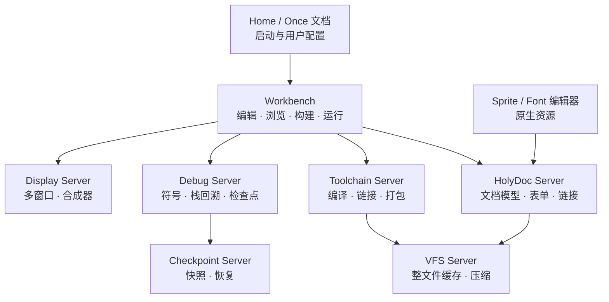
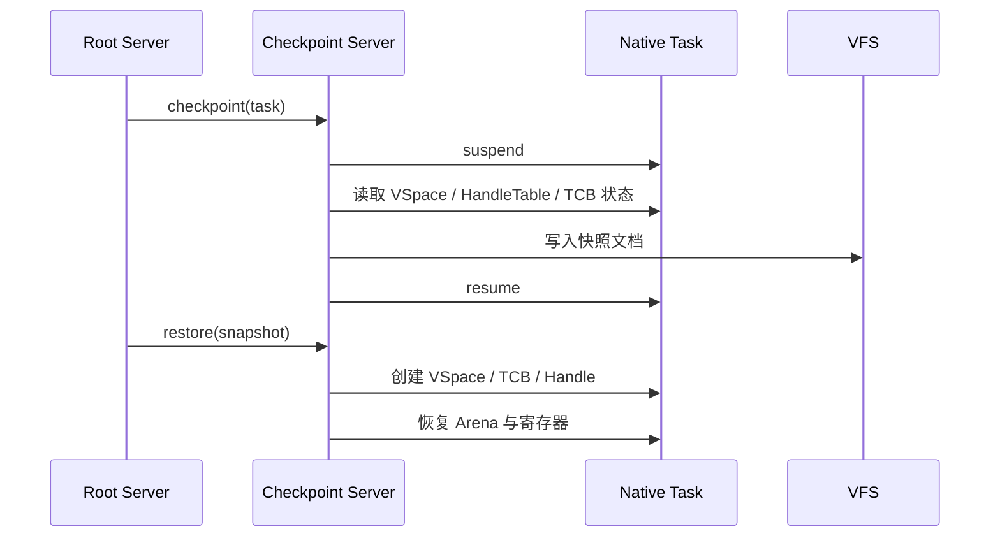

# Holy 原生体验

状态：**设计中** · 上级：[总体架构](architecture.md)

本文定义 HolyKernel 的原生体验层：HolyDoc、Workbench、系统内工具链、Task 命名空间、整文件缓存、Checkpoint、符号化调试、Home/Once 启动文档、Sprite/Font 编辑器、文本回退、可增长栈与 Task 消息。

---

## 1. 设计目标

1. **文档即界面**：帮助、设置、表单、调试面板、源码浏览共用 HolyDoc。
2. **一个工作台**：编辑、浏览、构建、运行、调试在同一个原生应用里完成。
3. **系统内工具链**：编译、链接、打包、运行由 Toolchain Server 提供。
4. **Task 命名空间**：每个 Native Task 拥有符号表与父链；服务按 Task 作用域注册。
5. **整文件文档 I/O**：HolyDoc/原生文档整体读写、透明压缩、内容缓存；HolyFS 提供底层文件系统与 Document API。
6. **可检查点**：Native Task/Server 可 checkpoint/restore，支持快速重启与状态恢复。
7. **符号化调试**：Debug Server 把地址映射到源码、符号与 HolyDoc。
8. **Home/Once**：启动与用户配置是可执行文档。
9. **原生资源编辑**：Sprite/Font 编辑器内建，资源直接嵌入 HolyDoc。
10. **降级可用**：文本/串口回退路径可用；真彩色与可缩放字体（8×16 位图回退）保持一致。

---

## 2. 服务全景



---

## 3. HolyDoc 作为 UI 基底

HolyDoc 同时服务文档与原生 UI：

- **帮助**：符号、服务、POSIX 路径、调试信息都可链接到 HolyDoc。
- **设置**：系统设置以 HolyDoc 表单呈现，提交调用原生函数。
- **调试面板**：Task、TCB、VSpace、HandleTable、Endpoint 以 HolyDoc 表格/树展示。
- **源码浏览**：源码文档带语法高亮、符号链接、错误位置跳转。
- **可执行块**：`@exec` 在沙箱中运行，结果显示为只读块。
- **嵌入资源**：Sprite、Font、图像直接嵌入文档。

```text
@title("Task 7")
@table {
  name | HolyShell
  state | Running
  arena | 128 KiB
}
@link(task: 7, "打开窗口")
@exec { TaskStats(7) }
```

---

## 4. Workbench

Workbench 是原生一体化应用：

- 左侧：Task/服务树、文件树、符号列表。
- 中间：源码/HolyDoc 编辑器、表单、调试面板。
- 底部：构建输出、trace、错误列表。
- 支持多窗口：编辑器、文档、调试各开窗口；窗口由 Display Server 管理。
- 操作：打开、编辑、保存、构建、运行、调试、检查点、恢复。
- 与 POSIX 环境互通：可打开 VFS 路径，可启动 POSIX 程序；默认命令行走 HolyShell，POSIX 通过 `posix` 入口。
- 内置 HolyShell 面板：每个面板是一个 Native Task/Session，拥有独立命名空间、历史与当前 Task；原生命令、结构化输出、构建/调试/检查点命令。
- 已落地初始版本（`hk-server-workbench`）：表面/窗口经 Display 协议创建，三栏展示 `H:` 文档树、编辑器与输出；文档整篇读写，支持选中打开、字符编辑与保存；构建统计行与指令，运行求值 `@exec`，调试读取 Root 的最近异常回溯；`smoke --mode workbench` 验证。后续接入 Toolchain、Checkpoint 与多窗口面板。

---

## 5. Toolchain Server

```text
源文档 → 解析 → 类型检查 → 代码生成 → 链接 → 原生模块/应用
```

- 系统内编译：源码文档直接构建，工具链内建。
- **编译期执行**：`@build { ... }` 在构建阶段运行，生成表、资源、配置。
- **隐藏链接步骤**：用户看到“构建文档”，Toolchain Server 负责目标文件/链接细节。
- 产物：原生模块、静态/动态应用、资源包、HolyDoc 资产。
- 缓存：按源码哈希缓存构建产物，放在 VFS 中。
- 与 POSIX 工具链并存：POSIX 环境仍可使用常规 cc/make。

```text
@build {
  let table = GenerateTable();
  Write("build/table.bin", table);
}
```

---

## 6. Task 命名空间

- 每个 Native Task 拥有可选 **符号表**：服务名、函数、资源、调试符号。
- 名字解析沿父 Task 链向上，最终到 Root Server 的全局表。
- 服务注册是显式的：Task 启动时向父 Task 注册 Endpoint 与元数据。
- Handle 仍是访问凭据；符号表只负责名字解析与调试展示。
- Debug Server 用符号表做栈回溯、源码定位、HolyDoc 链接。

---

## 7. 整文件文档 I/O

- HolyDoc 与原生文档默认**整体读写**：一次读入、一次写回。
- 透明压缩：压缩后更大则存原始；压缩算法与长度写入元数据。
- 内容哈希：按哈希缓存与去重；VFS 缓存命中时零拷贝。
- 大文档使用显式 Stream；默认路径保持整文件语义。
- POSIX 文件仍按 ext2 语义；整文件缓存主要服务 HolyDoc/原生资产。

---

## 8. Checkpoint 与恢复



- Native Task/Server 可 checkpoint：VSpace 映射、Frame 内容、HandleTable 状态、TCB 寄存器、Arena。
- 已落地：捕获用户页内容（零页省略）并序列化为版本化快照；默认在 Root 内存恢复，`checkpoint.disk` 可写 `H:/Checkpoints` 分块并读回；设备、共享 Frame、COW 与线程任务暂不支持。
- 目标：快照写入 VFS；恢复时重建 Task 与 Handle。
- 用于快速重启、调试回放、升级前备份。
- POSIX 进程采用进程语义；Checkpoint 由 POSIX Server 按策略提供。

---

## 9. 符号化调试

- Debug Server 读取构建期符号表与 Task 符号。
- 内核只安装内核符号；原始异常现场经 `FAULT_EVENT` 投递给订阅端点，不在内核保存；服务符号留在 `.hkx` 镜像中，经 Root 控制按地址按需查询。
- 回溯过滤、符号化与展示由用户态 `hk-debug`/Debug Server 完成，`hk-dbg` 与 Workbench 复用同一实现。
- 地址 → 函数/行号 → 源码文档/HolyDoc 链接。
- 栈回溯显示 Task、TCB、HolyDoc 链接。
- 崩溃 dump 包含符号化栈与相关文档链接。

---

## 10. Home / Once / MakeHome

- **Home**：每个用户的启动文档与服务清单；定义默认 Workbench、窗口、服务。
- **Once**：首次启动执行一次，初始化 Home、字体、示例文档。
- **MakeHome**：重新生成 Home 的脚本/文档。
- 启动文档是可执行 HolyDoc；启动与配置集中在文档中。
- 已落地：Shell 启动时读取 `H:/Home` 并执行其中的 `@exec` 行；`H:/Once` 仅在首次启动执行，完成后写入 `H:/Once.done`，后续启动跳过。`@exec` 行直接交给 Shell 命令解析，因此可以启动服务、创建标签或写配置。
- POSIX 环境对应 `/etc/holy/`、`/home/<user>/`；原生环境对应 VFS 路径。

---

## 11. Sprite / Font 编辑器

- 原生 Sprite 编辑器：RGBA 真彩色、透明色、网格、复制/粘贴。
- Font 编辑器：可缩放字形 + 8×16 位图回退、字符映射、导入/导出。
- 资源保存为 HolyDoc 资产或原生文档，可直接嵌入页面。
- Workbench 内打开，支持撤销/重做与预览。

---

## 12. 文本回退与显示约束

- 帧缓冲可用：Display Server 多窗口 + 合成器。
- 文本回退：Console Service 使用串口/VGA 文本模式；Workbench 降级为行模式。
- sRGB 真彩色 + 主题、可缩放字体（8×16 位图回退）贯穿原生 UI。
- 文本层始终可用；像素层是可选增强。

---

## 13. 可增长栈

- Native Task 默认使用固定栈 + guard page。
- 可选可增长栈：栈错误触发 Fault Endpoint，Task 扩大映射并恢复执行。
- POSIX pthread 保持固定栈 + guard page，遵循常规 ABI。
- 可增长栈服务于原生 Task/服务；POSIX 栈保持固定语义。

---

## 14. Task 消息

- Endpoint 上增加调试/控制消息：`Ping`、`Stats`、`Suspend`、`Resume`、`Checkpoint`。
- Debug Server 与 Workbench 通过消息查询/控制 Task。
- 消息通过显式 Handle 授权。
- 应用可注册自定义消息处理器，用于脚本化与自动化。

---

## 15. 服务归属

| 句柄 | 服务 |
| --- | --- |
| 文档模型、表单、链接 | HolyDoc Server |
| 编辑/浏览/构建/运行 | Workbench |
| 编译/链接/打包/缓存 | Toolchain Server |
| 符号、栈回溯、调试 | Debug Server |
| 快照/恢复 | Checkpoint Server |
| 启动/用户配置 | Home / Once 文档 |
| 图形/字体资源 | Sprite/Font 编辑器 + Display Server |
| 整文件缓存/压缩 | VFS Server |
| Task 命名空间 | Root/POSIX Server + Native Task |

---

## 16. 保证

1. HolyDoc 是原生 UI 的统一文档模型。
2. Workbench 通过服务 Endpoint 使用 Handle；权限由 Handle 检查。
3. Toolchain Server 隐藏链接细节；构建产物按内容哈希缓存。
4. Task 符号表只负责名字解析与调试；访问凭据仍是 Handle。
5. 整文件文档 I/O 采用原子提交；大文档使用显式 Stream。
6. Checkpoint 快照包含 VSpace、HandleTable、TCB、Arena；恢复后句柄重新分配。
7. Debug Server 的所有操作需要显式 Handle。
8. Home/Once 是可执行文档；首次启动只执行一次。
9. 文本回退始终可用。
10. 可增长栈只用于原生 Task；POSIX 线程保持固定栈。

---

## 17. 测试策略

| 层级 | 测试 |
| --- | --- |
| Hosted 单元 | HolyDoc 解析、表单、Task 符号表、整文件缓存、压缩 |
| Hosted 模拟 | Workbench 服务调用、Checkpoint/restore、Debug 符号化 |
| QEMU | Toolchain 构建、Workbench 编辑/运行、Sprite/Font 编辑器 |
| 故障注入 | Checkpoint 中断、恢复失败、构建失败、符号解析失败 |
| 基准 | 构建时间、文档打开、缓存命中、Checkpoint/restore |

---

## 18. 相关文档

- [总体架构](architecture.md)
- [服务器](servers.md)
- [HolyDoc 与 UI](ui.md)
- [VFS](vfs.md)
- [POSIX 与 libc](posix.md)
- [工程策略](engineering.md)
