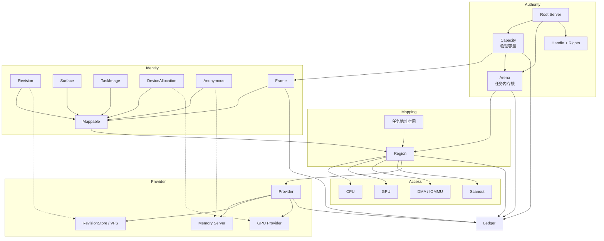
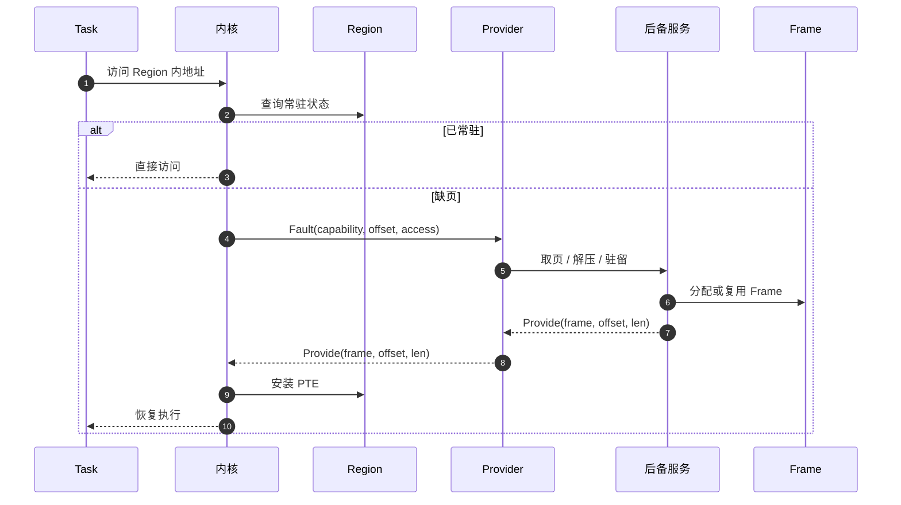
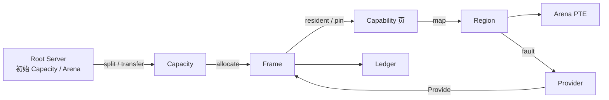

# Holy Memory Plane（HMP）

状态：**已接受** · 上级：[总体架构](architecture.md) · 决策：[ADR-0016](adr/0016-hmp-native-contract.md)

HMP 是 HolyKernel 的内存平面。内存在 Holy 原生对象图中是一等对象：`Arena` 承载任务内存，`Capacity` 授予物理容量，`Frame` 承载物理页，`Region` 把类型化能力映射进 Arena，`Provider` 提供页与回写，`Ledger` 记录容量与压力。

> **内存是 Holy 原生对象的能力映射平面。**

---

## 1. 原生判据

| 判据 | HMP 的体现 |
| --- | --- |
| 身份原生 | 每个对象有稳定标识：`ArenaId`、`CapacityId`、`FrameId`、`RegionId`，类型化能力以独立种类进入 Handle 图 |
| 权力原生 | Root Server 授予 Capacity 与 Arena；Handle + Rights 决定访问；DeviceGrant 约束设备 |
| 映射原生 | Region 是 Arena 中的唯一映射视图；CPU、GPU、DMA、scanout 共用同一路径 |
| 修订原生 | 文档内存按 `(DocId, RevisionId)` 组织；不可变修订可共享，写入产生新修订 |
| 契约原生 | Provider 按能力种类提供 fault、commit、scanout、pin、export、swap |
| 记账原生 | Ledger 记录容量、常驻、提交、峰值、配额与压力 |
| 统一原生 | 内核、Root Server、Memory Server、驱动与服务共享同一对象图与 Rights |
| 授予原生 | 初始 Handle 由服务清单授予；每一步只收窄 Rights |

---

## 2. 对象模型

| 对象 | 语义 | 关键操作 |
| --- | --- | --- |
| `Arena` | 任务的内存根；持有 Region 表、栈、堆与工作区 | create、map、grow、checkpoint、destroy |
| `Capacity` | 物理容量能力；按用途、页大小/order 与配额授予 | allocate、release、split、transfer |
| `Frame` | 连续物理页对象；带所属 Capacity、引用与 pin | map、phys、pin、export、transfer |
| `Region` | 类型化能力在 Arena 中的唯一映射视图 | map、unmap、protect、fault、grow |
| `Revision` | 不可变文档版本；按 `(DocId, RevisionId)` 寻址 | map、commit、snapshot、writeback |
| `Surface` | 像素缓冲与 scanout 状态 | map、damage、resize、scanout |
| `TaskImage` | Native Task 的代码与只读数据区域 | sealed map、execute |
| `DeviceAllocation` | 显存或 DMA 内存分配 | map、pin、export/import、residency |
| `Anonymous` | 页面初始为零的匿名能力 | map、grow、truncate、compress、swap |
| `Frame` | 物理页能力 | map、phys、pin、export |
| `Provider` | 类型化能力的缺页、回写与驻留服务 | fault、provide、evict、writeback |
| `Ledger` | 容量与使用记账 | charge、release、pressure、query |

---

## 3. Arena

Arena 是任务内存的根对象。

- 每个 Task 有一个 Arena；Arena 绑定该任务的地址空间。
- Arena 保存 Region 表、用户栈、堆与工作区；栈与堆都是 Arena 内的 Region。
- Arena 从 Capacity 取得 Frame；Arena 自身计入任务 Ledger。
- Arena 操作：`map`、`unmap`、`grow`、`checkpoint`、`restore`、`destroy`。
- 任务退出时销毁 Arena，解除全部 Region 并归还 Frame；pinned Frame 先解除 pin。
- Arena 属于单个任务；跨任务共享使用 `Capacity`、`Frame` 或 `Capability`，接收方在自己的 Arena 中创建 Region。
- 内核自身持有 System Arena；内核页表、栈与对象元数据都是 Arena 中的 Region。

Arena 让“任务内存”成为可枚举、可检查点、可记账的单一对象；地址空间只是 Arena 的一个属性。

---

## 4. Capacity

Capacity 是物理容量的授予单位。

- 声明用途：`System`、`User`、`Dma`、`Gpu`、`Numa`。
- 声明页大小与 order；4 KiB 为起始档位，16 KiB、64 KiB、2 MiB、1 GiB 由 Capacity 拓扑与 Frame order 表达。
- 声明配额、可回收属性与所属 Ledger。
- `allocate` 生成 Frame；`release` 归还 Frame；`split` 生成子 Capacity；`merge` 把已清空的子 Capacity 并回父容量；`transfer` 转移 Handle。
- Capacity 是记账边界：所有 Frame、Arena、Region 与对象元数据最终计入某个 Ledger。
- Root Server 持有初始 Capacity；Memory Server 持有 User Capacity，驱动持有 Dma/Gpu Capacity，内核持有 System Capacity。
- 物理空闲表只有一份：Capacity 是 `PhysicalBackend` 之上的配额视图，按 `CapacityId` 归因。`split` 切出的子容量拥有自己的窗口，`merge` 把它并回父窗口；未注册后端时 Capacity 退回自带的窗口分配器（Hosted 与单元测试）。
- 用量 `used` 只统计已分配的 Frame，切出或并回窗口本身不计入用量，两条分配路径语义一致。
- 后端是窗口归属的权威：子容量仍有未归还的分配、或窗口与容量不匹配时，`merge` 返回错误而不是静默成功；一个容量可能因不相邻合并持有多个窗口，`split` 从未被占用尾部空闲的窗口切出。

---

## 5. Frame

Frame 是唯一的物理内存对象。

- 带 `FrameId`、所属 Capacity、页大小/order、引用与 pin 状态。
- 引用来源：Region 的常驻页、DMA/scanout pin、显式 export。
- 最后一个引用归还 Capacity，归还前清零。
- pinned Frame 保持驻留，用于 DMA、scanout 与设备导出。
- Frame 可被任何类型的 Region 引用；Revision、Surface、TaskImage、DeviceAllocation、Anonymous 的物理页都由 Frame 承载。
- Frame 可导出给 IOMMU/GPU；导出转移引用，物理页保持单份。

---

## 6. Region

Region 是类型化能力在 Arena 中的唯一映射视图。

- 引用：`Mappable`、offset、len、rights、flags。
- 标志：`COW`、`GUARD`、`PINNED`、`SEALED`、`DONT_FORK`、`GROW`。
- 权利：`READ`、`WRITE`、`EXECUTE`；W^X 在创建与 protect 时检查。
- Region 是虚拟地址分配、缺页、COW 与保护的单元。
- CPU、GPU、DMA、scanout 都通过 Region 访问。
- 内核页表是 Region 的物化；Region 是唯一映射视图。
- unmap 释放 Region；所引用的类型化能力继续持有对象。

---

## 7. 类型化能力

### Revision

- 身份：`(DocId, RevisionId)`；路径与目录是 VFS 的命名视图。
- 操作：只读 map、commit、snapshot、writeback。
- 内容由 Extent 组成；Revision 不可变；写入产生新 Revision。
- `sealed` 修订只读、可共享；既有 Region 继续指向既有修订。
- Provider：RevisionStore / VFS；页缓存按修订组织。

### Surface

- 像素缓冲 + 格式 + stride + 尺寸 + damage/scanout 状态。
- 操作：map、damage、resize、scanout。
- 窗口是合成器对象，引用一个或多个 Surface。
- scanout 开启即 pinned；关闭时解除。
- Provider：Display / GPU。

### TaskImage

- Native Task 镜像（HKX）中的代码、只读数据与数据区域。
- 操作：sealed map、execute。
- 区域 sealed：拒绝写权限；需要改写的数据走 Revision 或 COW。
- Provider：Image Loader / Root Server；代码页通常已常驻。

### DeviceAllocation

- 承载显存与 DMA 内存；从 DeviceGrant 或 GPU Capacity 分配。
- 操作：map、pin、export/import、residency。
- Provider：GPU / 设备驱动；负责 residency、eviction、pin/unpin、IOMMU。
- MMIO 寄存器由 DeviceGrant 的设备映射路径处理；CPU 侧映射以 Region 为视图。

### Anonymous

- 页面初始为零；Provider 提供后备。
- 操作：map、grow、truncate、compress、swap。
- 用于共享零页、IPC 缓冲与独立匿名对象；任务栈、堆与工作区由 Arena 承载。
- Provider：Memory Server。

### Frame

- 物理页能力；map、phys、pin、export。
- 用于 IPC、DMA、共享缓冲与 scanout；页已常驻，Provider 契约省略。
- `SYS_FRAME_MAP` 直接把 Frame 建为 Region；Region 持有 Frame 句柄，解除时关闭句柄并归还 Capacity。

---

## 8. Provider

Provider 是类型化能力的缺页、回写与驻留服务，通过 Endpoint 交互。

- `Fault { capability, offset, access, region }`：请求页。
- `Provide { frame, offset, len }`：返回 Frame 或既有映射。
- `Evict` / `Writeback` / `Error`：驱逐、回写、错误。
- 批量、预读、fault token 与异步回写属于契约细节。
- `RevisionProvider`：fault、readahead、writeback、commit、snapshot、gc。
- `SurfaceProvider`：residency、scanout、damage、resize、pin。
- `ImageProvider`：load、seal、execute。
- `DeviceProvider`：residency、eviction、pin、export/import、IOMMU。
- `AnonymousProvider`：zero-fill、COW、compress、swap、grow。

内核快速路径：

1. 已常驻页：查页表并返回，零 IPC。
2. 默认 Provider 为空的 Anonymous：安装零页；匿名 COW 由内核复制 Frame。
3. 已绑定 Provider 的能力：缺页一律转发 Provider；Provider 失败按缺页故障处理。

文件缓存、压缩、swap、GPU 驻留与镜像装载策略属于 Provider；内核只实现页表安装、权限检查、COW 快速路径与 Frame 安装。

---

## 9. 缺页与 COW

- **COW 契约**：`RegionFlags::COW` 是唯一状态；页表只表达只读/可写权限与 Frame 安装。
- **匿名 COW**：默认 Provider 为空的 Anonymous 由内核快速路径复制 Frame。
- **文件/设备 COW**：绑定 Provider 的能力把复制、共享或拒绝交给 Provider。
- **fork**：复制 Arena 的 Region 表；可写 Region 标 COW，共享对象增加 Frame 引用。
- **Guard**：Region 标记 GUARD，命中即 fault；由 Provider/策略决定终止或扩展。
- **Pinned**：scanout/DMA Frame 保持驻留；回收策略跳过 pinned Frame。

---

## 10. Revision-aware page cache

HMP 的文件页缓存以修订为中心。

- 身份：`(DocId, RevisionId, Extent range)`；路径与目录是 VFS 视图。
- 不可变 Revision 的页只读、可共享、可跨进程映射。
- 读路径与映射共享同一份常驻 Frame；同一修订只有一份常驻页。
- 写入产生新 Revision / COW 页；`commit` 切换 head。
- 既有 Revision 的 Region 仍可被既有视图持有；达到回收条件后释放。
- RevisionStore 负责 readahead、writeback、脏页与既有修订回收。

---

## 11. Ledger

Ledger 是容量与内存使用的显式记账对象。

- 记录容量、常驻、提交、峰值、软/硬上限与压力状态。
- 每个 Capacity、Arena、Region、类型化能力与 Task 都有关联 Ledger。
- 内核执行硬上限；超过配额的申请失败。
- 记账随 Handle 转移：发送方归还，接收方按能力大小重新记账；接收方超配额则拒绝。
- 关闭 Handle 归还记账；设备授权与 DMA 窗口同样计入任务配额。
- 池紧张时内核回收可证明为零的匿名页，解除映射并归还 Frame，然后重试一次；再次缺页装入的仍是零页。
- 回收范围限于可回收匿名页：内容为零、pin 已解除、驻留状态为可丢弃；pinned Frame 与 Provider 提供的页由驻留策略保留。
- Debug/Checkpoint 可以枚举 Ledger；内核 System Capacity 同样记账。

---

## 12. 统一能力面与授予面

- ABI 对所有持权服务统一开放 `Arena`、`Capacity`、`Frame`、`Region`；调用只校验 `Handle + Rights + ObjectKind`。
- 初始授予由 Root Server 的服务清单决定：

| 持有者 | 初始授予 |
| --- | --- |
| Root Server | System / User / Dma / Gpu 顶层 Capacity；初始 Arena |
| Memory Server | User Capacity 子集；Anonymous Provider 绑定权 |
| 驱动服务 | Dma/Gpu Capacity 子集；DeviceGrant；Frame 的 pin/export |
| VFS / HolyFS | User Capacity 子集或 Memory Server 的 Capability；Revision Provider |
| Display / UI | Framebuffer/Surface Capability；Frame 的 map/pin |
| 普通服务 | 自己的 Arena；TaskImage/Anonymous/栈 Region；共享时取 Capability 或经 IPC 接收 Frame |
| Debug / Checkpoint | Arena/Capacity/Frame/Region/Ledger 的只读枚举 Handle |

- 普通服务持有 Region 是授予策略；任何服务只要收到 Arena/Capacity/Frame Handle，就使用同一组对象操作。
- `Region` 属于一个 Arena；跨任务共享使用 `Capacity`、`Frame` 或 `Capability`。

### Rights

| 对象 | READ | WRITE | EXECUTE | TRANSFER | ADMIN |
| --- | --- | --- | --- | --- | --- |
| `Arena` | 查询 Region 与 Ledger | map/grow/unmap | 执行 TaskImage | — | checkpoint、restore、destroy |
| `Capacity` | 查询容量与 Ledger | 分配/归还 Frame | — | 转移 Capacity | 拆分、配置、绑定 Provider |
| `Frame` | 映射只读 | 映射可写、pin/unpin | 映射可执行 | 转移、export/import | 配置导出与驻留 |
| `Region` | 映射只读 | 映射可写 | 映射可执行 | — | protect、unmap |
| `Capability` | 只读映射、查询 | 可写映射 | 可执行映射 | 转移 Capability | 绑定 Provider、scanout、pin |

---

## 13. 安全与可观测性

- 访问权在 Handle/Region 上；映射时持有对应类型化能力或 Frame 的 Handle。
- W^X、NX、guard、ASLR 在 Region/页表层执行；设备页默认按 NX 映射。
- 释放清零；Frame 回 Capacity 前清空敏感内容。
- 设备内存通过 DeviceGrant/IOMMU 约束；设备访问范围由授权 Frame 决定。
- Debug Server 枚举 Arena、Capacity、Frame、类型化能力、Region、Provider 与 Ledger。
- Checkpoint Server 按 Handle 图捕获 Arena、Region、Frame 与 Ledger。
- 内存压力、配额与 OOM 决策可审计。

---

## 14. 多架构机制边界

HMP 的对象与 ABI 与架构无关。以下只作为机制出现在包装 crate 内部：

- 页表格式与遍历：`page_table_multiarch` / `page_table_entry`。
- 固件描述：`acpi` / `hermit-dtb`。
- UEFI 引导：`uefi`。
- 架构原语：`x86_64` / `aarch64-cpu`。
- MMIO 寄存器：`volatile-register`。

对外只出现 `Arena / Capacity / Frame / Region / Capability / Provider / Ledger / Mappable / Handle / Rights`。

---

## 15. 不变量

1. 每个 Region 引用一份 `Mappable` 能力、offset、len 与 rights。
2. 每个 Region 属于一个 Arena；跨任务共享通过 `Capacity`、`Frame` 或 `Capability`。
3. 每个 Frame 来自一个 Capacity；每次分配计入 Ledger。
4. 每个 Arena 从 Capacity 取得 Frame；任务退出时整体回收。
5. 不可变 Revision 的 Region 是 sealed；写入产生新 Revision。
6. Region 是唯一访问路径；CPU/GPU/DMA/scanout 统一走 Region。
7. 类型化操作只接受匹配的能力；能力层拒绝错误类型。
8. Provider 是 Endpoint；文件系统、swap、GPU 策略由用户态服务实现。
9. 对象、Arena、Region、Ledger 都可枚举、可检查点。
10. 页大小/order 属于 Capacity/Frame。
11. pinned Frame 保持驻留；用于 DMA、scanout。
12. 内核与用户态服务共享同一组 HMP 对象、Rights 与 Ledger 规则；内存授权由 Handle、Rights 与 ObjectKind 决定。

---

## 16. 术语

| 术语 | 定义 |
| --- | --- |
| **HMP** | Holy Memory Plane；Holy 原生对象图的内存平面 |
| **Arena** | 任务的内存根；持有 Region 表、栈、堆与工作区 |
| **Capacity** | 物理容量能力；授予、拆分、配额与 Frame 分配 |
| **Frame** | 连续物理页对象；带 FrameId、所属 Capacity、引用与 pin |
| **Region** | 类型化能力在 Arena 中的唯一映射视图 |
| **Capability** | Revision、Surface、TaskImage、DeviceAllocation、Anonymous、Frame 的类型化能力 |
| **Provider** | 缺页、回写、驱逐与驻留的 Endpoint 服务 |
| **Ledger** | 容量、常驻、提交、配额与压力的显式记账 |
| **Mappable** | Region 可引用的统一能力接口 |
| **铸造链** | Root Server → Capacity → Frame → Capability → Region → PTE |
| **授予面** | Root Server 服务清单决定的初始 Arena/Capacity/Frame/Capability |
| **sealed** | 只读共享、拒绝写入的对象/Region 状态 |
| **pin** | 固定 Frame，保持驻留；用于 DMA、scanout |
| **COW** | 写时复制；写入时产生私有页或新修订 |
| **provenance** | 类型化能力的身份来源：Revision/Surface/TaskImage/Device/Anonymous/Frame |
