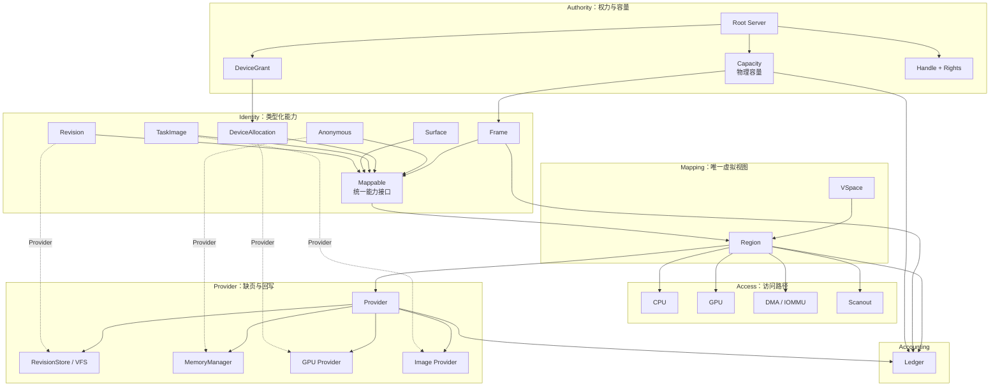
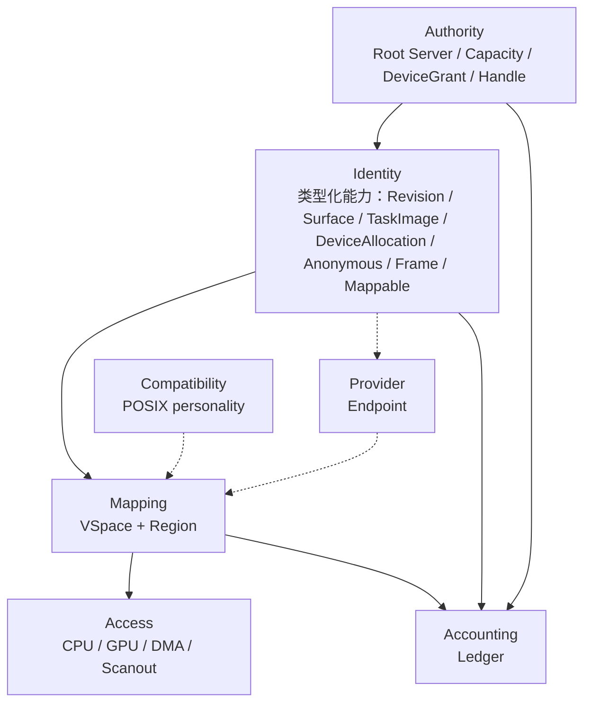
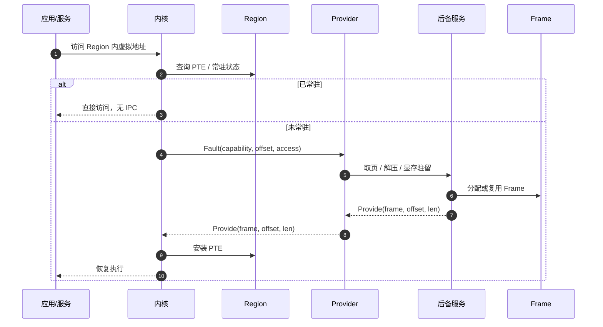
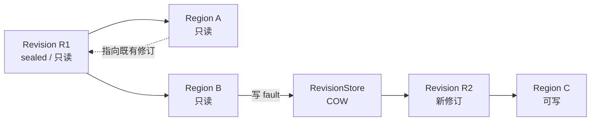

# Holy Memory Plane（HMP）

状态：**设计中**（Anonymous 能力、Provider 缺页与 Ledger 记账已在 x86_64 落地） · 上级：[总体架构](architecture.md)

HMP 是 HolyKernel 原生对象图的内存平面。`Region` 提供统一映射入口；Revision、Surface、TaskImage、DeviceAllocation、Anonymous、Frame 以类型化能力暴露，Provider 承担各自的缺页、回写与驻留语义。

本文定义模型与语义；实现顺序与迁移步骤由后续文档定义。

---

## 1. 定位

HMP 把内存组织为 Holy 原生对象的能力映射平面：

> **内存是 Holy 原生对象的能力映射平面。**

- 文档修订、Surface、任务镜像区域、设备分配、匿名内存、物理页以类型化能力进入 HMP。
- `Mappable` 是内核可见的统一能力接口；类型化能力实现 `Mappable`。
- `Region` 表示“一份类型化能力的一段被映射进某个 VSpace”。
- 缺页、回写、压缩、交换、显存驻留由用户态 `Provider` 提供。
- 容量、配额、压力由 `Capacity` 与 `Ledger` 表达。

---

## 2. 目标与边界

### 目标

1. **Holy 原生身份**：Revision、Surface、TaskImage、DeviceAllocation、Anonymous、Frame 以类型化能力承载身份、Provider 与生命周期。
2. **能力优先**：容量、映射、设备访问都通过 Handle 与权利表达。
3. **类型化操作**：commit、scanout、execute、pin、export、swap 分别只对对应能力开放。
4. **Revision 一等公民**：文件内存按修订组织；不可变修订可共享，写入产生新修订。
5. **用户态策略**：文件、匿名、压缩/交换、GPU 都由 `Provider` Endpoint 提供；内核实现页机制与映射快速路径。
6. **桌面可用**：按需分页、page cache、COW、压缩/交换、GPU 内存、配额、压力、安全。
7. **动态伸缩**：同一套模型覆盖数百 MiB 到数十 GiB；容量、页大小、Provider、Ledger 是启动期/运行期策略。
8. **可观测、可检查点**：对象、Region、Ledger 都可枚举，状态集中在 Handle 图。
9. **POSIX 在适配层**：`mmap`/`brk`/`fork` 由 personality 在 HMP 之上实现。

### 边界

- POSIX 地址空间语义由 personality 实现。
- HMP 的对象分类由 Holy 原生对象定义。
- 容量、页大小、Arena 与窗口由 Capacity/Region 策略决定。
- 具体 syscall、crate 结构与迁移阶段由后续文档定义。

---

## 3. Holy 原生判据

| 判据 | HMP 的体现 |
| --- | --- |
| 身份原生 | 每类对象以独立类型化能力暴露：`Handle<Revision>`、`Handle<Surface>`、`Handle<TaskImage>`、`Handle<DeviceAllocation>`、`Handle<Anonymous>`、`Handle<Frame>` |
| 权力原生 | Root Server 授予 Capacity；DeviceGrant 约束设备；Handle + Rights 约束访问 |
| 修订原生 | Revision 按 `(DocId, RevisionId)` 组织；sealed 修订只读共享；写入产生新修订 |
| 映射原生 | Region 是唯一访问路径；CPU/GPU/DMA/scanout 统一走 Region |
| 契约原生 | Provider 按类型提供 fault、commit、scanout、pin、export、swap 契约 |
| 操作原生 | commit、scanout、execute、pin、export、swap 按能力类型授权 |
| 记账原生 | Ledger 显式记录容量、常驻、配额与压力，可被 Debug/Checkpoint 枚举 |
| 动态原生 | 容量、页大小、Provider、Ledger 均由策略决定 |

---

## 4. 对象模型

| 对象 | 类型化能力 | Provider 契约 | 关键操作 |
| --- | --- | --- | --- |
| `Capacity` | `Handle<Capacity>` | 无 | 分配 Frame、拆分、配额 |
| `Frame` | `Handle<Frame>` | 无 | map、phys、pin、export |
| `Revision` | `Handle<Revision>` | `RevisionProvider` | 只读 map、commit、snapshot、writeback |
| `Surface` | `Handle<Surface>` | `SurfaceProvider` | map、damage、resize、scanout |
| `TaskImage` | `Handle<TaskImage>` | `ImageProvider` | sealed map、execute |
| `DeviceAllocation` | `Handle<DeviceAllocation>` | `DeviceProvider` | map、pin、export/import、residency |
| `Anonymous` | `Handle<Anonymous>` | `AnonymousProvider` | map、grow、truncate、compress、swap |
| `Region` | 映射对象 | 所引用能力的 Provider | map、unmap、protect、COW |
| `Provider` | Endpoint 服务 | 类型化契约 | fault、provide、evict、writeback |
| `Ledger` | 记账对象 | 无 | charge、pressure、query |

---

## 5. 层次

- **Authority**：决定“谁可以拥有多少内存、可以映射什么”；容量通过 Capacity/Handle 表达。
- **Identity**：类型化能力承载对象身份；每类能力实现 `Mappable` 接口。
- **Mapping**：Region 是唯一视图；权利、COW、guard、pin、sealed 都在这一层。
- **Access**：CPU、GPU、DMA、scanout 统一走 Region。
- **Provider**：按能力类型实现契约，提供页、回写、驱逐。
- **Accounting**：Ledger 记录容量、常驻、提交、配额、压力。
- **Compatibility**：POSIX 语义在 HMP 之上实现，位于内核核心之外。

---

## 6. 对象语义

### 6.1 Mappable 与类型化能力

- 内核提供 `Mappable` 能力接口：`size`、`page_size`、`provider`、`map`、`fault`。
- 每类原生对象以独立类型化能力暴露：`Handle<Revision>`、`Handle<Surface>`、`Handle<TaskImage>`、`Handle<DeviceAllocation>`、`Handle<Anonymous>`、`Handle<Frame>`。
- `Region` 引用一份 `Mappable` 能力 + offset + len + rights。
- 类型化操作接受匹配的能力：`commit` 接受 Revision，`scanout` 接受 Surface，`execute` 接受 TaskImage，`pin/export` 接受 Surface/DeviceAllocation，`grow/swap` 接受 Anonymous，`phys` 接受 Frame。
- Provider 契约按类型定义；能力层校验对象种类，内核实现 Region 映射与快速缺页。

### 6.2 Capacity

Capacity 是 Root Server 授予的物理容量能力。

- 声明页大小、order、用途（system / user / dma / gpu / NUMA）、配额、可回收属性。
- Frame 从 Capacity 分配；Capacity 可以拆分给子 Capacity，也可以随内存热插拔增加。
- Capacity 是记账边界：所有 Frame、Region、对象元数据最终都计入某个 Ledger。
- 服务通过自己的 Capacity 观察和管理内存容量。

### 6.3 Frame

Frame 是连续物理页，唯一的物理内存能力。

- 带 `order/page_size/capacity`、状态与引用计数。
- 可映射、pin、转移、导出给 IOMMU/GPU。
- 引用来自：Region 的常驻页、DMA/scanout pin、显式 export。
- 引用归零时回 Capacity；pinned Frame 保持驻留，用于 DMA/scanout。

### 6.4 类型化能力

#### Revision

- 身份由 `(DocId, RevisionId)` 确定；路径与 inode 是 VFS 视图。
- 能力：`Handle<Revision>`；操作：只读 map、commit、snapshot、writeback。
- 内容由若干 Extent 组成；Revision 本身不可变。
- `sealed` 修订只读、可共享；写入产生新 Revision，既有 Region 继续指向既有修订。
- Provider：RevisionStore / VFS；页缓存按修订组织。
- 典型用途：文件 `mmap`、共享只读文档、编辑器既有修订视图。

#### Surface

- 能力：`Handle<Surface>`；操作：map、damage、resize、scanout。
- 像素缓冲 + 格式 + stride + 尺寸 + damage/scanout 状态。
- 窗口是合成器对象，引用一个或多个 Surface。
- Provider：Display / GPU；scanout 时 pin 住。
- 典型用途：窗口内容、光标、任务栏、桌面背景、GPU 纹理/合成目标。

#### TaskImage

- 能力：`Handle<TaskImage>`；操作：sealed map、execute。
- 原生任务镜像（HKX）中的代码/只读数据/数据区域。
- TaskImage 是 Native Task 镜像区域；ELF 是编译中间产物。
- 装载后通常 sealed：代码只读/可执行，数据页可 COW。
- Provider：Image Loader / Root Server；代码页通常已 resident。
- 典型用途：服务启动映射代码段、共享镜像 text 页。

#### DeviceAllocation

- 能力：`Handle<DeviceAllocation>`；操作：map、pin、export/import、residency。
- 从 DeviceGrant 或 GPU Capacity 分配的显存/DMA 内存。
- DeviceAllocation 承载显存/DMA 内存；MMIO 寄存器由 DeviceGrant 的设备映射路径处理。
- Provider：GPU / 设备驱动；负责 residency、eviction、pin/unpin、IOMMU。
- 可被 CPU、GPU、DMA、scanout 映射，也可 export/import 给其他进程或设备。
- 典型用途：纹理、render target、scanout buffer、网卡/块设备 DMA 缓冲。

#### Anonymous

- 能力：`Handle<Anonymous>`；操作：map、grow、truncate、compress、swap。
- 页面初始为零，由 MemoryManager 提供后备。
- 支持按需零页、COW、压缩、swap、增长/截断。
- 典型用途：用户栈、堆/Arena、匿名 `mmap`、IPC 缓冲。
- `malloc` 在 Anonymous Region 之上实现；堆本身是 Anonymous 的 Region。

#### Frame

- 能力：`Handle<Frame>`；操作：map、phys、pin、export。
- 物理页对象，可以直接被 Region 映射。
- 用于 IPC、DMA、共享缓冲；无 Provider（已 resident）。
- Frame 是物理页对象；Revision/Surface/TaskImage/DeviceAllocation/Anonymous 的物理页由 Frame 承载。

### 6.5 Region

Region 是类型化能力在 VSpace 中的唯一视图。

- 引用：`mappable`、`offset`、`len`、`rights`、`flags`。
- 标志：`COW`、`GUARD`、`PINNED`、`SEALED`、`DONTFORK`、`GROW`。
- 权利：`READ`、`WRITE`、`EXECUTE`；W^X 在创建/保护时检查。
- Region 是虚拟地址分配、缺页、COW、保护的单元。
- CPU、GPU、DMA、scanout 都通过 Region 访问。
- unmap 释放 Region，所引用的类型化能力继续持有对象。

### 6.6 Provider

Provider 是类型化能力的缺页/回写/驱逐服务，通过 Endpoint 协议交互。

- `Fault { capability, offset, access, region }`：请求提供页。
- `Provide { frame, offset, len }`：返回 Frame 或已有映射。
- `Evict` / `Writeback` / `Error`：驱逐、回写、错误。
- 支持批量、预读、fault token；一次 IPC 可以处理多页。
- `RevisionProvider`：fault、readahead、writeback、commit、snapshot、gc。
- `SurfaceProvider`：residency、scanout、damage、resize、pin。
- `ImageProvider`：load、seal、execute。
- `DeviceProvider`：residency、eviction、pin、export/import、IOMMU。
- `AnonymousProvider`：zero-fill、COW、compress、swap、grow。
- 内核实现快速路径（已常驻、匿名 COW）和页表安装；文件系统、swap、GPU 策略由 Provider 实现。
- 快速路径只为未绑定 Provider 的能力服务；能力一旦绑定 Provider，该 Region 的缺页一律转发给 Provider。
- Provider 回复的页由内核装入 Region 并清零；Provider 失败按缺页故障处理，不回退到零页快速路径。
- Memory Server 承担匿名 Provider：按客户端请求分配匿名能力并把自身绑定为 Provider；Surface 等常驻类型经同一客户端分配带后备的能力。
- 用户态服务的 Surface、共享 Frame 与 VFS 缓冲统一经 Memory Server 客户端申请带后备的能力；HolyFS 解压缓存与 demo 自检走按需装入的匿名路径。

### 6.7 Ledger

Ledger 是容量与内存使用的显式记账对象。

- 记录：容量、常驻、提交、峰值、软/硬上限、压力状态。
- 每个 Capacity、Region、类型化能力、Task/Service 都有关联 Ledger。
- 内核在记账时执行硬上限；超过配额的能力申请返回失败。
- 记账随能力句柄转移：发送方在转移时归还，接收方按能力大小重新记账，接收方超配额则拒绝该句柄。
- 关闭能力句柄归还记账；设备授权与其 DMA 窗口同样计入任务配额。
- MemoryManager 根据软上限、前台/后台优先级、压力做回收/OOM 决策。
- Debug/Checkpoint 可以枚举 Ledger，内存记账集中在 HMP 对象图。

---

## 7. 缺页与 COW

- **已常驻**：内核查页表，零 IPC。
- **快速路径边界**：未绑定 Provider 的匿名能力由内核安装零页；绑定 Provider 的能力阻塞在缺页上等待 Provider 回复，Provider 失败按故障处理。
- **匿名 COW**：内核快速路径复制 Frame，一次处理一页，减少 IPC。
- **文件/设备 COW**：可委托 Provider 决定复制、共享或拒绝。
- **Guard**：Region 标记 GUARD，命中即 fault；由 Provider/策略决定终止或扩展。
- **驱逐**：Provider 请求内核 unmap/回收干净页；脏页先 writeback。
- **Pinned**：scanout/DMA Frame 保持驻留；回收策略跳过 pinned Frame。

### Revision 的 COW

---

## 8. Revision-aware page cache

HMP 的文件页缓存以修订为中心，不以 POSIX inode 为中心。

- 缓存键：`(DocId, RevisionId, Extent range)`。
- 不可变 Revision 的页只读、可共享、可跨进程映射。
- 读路径与 `mmap` 共享同一份常驻 Frame；不存在“文件缓存一份、mmap 一份”。
- 写入不原地修改 Revision，而是产生新 Revision / COW 页；`commit` 切换 head。
- 既有 Revision 的 Region 仍可被既有视图持有；达到回收条件后再释放。
- RevisionStore 负责 readahead、writeback、脏页、既有修订回收。
- 路径/目录只是 VFS 命名空间视图；内存身份始终是 Revision。

---

## 9. 桌面语义

HMP 面向桌面设备，但同一模型覆盖数百 MiB 到数十 GiB。

| 能力 | HMP 的做法 |
| --- | --- |
| Page cache | Revision 的常驻 Frame；读/写/mmap 共享 |
| 匿名内存 | Anonymous + MemoryManager；COW、压缩、swap |
| 共享内存 | Shared object + Region + Handle；零拷贝 |
| dma-buf | DeviceAllocation + export/import |
| GPU/显示 | Surface / DeviceAllocation + Provider；IOMMU；scanout pin |
| 配额/压力 | Ledger；硬上限由内核执行，软策略由 MemoryManager |
| 安全 | W^X、NX、guard、ASLR、SMAP/SMEP、KPTI、IOMMU、释放清零 |
| 页大小 | Capacity/Frame 声明；4K/16K/64K，大页用高阶 Frame |
| 休眠 | 后续在 Provider/Region 语义上定义，不进入核心模型 |

### 动态档位

| 设备 | Capacity 拓扑 | 页大小 | Provider 策略 | 服务 |
| --- | --- | --- | --- | --- |
| 256–512 MiB | 1 system + 1 小 user Capacity | 4K/16K | 压缩优先，无/极小 swap，积极回收 | 核心服务 |
| 1–2 GiB | 2–3 个 Capacity | 4K/16K | 压缩 + 小 swap，page cache 受限 | 核心 + 轻量 UI |
| 4–16 GiB | 多个 user Capacity | 4K/16K | page cache 较大，swap 可选 | 完整桌面 |
| 32–64 GiB | 多 Capacity / NUMA / VRAM | 4K/16K/2M/1G | 大 page cache，压缩/swap 可关，GPU 独立 | 完整桌面 + GPU |

---

## 10. 动态性

HMP 固定语义；容量由策略表达。

- Capacity 拓扑由 BootInfo、设备、NUMA 决定。
- Frame 按需分配；页大小/order 由 Capacity 决定。
- Region 按需映射；虚拟地址空间与物理容量解耦。
- Provider 可组合；压缩/swap/page cache/GPU 都是策略。
- Ledger 配额随设备档位调整；小设备紧，大设备宽。
- 服务集合由启动配置决定；核心服务 + 按需服务。
- 容量、页大小、Arena 与窗口由 Capacity/Region 表达。

---

## 11. 不变量

1. 每个 Region 引用一份 `Mappable` 能力、offset、len 与 rights。
2. 每类对象以独立类型化能力暴露，Handle 类型携带对象种类。
3. 每份类型化能力由对应 Provider 契约提供页，或者 sealed/resident。
4. 每个 Frame 来自一个 Capacity；每次分配计入 Ledger。
5. 不可变 Revision 的 Region 是 sealed；写入产生新 Revision。
6. Region 是唯一访问路径；CPU/GPU/DMA/scanout 统一走 Region。
7. 类型化操作只接受匹配的能力；能力层拒绝错误类型。
8. Provider 是 Endpoint；文件系统、swap、GPU、POSIX 策略由用户态服务实现。
9. 对象、Region、Ledger 都可枚举、可检查点，状态集中在 Handle 图。
10. 页大小/order 属于 Capacity/Frame。
11. pinned Frame 保持驻留；用于 DMA、scanout。
12. POSIX `mmap`/`brk`/`fork` 由 HMP 之上的 personality 实现。

---

## 12. 权限、安全与可观测性

- 访问权在 Handle/Region 上；映射时持有对应类型化能力或 Frame 的 Handle。
- W^X、NX、guard、ASLR 在 Region/页表层执行。
- 释放清零；Frame 回 Capacity 前清空敏感内容。
- 设备内存通过 DeviceGrant/IOMMU 约束；设备访问范围由授权 Frame 决定。
- Debug Server 可以枚举 Capacity/Frame/类型化能力/Region/Provider/Ledger。
- Checkpoint Server 按 Handle 图捕获类型化能力与 Region，状态集中在 HMP 对象图。
- 内存压力、配额、OOM 决策都可审计。

---

## 13. POSIX 适配

POSIX 是 HMP 之上的 personality。

- `mmap`：在 Anonymous / Revision / DeviceAllocation 上创建 Region。
- `brk`/`sbrk`：扩展 Anonymous 对象及其 Region。
- `mprotect`：修改 Region 权利；W^X 检查。
- `fork`：复制 Region 表，可写 Region 标 COW；共享对象增加引用。
- `exec`：装载 TaskImage，创建新的 Region 表。
- 文件路径/描述符：VFS 命名空间与 Handle 视图；内存身份仍是 Revision。
- 页错误信号/OOM：由 POSIX personality 在 Provider/Ledger 之上映射。

---

## 14. 与现有内核对象的关系

HMP 复用以下内核对象与语义：

- `Frame` 作为物理内存对象；
- `VSpace` 作为地址空间；
- `Handle` 与 Rights 作为访问凭据；
- `DeviceGrant` 与 IOMMU 约束设备内存；
- COW 作为写时复制机制。

HMP 将内存组织为类型化能力 + Mappable + Region + Provider + Ledger：

- Revision 成为一等内存身份；
- Surface、TaskImage、DeviceAllocation、Anonymous 通过 Mappable 与 Region 映射；
- 类型化能力承载对象身份与操作权限；
- Provider 按类型实现契约；
- Ledger 作为显式记账对象；
- Capacity 承载动态容量与配额。

---

## 15. 待定问题

以下属于模型层决策，留待后续 ADR：

- Page cache 放 VFS 服务还是内核/专用 cache 服务。
- 匿名 COW 是否始终走内核快速路径，还是允许 Provider 接管大对象。
- Provider 协议的批量、预读、fault token、异步回写细节。
- 32 位低端是否保留独立地址布局，还是桌面只做 64 位。
- GPU 用统一内存模型还是 VRAM/系统内存双 Capacity。
- Hibernation 是序列化对象/Region，还是只序列化匿名页与设备状态。
- 类型化能力在 ABI 中的表示：独立 Handle 类型，还是 Handle + kind 标签。
- Provider 契约的版本化与能力协商。
- `Mappable` 接口的 fault/map 边界：内核快速路径与 Provider 接管的划分。
- 命名最终采用 `Region` / `Mapping`、`Provider` / `Pager`、`Capacity` / `MemoryGrant` 中的哪一组。

---

## 16. 术语

| 术语 | 定义 |
| --- | --- |
| **HMP** | Holy Memory Plane；以 Region 统一映射、类型化能力承载身份的内存平面 |
| **Capacity** | Root Server 授予的物理容量能力 |
| **Frame** | 连续物理页；唯一的物理内存能力 |
| **FrameLease** | Frame 的持有租约；释放时归还 Capacity/DMA 池 |
| **类型化能力** | Revision、Surface、TaskImage、DeviceAllocation、Anonymous、Frame 各自以独立 Handle 类型暴露 |
| **Revision** | HolyFS 文档的不可变版本；按 `(DocId, RevisionId)` 寻址 |
| **Surface** | 像素缓冲与 scanout 状态；窗口引用它 |
| **TaskImage** | Native Task 镜像中的代码/数据区域；通常 sealed |
| **DeviceAllocation** | 显存/DMA 内存分配；MMIO 寄存器由 DeviceGrant 映射 |
| **Anonymous** | 由 MemoryManager 提供后备、页面初始为零的匿名内存 |
| **Region** | 类型化能力在 VSpace 中的唯一映射视图 |
| **Provider** | 缺页、回写、驱逐的 Endpoint 服务；契约按类型定义 |
| **Mappable** | 内核可见的统一能力接口；类型化能力实现它，由 Region 引用 |
| **Provider 契约** | 每类能力对应的 fault/commit/scanout/pin/export/swap 协议 |
| **Ledger** | 容量、常驻、配额、压力的显式记账对象 |
| **sealed** | 只读共享的对象/Region 状态 |
| **pin** | 固定 Frame，保持驻留；用于 DMA、scanout |
| **COW** | 写时复制；写入时产生私有页或新修订 |
| **provenance** | 类型化能力的身份来源：Revision/Surface/TaskImage/Device/Anonymous |
