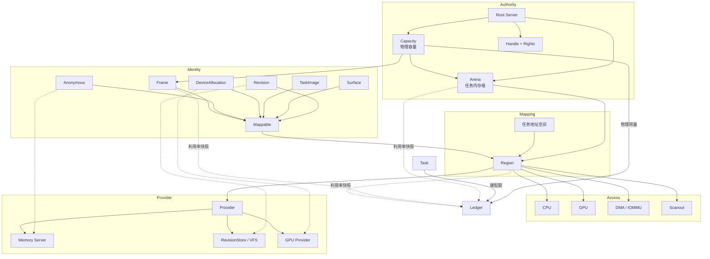
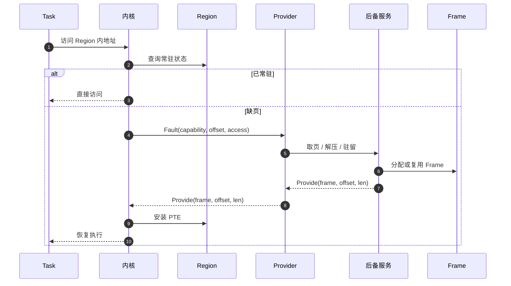
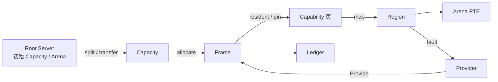

# Holy Memory Plane（HMP）

状态：**已接受** · 上级：[总体架构](architecture.md) · 决策：[ADR-0016](adr/0016-hmp-native-contract.md)

HMP 是 HolyKernel 的内存平面。内存在 Holy 原生对象图中是一等对象：`Arena` 承载任务内存，`Capacity` 授予物理容量，`Frame` 承载物理页，`Region` 把类型化能力映射进 Arena，`Provider` 提供页与回写，`Ledger` 记录容量与压力。

> **内存是 Holy 原生对象的能力映射平面。**

---

## 1. 原生判据

| 判据 | HMP 的体现 |
| --- | --- |
| 身份原生 | 每个对象有稳定标识：`ArenaId`、`CapacityId`、`FrameId`、`RegionId`，类型化能力以独立种类进入 Handle 图 |
| 权力原生 | Root Server 授予 Capacity 与 Arena；Handle + Rights 决定访问；DeviceGrant 约束设备 |
| 映射原生 | Region 是 Arena 中的唯一映射视图；CPU、GPU、DMA、scanout 共用同一路径 |
| 修订原生 | 文档内存按 `(DocId, RevisionId)` 组织；不可变修订可共享，写入产生新修订 |
| 契约原生 | Provider 按能力种类提供 fault、commit、scanout、pin、export、swap |
| 记账原生 | Ledger 记录容量、常驻、提交、峰值、配额与压力 |
| 统一原生 | 内核、Root Server、Memory Server、驱动与服务共享同一对象图与 Rights |
| 授予原生 | 初始 Handle 由服务清单授予；每一步只收窄 Rights |

---

## 2. 对象模型

| 对象 | 语义 | 关键操作 |
| --- | --- | --- |
| `Arena` | 任务的内存根；持有 Region 表、栈、堆与工作区 | create、map、grow、checkpoint、destroy |
| `Capacity` | 物理容量能力；按用途、页大小/order 与配额授予 | allocate、release、split、transfer |
| `Frame` | 连续物理页对象；带所属 Capacity、引用与 pin | map、phys、pin、export、transfer |
| `Region` | 类型化能力在 Arena 中的唯一映射视图 | map、unmap、protect、fault、grow |
| `Revision` | 不可变文档版本；按 `(DocId, RevisionId)` 寻址 | map、commit、snapshot、writeback |
| `Surface` | 像素缓冲与 scanout 状态 | map、damage、resize、scanout |
| `TaskImage` | Native Task 的代码与只读数据区域 | sealed map、execute |
| `DeviceAllocation` | 显存或 DMA 内存分配 | map、pin、export/import、residency |
| `Anonymous` | 页面初始为零的匿名能力 | map、grow、truncate、compress、swap |
| `Frame` | 物理页能力 | map、phys、pin、export |
| `Provider` | 类型化能力的缺页、回写与驻留服务 | fault、provide、evict、writeback |
| `Ledger` | 任务硬配额、物理用量与对象利用率快照 | charge、release、pressure、query |

---

## 3. Arena

Arena 是任务内存的根对象。

- 每个 Task 有一个 Arena；Arena 绑定该任务的地址空间。
- Arena 保存 Region 表、用户栈、堆与工作区；栈与堆都是 Arena 内的 Region。
- 装载器把镜像段与用户栈映射后登记为 Region；`SYS_ALLOC` 每次分配建立独立的惰性匿名 Region，Arena 的 Region 表是唯一的分配视图。
- Arena 从 Capacity 取得 Frame；物理页计入任务 Ledger，Arena 快照报告地址窗口利用率。
- Arena 由运行时持有，提供 Region 表的 `insert`、`resize`、`remove` 与 `used` 统计；`checkpoint`、`restore`、`destroy` 由运行时按 Region 元数据编排，Arena 提供 Region 元数据与地址窗口。任务通过 Region 操作使用 Arena 内的映射。
- 任务退出时销毁 Arena，解除全部 Region 并归还 Frame；pinned Frame 先解除 pin。
- Arena 属于单个任务；跨任务共享使用 `Capacity`、`Frame` 或 `Capability`，接收方在自己的 Arena 中创建 Region。
- `SYS_ARENA_INFO` 报告任务 Arena 的地址窗口：`base` 是基址，`size` 是窗口长度，`used` 是已登记 Region 的字节数，`regions` 是 Region 数。`SYS_ALLOC` 的可分配窗口与游标由 `TaskInfo.arena_size`/`arena_used` 报告；Arena 窗口包含镜像、栈与动态窗口映射，两套口径分别用于对象视图与分配配额。`SYS_ARENA_GROW` 以页对齐长度扩展 `SYS_ALLOC` 窗口，返回新窗口大小；`arg0 == 0` 时只查询当前大小。
- 内核自身持有 System Arena；内核镜像、direct map、内核堆、per-CPU 栈、MMIO 窗口、页表页与 IOMMU 表都以 Region 登记。用户地址空间的页表页（含检查点恢复建立的根与中间页表）也在分配时经 direct map 登记、地址空间释放时移除，因此枚举覆盖全部内核自用物理页。System Arena 覆盖内核高半区，物理页仍由 System Capacity/FrameBank 承载；`SYS_SYSTEM_ARENA_INFO` 报告窗口与 Region 统计，`SYS_SYSTEM_ARENA_REGIONS` 按索引枚举 Region（虚拟地址、长度、权利、标志）。
- 内核高半区的登记以页表实际权利为准：可执行段登记为 `TaskImage` + `READ|EXECUTE|SEALED|PINNED`，数据段、`.bss`、启动栈、per-CPU 栈与 direct map 数据视图登记为 `Anonymous` + `READ|WRITE|PINNED`；先登记的窗口优先，重叠的后续登记跳过。

Arena 让“任务内存”成为可枚举、可检查点、可记账的单一对象；地址空间只是 Arena 的一个属性。

---

## 4. Capacity

Capacity 是物理容量的授予单位。

- 声明用途：`System`、`User`、`Dma`、`Gpu`、`Numa(node)`。`Numa` 携带节点号；
  启动期从 ACPI SRAT 的内存邻近域建立拓扑，FrameBank 的空闲条目按节点边界
  切分，`SYS_CAPACITY_INFO` 报告绑定节点，`SYS_NUMA_INFO` 枚举物理邻近域。
  SLIT 提供节点距离矩阵：未显式指定节点时按当前 CPU 邻近域本地优先，失败按
  距离回退；`SYS_NUMA_MIGRATE` 可把能力的一段常驻页显式迁移到目标节点，迁移
  保留 Task Ledger，并解除全部进程的旧 PTE，下一次缺页按新 Frame 重建。
- `Gpu` 是 Capacity 用途；`DeviceAllocation` 从服务的分配 Capacity 取得后备，Gpu 服务由 Root 授予独立的 Gpu 子容量。懒 `DeviceAllocation` 由 Provider 在缺页时提供驻留 Frame，Provider 决定驻留、驱逐与 pin。
- 声明页大小与 order；4 KiB 为起始档位，16 KiB、64 KiB、2 MiB、1 GiB 由 Capacity 拓扑与 Frame order 表达。`SYS_CAPACITY_SPLIT` 的 `page_size` 参数在切分时指定页大小（0 继承父容量）；子容量窗口只保证 4 KiB 对齐，Frame 分配按声明的页大小对齐；窗口碎片导致的连续段不足按容量失败处理。
- 声明配额与可回收属性；物理用量由 Capacity/FrameBank 报告。
- `allocate` 生成 Frame；`release` 归还 Frame；`split` 生成子 Capacity；`merge` 把已清空的子 Capacity 并回父容量；`transfer` 转移 Handle。
- Task Ledger 是任务配额的唯一硬账；Capacity/FrameBank 是物理边界；Arena/Region/Capability/Frame 的 Ledger 快照只报告利用率。
- Root Server 持有初始 Capacity；普通服务与 Memory Server 共享顶层 User Capacity，设备授权服务取得独立的 Dma 子容量，Gpu 服务取得从顶层 Gpu Capacity 切出的子容量，内核持有 System Capacity。
- 物理空闲表只有一份：Capacity 是 `PhysicalBackend` 之上的配额视图，按 `CapacityId` 归因。`split` 切出的子容量拥有自己的窗口，`merge` 把它并回父窗口；未注册后端时 Capacity 退回自带的窗口分配器（Hosted 与单元测试）。

报告口径：

- `Capacity::limit` 是授予配额视图；Task Ledger 的 `limit` 是任务配额，创建时取自该任务分配 Capacity 的 `limit`；FrameBank Ledger 保持物理总量。三者口径不同：Capacity 配额随 `split` 扣减、随 `merge` 或析构恢复，Task Ledger 随任务分配/转移变化。
- 容量可以持有多个窗口（`grow` 或 `split` 产生）。`SYS_CAPACITY_INFO` 的 `start/len` 只表示首个窗口；完整列表用 `SYS_CAPACITY_WINDOWS` 枚举，每条记录为起始物理地址与长度。
- 子 Capacity 的 `limit` 是 `split` 时授予的硬上限：分配超过配额直接失败。配额内既有窗口缺少足够长的连续空闲段时，从父容量转移一段物理窗口再重试；两侧配额保持原值，连续段不足按容量失败处理。顶层 User Capacity 在启动时按可用物理内存切出，System 保留固定余量供内核堆与页表增长；`merge` 或析构把窗口与配额并回父容量。
- 容量树按代际归还：子容量切出的孙窗口仍由其孙容量持有时，`merge` 立即并回配额与子容量当前剩余窗口，孙窗口在孙容量析构（或并回）时沿父链补齐。
- 服务镜像段与用户栈从顶层 User Capacity 分配，按页映射并登记 Region；页表页由 System 承载。装载页计入任务 Ledger，容量窗口与物理归因记录在对应 Capacity。
- 对外报告分别使用 System quota 与 FrameBank/Ledger 物理总量两套名称。
- `SYS_FRAME_BANK_STATS` 返回 FrameBank 物理 `total/used/peak/free`、按 `CapacityKind` 的用量（System、User、Dma、Gpu、Numa）与按 NUMA 节点的用量；`SYS_LEDGER_ENUM` 返回每个 Capacity 的明细。对外统计使用 `CapacityKind`。

---

## 5. Frame

Frame 是唯一的物理内存对象。

- 带 `FrameId`、所属 Capacity、页大小/order 与 pin 状态。
- 引用就是句柄：Frame 的最后一个句柄关闭（或显式 `SYS_CAPACITY_FREE`）时归还 Capacity，归还前清零；映射由页表机制单独维护，共享状态由句柄引用表达。
- `SYS_FRAME_INFO` 的 `refs` 字段报告指向该 Frame 的句柄数。
- pinned Frame 保持驻留，用于 DMA、scanout 与设备导出。
- Frame 可被任何类型的 Region 引用；Revision、Surface、TaskImage、DeviceAllocation、Anonymous 的物理页都由 Frame 承载。
- Frame 可导出给 IOMMU/GPU；导出转移引用，物理页保持单份。
- `FrameKind` 只作为 FrameBank 内部分配用途标签（内核堆、页表、COW、恢复、镜像等），用于判断页能否回收；对外统计使用 `CapacityKind`。

---

## 6. Region

Region 是类型化能力在 Arena 中的唯一映射视图。

- 引用：`Mappable`、offset、len、rights、flags。
- 标志：`COW`、`GUARD`、`PINNED`、`SEALED`、`DONT_FORK`、`GROW`。
- 权利：`READ`、`WRITE`、`EXECUTE`；W^X 在创建与 protect 时检查。
- `EXECUTE` 只允许 `TaskImage` 与 `Frame` 能力；`GROW` 只允许 `Anonymous`。
- `SEALED` 与 `COW` 是单向状态：protect 可以收紧或保持，两种标志保持置位。
- Region 是虚拟地址分配、缺页、COW 与保护的单元。
- CPU、GPU、DMA、scanout 都通过 Region 访问。
- 内核页表是 Region 的物化；Region 是唯一映射视图。
- `SYS_REGION_PROTECT` 的权限上限是被映射能力句柄的 Rights：可在句柄范围内调整；只读能力句柄的映射权限保持只读。
- `PINNED` 在映射或 protect 时固定能力（需要 `Capability` 的 ADMIN），解除映射时解除固定；scanout 驻留期间拒绝解除。
- Region 句柄属于创建它的任务，不参与 `SYS_HANDLE_DUPLICATE` 或 IPC 转移；`unmap`/`grow` 校验 Region 句柄的 ADMIN。
- unmap 释放 Region；所引用的类型化能力继续持有对象。

---

## 7. 类型化能力

### Revision

- 身份：`(DocId, RevisionId)`；路径与目录是 VFS 的命名视图。
- 操作：只读 map、commit、snapshot、writeback（`SYS_CAPABILITY_WRITEBACK` 转发给 Provider）。
- 内容由 Extent 组成；Revision 不可变；写入产生新 Revision。
- `sealed` 修订只读、可共享；既有 Region 继续指向既有修订。
- Provider：RevisionStore / VFS；页缓存按修订组织。

### Surface

- 像素缓冲 + 格式 + stride + 尺寸 + damage/scanout 状态。
- 操作：map、damage、resize、scanout。
- 窗口是合成器对象，引用一个或多个 Surface。
- scanout 开启即 pinned；关闭时解除。
- Provider：Display / GPU。当前由 `hk-server-surface-provider` 承担：`SURFACE_ALLOC` 创建懒 Surface 能力并绑定自身端点，缺页提供零页；Display 的后备缓冲通过该服务映射。

### TaskImage

- Native Task 镜像（HKX）中的代码、只读数据与数据区域。
- 操作：sealed map、execute。
- 区域 sealed：拒绝写权限；需要改写的数据走 Revision 或 COW。
- Provider：Image Loader / Root Server；代码页通常已常驻。

### DeviceAllocation

- 承载显存与 DMA 内存；从 DeviceGrant 或 GPU Capacity 分配。
- 操作：map、pin、export/import、residency。
- Provider：GPU / 设备驱动；负责 residency、eviction、pin/unpin、IOMMU。
- MMIO 寄存器由 DeviceGrant 的设备映射路径处理；CPU 侧映射以 Region 为视图。
- 缓存属性（`hk_hal::CachePolicy`）在创建能力时按物理内存种类确定并记入能力与
  Region，映射时直接取用：寄存器窗口 `Uncached`、系统内存扫描输出 `WriteBack`、
  显存扫描输出 `WriteCombining`；用户可请求的映射标志里没有缓存位。
- `SYS_CAPABILITY_CREATE` 建的 DeviceAllocation 从服务的分配 Capacity 取得内存，默认 `WriteBack`；MMIO 寄存器窗口只经设备映射路径建立，显式 `Uncached`。
  显存与 DMA 共用 `DeviceAllocation`，由 `CapacityKind::Gpu` 与 Provider residency 区分。

### Anonymous

- 页面初始为零；Provider 提供后备。
- 操作：map、grow、truncate、compress、swap、pin（pin 阻止零页回收）。
- 用于共享零页、IPC 缓冲与独立匿名对象；任务栈、堆与工作区由 Arena 承载。
- Provider：Memory Server。

### Frame

- 物理页能力；map、phys、pin、export。
- 用于 IPC、DMA、共享缓冲与 scanout；页已常驻，Provider 契约省略。
- `SYS_FRAME_MAP` 把 Frame 的 `OwnedFrame` 转移给内核代建的 Frame capability；Region 只持有 capability 句柄，解除时关闭 capability 并归还 Capacity。Frame 句柄在映射时消耗，pin 与 share 状态由 Region 与能力页表承载。需要多方共享的缓冲区使用匿名能力（`Anonymous`）：能力可以同时映射到多个地址空间，句柄不因映射失效。

`PHYS` 查询适用于 Surface、DeviceAllocation、Anonymous 与 Frame；Revision 与 TaskImage 的页由 Provider/Region 管理，不直接暴露物理区间。

---

## 8. Provider

Provider 是类型化能力的缺页、回写与驻留服务，通过 Endpoint 交互。

- `Fault`（`0x1200`）：请求页。8 个字为 `[offset, page, address, access, capability, rights, flags, reserved]`；`access` 为 0 读、1 写，`capability` 是能力对象标识，`rights`/`flags` 来自 Region。
- `Provide`（`0x1201`）：返回 Frame；必须携带句柄并以该标签回包。`Error`（`0x1204`）或其它标签按缺页故障终止任务。
- `Evict`（`0x1202`）：内核回收 Provider 绑定的匿名零页后向 Provider 发送驱逐通知；8 个字为 `[capability, offset, page, 0…]`，一次性通知，不需要回包。Provider 必须对被驱逐页再次提供零填充内容。
- `Writeback`（`0x1203`）：`SYS_CAPABILITY_WRITEBACK` 把回写请求转发给能力绑定的 Provider；8 个字为 `[capability, 0…]`。只有 Revision 接受该操作（`CapabilityOp::Writeback`）；写回策略与持久化由 Provider 负责；该通知单向发送，内核立即返回。
- `Release`（`0x1205`）：内核在能力对象析构后通知绑定 Provider；`words[0]` 为能力对象标识，不需要回包。Provider 用它在最后一个句柄关闭或任务退出时回收按能力记录的元数据；与页驱逐语义分开。
- `Reclaim`（`0x1206`）：`SYS_CAPABILITY_SWAP` 请求绑定 Provider 保存/压缩一页；8 个字为 `[capability, page_index, offset, len, flags, token, 0, 0]`，字节载荷为原始 4 KiB 页。内核在发送前解除该能力页在全部进程中的 PTE，并认领在途回收；同一页重复请求直接失败。
- `Reclaimed`（`0x1207`）：Provider 以该标签回包；`words[3] == 0` 表示内容已安全保存。内核收到确认后取走 Frame、归还 Capacity、释放 Task Ledger；失败或 1 秒超时则保留页，任务恢复并返回错误。Provider 负责压缩、swap 存储与换入内容。
- `GUARD` 页在 Provider 分派前判定：命中即故障，不装零页，也不转发 Provider。
- 批量、预读、fault token 与异步回写属于契约细节。
- `RevisionProvider`：fault、readahead、writeback、commit、snapshot、gc。
- `SurfaceProvider`：residency、scanout、damage、resize、pin。
- `ImageProvider`：load、seal、execute。
- `DeviceProvider`：residency、eviction、pin、export/import、IOMMU。
- `AnonymousProvider`：zero-fill、COW、compress、swap、grow。
- 除 Frame 外的类型化能力都可以创建为无 backing 的懒加载能力；绑定 `ProviderKind` 匹配的端点后，缺页转发给 Provider。Frame 是常驻页能力，不参与懒加载。未绑定 Provider 的非 Anonymous 能力没有后备来源，`SYS_REGION_MAP` 直接拒绝。

内核快速路径：

1. 已常驻页：查能力页表并直接建立当前 Region 的 PTE，零 IPC。同一能力被多个
   Region/任务映射时共享同一物理页，只按当前任务记账。
2. 默认 Provider 为空的 Anonymous：安装零页；匿名 COW 由内核复制 Frame。
3. 已绑定 Provider 的能力：缺页一律转发 Provider；Provider 失败按缺页故障处理。

文件缓存、压缩、swap、GPU 驻留与镜像装载策略属于 Provider；内核只实现页表安装、权限检查、COW 快速路径、RAW 页传输与 Frame 安装。池紧张时内核只回收可证明为零的匿名页；非零页由 Provider 的 `Reclaim` 路径处理，压缩块由 Provider 保存。

---

## 9. 缺页与 COW

- **COW 契约**：`RegionFlags::COW` 是唯一状态；页表只表达只读/可写权限与 Frame 安装。
- **匿名 COW**：默认 Provider 为空的 Anonymous 由内核快速路径复制 Frame；复制页从任务 Capacity 分配，并计入 Task Ledger；进程私有页登记在 Arena 的覆盖表中，解除映射或退出时归还。
- **文件/设备 COW**：绑定 Provider 的能力在写缺页时把 `Fault { offset, page, address, access }` 转发 Provider，由 Provider 决定复制、共享或拒绝；Provider 回包作为当前进程的私有覆盖安装，不修改共享能力页。
- **fork**：可写 Region 标 `COW` 并共享 Frame；为子任务复制私有页（范围外的可写页）产生的字节计入子任务 Task Ledger。绑定 Provider 的懒 Region 不在 fork 前预装入，子任务首次访问时再由 Provider 提供。
- **fork**：复制 Arena 的 Region 表；可写 Region 标 COW，共享对象增加 Frame 引用。
- **Guard**：Region 标记 GUARD，命中即 fault；由 Provider/策略决定终止或扩展。
- **Pinned**：scanout/DMA Frame 保持驻留；回收策略跳过 pinned Frame。

---

## 10. Revision-aware page cache

HMP 的文件页缓存以修订为中心。

- 身份：`(DocId, RevisionId, Extent range)`；路径与目录是 VFS 视图。
- 不可变 Revision 的页只读、可共享、可跨进程映射。
- 读路径与映射共享同一份常驻 Frame；同一修订只有一份常驻页。
- 实现上，VFS 对每个 `(DocId, RevisionId)` 只保留一个 Revision 能力对象；后续
  映射通过 `SYS_CAPABILITY_GRANT` 取得同一对象的只读句柄（该调用只对绑定该
  能力的 Provider 任务开放），因此所有 Region 共享同一份能力页。最后一个句柄
  关闭后对象析构，`PROVIDER_RELEASE` 通知 VFS 移除元数据；VFS 不额外持有会
  阻止释放的句柄。
- 写入产生新 Revision / COW 页；`commit` 切换 head。
- 既有 Revision 的 Region 仍可被既有视图持有；达到回收条件后释放。
- RevisionStore 负责 readahead、writeback、脏页与既有修订回收。

---

## 11. Ledger

Ledger 分为三层，同一批字节按层级各司其职：

- **Task Ledger**：任务配额的唯一硬账。`SYS_LEDGER_INFO` 返回它；超过 `limit` 的分配失败。`charged` 只统计常驻物理页：装载器镜像与栈、常驻能力、匿名缺页装入页、COW/fork 私有页、DMA 与设备映射。虚拟 Region 与惰性能力创建不占用 Task Ledger；页被回收、Region 关闭或进程退出时释放对应记账。
- **Capacity / FrameBank**：物理边界。Capacity 按 `CapacityId` 归因物理窗口，FrameBank 维护物理总量与峰值。
- **对象利用率快照**：Region、Capability、Frame 不持有独立 `Charge`，也不执行硬配额；`SYS_OBJECT_LEDGER` 按当前占用与对象容量计算 `charged/limit/peak/pressure`，只用于报告。Region 报告映射利用率，Capability 报告常驻利用率，Frame 报告常驻量；Arena 的地址窗口利用率由 `SYS_ARENA_INFO` 报告。
- 记账随 Handle 转移：发送方归还，接收方按实际常驻物理页重新记入 Task Ledger；惰性能力在接收方首次缺页时记账。转移与配额在内核的句柄转移事务中一次完成：接收方超配额时转移失败，消息保持可再次接收，句柄仍归发送方。
- 关闭 Handle 归还 Task Ledger 记账；设备授权与 DMA 窗口、帧缓冲映射、装载器镜像/用户栈、COW 私有页与 fork 私有复制同样计入任务配额。
- 池紧张时内核回收可证明为零的匿名页，解除映射并归还 Frame，然后重试一次；再次缺页装入的仍是零页。绑定 Provider 的匿名页可被回收，但 Provider 必须对被回收页再次提供零填充内容。
- 非零匿名页的压缩/swap 走 Provider `Reclaim`：内核发送原始页，Provider 保存压缩块，确认后取走 Frame。回收解除该能力页在全部进程中的 PTE，并跨进程释放 Task Ledger 记账；同一页在途回收有认领标记，重复请求失败。
- 回收范围限于可回收匿名页：内容为零或经 Provider 保存、pin 已解除、驻留状态为可丢弃；pinned Frame 始终保留。
- Debug/Checkpoint 可以枚举 Ledger；内核 System Capacity 同样记账。

---

## 12. 统一能力面与授予面

- ABI 对所有持权服务统一开放 `Arena`、`Capacity`、`Frame`、`Region`；调用只校验 `Handle + Rights + ObjectKind`。
- 初始授予由 Root Server 的服务清单决定；设备授权服务获得独立的 Dma 子容量，其余服务共享顶层 User Capacity。启动与重启使用同一规则（`service_capacity`）：

| 持有者 | 初始授予 |
| --- | --- |
| Root Server | System / User / Dma / Gpu 顶层 Capacity；初始 Arena |
| Memory Server | User Capacity 子集；Anonymous Provider 绑定权 |
| 驱动服务 | Dma/Gpu Capacity 子集；DeviceGrant；Frame 的 pin/export |
| VFS / HolyFS | User Capacity 子集或 Memory Server 的 Capability；Revision Provider |
| Display / UI | Framebuffer/Surface Capability；Frame 的 map/pin |
| 普通服务 | 自己的 Arena；TaskImage/Anonymous/栈 Region；共享时取 Capability 或经 IPC 接收 Frame |
| Debug / Checkpoint | Capacity/Frame/Region 的只读枚举 Handle；Arena 与 Ledger 通过运行时快照报告 |

- 普通服务持有 Region 是授予策略；Arena 由运行时持有，收到 Capacity/Frame Handle 后使用同一组对象操作。
- `Region` 属于一个 Arena；跨任务共享使用 `Capacity`、`Frame` 或 `Capability`。

### Rights

| 对象 | READ | WRITE | EXECUTE | TRANSFER | ADMIN |
| --- | --- | --- | --- | --- | --- |
| `Capacity` | 查询容量与 Ledger | 分配/归还 Frame | — | 转移 Capacity | 拆分、配置、绑定 Provider |
| `Frame` | 映射只读 | 映射可写、pin/unpin | 映射可执行 | 转移、export/import | 配置导出与驻留 |
| `Region` | 映射只读 | 映射可写 | 映射可执行 | 不参与转移 | protect、unmap |
| `Capability` | 只读映射、查询 | 可写映射 | 可执行映射 | 转移 Capability | 绑定 Provider、scanout、pin |

---

## 13. 安全与可观测性

- 访问权在 Handle/Region 上；映射时持有对应类型化能力或 Frame 的 Handle。
- W^X、NX、guard、ASLR 在 Region/页表层执行；设备页默认按 NX 映射。
- 释放清零；Frame 回 Capacity 前清空敏感内容。
- 设备内存通过 DeviceGrant/IOMMU 约束；设备访问范围由授权 Frame 或能力句柄决定。IOMMU 映射与 CPU 的 Region 都从同一句柄派生：`SYS_DMA_MAP` 解析 Frame/Capability 后建立设备页表项，不构成第二条 CPU 访问路径。
- Debug Server 枚举 Capacity、Frame、类型化能力、Region 与 Provider；Arena/Ledger 通过运行时快照报告。
- Checkpoint Server 按 Handle 图捕获 Region、Frame、Capacity 与类型化能力：运行时快照记录对象类别、权利、句柄编号、对象标识、大小、物理地址与类别细节；`SYS_OBJECT_ENUM` 提供同一份只读枚举。恢复重建页、Region 元数据与 TCB，并由运行时建立临时能力与 User Capacity 视图；正式 Capacity/Frame 授权仍由 Root/Memory Server 在恢复后授予或收窄。
- 内存压力、配额与 OOM 决策可审计：
  - `SYS_MEMORY_PRESSURE`：free/total/阈值、OOM 次数、终止次数、回收/换出/迁移字节与各节点空闲；
  - `SYS_OOM_POLICY`：Root 设置阈值与动作（0 只回收、1 允许终止）；
  - `SYS_OOM_EVENT`：最近一次 victim、回收量与终止结果；
  - `SYS_MEMORY_EVENTS`：64 条环形事件，覆盖回收、Provider 换出、OOM 与 NUMA 迁移；每条 56 字节，按序号、类别、对象、偏移、长度、任务槽位、附加值排列；
  - `SYS_RECLAIM`：主动回收当前任务可证明为零的匿名页；
  - 同一 Task 的 Provider 回收线程可在压力下按对象标识取回句柄并调用 `SYS_CAPABILITY_SWAP`。

---

## 14. 多架构机制边界

HMP 的对象与 ABI 与架构无关。以下只作为机制出现在包装 crate 内部：

- 页表格式与遍历：`page_table_multiarch` / `page_table_entry`。
- 固件描述：`acpi` / `hermit-dtb`。
- UEFI 引导：`uefi`。
- 架构原语：`x86_64` / `aarch64-cpu`。
- MMIO 寄存器：`volatile-register`。

对外只出现 `Arena / Capacity / Frame / Region / Capability / Provider / Ledger / Mappable / Handle / Rights`。

---

## 15. 不变量

1. 每个 Region 引用一份 `Mappable` 能力、offset、len 与 rights。
2. 每个 Region 属于一个 Arena；跨任务共享通过 `Capacity`、`Frame` 或 `Capability`。
3. 每个 Frame 来自一个 Capacity；每次分配计入 Task Ledger，物理边界由 Capacity/FrameBank 记账。
4. 每个 Arena 从 Capacity 取得 Frame；任务退出时整体回收。
5. 不可变 Revision 的 Region 是 sealed；写入产生新 Revision。
6. Region 是唯一访问路径；CPU/GPU/DMA/scanout 统一走 Region。
7. 类型化操作只接受匹配的能力；能力层拒绝错误类型。
8. Provider 是 Endpoint；文件系统、swap、GPU 策略由用户态服务实现。
9. Capacity、Frame、Region 与类型化能力可枚举、可检查点；Arena 与 Ledger 通过运行时快照报告。
10. 页大小/order 属于 Capacity/Frame。
11. pinned Frame 保持驻留；用于 DMA、scanout。
12. 内核与用户态服务共享同一组 HMP 对象、Rights 与 Ledger 规则；内存授权由 Handle、Rights 与 ObjectKind 决定。
13. 服务镜像与用户栈、COW 私有页、设备映射都从任务 Capacity 取页并计入 Task Ledger；页表页由 System 承载。

---

## 16. 术语

| 术语 | 定义 |
| --- | --- |
| **HMP** | Holy Memory Plane；Holy 原生对象图的内存平面 |
| **Arena** | 任务的内存根；持有 Region 表、栈、堆与工作区 |
| **Capacity** | 物理容量能力；授予、拆分、配额与 Frame 分配 |
| **Frame** | 连续物理页对象；带 FrameId、所属 Capacity、引用与 pin |
| **Region** | 类型化能力在 Arena 中的唯一映射视图 |
| **Capability** | Revision、Surface、TaskImage、DeviceAllocation、Anonymous、Frame 的类型化能力 |
| **Provider** | 缺页、回写、驱逐与驻留的 Endpoint 服务 |
| **Ledger** | 容量、常驻、提交、配额与压力的显式记账 |
| **Mappable** | Region 可引用的统一能力接口 |
| **铸造链** | Root Server → Capacity → Frame → Capability → Region → PTE |
| **授予面** | Root Server 服务清单决定的初始 Arena/Capacity/Frame/Capability |
| **sealed** | 只读共享、拒绝写入的对象/Region 状态 |
| **pin** | 固定 Frame，保持驻留；用于 DMA、scanout |
| **COW** | 写时复制；写入时产生私有页或新修订 |
| **provenance** | 类型化能力的身份来源：Revision/Surface/TaskImage/Device/Anonymous/Frame |
