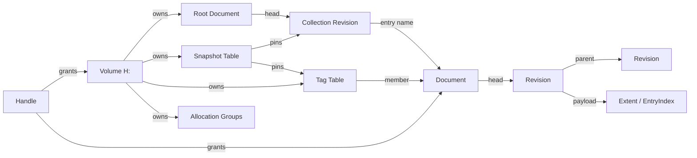
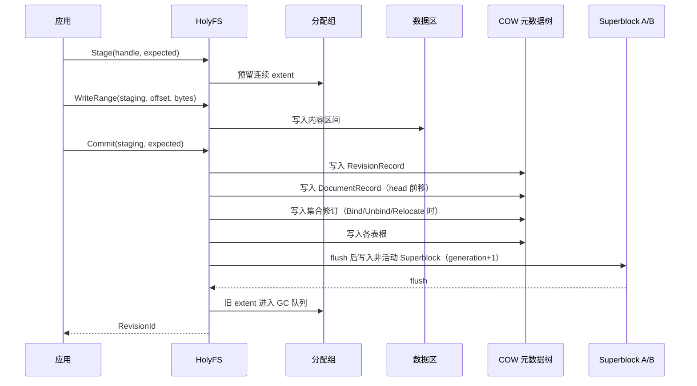
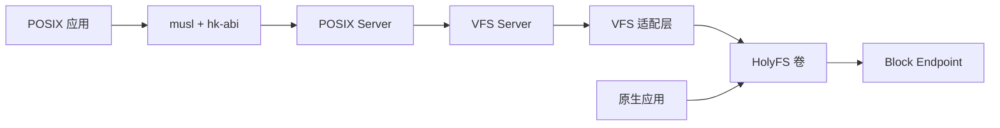

# HolyFS 文件系统

状态：**v1 后端已实现，数据卷接入可用** · 定位：**HolyKernel 原生文件系统** · 关联：[总体架构](architecture.md)、[服务器](servers.md)、[VFS](vfs.md)、[POSIX 与 libc](posix.md)

HolyFS 是 HolyKernel 的原生文件系统。它以卷和盘符组织命名空间，以文档为内容单位，以修订记录历史，以集合表达原生关系。设计目标是现代、稳定、可靠、高性能。

Holy 语义围绕对象、关系与操作展开：身份是 DocId，名字是集合中的关系，内容是版本化的文档，访问通过带权利的句柄完成。POSIX 兼容环境通过 VFS 适配层访问同一批文档；适配层承担路径、偏移、fd 与凭证语义。

已实现 `crates/hk-fs-holyfs` v1：Volume/Document/Revision/Entry 对象模型，文档与集合项共用修订链；Document/Revision/Collection 三棵元数据树全部以 COW 方式构建并通过 Superblock 根切换提交；4 KiB 块、双超级块（generation + CRC32C）、连续 extent、追加写快路径、整文档读取、子集合与 VFS 适配层。原生 Document API 与 `H:` 盘符已接入：按 DocPath 解析、枚举集合、整文档读写、文档视图与修订链；数据卷通过 `vfs.fs=holyfs` 挂载，QEMU `smoke --mode holyfs/holydoc` 校验落盘与 `H:` 文档浏览。快照、标签、句柄令牌、分配组、修订保留/GC、流式写、压缩与配额在后续版本落地。

---

## 1. 设计原则

1. **对象化**：卷、文档、修订、集合、标签、快照是独立对象，各有稳定身份。
2. **关系显式**：名字、引用、历史、成员、固定点都由关系表达。
3. **修订统一**：文档内容是修订，集合项也是修订；一条修订记录同时表达两者。
4. **提交整体可见**：写生成新修订，提交后整体可见；旧修订保持完整。
5. **单用户**：卷以单用户运行；访问由句柄权利约束。
6. **稳定可靠**：CRC32C、双超级块、全元数据 COW、提交点、scrub。
7. **现代能力**：修订、快照、标签、封存、流式写、压缩、配额、在线校验。
8. **边界清晰**：POSIX 语义属于兼容环境；HolyFS 提供 Holy 对象与操作。

---

## 2. 对象模型

| 对象           | 身份                       | 职责                         |
| ------------ | ------------------------ | -------------------------- |
| **Volume**   | VolumeId + 盘符            | 卷、提交代数、根文档、快照表、标签表、分配组、配额  |
| **Document** | DocId（128 位）             | 文档身份；持有 head 修订            |
| **Revision** | RevisionId + ContentHash | 不可变版本；持有内容 extent、集合项索引或两者 |
| **Entry**    | (CollectionId, Name)     | 名字到 DocId 的关系；住在集合修订里      |
| **Tag**      | TagId                    | 跨集合的文档成员关系                 |
| **Snapshot** | SnapshotId               | 时间点根；固定根修订、标签表与代数          |
| **Handle**   | HandleToken（128 位）       | 服务端不可伪造的访问凭据               |
| **Drive**    | 盘符                       | 卷在 Holy 命名空间中的名字，由卷注册表分配   |

### 文档与修订

```rust
pub struct Document {
    pub id: DocId,
    pub head: RevisionId,
    pub checksum: Checksum,
}

pub struct Revision {
    pub id: RevisionId,
    pub document: DocId,
    pub parent: Option<RevisionId>,
    pub payload: Payload,
    pub content_hash: Hash,
    pub size: u64,
    pub moment: CivilTime,
    pub flags: RevisionFlags, // Sealed | Compressed | Encrypted
    pub checksum: Checksum,
}

pub enum Payload {
    Content(ExtentList),
    Collection(EntryIndex),
    Both { content: ExtentList, entries: EntryIndex },
}
```

- **Content 修订**保存字节内容；**Collection 修订**保存集合项索引；**Both 修订**同时保存两者。
- 集合是一份文档，head 指向 Collection 修订；集合项随修订一起 COW，快照因此完整固定集合视图。
- 修订不可变；`Write` 与集合变更生成新修订，`parent` 指向上一修订。
- `moment` 是唯一的民用时间戳；修订元数据由 ContentHash、size、moment 与 flags 组成。
- `content_hash` 覆盖明文内容，用于完整性与去重。

### 集合项

```rust
pub struct Entry {
    pub name: Name,
    pub document: DocId,
    pub kind: EntryKind,   // Content | Collection | Both
    pub flags: EntryFlags, // Visible | Sealed
    pub checksum: Checksum,
}
```

- 集合项保存名字、DocId、类型、标志与校验和；长度由 `Inspect` 从文档记录读取。
- `EntryIndex` 是按名字哈希组织的 B-tree，`Resolve` 与 `Enumerate` 走 O(log n)。
- 名字在集合内唯一；同名 `Bind` 返回 `Occupied`。
- 文档可以出现在多个集合中；名字属于集合项，身份属于文档。

### 句柄权利

```rust
bitflags! {
    pub struct HandleRights: u32 {
        const INSPECT  = 1 << 0; // Inspect、Enumerate、Revisions
        const READ     = 1 << 1; // Read、ReadRange
        const WRITE    = 1 << 2; // Stage、WriteRange、Commit、Write
        const BIND     = 1 << 3; // Bind、Unbind、Relocate、Tag
        const ADMIN    = 1 << 4; // Snapshot、Restore、Seal、Prune、Purge
        const TRANSFER = 1 << 5; // 通过 IPC 转移句柄
    }
}
```

- 句柄是服务端签发的 128 位随机令牌，带权利、卷代与过期代；令牌不可伪造，服务端在每次请求校验。
- 内核 Handle 承载 FS 服务 Endpoint；文档句柄令牌作为请求负载传递，转移由 `TRANSFER` 权利控制。
- `Grant` 收窄权利，`Revoke` 立即失效，`Restore` 使旧代令牌返回 `Stale`。

---

## 3. 原生关系



| 关系             | 方向                                   | 语义                           | 生命周期                         |
| -------------- | ------------------------------------ | ---------------------------- | ---------------------------- |
| **contains**   | Collection Revision → Entry          | 名字在集合内唯一；同一文档可被多个集合引用        | 新集合修订移除关系                    |
| **references** | Entry / Tag / Snapshot → Document    | 文档由集合项、标签与快照保活               | 最后一个引用消失后进入回收                |
| **revises**    | Document → Revision                  | 单链历史；head 指向当前修订             | `Seal` 标记保留；`Prune` 截断未封存旧修订 |
| **stores**     | Revision → Extent / EntryIndex       | 内容与集合项按修订存储；子修订共享未改动的 extent | 修订回收时释放                      |
| **pins**       | Snapshot → Root Revision + Tag Table | 快照固定集合树、标签视图与可达修订            | `Forget` 释放快照                |
| **grants**     | Handle → Object                      | 句柄把一组权利授予对象                  | `Release`、`Revoke` 或代际切换收回   |
|                |                                      |                              |                              |

关系的三条规则：

1. **身份优先**：DocId 稳定；名字与 DocPath 是关系视图，文档可以拥有多个名字。
2. **修订承载**：内容与集合项都住在修订里；一次变更生成一条新修订。
3. **快照隔离**：快照固定创建时刻的根修订与标签根；之后的变更生成新修订。

---

## 4. 语义

### 身份与命名

- DocId 是 128 位稳定标识；RevisionId 是卷内单调编号；SnapshotId、TagId 与 HandleToken 由卷分配。
- 名字为 UTF-8、NFC 规范化、区分大小写，长度 ≤ 255 字节。
- 名字由 1 个字节以上的可见 Unicode 组成；分隔符 `/` 由 DocPath 使用。
- 名字在集合内唯一；`Bind` 一个已存在的名字返回 `Occupied`。
- DocPath 是 `盘符 + 集合项名字序列`，例如 `H:/docs/readme`；DocPath 是查找视图，身份由 DocId 承载。

### 变更协议

- 每次变更携带 `expected`：文档操作带 head RevisionId，集合操作带集合 head RevisionId，卷操作带 generation。
- `expected` 与当前值一致时提交；不一致时返回 `Stale`，调用方读取新值后重试。
- `Create` 是一个原子操作：新文档记录、新集合修订与新集合项在同一次 Superblock 切换中提交。
- `Bind`、`Unbind`、`Relocate` 生成新的集合修订，旧修订保持完整。
- `Write` 生成新的内容修订；内容写入保持集合项不变，集合项索引在 `Bind`/`Unbind` 时更新。
- 同一文档保持单写多读；并发写通过 `expected` 做乐观并发控制。

### 流式写入

- `Stage(handle, expected)` 分配 staging 修订；`WriteRange(staging, offset, bytes)` 写入区间；`Commit(staging, expected)` 生成正式修订。
- `Append(handle, expected)` 创建以当前修订 extent 列表为基线的 staging；`WriteRange` 追加新区间；`Commit` 合并基线 extent 与新 extent，避免整文档复制。
- `Write(handle, content, expected)` 是小文档的便捷路径，内部走 staging 与 commit。
- `Abort(staging)` 释放 staging extent；断电后由 Scrub 回收 staging。

### 原子性与隔离

- 一次变更在提交点整体可见；读者看到旧修订或新修订。
- 提交点是 Superblock 根切换；Document Table、Revision Table、Tag Table、Snapshot Table、Allocation Group Table 全部以 COW 树存储。
- 写顺序为：内容 extent → 修订记录 → 文档记录 → 集合修订 → 表根 → Superblock；数据与元数据在各自阶段 flush，Superblock 最后 flush。
- `Acquire` 固定当前 head；`Read` 在句柄存续期间看到同一修订；`Checkout` 返回指定修订的只读视图。
- 快照提供卷级隔离；`Restore` 把卷的根、标签根与代数切回快照，并使旧代句柄返回 `Stale`。
- `Restore` 获取卷写锁：在途变更完成提交或返回 `Busy`，之后切换根。

### 持久性与回收

- `Commit` 返回时数据与元数据已提交；`Sync` 把卷缓存刷到稳定存储。
- 旧修订在提交后进入回收队列；回收按根可达性标记，标记完成后释放 extent。
- 文档在最后一个引用消失后进入回收；`Purge` 清除集合项、标签与修订；快照仍固定时返回 `Pinned`。
- 快照由 `Snapshot` 创建、`Forget` 释放；释放后的根在下一个 GC 周期回收。

### 修订保留

- 卷默认保留最近 16 条未封存修订与全部封存修订；配额按卷配置。
- `Seal(revision)` 把修订标记为保留；`Prune(handle, keep_last, expected)` 生成新的基线修订，保留最近 `keep_last` 条未封存修订与全部封存修订，旧修订随后回收。
- 历史保持单链；`Checkout` 提供只读视图；派生新文档通过 `Clone` 生成独立 DocId（规划）。
- `Purge` 是显式销毁；快照固定时返回 `Pinned`，释放快照后可再次 `Purge`。

### 垃圾回收

- GC 从当前根、全部快照根、全部封存修订与标签表出发做可达性标记。
- 每个修订带提交代；读者固定修订，GC 在宽限期后回收未被标记的 extent。
- 快照删除、`Prune` 与 `Purge` 只更新对象图；extent 释放由 GC 统一完成。
- 标记与清扫分阶段执行；`Scrub` 校验可达对象图并回收泄漏 extent。

### 时间

- 每个修订保存一个民用时间 `moment`；卷元数据由 generation、配额与根组成。
- 时间由平台民用时钟提供；平台时钟就绪前写入 `Unknown` 标记并保留字段。

### 空间与配额

- 卷按固定大小的分配组组织空间；每组维护位图与连续空闲段摘要，分配优先组内连续 run。
- 文档支持多 extent；子修订共享未改动的 extent，写入只分配改动区间。
- 卷配额覆盖文档数、字节数、修订数、快照数与标签数；`Stage` 预留配额，`Commit` 记账，`Abort` 释放。
- 释放 extent 时向块层发送 `Discard`，保持介质回收效率。

### 完整性与修复

- Superblock、Document Table、Revision Table、Tag Table、Snapshot Table、Allocation Group Table、集合项带 CRC32C。
- 修订内容带 ContentHash；读取时按策略校验。
- `Check` 只读校验；`Repair` 显式修复；`Scrub` 后台扫描并回收泄漏 extent。
- 校验失败或 I/O 错误时，卷进入只读并返回 `Damaged`。

### 状态

| 状态 | 含义 |
| --- | --- |
| `Missing` | 对象或名字不存在 |
| `Occupied` | 名字已被占用 |
| `NotCollection` | 目标文档的 head 修订承载内容 |
| `NotEmpty` | 集合仍有成员 |
| `Stale` | 期望值与当前 head 或 generation 不一致 |
| `Sealed` | 修订已封存 |
| `Pinned` | 对象被快照固定 |
| `Busy` | 卷正在恢复或切换根 |
| `NoSpace` | 卷空间不足 |
| `Quota` | 超出配额 |
| `Damaged` | 校验失败或介质损坏 |
| `Offline` | 卷或后端离线 |
| `Refused` | 句柄权利不足或令牌过期 |
| `Unsupported` | 当前格式或版本超出支持范围 |

---

## 5. 操作

### Volume

| 操作                                    | 语义                         |
| ------------------------------------- | -------------------------- |
| `Attach(drive, block, options)`       | 注册盘符并接入块设备，返回卷句柄           |
| `Detach(volume)`                      | 刷写并断开卷，释放盘符                |
| `Inspect(volume)`                     | 返回 VolumeId、代数、容量、配额与状态    |
| `Sync(volume)`                        | 刷写挂起写入                     |
| `Snapshot(volume, name)`              | 固定根修订、标签根与代数，返回 SnapshotId |
| `Restore(volume, snapshot, expected)` | 把卷根切到快照，推进代数并使旧句柄失效        |
| `Snapshots(volume)`                   | 枚举快照                       |
| `Forget(volume, snapshot)`            | 释放快照固定                     |
| `Check` / `Repair` / `Scrub`          | 在线校验、修复与回收                 |

### Collection

| 操作                                           | 语义                    |
| -------------------------------------------- | --------------------- |
| `Enumerate(collection)`                      | 列出集合项：名字、DocId、类型、标志  |
| `Resolve(collection, name)`                  | 名字解析为 DocId           |
| `Bind(collection, name, document, expected)` | 建立名字关系，返回新集合修订        |
| `Unbind(collection, name, expected)`         | 移除集合项，返回新集合修订         |
| `Relocate(collection, from, to, expected)`   | 原子改名，返回新集合修订          |
| `Create(collection, name, kind, expected)`   | 原子创建文档与集合项，返回文档句柄与新修订 |

### Document

| 操作                                        | 语义                       |
| ----------------------------------------- | ------------------------ |
| `Acquire(volume, target, rights)`         | 按 DocId 或 DocPath 获取句柄令牌 |
| `Release(handle)`                         | 释放句柄                     |
| `Grant(handle, rights)`                   | 派生收窄权利的新令牌               |
| `Revoke(handle)`                          | 立即失效令牌                   |
| `Inspect(handle, revision?)`              | 返回类型、head、长度、标签、标志       |
| `Read(handle, revision?)`                 | 读取完整内容                   |
| `ReadRange(handle, revision, range)`      | 读取内容区间                   |
| `Stage(handle, expected)`                 | 创建 staging 修订            |
| `WriteRange(staging, offset, bytes)`      | 写入 staging 区间            |
| `Commit(staging, expected)`               | 提交 staging，返回 RevisionId |
| `Abort(staging)`                          | 丢弃 staging               |
| `Write(handle, content, expected)`        | 小文档便捷写入，返回 RevisionId    |
| `Append(handle, expected)`                | 以当前修订为基线的 staging        |
| `Revisions(handle)`                       | 枚举修订链                    |
| `Checkout(handle, revision)`              | 返回指定修订的只读视图              |
| `Seal(handle, revision)`                  | 标记修订保留                   |
| `Prune(handle, keep_last, expected)`      | 截断未封存旧修订，返回新基线           |
| `Tag(handle, tag)` / `Untag(handle, tag)` | 更新标签成员关系                 |
| `Purge(handle, expected)`                 | 销毁文档及其关系                 |

### Tag

| 操作 | 语义 |
| --- | --- |
| `CreateTag(volume, name)` | 创建标签，返回 TagId |
| `DropTag(volume, tag, expected)` | 删除标签 |
| `EnumerateTags(volume)` | 枚举标签 |
| `TagMembers(volume, tag)` | 列出成员 DocId |

---

## 6. 磁盘布局

```text
Superblock A (4 KiB, 前 96 字节有效)
Superblock B (4 KiB, 前 96 字节有效)
Allocation Group Table (COW B-tree)
Document Table (COW B-tree: DocId → DocumentRecord)
Revision Table (COW B-tree: RevisionId → RevisionRecord)
Tag Table (COW B-tree: TagId → TagRecord，含 doc → tags 索引)
Snapshot Table (COW B-tree: SnapshotId → SnapshotRecord)
Extent Tree / Extent Lists
Collection EntryIndex (COW B-tree，住在集合修订里)
Allocation Groups (位图 + 连续空闲段摘要)
Data Area
```

Superblock 字段：

| 字段              | 含义                  |
| --------------- | ------------------- |
| magic / version | `HOLYFS` 与格式版本      |
| feature_flags   | 兼容特性位               |
| endianness      | 小端标记                |
| volume_id       | 卷身份                 |
| generation      | 提交代数                |
| root            | 根文档 DocId           |
| document_table  | 文档表根                |
| revision_table  | 修订表根                |
| tag_table       | 标签表根                |
| snapshot_table  | 快照表根                |
| group_table     | 分配组表根               |
| quota           | 文档数、字节数、修订数、快照数、标签数 |
| checksum        | CRC32C              |

- 全部表以 COW 树存储；Superblock 保存根，提交只切换根。
- 挂载时校验 magic、版本、feature flags、卷身份、各表根、分配组表与 Superblock CRC；校验通过后选择 generation 最新的有效槽。
- 文档记录保存 DocId、head、校验和；修订记录保存 RevisionId、DocId、parent、payload 根、ContentHash、size、moment、flags 与校验和。
- 集合项保存在集合修订的 EntryIndex 中；索引按名字哈希排序，项内保存名字、DocId、类型、标志与校验和。
- 分配组按固定容量划分；组表记录每组位图、连续空闲段摘要与分配提示。
- 块大小 4 KiB；字段小端；格式版本与 feature flags 决定兼容边界。

---

## 7. 写路径与提交



- 提交点是 Superblock 根切换；崩溃后挂载选择旧代或新代。
- 数据阶段、元数据阶段、Superblock 阶段各自 flush；Superblock 写入前，全部新对象已稳定。
- 新 extent 在提交前只被新对象图引用；旧 extent 在提交后由 GC 回收。
- 回收中断或断电产生泄漏 extent；`Scrub` 扫描可达对象图后回收。

---

## 8. 现代能力

- **修订链**：每次写入生成不可变修订；`Checkout` 提供只读历史视图，`Prune` 控制保留窗口。
- **快照与恢复**：COW 根固定；快照零拷贝；`Restore` 原子切换根、标签根与代数。
- **标签**：Tag Table 是唯一索引，包含 tag → members 与 doc → tags 两个方向；快照固定标签根。
- **流式写**：`Stage`/`WriteRange`/`Commit` 支持大文档；`Append` 共享基线 extent。
- **去重**：ContentHash 相同的内容共享 extent；加密卷使用 keyed hash（规划）。
- **压缩**：按修订或 extent 选择 LZ4/Zstd；读取透明解压。
- **加密**：按修订加密内容与元数据；密钥由卷配置提供（规划）。
- **配额**：文档数、字节数、修订数、快照数、标签数；在 `Stage` 预留、`Commit` 记账。
- **在线校验**：`Check`、`Repair`、`Scrub` 在卷运行时工作。
- **性能**：分配组、连续 extent、共享基线、文档缓存、group commit、多队列 DMA。

---

## 9. 性能预算

| 指标 | 预算 |
| --- | --- |
| 1 MiB 文档读（缓存命中） | ≥ 1 GiB/s |
| 1 MiB 文档写（group commit） | ≥ 500 MiB/s |
| 4 KiB 随机读 | ≥ 50k IOPS（设备允许时） |
| 快照创建 | ≤ 1 ms |
| 挂载/恢复 | ≤ 100 ms |
| 压缩吞吐（LZ4） | ≥ 500 MiB/s/core |

预算由 `hk-bench holyfs` 锁定；里程碑退出以数据为准。

---

## 10. 与兼容层的关系



- POSIX 兼容环境拥有自己的 VFS、fd 表与路径解析；VFS 通过适配层把路径与偏移翻译为 Holy 文档操作。
- 适配层合成 POSIX 元数据（`mode`、`uid`、`gid`、时间字段），HolyFS 磁盘格式保存 Holy 对象与关系。
- ext2/ext4 作为 POSIX 兼容环境的根文件系统；HolyFS 卷接入兼容环境的挂载点，同时以盘符供原生应用访问。

---

## 11. 范围边界

- 卷覆盖本地块设备；网络文件系统由独立服务提供。
- 系统以单用户运行；多用户凭证由兼容层维护。
- 兼容层表达所有权、权限位、硬链接、符号链接、稀疏文件与 POSIX 时间属性；HolyFS 磁盘格式保存 Holy 对象与关系。
- 文件系统运行在用户态；内核提供 Block、Endpoint、Frame 与 Handle 机制。
- `H:` 盘符与 VFS 挂载点指向同一卷；两者共享同一份文档数据。

---

## 12. 实现现状

| 能力                              | 状态  |
| ------------------------------- | --- |
| 4 KiB 块、双超级块、CRC32C、连续 extent   | 已实现 |
| Document/Revision/Entry 对象模型、文档与集合项共用修订链 | 已实现 |
| Document/Revision/Collection 元数据 COW 树与根切换 | 已实现 |
| 追加写快路径、整文档读取、子集合、跨块集合项 | 已实现 |
| 数据卷接入、VFS 适配层、QEMU 落盘校验 | 已实现 |
| 原生 Document API（DocPath 解析、集合枚举、整文档读写、文档视图、修订链）与 `H:` 盘符 | 已实现 |
| 标签：创建/删除、加入/移除、成员枚举、COW 持久化 | 已实现 |
| 快照、句柄令牌、分配组、修订保留/GC | 规划 |
| 流式写、压缩、去重、配额、scrub            | 规划  |
| ContentHash/民用时间写入、内容校验 | 字段保留，规划 |

### 代码组织

```text
crates/hk-fs-holyfs/src/
├── lib.rs          公共 API、模块装配、format
├── ids.rs          DocId、RevisionId、VolumeId、HandleRights
├── types.rs        Document/Revision/Entry 记录与编码
├── error.rs        HolyError
├── crc32c.rs       CRC32C
├── superblock.rs   卷布局、双超级块、校验
├── store.rs        块设备、位图分配器、区间 I/O
├── tree.rs         持久化 COW 元数据树
├── volume/         卷状态、内容、元数据、标签与提交
│   ├── mod.rs      卷状态、挂载与提交入口
│   ├── content.rs  内容读写与内容修订
│   ├── metadata.rs 集合项、路径解析与文档视图
│   ├── tags.rs     标签与成员关系
│   └── persist.rs  元数据树与超级块提交
├── handle.rs       原生卷句柄（DocPath、整文档、修订链）
└── tests.rs        单元、子集合、持久化测试

crates/hk-fs-holyfs-vfs/src/lib.rs
                     VFS Backend 适配：NodeId ↔ DocId、错误与类型映射
```

---

## 13. 测试策略

| 层级 | 测试 |
| --- | --- |
| Hosted 单元 | 分配组、COW 表、修订链、集合索引、快照固定与恢复 |
| Hosted 模拟 | 断电点矩阵、短写、坏块、flush 失败、GC 并发、压缩边界 |
| VFS 适配 | 路径映射、偏移读写、句柄、挂载与卸载、POSIX 元数据合成 |
| QEMU | 卷接入、写入、重启、校验、快照恢复 |
| 并发 | 多读者单写、集合并发变更、Restore 与在途写、GC 宽限期 |
| fuzz | Superblock、文档记录、修订记录、集合项、名字、压缩流、快照 |

---

## 14. 路线图

- M6：HolyFS Core（COW 表、修订链、连续 extent、CRC32C、双超级块、整文档 API、VFS 适配层、`H:` 盘符）。
- M7：POSIX 元数据与 inode 适配（POSIX 核心接入时）。
- M8：集合索引、修订保留、快照、标签、封存、GC、check/repair、scrub 与性能优化。
- M9：流式写、压缩、去重、配额、加密、并行 I/O 与基准锁定。

---

## 15. 相关文档

- [总体架构](architecture.md)
- [服务器](servers.md)
- [VFS](vfs.md)
- [POSIX 与 libc](posix.md)
- [工程策略](engineering.md)
- [ADR-0010：HolyFS 文件系统](adr/0010-holyfs.md)
