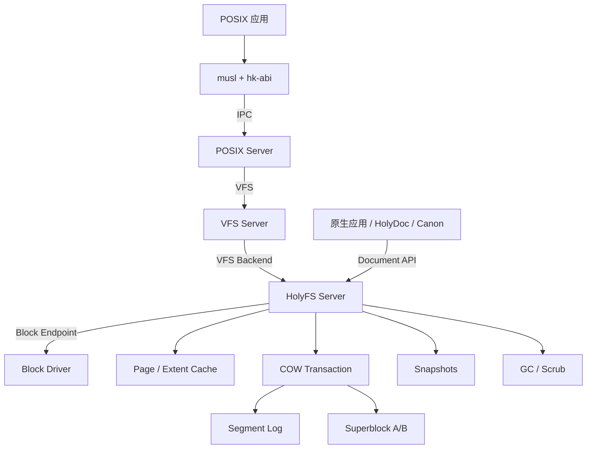
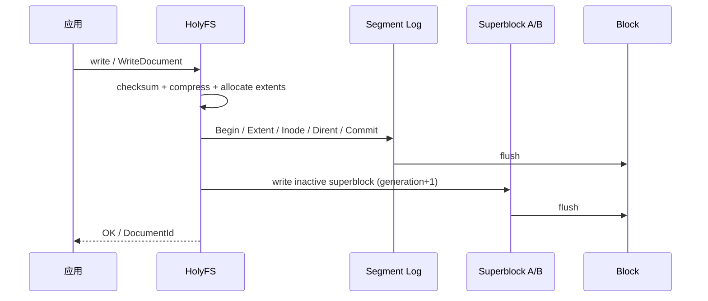

# HolyFS 文件系统

状态：**设计中** · 定位：**用户态文件系统，可作主根** · 关联：[总体架构](architecture.md)、[服务器](servers.md)、[VFS](vfs.md)、[POSIX 与 libc](posix.md)

HolyFS 是 HolyKernel 的原生文件系统，采用盘符、整文档、压缩、单用户与快照设计；内部使用 COW、extent、checksum、cache 与并发 I/O。

HolyFS 是**一等文件系统后端**：既可以作为 POSIX `/` 主根，也可以挂到 `/home` 或其他挂载点；原生命名空间通过 `H:` 盘符访问同一卷。同一套磁盘格式同时提供 POSIX 文件视图与整文档 Document API。

---

## 1. 目标与范围

### 目标

1. **可作主根**：HolyFS Server 实现 VFS Backend，挂载为 `/`；POSIX Server 在其上运行 `/sbin/init`。
2. **POSIX 视图**：inode、目录、`mode`/`uid`/`gid`、硬链接、符号链接、稀疏文件、时间戳、原子 `rename`、`fsync`。
3. **原生文档视图**：`ReadDocument` 返回完整内容，`WriteDocument` 原子提交；支持压缩、Tags、Links、Snapshots。
4. **盘符**：原生命名空间把卷映射到 `H:` 等盘符；与 VFS 挂载点指向同一卷。
5. **COW + 原子提交**：崩溃后回到最近一致点。
6. **校验和**：extent、inode、目录块、superblock 全校验。
7. **快照**：零拷贝快照、回滚、GC。
8. **透明压缩**：每 extent 选择 LZ4/Zstd 或原始。
9. **高性能**：extent、连续快路径、页缓存、零拷贝、group commit、多队列。
10. **可选启用**：由服务清单选择 HolyFS 根或 ext4/ext2 根；HolyFS、ext4、ext2 都是一等候选。

### 范围边界

- 文件系统运行在用户态；内核提供 Block、Endpoint 与 Handle 机制。
- 权限模型覆盖 POSIX `mode`/`uid`/`gid`；ACL、xattr、配额组作为扩展项。
- 存储范围覆盖本地块设备；网络文件系统由独立服务提供。
- 磁盘格式按 HolyKernel 设计；整文档与盘符构成原生文件体验。
- 系统默认单用户；POSIX `uid`/`gid` 可存储并参与权限检查，多用户凭证作为扩展项。

---

## 2. 架构



- HolyFS Server 运行在用户态，持有 Block Endpoint 与必要 Handle。
- 同一服务提供两个接口：**VFS Backend**（POSIX）与 **Document API**（原生）。
- VFS 挂载为 `/` 时，HolyFS 是主根；挂到其他路径时是普通文件系统。
- `H:` 是原生盘符别名，指向同一个 Volume；数据只存一份。
- `/dev`、`/proc`、`/tmp` 仍由 devfs/procfs/tmpfs 单独挂载。

---

## 3. 磁盘布局

```text
Superblock A (4 KiB)
Superblock B (4 KiB)
Checkpoint / Manifest
Segment Log
  ├── Data Extent
  ├── Inode Record
  ├── Directory Entry
  ├── Extent Tree Node
  └── Commit Record
Free Space Bitmap
Snapshot Roots
```

- 块大小 4 KiB；小端。
- Superblock：magic、version、generation、root、log head/tail、snapshot head、checksum。
- Manifest：根 inode、inode 表、快照链、空闲段位图。
- Segment Log：追加写、循环使用；未 Commit 的记录恢复时丢弃。
- Extent Tree：inode → extent 列表；小文件单 extent 连续。
- Directory Index：B-tree/hash，按名字查 inode；目录项保存 `name → inode`。
- Free Space：bitmap + 预留区；分配优先连续。
- POSIX 元数据直接存在 inode 记录中，形成单一数据源。

---

## 4. POSIX 视图

### Inode

```rust
pub struct Inode {
    pub id: InodeId,
    pub kind: FileKind,          // File | Dir | Symlink
    pub mode: u32,               // POSIX mode bits
    pub uid: u32,
    pub gid: u32,
    pub nlink: u32,
    pub size: u64,
    pub atime: Timestamp,
    pub mtime: Timestamp,
    pub ctime: Timestamp,
    pub birthtime: Timestamp,
    pub extents: ExtentRoot,
    pub symlink: Option<Arc<[u8]>>,
    pub tags: TagSet,
    pub content_hash: Hash,
    pub checksum: Checksum,
}
```

- **硬链接**：多个目录项指向同一 inode；`nlink` 计数；最后一个链接删除时回收。
- **符号链接**：inode 保存目标；VFS 解析，限制深度。
- **稀疏文件**：extent 可以表示 hole；`truncate` 扩展为零洞。
- **权限**：`mode`/`uid`/`gid` 持久化；VFS 与 HolyFS 执行检查。
- **时间戳**：`atime`/`mtime`/`ctime`/`birthtime`；挂载选项可关闭 `atime` 更新。
- **原子 rename**：COW 目录项 + commit；路径切换一次完成。
- **fsync**：提交当前事务；`fdatasync` 提交数据与必要元数据。

### VFS 操作

```text
lookup getattr setattr readdir create mkdir unlink rmdir
rename link symlink readlink read write truncate fsync statfs
```

- VFS 负责路径解析、dentry/inode 缓存、挂载边界。
- HolyFS 负责 inode、extent、目录项、权限、事务。
- `/dev`、`/proc`、`/tmp` 由独立后端挂载；设备节点由 devfs 提供。
- POSIX Server 的 fd 指向 VFS `FileHandle`；`FileHandle` 指向 HolyFS inode。

---

## 5. 原生文档视图

```rust
pub struct Document {
    pub meta: DocumentMeta,
    pub content: Arc<[u8]>,
}

impl HolyFS {
    pub fn read_document(&self, path: &DocPath) -> Result<Document>;
    pub fn write_document(&self, path: &DocPath, doc: &Document) -> Result<DocId>;
    pub fn delete_document(&self, path: &DocPath) -> Result<()>;
    pub fn snapshot(&self, name: Name) -> Result<SnapshotId>;
    pub fn restore(&self, id: SnapshotId) -> Result<()>;
}
```

- Document 是 inode + extent 的整文档视图，与 POSIX 共享同一份数据。
- 大文档使用显式 `Stream`；默认整文档读写。
- 压缩、Tags、Links、ContentHash 存在 inode 或 Document 扩展区。
- 原生应用通过 HolyFS Endpoint 使用完整 Document API；POSIX 应用通过 VFS 使用同一批 inode。
- `H:` 盘符映射到 Volume 根；POSIX `/` 也映射到同一 Volume 根（若选作主根）。

---

## 6. 事务与恢复



- COW：写入新 extent；旧 extent 由 GC 回收。
- 提交点 = Superblock 切换；崩溃后旧状态或新状态。
- 双超级块 + generation + checksum；选择较新且校验通过的一份。
- group commit：多个事务合并一次 flush；`fsync` 强制落盘。
- 恢复：选择 checkpoint，重放完整事务，丢弃未提交段。
- `check` 只读校验；`repair` 显式修复；`scrub` 后台校验。

---

## 7. 可靠性

- **校验和**：extent、inode、目录块、superblock、commit 记录。
- **COW**：写入失败保留旧版本；崩溃恢复到 checkpoint。
- **写顺序**：data → metadata → commit → superblock；必要时 barrier/flush。
- **坏块/短写**：返回 `EIO` 并记录；卷可回退只读。
- **快照**：COW 根引用；快照零拷贝；GC 保留可达数据。
- **原子替换**：整文档写入以完整版本生效，旧版本保留到提交完成。
- **只读降级**：检测到持久性错误时，卷进入只读并报告。
- **端到端校验**：API 层校验长度与哈希，保证块与内容一致。
- **主根保护**：`/` 上的 HolyFS 错误进入只读或 panic-to-recovery，并记录错误。

---

## 8. 性能

- **Extent**：小文件单 extent 连续；大文件多 extent；extent tree O(log n)。
- **连续快路径**：allocator 优先连续；预留/预分配；后台 defrag。
- **页缓存**：Frame 共享、readahead、writeback、零拷贝 到应用。
- **Group commit**：批量提交提高吞吐；单次 `fsync` 保证持久。
- **并发**：每 inode rwlock/range lock；目录/分配器分片；块层多队列。
- **压缩**：每 extent LZ4（速度）或 Zstd（比率）；并行压缩；冷热数据策略。
- **GC**：后台段回收；快照隔离；低水位触发。
- **元数据缓存**：inode、dentry、extent、free-space、负查找缓存。

---

## 9. 安全

- HolyFS Server 用户态、独立 VSpace/HandleTable。
- 仅持有 Block Endpoint 与必要配置 Handle。
- POSIX 路径受 `mode`/`uid`/`gid` 检查；VFS 传入凭证。
- 原生 Document API 通过显式 Handle 访问；权限来自 Handle。
- 压缩/解析有大小与深度限制，防压缩炸弹。
- 所有解析器 fuzz；校验和失败返回 `Corrupt`。
- 主根挂载时，HolyFS 与 ext4 采用同一套 VFS 权限检查；原生接口与 POSIX 路径采用同一套权限规则。

---

## 10. 性能预算

| 指标 | 预算 |
| --- | --- |
| 1 MiB 文档读（缓存命中） | ≥ 1 GiB/s |
| 1 MiB 文档写（group commit） | ≥ 500 MiB/s |
| 4 KiB 随机读 | ≥ 50k IOPS（设备允许时） |
| 快照创建 | ≤ 1 ms |
| 挂载/恢复 | ≤ 100 ms |
| 压缩吞吐（LZ4） | ≥ 500 MiB/s/core |

预算由 `hk-bench holyfs` 锁定；里程碑退出以数据为准。

---

## 11. 保证

1. HolyFS 是用户态文件系统后端，可挂载为 `/`、`/home` 或 `H:`。
2. 同一套磁盘格式同时服务 POSIX VFS 与原生 Document API。
3. POSIX `mode`/`uid`/`gid`/`nlink`/时间戳持久化并由 VFS/HolyFS 检查。
4. 硬链接、符号链接、稀疏文件、原子 `rename`、`fsync` 可用。
5. 文档写入原子提交；要么完整可见，要么保持旧状态。
6. 所有 extent/inode/目录/superblock 读取时校验 checksum。
7. 快照根只读；`restore` 切换根。
8. GC 保留所有可达 extent，包括快照引用。
9. 提交前 data/metadata 已 flush；superblock 切换是提交点。
10. 压缩/解析有资源上限。
11. HolyFS Server 崩溃后 Root Server 重启；主根进入恢复流程，客户端收到错误并重连。

---

## 12. 测试策略

| 层级 | 测试 |
| --- | --- |
| Hosted 单元 | extent tree、allocator、checksum、压缩、事务、POSIX inode |
| Hosted 模拟 | 断电、短写、坏块、flush 失败、GC 并发、快照、硬链接/符号链接 |
| VFS/POSIX | `open/read/write/stat/readdir/rename/link/symlink/fsync` |
| QEMU | HolyFS 作为 `/` 启动、写入、重启、校验、快照恢复 |
| fuzz | superblock、日志、extent、目录、压缩、文档名、inode |
| 基准 | 顺序/随机 I/O、group commit、快照、恢复、POSIX 元数据 |
| 故障注入 | 写失败、checksum 损坏、只读降级、主根恢复 |

---

## 13. 路线图

- M7：HolyFS Core（extent、checksum、双超级块、页缓存、VFS Backend、POSIX inode）。
- M8：COW 事务、快照、GC、check/repair、scrub、HolyFS 主根启动。
- M9：性能优化、group commit、并行压缩、可选 `holyfs-bridge` 导入/导出。

---

## 14. 相关文档

- [总体架构](architecture.md)
- [服务器](servers.md)
- [VFS](vfs.md)
- [POSIX 与 libc](posix.md)
- [工程策略](engineering.md)
- [ADR-0010：HolyFS 文件系统](adr/0010-holyfs.md)
