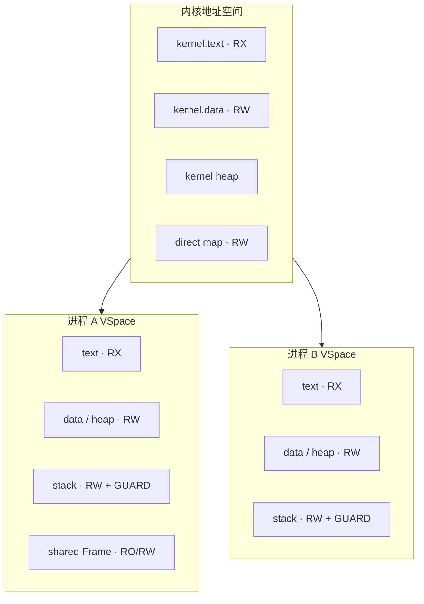
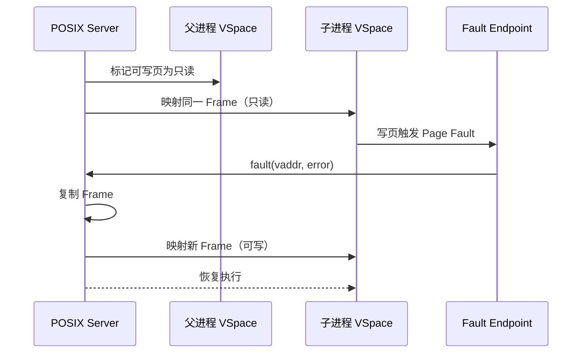

# 内存模型

状态：**设计中** · 上级：[总体架构](architecture.md)

HolyKernel 的内存模型围绕 **Untyped、Frame、VSpace 与 Handle** 组织。每个进程拥有独立地址空间；内核与用户态地址空间分离。

---

## 1. 目标与范围

### 目标

1. **独立地址空间**：每个进程拥有自己的 VSpace；内核地址空间与用户地址空间分离。
2. **Untyped 管理**：启动内存由 Untyped 描述；通过 retype 创建内核对象与 Frame。
3. **Frame 共享**：Frame 通过 Handle 共享；支持只读映射、写时复制与 DMA。
4. **COW**：`fork` 使用只读映射与页错误 Endpoint；POSIX 服务器处理写时复制。
5. **W^X**：代码页 RX、数据页 RW；JIT 完成后翻转。
6. **DMA 隔离**：用户态驱动通过 DeviceGrant 与 Frame 访问设备内存；IOMMU 可用时绑定 DeviceGrant。
7. **可测试**：Hosted 模拟器复现 VSpace、COW、页错误与 DMA 路径。

### 构件

- **Untyped**：未类型化物理内存。
- **Frame**：物理页帧；可映射到 VSpace。
- **VSpace**：进程地址空间；页表根、映射、保护。
- **PageTable**：页表对象；由 Untyped retype。
- **HandleTable**：每 Task 的句柄表；表项指向 Frame/VSpace/DeviceGrant 等对象。
- **Fault Endpoint**：页错误与异常的 IPC 出口。
- **DeviceGrant**：MMIO、DMA、IRQ 句柄集合。

---

## 2. 地址空间



- 内核运行在高半区，使用自己的页表根。
- 每个进程拥有独立 VSpace；切换进程切换页表根。
- 内核通过 direct map 访问物理内存、页表与 DMA 缓冲。
- 用户空间区域由 POSIX 服务器与 libc 管理：text/data/heap/stack/mmap/shared。

---

## 3. Untyped 与对象创建

```rust
pub struct Untyped {
    region: PhysRange,
    watermark: PhysAddr,
    size_bits: u8,
}

impl Untyped {
    pub fn retype(&mut self, kind: ObjectKind, size_bits: u8) -> Result<Handle>;
}
```

- 启动时 BootInfo 提供可用物理内存；Root Server 获得初始 Untyped Handle。
- `retype` 将 Untyped 分割为 TCB、VSpace、HandleTable、Frame、PageTable、Endpoint、Notification。
- 对象大小按 2 的幂管理；剩余 Untyped 可继续分割。
- Root Server 按服务清单向服务器分配 Untyped 与初始 Handle。
- 物理帧由 Untyped Handle 表达；分配策略位于用户态。

---

## 4. VSpace

```rust
pub trait VSpace {
    fn map(&self, frame: Handle<Frame>, vaddr: VirtAddr, flags: MapFlags) -> Result<()>;
    fn unmap(&self, vaddr: VirtAddr) -> Result<Handle<Frame>>;
    fn protect(&self, vaddr: VirtAddr, flags: MapFlags) -> Result<()>;
    fn translate(&self, vaddr: VirtAddr) -> Option<(PhysAddr, MapFlags)>;
}
```

`MapFlags`：

```rust
bitflags! {
    pub struct MapFlags: u32 {
        const READ      = 1 << 0;
        const WRITE     = 1 << 1;
        const EXECUTE   = 1 << 2;
        const DEVICE    = 1 << 3;
        const GUARD     = 1 << 4;
        const SHARED    = 1 << 5;
    }
}
```

- 映射必须持有对应 Frame Handle。
- W^X：`WRITE` 与 `EXECUTE` 互斥。
- `GUARD` 页保持保护状态。
- 设备映射携带 `DEVICE` 与 uncached 属性。
- 页表变更通过 TLB shootdown 同步。

---

## 5. Frame 与共享内存

```rust
pub struct Frame {
    phys: PhysAddr,
    size: usize,
    owner: ObjectId,
}
```

- Frame 由 Untyped retype 创建；通过 Handle 传递。
- 只读共享：多个 VSpace 映射同一 Frame，权限为 READ。
- 可写共享：显式授予 WRITE；POSIX 共享内存使用此路径。
- 引用计数归零时 Frame 回到 Untyped 或由 Root Server 回收。
- 大块 IPC 数据通过共享 Frame 传递，Endpoint 只传 Handle 与元数据。

---

## 6. COW 与页错误



- `fork` 通过 VSpace 复制与只读映射实现。
- 页错误通过 Fault Endpoint 发送给 POSIX 服务器。
- POSIX 服务器分配新 Frame、复制内容、更新映射，然后恢复线程。
- 失败时终止进程并回收 Frame。

---

## 7. 用户态内存管理

- **`brk`/`sbrk`**：POSIX 服务器维护进程 heap 区域；扩展时映射新 Frame。
- **`mmap`**：POSIX 服务器从 Untyped 或文件系统获得 Frame，映射到进程 VSpace。
- **`munmap`/`mprotect`**：POSIX 服务器更新 VSpace 映射。
- **ELF 加载**：libc 的 ELF 加载器解析段，请求 POSIX 服务器映射 text/data/stack。
- **pthreads**：libc 通过 POSIX 服务器分配线程栈与 TLS。
- 内核只提供 VSpace/Frame 机制；POSIX 语义在用户态完成。

---

## 8. DMA 与设备内存

```rust
pub struct DeviceGrant {
    mmio: PhysRange,
    dma: Option<PhysRange>,
    irq: Option<Handle<IRQHandler>>,
}
```

- Device Manager 将 DeviceGrant 授予驱动。
- 驱动映射 MMIO 为 `DEVICE`；通过 `volatile` 访问。
- 驱动分配 Frame 作为 DMA 缓冲；缓存维护由平台实现。
- IOMMU 可用时，DeviceGrant 绑定地址空间；DMA 只访问授权 Frame。
- IOMMU 关闭时，驱动按受信任组件审计。

---

## 9. 内核内存

- 内核使用静态分配、per-CPU 结构与最小堆。
- 内核堆实现 `GlobalAlloc`；启动后固定大小。
- 内核对象（TCB/VSpace/HandleTable/Endpoint）来自 Untyped；内核堆保持独立。
- 栈：每 TCB 独立内核栈与 guard page；异常使用独立栈。
- panic 路径使用静态缓冲，独立于堆。

---

## 10. 保证

1. 每个进程拥有独立 VSpace；内核与用户地址空间分离。
2. 所有映射持有对应 Frame Handle。
3. W^X：代码页 RX、数据页 RW。
4. COW 页在写错误后由 POSIX 服务器替换为私有 Frame。
5. Frame 引用归零后回到 Untyped 或 Root Server。
6. 设备 MMIO 通过 DeviceGrant 映射；DMA 只访问授权 Frame。
7. 页表变更后，所有相关 CPU 的 TLB 完成同步。
8. 内核对象由 Untyped retype 创建，大小与类型受句柄约束。
9. 用户栈带 guard page；溢出终止线程。
10. 内核 heap 失败返回明确错误或进入 panic。

---

## 11. 测试策略

| 层级 | 测试 |
| --- | --- |
| Hosted 单元 | Untyped retype、Frame 引用、VSpace 映射、W^X、COW |
| Hosted 模拟 | 页错误注入、COW 压力、共享内存、DMA 模拟 |
| QEMU x86_64 | 多进程 VSpace、COW、mmap、页表切换、TLB shootdown |
| QEMU AArch64/RISC-V | 同上，验证页表格式、缓存维护、IOMMU |
| POSIX 测试 | `fork` + 写时复制、`mmap`、`mprotect`、共享内存 |
| fuzz | Untyped retype 序列、VSpace 映射序列、页错误地址 |

---

## 12. 相关文档

- [总体架构](architecture.md)
- [执行模型](execution.md)
- [POSIX 与 libc](posix.md)
- [服务器](servers.md)
- [平台与启动](platforms.md)
- [工程策略](engineering.md)
