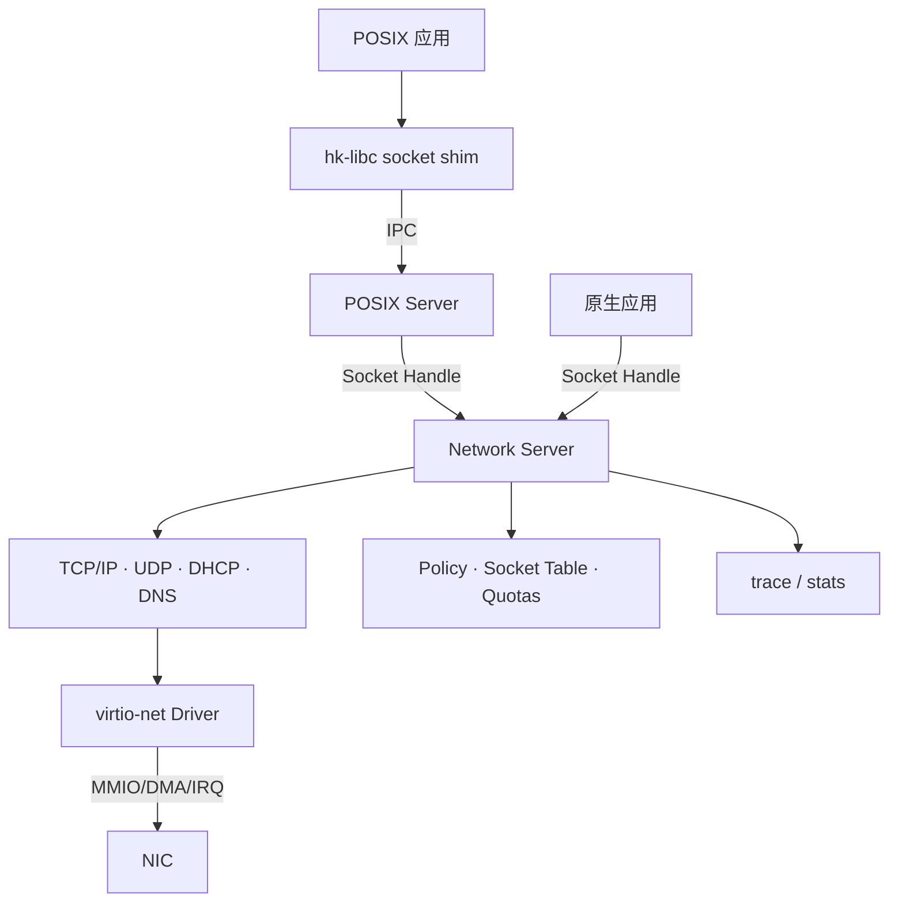
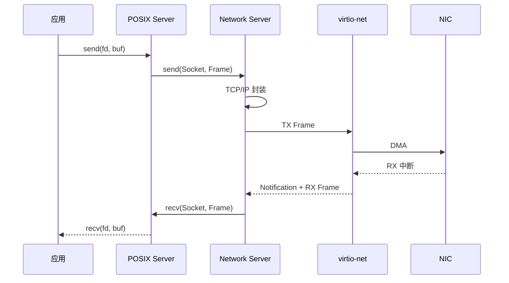

# 网络

状态：**设计中** · 关联：[总体架构](architecture.md)、[服务器](servers.md)、[POSIX 与 libc](posix.md)

里程碑：网络在 **M5** 先行交付，原生 Socket Handle 与 `net` 命令先可用；POSIX socket API 在 **M10** 映射到同一 Socket Handle。

HolyKernel 的网络以用户态 **Network Server** 为核心：内核只提供 Endpoint、Notification、HMP（Capacity/Frame/Region）、DeviceGrant；TCP/IP、socket、DHCP、DNS、策略都在用户态。驱动是用户态 virtio-net。

## 实现选型

| 层 | 选型 | 边界 |
| --- | --- | --- |
| virtio-net 驱动 | `virtio-drivers` 0.13 `VirtIONetRaw` | 独立 `hk-server-virtio-net`，持有 DeviceGrant |
| TCP/IP 协议栈 | `smoltcp`（无 std/堆） | `hk-server-net` 内的 `Interface` + `SocketSet` |
| PHY 适配 | 自研 `phy::Device` | Net Endpoint + 共享 Frame 队列 |
| Socket | 自研 `hk-net` | Socket Handle、rights、配额、`net` 命令 |

- 驱动与协议栈通过以太网 Frame 交换；驱动侧零拷贝，smoltcp 边界允许一次复制。
- smoltcp 启用 Ethernet、IPv4/IPv6、ICMP、UDP、TCP、DHCP 与 DNS；不启用 std/默认特性。
- 详见 [ADR-0013](adr/0013-net-stack.md)。

实现状态：`hk-driver-virtio` 已提供 `Device::Network`；独立 `hk-server-virtio-net` 已接入按类授权、精确 BDF 探测、MAC 输出、`NET_INFO`/`NET_POLL`/`NET_TX`/`NET_RX` Endpoint 与非阻塞接收；驱动可绑定 IRQ Notification，并由 Network Server 的 TX Notification 唤醒。`hk-server-net` 已完成 Net Endpoint 握手、DHCP 租约、`ping` 与 TCP 回显；QEMU 中验证了真实 ARP/ICMP/DHCP/TCP 的 TX/RX 路径。`hk-net` 提供 TCP 与 DNS（A/AAAA）socket API，DNS 查询带 Pending/Failed/超时语义，socket 用后可回收；主机侧双栈测试覆盖 A、AAAA、失败与超时。协议栈时间源由 TSC 换算为单调毫秒；内核 `SYS_TICKS` 改为累计计数，调度 tick 首次启动后持续运行，避免预算切片反复重置 LAPIC 定时器导致抢占停摆。DNS 自检名称可用 `net.dns=<name>` 覆盖；默认 `smoke --mode net` 用 `net.dns=localhost` 覆盖 DHCP、ICMP ping、TCP 回显、UDP 回显与 DNS 解析（宿主同时提供 TCP/UDP echo）。内核 `send` 改为异步入队，发送方不再因等待接收方而阻塞，消除了 Network Server 与驱动互相发送时的双向死锁。启动参数 `watchdog` 开启活性看门狗，会周期性输出任务快照；据此定位到 QEMU 内 DNS 高频发送时，virtio-net 的阻塞式 `send` 偶发等待 TX used-ring 完成不返回。网络驱动已改为基于 `VirtIONetRaw` 的非阻塞收发：接收缓冲预投队列并回收，发送只入队并 kick、完成由轮询回收，另有有界待发队列；驱动不再在 TX 完成上自旋。Device Manager 改为启动时枚举并缓存 `DeviceGrant`，运行期不再重新 `bar_size`——此前每次授权申请都会临时关闭命令寄存器解码并改写 BAR，打断正在工作的 virtio 设备，导致 DNS 阶段 TX 停滞与 VFS 块 I/O 停顿。修复后默认 `smoke --mode net` 覆盖 DHCP、ICMP ping、TCP 回显与 DNS 解析（`net.dns=localhost`）。`net` 命令由独立用户态 `hk-server-netstat` 客户端实现：它向 Network Server 发送 `NET_STATUS_REQUEST`/`NET_ARP_REQUEST`，打印 MAC、IPv4/前缀、网关、Socket 数、收发计数、路由视图、ARP 邻居（smoltcp 邻居缓存不公开，`hk-net` 从入站 ARP 帧旁路观察）与原生配置（DHCP/地址/网关/DNS/MTU）；内核态 shell 只负责按需启动该服务，不接触网络协议。驱动重启恢复已落地：virtio-net 退出后由 Root Server 按 `Always` 策略重启，Network Server 检测端点变化、重新握手并恢复链路（`smoke --mode netrestart` 验证）。共享 Frame 收发环已落地：驱动经 Memory Server 客户端分配共享帧能力并登记 DMA 帧，把副本句柄交给 Network Server；RX 由设备直接 DMA 到共享帧，协议栈以借用 token 读取并在消费后归还，TX 由协议栈直接写入共享帧、驱动零拷贝提交 virtio。`net.zerocopy` 启用该路径，`smoke --mode netzerocopy` 覆盖。原生 Socket Handle 已落地：`hk-proto::socket` 提供 `Client`（open/connect/send/recv/close、UDP send/recv、DNS resolve），Network Server 处理请求并驱动协议栈；`hk-server-netsock` 作为用户态客户端服务验证 TCP/UDP/DNS（`smoke --mode netsocket`）。内核与 Shell 不感知该协议。更长期是 POSIX socket 复用同一后端。

---

## 1. 目标与范围

### 1.0 目标

- **IPv4**：ARP、ICMP、UDP、TCP、DHCP 客户端、静态地址、路由表。
- **IPv6 基础**：NDP、SLAAC、ICMPv6、UDP/TCP。
- **DNS**：A/AAAA 查询、缓存、`getaddrinfo`。
- **Socket**：AF_INET、AF_INET6、SOCK_STREAM、SOCK_DGRAM；POSIX socket API。
- **原生 API**：Socket Handle、Network Server Endpoint。
- **驱动**：virtio-net（PCI/MMIO）；e1000/igb 后续。
- **策略**：每客户端网络权限、raw socket 管理员限定、监听端口授权。
- **诊断**：`net status`、`net sockets`、`net dhcp`、`net dns`、统计与 trace。

### 后续版本评估

- TLS/证书（用户态库）
- Wi-Fi、USB 网卡
- NAT、VPN、防火墙规则语言
- 多网络命名空间、流量整形
- QUIC/HTTP 库（用户态）

### 范围边界

- TCP/IP 栈位于用户态 Network Server。
- socket、netfilter、路由位于用户态 Network Server。
- 设备固件加载与 Wi-Fi 协议栈由后续设备服务提供。
- 远程管理通过显式服务与权限实现。

---

## 2. 架构



- **Network Driver** 持有 NIC 的 DeviceGrant，基于 `virtio-drivers` 的 `VirtIONetRaw` 收发 Frame；**Network Server** 持有 Net Endpoint、`smoltcp` 协议栈、socket 表、路由表、策略。
- POSIX Server 把 socket fd 映射到 Network Server 的 Socket Handle。
- 原生应用可直接通过 Network Server Endpoint 使用 Socket Handle。
- 驱动只负责收发 Frame；协议在 Network Server。
- 协议解析、端口分配与连接状态由用户态 Network Server 负责。

---

## 3. Network Server

```text
Network Server
├── Interfaces        eth0 / lo
├── ARP / NDP
├── IPv4 / IPv6
├── ICMP / ICMPv6
├── UDP / TCP
├── DHCP client
├── DNS resolver + cache
├── Socket table
├── Listener table
├── Routing table
├── Policy / quotas
└── Stats / trace
```

- 一个 Network Server 实例管理一个网络命名空间；1.0 使用默认命名空间。
- Socket 表：`SocketId → State`（bound、listening、connected、closed）。
- Listener 表：端口/地址 → backlog；`accept` 返回新 Socket。
- TCP 状态机、重传、窗口、拥塞控制；UDP 采用数据报模型，连接状态由应用维护。
- DHCP 与 DNS 在 Network Server 内；结果写入配置与缓存。
- 策略：每客户端 socket 权限、监听端口授权、raw socket 管理员限定。
- 配额：socket 数、backlog、DNS 缓存、连接数；防 DoS。

---

## 4. Socket Handle

```rust
pub struct SocketHandle; // Handle<Socket>

pub struct Socket {
    domain: Domain,      // INET | INET6
    ty: SocketType,      // STREAM | DGRAM
    state: SocketState,
    local: Option<EndpointAddr>,
    remote: Option<EndpointAddr>,
    rights: Rights,      // READ | WRITE | ADMIN
}
```

- `READ`：recv/recvfrom/accept。
- `WRITE`：send/sendto/connect。
- `ADMIN`：bind/listen/setsockopt/close。
- `socket` 返回 Socket Handle；`accept` 返回新 Handle。
- POSIX fd 表引用 Socket Handle；内核权限由 Handle 管理。
- Socket 关闭或 Network Server 重启时，fd 收到 `BadHandle`/`ECONNRESET`，应用重连。

---

## 5. POSIX socket API（M10）

支持：

- `socket`、`bind`、`listen`、`accept`、`connect`
- `send`、`recv`、`sendto`、`recvfrom`、`shutdown`
- `getsockopt`、`setsockopt`
- `getaddrinfo`、`freeaddrinfo`
- `select`、`poll`
- `getsockname`、`getpeername`

语义：

- `errno` 按 POSIX；非阻塞、超时、`EINTR` 由 libc/POSIX Server 映射。
- `SO_REUSEADDR`、`SO_KEEPALIVE`、`TCP_NODELAY` 等常用选项。
- `SOCK_RAW` 需要 `ADMIN`，默认只授予诊断/管理服务。
- 监听端口需要 `ADMIN`；普通客户端只获得 connected Socket。

---

## 6. 原生网络 API

```text
holy> net status
eth0  up  192.168.1.20/24  gw 192.168.1.1  dns 1.1.1.1

holy> net sockets
ID  Proto  Local            Remote            State
7   TCP    0.0.0.0:8080     -                 LISTEN
8   TCP    192.168.1.20:51000 1.1.1.1:443     ESTABLISHED

holy> net dhcp renew
holy> net dns example.com
```

- 原生命令通过 Network Server Endpoint 查询/配置。
- 原生应用使用 Socket Handle；POSIX 应用通过 POSIX Server 使用同一后端。
- 配置文档：`H:/Network/Config.hd` 或服务清单；DHCP 默认。
- POSIX 兼容环境通过 POSIX 桥看到 `/etc/resolv.conf`、`/etc/hosts` 的投影；原生配置是唯一来源。

---

## 7. 驱动与数据路径



- 驱动使用 DeviceGrant 的 MMIO/DMA/IRQ；RX/TX 使用 Frame 队列；协议栈通过自定义 smoltcp `phy::Device` 读取/写入队列。
- 中断通过 IRQHandler → Notification 交付驱动 Task。
- 协议栈与驱动通过共享 Frame 传递数据包，保持零拷贝路径。
- IOMMU 可用时绑定 DeviceGrant 域；IOMMU 关闭时驱动采用受信任模式。

---

## 8. 配置

- 默认 DHCP；失败时使用静态配置或链路本地地址。
- 原生配置：`H:/Network/Config.hd`：
  - 接口、地址、网关、DNS、MTU、策略。
- POSIX 兼容：`/etc/resolv.conf`、`/etc/hosts`、`/etc/network` 是 POSIX 桥从原生配置投影出的视图，仅供 Unix 程序读取；Network Server 只认原生配置对象，不回读 `/etc`。
- 读取：`NET_CONFIG_REQUEST` 返回 DHCP/静态、地址、网关、DNS 与 MTU；配置变更通过 `net` 命令或 Network Server Endpoint；审计记录。`NET_CONFIG_SET` 与 `H:/Network/Config.hd` 持久化随后接入。
- 引导配置：`net.dhcp=off`、`net.ip=`、`net.prefix=`、`net.gw=`、`net.resolver=` 是 Holy 启动参数，不读取任何 Unix 文件；`smoke --mode netstatic` 验证静态路径。
- Network Server 自身管理接口状态。

---

## 9. 安全与策略

- Network Server 在用户态，独立 Arena/HandleTable，仅持有 Net Endpoint 与必要配置句柄；DeviceGrant 由 Network Driver 持有。
- 每客户端需显式 Socket Handle；权限来自 Handle。
- `SOCK_RAW`、`bind` 特权端口、`listen` 需要 `ADMIN`。
- 每客户端配额：socket 数、连接数、backlog、带宽/速率（可选）。
- 入站连接只投递到已授权 Listener；其他连接由 Network Server 拒绝。
- 出站策略可配置 allow/deny（地址/端口/域名）；默认 allow，管理服务可收紧。
- TLS 在用户态库完成；证书/密钥通过 VFS 与 Handle 管理，内核保持协议无关。
- 网络解析器（Ethernet/ARP/IP/TCP/UDP/DHCP/DNS）全部 fuzz。
- DNS 缓存与 DHCP 租约有过期与上限，防资源耗尽。

---

## 10. 性能

| 指标 | 预算 |
| --- | --- |
| 小包 TX/RX 延迟 | ≤ 50 µs |
| TCP 吞吐（virtio-net, QEMU） | ≥ 500 MiB/s |
| UDP 小包 PPS | ≥ 100k |
| `getaddrinfo` 缓存命中 | ≤ 100 µs |
| Socket 创建/关闭 | ≤ 20 µs |

- 零拷贝 Frame、批量收发、NAPI 式轮询、中断合并。
- DNS 缓存、连接复用；TCP 窗口与拥塞控制可调。

---

## 11. 测试策略

| 层级 | 测试 |
| --- | --- |
| Hosted 单元 | 校验和、ARP、IP、TCP 状态机、UDP、DHCP、DNS |
| Hosted 模拟 | 丢包、乱序、重复、MTU、超时、半关闭、RST |
| QEMU | virtio-net + user-mode networking、ping、TCP、DNS |
| POSIX | socket API、非阻塞、poll/select、getaddrinfo |
| 安全 | raw socket 拒绝、监听授权、配额、恶意包 |
| fuzz | Ethernet/ARP/IP/IPv6/TCP/UDP/DHCP/DNS |
| 基准 | 吞吐、延迟、PPS、连接建立 |

---

## 12. 保证

1. TCP/IP、socket、路由、netfilter 位于用户态 Network Server。
2. Network Server 运行在用户态，持有 Net Endpoint；Network Driver 持有 NIC DeviceGrant。
3. Socket 访问通过 Handle；权限来自 Handle。
4. raw socket 与监听端口需要 ADMIN。
5. POSIX fd 映射到 Socket Handle；内核权限由 Handle 管理。
6. 每客户端有 socket/连接/backlog 配额。
7. 所有网络解析器有 fuzz 目标。
8. 配置变更与高权限 socket 操作有审计。
9. Network Server 崩溃后 Root Server 重启，客户端收到错误并重连。
10. IOMMU 可用时绑定 DeviceGrant 域；IOMMU 关闭时驱动采用受信任模式。

---

## 13. 相关文档

- [总体架构](architecture.md)
- [服务器](servers.md)
- [POSIX 与 libc](posix.md)
- [权限模型](permissions.md)
- [平台与启动](platforms.md)
- [工程策略](engineering.md)
- [ADR-0009：用户态网络](adr/0009-network.md)
