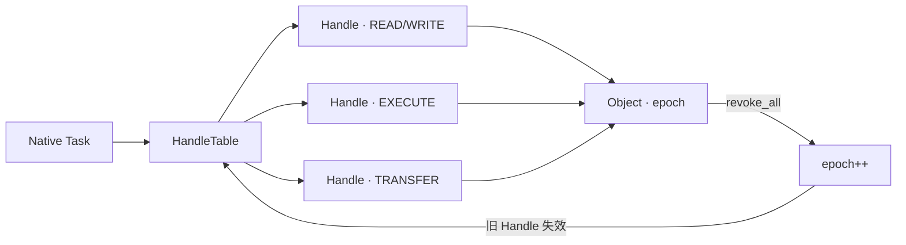

# 权限模型

状态：**设计中** · 关联：[总体架构](architecture.md)、[执行模型](execution.md)、[服务器](servers.md)

HolyKernel 的权限模型采用 **HandleTable + 对象 epoch**：每个 Task 一张句柄表；Handle 携带 `index + generation`；对象带 `epoch`；权限用 5 种 rights 表达；配额、转移、撤销、审计共同保证可靠性。

---

## 1. 模型总览



- **HandleTable** 属于 Native Task；同 Task 的 TCB 共享。
- **Handle** = `index + generation`；槽位记录对象、rights、grant epoch。
- **Object** 有 `epoch`；`revoke_all` 递增 epoch，使所有旧 Handle 失效。
- 权限模型采用线性 HandleTable；撤销在对象级通过 epoch 完成，O(1)。

---

## 2. Rights

| right | 用途 |
| --- | --- |
| `READ` | 读取对象、接收消息、等待通知、查询状态 |
| `WRITE` | 修改对象、发送消息、映射可写 Region/Frame |
| `EXECUTE` | 执行代码、映射可执行 Region/Frame |
| `TRANSFER` | 通过 IPC 把 Handle 转移给其他 Task |
| `ADMIN` | 配置对象、duplicate、revoke_all、close |

规则：

- `duplicate` 需要 `ADMIN`；结果 rights 只能收窄。
- `transfer` 需要 `TRANSFER`；接收方必须通过配额检查；发送方失去该 Handle（move）。
- `revoke_all` 需要对象 owner 的 `ADMIN` Handle；递增对象 epoch。
- `close` 由持有者执行，只影响自己的槽位。
- 对象类型检查失败返回 `WrongType`；rights 不足返回 `PermissionDenied`。

### 2.1 HMP 对象 rights

| 对象 | READ | WRITE | EXECUTE | TRANSFER | ADMIN |
| --- | --- | --- | --- | --- | --- |
| `Capacity` | 查询容量与 Ledger | 分配/归还 Frame | — | 转移 Capacity Handle | 拆分、配置、绑定 Provider |
| `Frame` | 映射只读 | 映射可写、pin/unpin | 映射可执行 | 转移、export/import | 配置导出与驻留 |
| `Region` | 映射只读 | 映射可写 | 映射可执行 | — | protect、unmap |
| `Capability` | 只读映射、查询 | 可写映射 | 可执行映射 | 转移 Capability | 绑定 Provider、scanout、pin |

#### 调度对象 rights

| 对象 | READ | WRITE | EXECUTE | TRANSFER | ADMIN |
| --- | --- | --- | --- | --- | --- |
| `Cadence` | 查询契约与 Meter | 在父范围内调整 weight/budget/latency | 转移契约 | — | 创建、拆分、撤销、设置 lending |
| `Meter` | 读取计量 | — | — | — | 重置、设置水位 |

- `Region` 是任务本地对象；跨任务共享使用 `Capacity`、`Frame` 或 `Capability`。
- `Region` 是唯一映射视图；内核页表是 Region 的物化。
- ABI 面对所有持权服务统一开放 `Capacity`、`Frame`、`Region`；内存授权由 `Handle + Rights + ObjectKind` 决定。
- 初始授予由 Root Server 的服务清单决定；普通服务与 Memory Server 共享顶层 User Capacity，设备授权服务取得独立的 Dma 子容量，内核持有 System Capacity。
- Root Server 持有初始 Cadence 池；Tempo Server 持有普通服务 Cadence 的创建、拆分、调整、准入与撤销权；普通 Task 持有自身 Cadence/Meter 的 READ。
- Cadence 的 WRITE 限制在父契约范围内；ADMIN 只授予 Root/Tempo。Task 通过 Handle 转移获得契约，epoch 撤销使旧 Handle 失效。

---

## 3. 对象 epoch 撤销

```text
grant:   slot.grant_epoch = object.epoch
lookup:  if slot.grant_epoch != object.epoch -> Revoked
revoke:  object.epoch += 1
```

- epoch 撤销是**对象级**的：一次 revoke 使该对象所有旧 Handle 失效。
- 查找直接定位槽位并比较 epoch，O(1)。
- 对象创建者获得 owner `ADMIN` Handle；owner 可重新授予新 Handle。
- 适合撤销服务 Endpoint、共享 Frame、Volume、Window 等对象。
- 代价：撤销粒度是对象级；需要按对象重建 Handle。

---

## 4. Handle 配额

- 每 Task 默认 4096 个 Handle；Root Server 可配置。
- 每服务器独立配额；Root Server 记录使用量与峰值。
- `duplicate`/`transfer` 前检查配额；失败返回 `NoHandles`，配额保持原状。
- Task 退出关闭全部 Handle；`exec` 关闭 `CLOEXEC` 对应 Handle。
- 服务器重启关闭旧 Handle；客户端收到 `BadHandle` 并重连。
- 审计事件：`handle.alloc`、`handle.dup`、`handle.transfer`、`handle.revoke`、`handle.close`、`handle.quota_hit`。

---

## 5. 转移规则

- Handle 只能通过 Endpoint 消息显式转移。
- 发送方必须有 `TRANSFER`；发送后失去该 Handle。
- 接收方必须有配额空位；否则消息失败，发送方保留 Handle。
- Arena/HandleTable 的 `ADMIN`/transfer 只授予管理服务；DeviceGrant 只授予驱动。普通应用管理自己的 HandleTable；Arena/HandleTable/DeviceGrant 由管理服务与驱动持有。
- Capacity/Frame/Capability 通过 `TRANSFER` 转移；每次转移只收窄 rights，并按 Handle 重新记账；Region 任务本地创建，不跨任务转移。
- 内存授权由 Handle、Rights 与 ObjectKind 决定；Root Server 通过服务清单授予初始 Capacity/Frame/Capability。
- POSIX fd 与 Handle 分层：POSIX Server 的 fd 表引用 VFS FileHandle；内核权限由 Handle 管理。
- Endpoint badge 用于客户端标识；权限由 Handle 决定。

---

## 6. POSIX 兼容权限

- POSIX Server 维护 uid/gid/groups/umask。
- VFS/ext2 检查 mode bits：owner/group/other 的读/写/执行。
- `root` 是 POSIX 兼容环境内的 uid 0；权限来自 POSIX 凭证与 Handle。
- 1.0 默认单用户；多用户、ACL、setuid 属于后续版本。
- POSIX Server 是可信组件；其漏洞会影响兼容环境权限，但内核 Handle 仍限制其直接资源访问。

---

## 7. 设备权限

- DeviceGrant 是 MMIO/DMA/IRQ 的 Handle 集合。
- 只有驱动 Task 获得 DeviceGrant；普通应用通过设备服务 Endpoint 访问。
- DeviceGrant 由 Device Manager 按服务清单授予；普通 IPC 只传递 Handle。
- 驱动退出/崩溃时关闭 DeviceGrant；设备重新初始化。
- IOMMU 可用时 DeviceGrant 绑定硬件边界；IOMMU 关闭时驱动采用受信任模式。

---

## 8. 审计与诊断

- 所有 Handle 操作产生 trace：`alloc/dup/transfer/revoke/close/quota_hit`。
- Debug Server 可列出每 Task 的 Handle 数、类型分布、峰值。
- Root Server 监控服务器 Handle 使用量；异常增长触发告警。
- 安全事件记录：`PermissionDenied`、`WrongType`、`Revoked`、`NoHandles`、`QuotaExceeded`。

---

## 9. 保证

1. Handle 查找校验 generation；close 后旧 Handle 失效。
2. Handle 查找校验对象 epoch；revoke_all 后所有旧 Handle 失效。
3. `duplicate` 只能保持或收窄 rights。
4. `transfer` 需要 TRANSFER，接收方需要配额。
5. 每 Task 的 Handle 数保持在配额内。
6. Task 退出/exec/服务器重启执行回收。
7. 对象类型与 rights 检查在每次调用时执行。
8. POSIX fd 与内核 Handle 分离；POSIX root 的权限来自 POSIX 凭证与 Handle。
9. DeviceGrant 只授予驱动/管理服务。
10. 所有 Handle 操作有审计事件。
11. 每个 Frame 来自 Capacity；每次分配、转移与释放都计入 Ledger。
12. 内核与用户态服务共享同一组 HMP 对象与 Rights；内存授权由 Handle、Rights 与 ObjectKind 决定。
13. 每个 Task 持有有效 Cadence 后才能运行；Cadence 与 Meter 通过 Handle、Rights 与 epoch 管理。

---

## 10. 测试策略

| 层级 | 测试 |
| --- | --- |
| Hosted 单元 | generation、epoch 撤销、rights 收窄、配额、transfer 原子性 |
| Hosted 模拟 | Handle 泄漏、配额耗尽、跨 Task 转移、revoke 后重连 |
| QEMU | 服务重启、驱动 DeviceGrant、POSIX fd/mode bits |
| fuzz | Handle 操作序列、IPC Handle 转移、权限组合 |
| 模型检查 | HandleTable 状态机、revoke/close/transfer 交错 |
| 红队 | 提升权限、泄漏 Handle、配额 DoS、类型混淆 |

---

## 11. 残余风险

- IOMMU 关闭时，DeviceGrant 采用受信任驱动模式。
- 对象级 epoch 撤销粒度较粗；需要按对象重建 Handle。
- POSIX Server 是大可信组件；其漏洞影响兼容环境。
- 单用户默认模型提供 Task/Handle 隔离；多用户强隔离由扩展凭证模型提供。
- 当前范围聚焦权限模型、Handle 与审计；签名启动、硬件侧信道加固属于后续评估。

---

## 12. 相关文档

- [总体架构](architecture.md)
- [执行模型](execution.md)
- [服务器](servers.md)
- [POSIX 与 libc](posix.md)
- [工程策略](engineering.md)
- [ADR-0005：Handle 与 IPC](adr/0005-handles.md)
