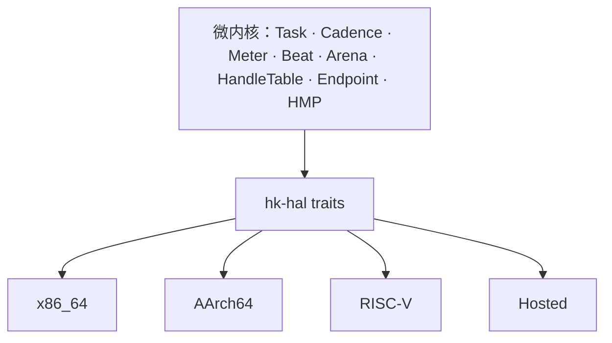

# 平台、启动与移植

状态：**设计中** · 上级：[总体架构](architecture.md)

“全平台全架构”是架构属性：微内核只有一套，架构差异止步于 `hk-hal` 与 platform crate。驱动与设备管理运行在用户态。

---

## 1. 目标与范围

### 目标

1. **一套内核**：`hk-kernel`、`hk-mem`、`hk-ipc`、`hk-handle` 通过 HAL 访问平台。
2. **统一 BootInfo**：memory map、内核镜像、帧缓冲、DTB/RSDP、服务器模块。
3. **用户态驱动**：DeviceGrant 授予 MMIO/DMA/IRQ；驱动运行在用户态。
4. **多架构**：x86_64、AArch64、RISC-V、Hosted 共享同一套语义。
5. **可验证**：Tier 1 x86_64 QEMU 与 Hosted 模拟器；Tier 2 AArch64/RISC-V QEMU。

### 构件

- **HAL traits**：CPU、MMU、IRQ、Timer、SMP、Console、DMA、PCI、Entropy、Power。
- **BootInfo**：内存 map、内核镜像、帧缓冲、direct map、DTB/RSDP、服务器载荷。
- **platform crate**：`hk-platform-hosted`、`hk-platform-x86_64`、`hk-platform-aarch64`、`hk-platform-riscv64`。
- **启动目录**：`platforms/{x86_64,aarch64,riscv64}-qemu` 与 `platforms/hosted`。
- **Hosted 模拟**：虚拟时钟、虚拟 CPU、模拟设备、故障注入、回放。

---

## 2. 平台层级

| 层级 | 目标 | 用途 | 状态 |
| --- | --- | --- | --- |
| Tier 1 | x86_64 QEMU（Limine） | 主要开发与演示 | 已完成（M2） |
| Tier 1 | Hosted 模拟器 | 单元测试、CI、确定性回放 | 已完成（M1） |
| Tier 2 | AArch64 QEMU `virt` | 多架构验证 | 设计完成，待 M7 |
| Tier 2 | RISC-V 64 QEMU `virt` | 多架构验证 | 设计完成，待 M11 |
| Tier 3 | 主流 x86_64 UEFI 真机 | 真机验证 | M11 后 |

---

## 3. HAL



```rust
pub trait Platform: Send + Sync {
    fn name(&self) -> &'static str;
    fn arch(&self) -> Arch;
    fn cpu_count(&self) -> usize;
    fn init(&self, boot: &BootInfo) -> Result<()>;
    fn init_cpu(&self, cpu: CpuId) -> Result<()>;
    fn shutdown(&self) -> !;
    fn reboot(&self) -> !;
    fn mmu(&self) -> &dyn Mmu;
    fn irq(&self) -> &dyn InterruptController;
    fn timer(&self) -> &dyn Timer;
    fn console(&self) -> &dyn Console;
    fn pci(&self) -> Option<&dyn PciConfig>;
    fn dma(&self) -> &dyn DmaOps;
    fn physical(&self) -> &dyn PhysicalAccess;
    fn entropy(&self) -> &dyn Entropy;
}
```

- 核心 crate 通过 trait 访问硬件；架构判断位于 `hk-hal` 实现或 platform crate。
- x86_64 已实现完整 `Platform`：`Mmu`（用户页表登记 + 映射/解除/保护/翻译）、`InterruptController`（IOAPIC）、`Timer`（TSC + LAPIC one-shot）、串口控制台、legacy PCI、DMA 池、direct map 物理访问、RDRAND 熵源、IOMMU 与缓存接口；启动校验走 `Platform::init`，运行时适配器持有该平台对象，PCI/IRQ/计时/DMA/物理访问/IOMMU/缓存均经 HAL 访问。
- Hosted 平台同样实现 `Platform`，用于确定性模拟与单元测试。
- x86_64 安全状态：CPU 支持时启用 SMEP/SMAP，内核访问用户内存用 STAC/CLAC 包裹；用户镜像按 ELF 段落实 W^X（代码 RX、数据 RW/NX），用户栈 RW/NX；每个 CPU 的中断栈分配自独立内核窗口并保留未映射 guard page。
- x86_64 系统调用走 `syscall`/`sysret` 快路径：用户入口用 `syscall`，内核汇编入口切换到 per-CPU 内核栈并构造与中断一致的 `InterruptFrame`，出口用 `sysretq`；`int 0x80` 仍保留为兼容入口。IRQ 绑定按线均摊到已启动 CPU，`InterruptController::set_affinity` 可显式改路由。
- x86_64 页表：CPU 支持 PCID 且具备 INVPCID 时启用 CR4.PCIDE，用户地址空间分配 12 位 PCID，切换写 CR3 不再全量失效，定向失效走 INVPCID；映射按长度与对齐自动选择 2 MiB / 1 GiB 大页，`protect`/`unmap`/`fork` 遇到大页时按需逐级拆分到 4 KiB。
- DMA/IOMMU：`dma_map_capability`/`dma_map_frame` 把设备区间登记到按 BDF 划分的 IOMMU 域，`SYS_DMA_SYNC` 先经 IOMMU translate 再维护缓存；只有后端声明会翻译设备地址（如 VT-d）时，才在 DeviceGrant 的 DMA 窗口内分配 IOVA 并返回给驱动，软件 IOMMU 保持 identity，避免无硬件翻译时破坏真实 DMA。
- MSI-X：表项 vector control 位于 16 字节表项的 +12，启用时先屏蔽全部表项、只放开表项 0，并清除 PCI Interrupt Disable。
- ACPI 固件：`hk-fw` 解析 FADT（PM1 控制/事件块、SCI/GPE、复位寄存器、DSDT/FACS 地址）、MCFG（ECAM 窗口）、SRAT（CPU/内存邻近域）、PPTT（处理器拓扑）、DMAR/IVRS（Intel VT-d / AMD-Vi 单元）、HPET 与 FACS；RSDP v2 同时校验扩展校验和。DMAR/IVRS 与设备树的 `arm,smmu-v3`、`arm,smmu-v2`/`arm,mmu-500`、`riscv,*iommu*` 节点统一映射为平台中性的 `IommuUnit/IommuInfo`，HAL 后端仍由各平台实现。S5 的 SLP_TYP 优先从 DSDT `_S5` 解析，失败再扫描 SSDT，最后才使用通用值 5。SCI 路由到独立向量：处理 PM1 状态与 GPE0/GPE1（写 1 清除），GPE 事件位图通过 `SYS_ACPI_EVENTS` 读取、通过 `SYS_ACPI_LISTEN` 订阅通知。电源/睡眠按钮分别使用虚拟 IRQ 33/34 投递通知位 2/4；没有用户监听者时电源按钮保留默认 S5 策略。空闲 CPU 使用 C1 `hlt`；`SYS_THERMAL` 通过数字温度传感器 MSR 返回当前 CPU 温度。`SYS_CPU_TOPOLOGY` 把 MADT ACPI UID、SRAT proximity 与 PPTT package 组成逻辑 CPU 拓扑返回用户态。x86 启动期按 MCFG 每个窗口分别建立常驻 ECAM 映射并优先用于 PCI 配置访问，解析结果保留在 `bootstrap::firmware()`。HPET 除作为 TSC 不可用时的单调时钟回退外，还用 10 ms 窗口校准 LAPIC 调度 tick；TSC 校准失败时用 HPET 重建 TSC 频率并初始化 RTC。HPET timer0 以 1 s 周期中断按 capability 路由到独立向量，作为独立周期计数/watchdog 信号，不替代 LAPIC tick。`Platform::shutdown` 优先按 FADT 进入 S5，`Platform::reboot` 优先写 FADT reset register，失败分别回退测试退出与 8042。NMI 默认记录后返回；MCE 默认打印银行状态，若 MCG_STATUS 的 MCIP/RIPV/EIPV 置位且各有效 bank 均未标记 UC/PCC，则清除 MCi/MCG 状态并恢复返回，否则按致命异常处理；可通过 `set_nmi_hook` / `set_mce_hook` 覆盖。
- `Mmu` 管理 Arena 地址空间、页表与 TLB shootdown；它是 HMP Region 的物化机制。
- `HMP` 是唯一内存面：Capacity/Frame/Region 由内核与用户态服务共享；平台只提供页表、物理访问与 DMA 机制。
- `InterruptController` 提供 IRQ 绑定与 IPI；运行时保存 IRQ→Notification 绑定，收到待处理中断后按对象标识直接唤醒通知，平台只负责路由/解绑。
- `Timer` 提供一次性定时器与单调时间。
- `DmaOps` 提供 DMA Frame 的缓存维护。
- `PciConfig` 提供 ECAM/legacy 配置访问。

---

## 4. BootInfo

```rust
pub struct BootInfo {
    pub magic: u64,
    pub version: u32,
    pub arch: Arch,
    pub memory_map: &'static [MemoryRegion],
    pub kernel_image: MemoryRegion,
    pub framebuffer: Option<FramebufferInfo>,
    pub direct_map: Option<DirectMapInfo>,
    pub dtb: Option<PhysAddr>,
    pub rsdp: Option<PhysAddr>,
    pub server_modules: &'static [BootModule],
}
```

- `server_modules` 包含 Root Server、Device Manager、VFS、Network Server、HolyFS Server、HolyShell、POSIX Server 等原生 HKX 镜像。
- 内核校验 memory map 非空且不重叠、内核镜像非空且被内存描述、帧缓冲整段落在内存、direct map 覆盖内核/帧缓冲/模块且地址不溢出、模块非空、不重名、互不重叠且不与内核重叠。
- BootInfo 在启动后映射为只读，供诊断使用。

---

## 5. 启动流程

启动流程与顺序以 [总体架构](architecture.md) 为准：

```text
Firmware / Bootloader → Kernel → Root Server
  → Tempo / Device Manager / VFS / Path / Memory
  → Display / Input / Console
  → HolyShell
  → POSIX Server（可选）
```

- 内核只创建 Root Task，并把初始 Capacity、Cadence、HandleTable 与 Endpoint 交给它。
- Root Server 按服务清单启动服务器，分配最小 Handle 与初始 Cadence；HolyShell 是默认命令行。
- POSIX Server 是可选兼容环境，启用时启动 `/sbin/init`。
- 服务器镜像由 bootloader 作为模块提供；Root Server 加载原生任务镜像（HKX）。
- 引导后端：`hk-boot` 的 crate 根只定义 `BootBackend`、`BootError` 与 DTB 后端；`hk_boot::limine` 覆盖 x86_64/AArch64/RISC-V（帧缓冲、RSDP、DTB 请求与 MP 协议按架构取字段），直接 `-kernel` 启动也可用 `hk_boot::dtb`。新增平台只需选择或实现后端，并把产出的 `BootInfo` 交给内核。

---

## 6. 架构细节

| 项 | x86_64 | AArch64 | RISC-V 64 |
| --- | --- | --- | --- |
| 网络设备 | virtio-net / e1000 | virtio-net | virtio-net |
| 页大小 | 4 KiB | 4 KiB | 4 KiB |
| 虚拟地址 | 48 位 | 48 位 | Sv39/Sv48 |
| 页表根 | CR3 | TTBR1 | satp |
| 中断控制器 | APIC/IOAPIC | GICv3 | PLIC/ACLINT |
| 定时器 | TSC deadline / HPET | Generic Timer | SBI timer / ACLINT |
| 串口 | 16550 | PL011 | 16550 |
| SMP 启动 | INIT-SIPI-SIPI | PSCI CPU_ON | SBI HSM |
| 固件信息 | ACPI | DTB | DTB |
| 引导 | Limine | QEMU `-kernel` / UEFI | OpenSBI |

---

## 7. Hosted 模拟器

- 普通进程运行微内核与用户态服务器。
- 虚拟地址区域表模拟 Arena 与 HMP Region 的物化；虚拟时钟模拟 Timer；虚拟设备模拟 PCI/块/输入/网络。
- 支持 `--seed`、`--deterministic`、`--fault-inject`、`--restart-server`。
- 用于单元测试、CI、IPC 回放、服务器重启与 POSIX 测试。

---

## 8. 移植指南

1. 创建 `hk-platform-<arch>`，实现 `Platform`、`Mmu`、`InterruptController`、`Timer`、`Console`、`DmaOps`、`PciConfig`、`Entropy`；`Mmu` 物化 HMP Region，内存对象由 HMP 定义。
2. 创建 `platforms/<arch>-qemu/`：链接脚本、启动汇编、QEMU 配置。
3. BootInfo 适配：memory map、帧缓冲、DTB/ACPI、服务器模块；初始 Capacity 从 BootInfo 建立。
4. 早期启动：栈、BSS、串口、页表、异常向量。
5. SMP：IPI 与 AP 启动。
6. 设备：virtio 优先；DeviceGrant 生成。
7. 通过 conformance suite 后标记支持。

---

## 9. 一致性测试

| 测试 | 内容 |
| --- | --- |
| `boot` | 内核启动、Root Server、服务器加载 |
| `ipc` | Endpoint、Notification、Handle 传递 |
| `memory` | Capacity、Frame、Capability、Region、COW、Ledger、DMA |
| `irq` | IRQHandler、Notification、SMP IPI |
| `vfs` | 挂载、路径解析、ext2 读写 |
| `shell` | HolyShell、Holy 命令、结构化管道、`posix` 入口 |
| `net` | virtio-net、ARP/IPv4/IPv6、TCP/UDP、DHCP、DNS、socket |
| `holyfs` | HolyFS `H:` 卷、文档、修订、快照、恢复 |
| `posix` | fork/exec/wait、pipe、socket、pthreads |
| `restart` | 驱动/VFS/POSIX/Network/HolyFS 崩溃与重启 |
| `ui` | 帧缓冲、窗口、Console |

---

## 10. 保证

1. 微内核通过 HAL 访问平台，保持架构无关。
2. 每个 Task 独立 Arena；内核地址空间与用户态分离。
3. 设备通过 DeviceGrant 授权；驱动运行在用户态。
4. BootInfo 校验失败时进入早期 panic。
5. 每个平台通过同一套 conformance suite 后标记支持。
6. Hosted 平台向内核提供虚拟 HAL 与模拟设备。
7. 目标架构为 64 位：x86_64、AArch64、RISC-V 64、Hosted。
8. 服务器模块由 bootloader 提供，Root Server 加载。
9. 平台只提供 Region 物化与物理访问机制；Capacity/Frame/Region 的语义由 HMP 统一。

---

## 11. 相关文档

- [总体架构](architecture.md)
- [执行模型](execution.md)
- [内存模型（HMP）](hmp.md)
- [服务器](servers.md)
- [网络](network.md)
- [HolyFS 文件系统](holyfs.md)
- [工程策略](engineering.md)
- [路线图](roadmap.md)
