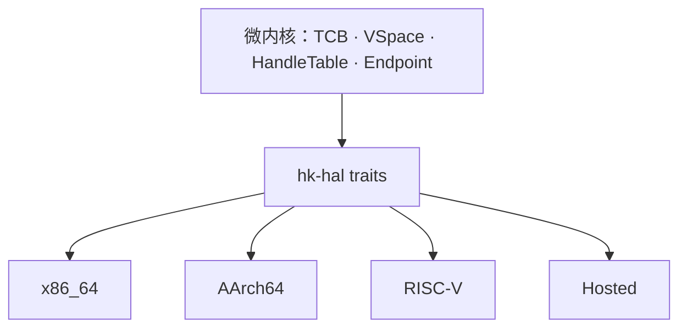
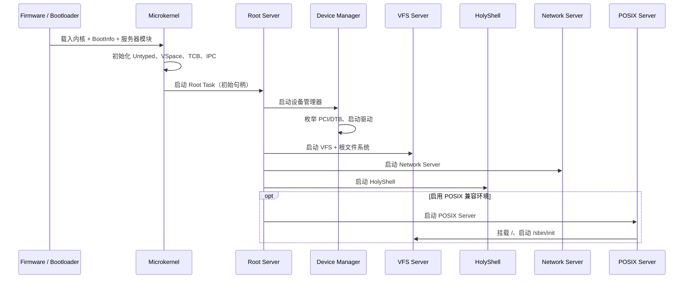

# 平台、启动与移植

状态：**设计中** · 上级：[总体架构](architecture.md)

“全平台全架构”是架构属性：微内核只有一套，架构差异止步于 `hk-hal` 与 platform crate。驱动与设备管理运行在用户态。

---

## 1. 目标与范围

### 目标

1. **一套内核**：`hk-kernel`、`hk-mem`、`hk-exec`、`hk-ipc`、`hk-handle` 通过 HAL 访问平台。
2. **统一 BootInfo**：memory map、内核镜像、帧缓冲、DTB/RSDP、服务器模块。
3. **用户态驱动**：DeviceGrant 授予 MMIO/DMA/IRQ；驱动运行在用户态。
4. **多架构**：x86_64、AArch64、RISC-V、Hosted 共享同一套语义。
5. **可验证**：Tier 1 x86_64 QEMU 与 Hosted 模拟器；Tier 2 AArch64/RISC-V QEMU。

### 构件

- **HAL traits**：CPU、MMU、IRQ、Timer、SMP、Console、DMA、PCI、Entropy、Power。
- **BootInfo**：内存 map、内核镜像、帧缓冲、direct map、DTB/RSDP、服务器载荷。
- **platform crate**：`hk-platform-hosted`、`hk-platform-x86_64`、`hk-platform-aarch64`、`hk-platform-riscv64`。
- **启动目录**：`platforms/{x86_64,aarch64,riscv64}-qemu` 与 `platforms/hosted`。
- **Hosted 模拟**：虚拟时钟、虚拟 CPU、模拟设备、故障注入、回放。

---

## 2. 平台层级

| 层级 | 目标 | 用途 | 状态 |
| --- | --- | --- | --- |
| Tier 1 | x86_64 QEMU（Limine） | 主要开发与演示 | 启动路径完成，M2 收尾中 |
| Tier 1 | Hosted 模拟器 | 单元测试、CI、确定性回放 | 已完成（M1） |
| Tier 2 | AArch64 QEMU `virt` | 多架构验证 | 设计完成，待 M9 |
| Tier 2 | RISC-V 64 QEMU `virt` | 多架构验证 | 设计完成，待 M9 |
| Tier 3 | 主流 x86_64 UEFI 真机 | 真机验证 | M10 后 |

---

## 3. HAL



```rust
pub trait Platform: Send + Sync {
    fn name(&self) -> &'static str;
    fn arch(&self) -> Arch;
    fn cpu_count(&self) -> usize;
    fn init(&self, boot: &BootInfo) -> Result<()>;
    fn init_cpu(&self, cpu: CpuId) -> Result<()>;
    fn shutdown(&self) -> !;
    fn reboot(&self) -> !;
    fn mmu(&self) -> &dyn Mmu;
    fn irq(&self) -> &dyn InterruptController;
    fn timer(&self) -> &dyn Timer;
    fn console(&self) -> &dyn Console;
    fn pci(&self) -> Option<&dyn PciConfig>;
    fn dma(&self) -> &dyn DmaOps;
    fn physical(&self) -> &dyn PhysicalAccess;
    fn entropy(&self) -> &dyn Entropy;
}
```

- 核心 crate 通过 trait 访问硬件；架构判断位于 `hk-hal` 实现或 platform crate。
- `Mmu` 管理 VSpace 页表、映射、TLB shootdown。
- `InterruptController` 提供 IRQ 绑定与 IPI；运行时保存 IRQ→Notification 绑定，收到待处理中断后按对象标识直接唤醒通知，平台只负责路由/解绑。
- `Timer` 提供一次性定时器与单调时间。
- `DmaOps` 提供 DMA Frame 的缓存维护。
- `PciConfig` 提供 ECAM/legacy 配置访问。

---

## 4. BootInfo

```rust
pub struct BootInfo {
    pub magic: u64,
    pub version: u32,
    pub arch: Arch,
    pub memory_map: &'static [MemoryRegion],
    pub kernel_image: MemoryRegion,
    pub framebuffer: Option<FramebufferInfo>,
    pub direct_map: Option<DirectMapInfo>,
    pub dtb: Option<PhysAddr>,
    pub rsdp: Option<PhysAddr>,
    pub server_modules: &'static [BootModule],
}
```

- `server_modules` 包含 Root Server、Device Manager、VFS、Network Server、HolyFS Server、HolyShell、POSIX Server 等原生 HKX 镜像。
- 内核校验 memory map 非空且不重叠、内核镜像非空且被内存描述、帧缓冲整段落在内存、direct map 覆盖内核/帧缓冲/模块且地址不溢出、模块非空、不重名、互不重叠且不与内核重叠。
- BootInfo 在启动后映射为只读，供诊断使用。

---

## 5. 启动流程



- 内核只创建 Root Task，并把初始 Untyped/HandleTable/Endpoint 交给它。
- Root Server 按服务清单启动服务器，分配最小 Handle；HolyShell 是默认命令行。
- POSIX Server 是可选兼容环境，启用时启动 `/sbin/init`。
- 服务器镜像由 bootloader 作为模块提供；Root Server 加载原生任务镜像（HKX）。

---

## 6. 架构细节

| 项 | x86_64 | AArch64 | RISC-V 64 |
| --- | --- | --- | --- |
| 网络设备 | virtio-net / e1000 | virtio-net | virtio-net |
| 页大小 | 4 KiB | 4 KiB | 4 KiB |
| 虚拟地址 | 48 位 | 48 位 | Sv39/Sv48 |
| 页表根 | CR3 | TTBR1 | satp |
| 中断控制器 | APIC/IOAPIC | GICv3 | PLIC/ACLINT |
| 定时器 | TSC deadline / HPET | Generic Timer | SBI timer / ACLINT |
| 串口 | 16550 | PL011 | 16550 |
| SMP 启动 | INIT-SIPI-SIPI | PSCI CPU_ON | SBI HSM |
| 固件信息 | ACPI | DTB | DTB |
| 引导 | Limine | QEMU `-kernel` / UEFI | OpenSBI |

---

## 7. Hosted 模拟器

- 普通进程运行微内核与用户态服务器。
- 虚拟地址区域表模拟 VSpace；虚拟时钟模拟 Timer；虚拟设备模拟 PCI/块/输入/网络。
- 支持 `--seed`、`--deterministic`、`--fault-inject`、`--restart-server`。
- 用于单元测试、CI、IPC 回放、服务器重启与 POSIX 测试。

---

## 8. 移植指南

1. 创建 `hk-platform-<arch>`，实现 `Platform`、`Mmu`、`InterruptController`、`Timer`、`Console`、`DmaOps`、`PciConfig`、`Entropy`。
2. 创建 `platforms/<arch>-qemu/`：链接脚本、启动汇编、QEMU 配置。
3. BootInfo 适配：memory map、帧缓冲、DTB/ACPI、服务器模块。
4. 早期启动：栈、BSS、串口、页表、异常向量。
5. SMP：IPI 与 AP 启动。
6. 设备：virtio 优先；DeviceGrant 生成。
7. 通过 conformance suite 后标记支持。

---

## 9. 一致性测试

| 测试 | 内容 |
| --- | --- |
| `boot` | 内核启动、Root Server、服务器加载 |
| `ipc` | Endpoint、Notification、Handle 传递 |
| `memory` | Untyped、VSpace、COW、DMA |
| `irq` | IRQHandler、Notification、SMP IPI |
| `vfs` | 挂载、路径解析、ext2 读写 |
| `shell` | HolyShell、Holy 命令、结构化管道、`posix` 入口 |
| `net` | virtio-net、ARP/IPv4/IPv6、TCP/UDP、DHCP、DNS、socket |
| `holyfs` | HolyFS `H:` 卷、文档、修订、快照、恢复 |
| `posix` | fork/exec/wait、pipe、socket、pthreads |
| `restart` | 驱动/VFS/POSIX/Network/HolyFS 崩溃与重启 |
| `ui` | 帧缓冲、窗口、Console |

---

## 10. 保证

1. 微内核通过 HAL 访问平台，保持架构无关。
2. 每个进程独立 VSpace；内核地址空间与用户态分离。
3. 设备通过 DeviceGrant 授权；驱动运行在用户态。
4. BootInfo 校验失败时进入早期 panic。
5. 每个平台通过同一套 conformance suite 后标记支持。
6. Hosted 平台向内核提供虚拟 HAL 与模拟设备。
7. 目标架构为 64 位：x86_64、AArch64、RISC-V 64、Hosted。
8. 服务器模块由 bootloader 提供，Root Server 加载。

---

## 11. 相关文档

- [总体架构](architecture.md)
- [执行模型](execution.md)
- [内存模型（HMP）](hmp.md)
- [服务器](servers.md)
- [网络](network.md)
- [HolyFS 文件系统](holyfs.md)
- [工程策略](engineering.md)
- [路线图](roadmap.md)
