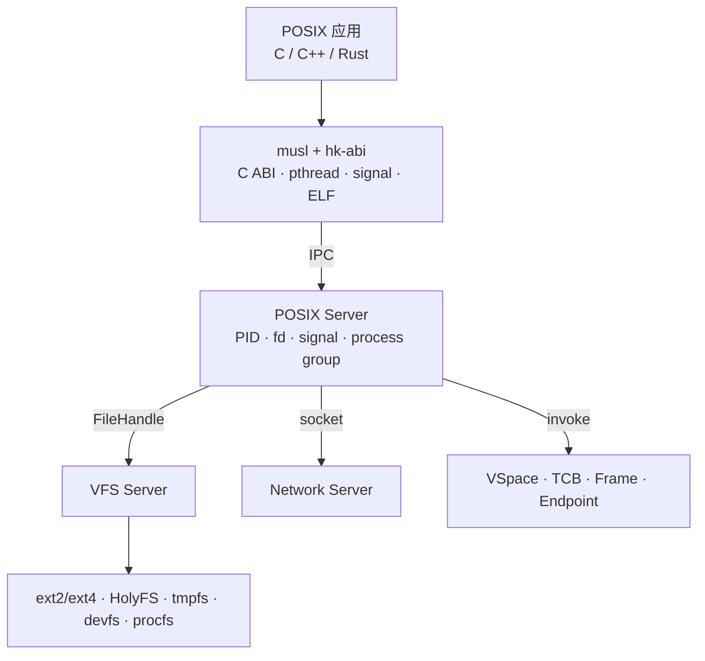
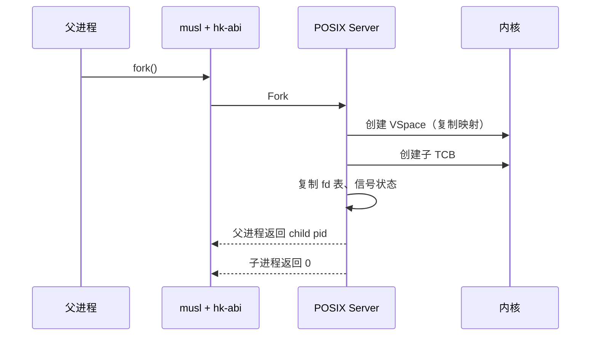

# POSIX 与 libc

状态：**设计中** · 上级：[总体架构](architecture.md)

里程碑：网络与原生 UI 先行（M5/M6）；POSIX 核心在 **M7**、POSIX 扩展与 socket 在 **M8** 接入。

HolyKernel 的默认命令行是 **HolyShell + Holy 命令**；POSIX.1 是**兼容环境**。用户态 **POSIX Server** 提供 POSIX 语义，musl 作为兼容 C libc；`hk-abi` 提供 syscall shim 协议与头文件，`hk-crt` 提供启动、TLS、signal trampoline 与 ELF 加载；`hk-libc` 作为薄兼容层。通过 `posix` 入口使用 `/bin/sh`、coreutils 与 POSIX 应用。

---

## 1. 目标与范围

### 目标

1. **POSIX 兼容环境**：通过 `posix` 入口提供进程、文件、目录、信号、线程、管道、FIFO、Unix 套接字、共享内存、定时器；默认命令行走 HolyShell。
2. **musl + ABI shim**：musl 提供 C 运行时、pthreads、stdio、malloc；`hk-abi` 提供 syscall shim 与头文件；`hk-crt` 提供启动、TLS、signal trampoline、ELF 加载；`hk-libc` 作为薄兼容层。
3. **用户态实现**：POSIX 语义由 POSIX Server 维护；内核只提供 TCB、VSpace、Endpoint、Notification、Frame、Handle。
4. **VFS 集成**：文件与目录操作通过 VFS Server；文件系统后端为 ext2/ext4、tmpfs、devfs、procfs；HolyFS 经适配层提供 Holy 文档。
5. **进程模型**：`fork`、`exec`、`wait`、`exit`、进程组、会话、作业控制。
6. **线程模型**：pthreads 映射到 TCB；libc 管理栈、TLS、join、取消。
7. **兼容性测试**：POSIX 测试套件 + 自有回归 + 应用示例。
8. **可重启**：POSIX Server 崩溃后由 Root Server 重启；应用按策略恢复或终止。

### 1.0 范围

- POSIX.1-2017 核心接口
- `fork`/`exec`/`wait`/`exit`
- 文件与目录：`open`/`read`/`write`/`close`/`stat`/`readdir`/`rename`/`unlink`
- 信号：`sigaction`/`kill`/`sigprocmask`/`sigsuspend`
- 线程：`pthread_create`/`join`/`mutex`/`cond`/`rwlock`/`key`
- IPC：pipe、FIFO、Unix 域套接字、POSIX 共享内存、信号量
- `mmap`/`munmap`/`mprotect`/`brk`
- 时间、`select`/`poll`、终端控制
- ext2/ext4 根文件系统、tmpfs、devfs、procfs；HolyFS 作为 Holy 数据卷

**后续版本评估**

- Linux 二进制 ABI
- TCP/IP、更多 socket 选项
- `epoll`、`inotify`、`fanotify`
- 完整 POSIX 凭证与多用户
- 实时扩展与更完整的终端/pty

---

## 2. 架构



- **musl + `hk-abi`**：musl 提供 C 运行时与 POSIX 函数；`hk-abi` 把 POSIX 调用转换为 POSIX Server IPC；`hk-crt` 提供启动与 ELF 加载。
- **POSIX Server**：维护进程、fd、信号、进程组、会话、管道、Unix 套接字。
- **VFS Server**：路径解析、挂载表、文件句柄、页缓存。
- **Network Server**：socket 后端。
- **内核**：提供 VSpace/TCB/Frame/Endpoint 等机制。

---

## 3. POSIX Server状态

```rust
pub struct PosixServer {
    processes: BTreeMap<Pid, Process>,
    process_groups: BTreeMap<Pgid, ProcessGroup>,
    sessions: BTreeMap<Sid, Session>,
    next_pid: Pid,
    init: Pid,
}

pub struct Process {
    pid: Pid,
    ppid: Pid,
    pgid: Pgid,
    sid: Sid,
    vspace: Handle<VSpace>,
    handle_table: Handle<HandleTable>,
    threads: Vec<Handle<Tcb>>,
    fds: BTreeMap<Fd, FdEntry>,
    signals: SignalState,
    cwd: PathBuf,
    root: PathBuf,
    umask: Mode,
    creds: Credentials,
    exit: Option<ExitStatus>,
}
```

- **PID 表**：进程、父子关系、进程组、会话。
- **fd 表**：fd → `FdEntry`（File、Pipe、Socket、Event、Timer）。
- **信号状态**：pending、blocked、handler、默认动作。
- **凭证**：uid/gid/groups；1.0 使用单用户默认值，接口保留多用户扩展；内核权限模型见 [权限模型](permissions.md)。
- **cwd/root**：POSIX 路径起点；VFS 路径解析使用。
- **退出状态**：父进程通过 `wait` 获取。

---

## 4. musl 与 ABI shim

### 4.1 结构

```c
// musl + hk-abi 提供的 POSIX 入口
int open(const char *path, int flags, ...);
ssize_t read(int fd, void *buf, size_t count);
pid_t fork(void);
int execve(const char *path, char *const argv[], char *const envp[]);
```

- musl 的 POSIX 函数通过 `hk-abi` 的 syscall shim 组装 IPC 请求，发送到 POSIX Server Endpoint。
- 小参数放入消息 words；路径与数据通过共享 Frame。
- 返回值与 `errno` 由 shim 转换为 POSIX 语义。
- 快速路径：`getpid`、`getuid`、时钟读取等由 shim 缓存或直接读共享页。
- 慢路径：`fork`、`exec`、`open`、`read`、`write` 进入 POSIX Server。

### 4.2 请求格式

```rust
pub enum PosixRequest {
    Open { path: FrameRef, flags: u32, mode: u32 },
    Read { fd: i32, len: u32, buf: FrameRef },
    Write { fd: i32, len: u32, buf: FrameRef },
    Fork,
    Exec { path: FrameRef, argv: FrameRef, envp: FrameRef },
    Wait { pid: i32, options: u32 },
    Kill { pid: i32, sig: i32 },
    Socket { domain: i32, ty: i32, proto: i32 },
    ...
}
```

- FrameRef 是共享 Frame Handle + 偏移/长度。
- POSIX Server 通过 VFS/Network Endpoint 转发请求。
- 错误码使用 POSIX `errno` 数值；libc 设置 `errno`。

### 4.3 启动

- 应用由 ELF 加载器启动；`_start` 由 `hk-crt` 提供。
- `hk-crt` 初始化：TLS、栈保护、signal trampoline、`hk-abi` 连接、atexit 表。
- musl 初始化：堆、stdio、pthread 运行时、locale。
- `main(argc, argv, envp)` 由 musl 调用。
- 动态链接：musl 的 `ld-musl-*.so.1` 移植版；支持静态与动态链接。

### 4.4 应用自带 libc

HolyKernel 的稳定边界是 **`hk-abi` syscall shim**，不是某个 libc 的内部 ABI。应用可以自带 libc，但该 libc 必须把底层系统调用实现为 `hk-abi` 请求，并通过 POSIX Server 获得进程、文件、线程、信号与 socket 语义。

| 形态 | 支持级别 | 说明 |
| --- | --- | --- |
| 静态 musl | 一等 | 默认推荐；libc 与 `hk-abi` 后端打进 ELF，无运行时 libc 依赖 |
| 静态自有 libc | best-effort | 需移植 `hk-abi` 后端、启动/TLS/signal hook；不承诺 libc 内部 ABI |
| 系统动态 musl | 一等 | 由系统提供 `ld-musl-*.so.1` 与共享 libc |
| 自带动态 libc | 不推荐 | 需自带加载器，处理符号、TLS 与版本冲突；1.0 不纳入支持矩阵 |
| glibc/Linux 二进制 | 不支持 | 依赖 Linux syscall 号、vDSO、`clone`/futex 等；需单独的 Linux ABI 兼容层 |

自带 libc 的适配要求：

- **系统调用**：不得直接执行 Linux syscall 或假设 `int 0x80` 的 Linux ABI；所有 POSIX 请求经 `hk-abi` 发送到 POSIX Server。
- **启动**：`_start` 可以自带，但必须完成与 `hk-crt` 等价的初始化：TLS、栈保护、`hk-abi` 连接、atexit/析构表、signal trampoline。
- **线程与信号**：pthread、futex、`fork`、COW、信号投递与 `sigreturn` 必须遵循 POSIX Server 与 HK TCB 的协议，libc 不能绕过服务器直接操作内核。
- **命名与错误**：C 符号使用标准 POSIX 名称；`errno` 使用 POSIX 数值；避免与系统 musl 的动态符号混用。
- **链接**：优先静态链接自有 libc；同一 VSpace 只应存在一套 libc 运行时。Native Holy 应用不使用 POSIX libc。

因此官方表述为：**“应用可静态链接自有 libc，但该 libc 必须实现 `hk-abi` 后端；musl 是一等支持，其他 libc 为 best-effort。”**

### 4.5 动态 musl ABI 兼容

除源码重编译外，还提供 **L1.5 动态 musl 兼容**：保持上游 musl 的公开 ABI、loader 路径与 soname，把 syscall 后端替换为 `hk-abi`。未修改的动态 musl ELF（如 Alpine 程序）可直接使用系统的 `ld-musl-x86_64.so.1`/`libc.so` 运行，不经过 Linux ABI Server。

边界：静态 musl 与 glibc 二进制仍走 L2；绕过 libc 直接发 Linux syscall 的程序不属于 L1.5。细节见 [应用兼容与 Linux ABI](compat.md) 与 [ADR-0012](adr/0012-musl-dynamic-abi.md)。

---

## 5. 进程

### 5.1 fork



- 子进程获得新 VSpace；页映射标记只读，写时复制。
- fd 表复制；共享 `OpenFile` 偏移由 VFS 维护。
- 信号处理继承；pending 集合清空。
- 失败时返回 `-1` 并设置 `errno`。

### 5.2 exec

- `hk-crt` + musl 动态链接器读取 ELF，验证头部与段。
- POSIX Server 创建新 VSpace，映射 text/data/bss/stack/interpreter。
- 旧 VSpace 在成功后释放；fd 按 `FD_CLOEXEC` 关闭。
- `argv`/`envp` 复制到新栈；设置入口点。
- 失败时保留旧映像并返回 `-1`。

### 5.3 wait / exit

- 子进程退出向父进程 Endpoint 发送 `SIGCHLD` 事件。
- 父进程 `wait`/`waitpid` 从 POSIX Server 获取退出状态。
- 孤儿进程由 PID 1（`/sbin/init`）收养。
- 僵尸状态由 POSIX Server 维护，直到父进程回收。

---

## 6. 线程

- 原生基础已落地：`SYS_THREAD_CREATE`/`SYS_THREAD_JOIN`/`SYS_THREAD_SET_TLS` 提供同地址空间线程、TLS 与等待，`SYS_FUTEX_WAIT`/`SYS_FUTEX_WAKE` 提供共享内存等待。
- pthreads 映射到内核 TCB；每个线程拥有独立栈与 TLS，由 musl 分配后调用原生线程接口创建 TCB。
- `pthread_join` 通过原生线程等待线程退出。
- `pthread_mutex`/`cond`/`rwlock` 使用 futex 语义：共享 Frame + 原生 futex 等待/唤醒。
- `pthread_cancel` 通过取消点与异常展开实现；musl 维护取消状态。
- `pthread_key` 由 musl 的 TLS/析构表管理。

---

## 7. 信号


- POSIX Server 维护进程级 pending/blocked 集合。
- 投递时选择未阻塞该信号的线程；musl trampoline 保存上下文并调用 handler。
- 默认动作：终止、忽略、停止、继续。
- 内核异常通过 Fault Endpoint 交给 POSIX Server，再转换为 `SIGSEGV`/`SIGFPE`/`SIGILL`。
- `sigreturn` 由 musl 与 POSIX Server 协作恢复上下文。

---

## 8. 文件与 VFS

- POSIX Server 的 fd 表指向 VFS `FileHandle`。
- `open`：POSIX Server 调用 VFS `open`，获得 `FileHandle`。
- `read`/`write`：通过共享 Frame 传输数据；VFS 命中页缓存时零拷贝。
- `stat`/`readdir`/`rename`/`unlink`：转发到 VFS。
- `dup`/`dup2`：复制 fd 条目，共享 `OpenFile`。
- `fcntl`：flags、锁、`O_APPEND` 由 POSIX Server 与 VFS 协作。
- `mount`/`umount`：转发到 VFS 挂载表。
- 设备文件：VFS devfs 后端转发到设备 Endpoint。
- HolyFS 以 Holy 卷工作：VFS 通过适配层把路径与偏移映射为文档对象、修订与集合操作；适配层承担 POSIX 语义，HolyFS 磁盘格式保持 Holy 模型。
- HolyFS 卷可作为兼容环境的数据挂载点，同时以 `H:` 盘符供原生应用访问。

详见 [VFS](vfs.md)。

---

## 9. 管道、FIFO、套接字

- **pipe**：POSIX Server 创建一对共享 Frame + Notification；fd 表保存读/写端。
- **FIFO**：VFS 中的命名管道节点；打开时连接 POSIX Server 的管道对象。
- **Unix 域套接字**：POSIX Server 管理端点与连接队列；数据通过 Frame 传递。
- **网络套接字**：POSIX Server 转发到 Network Server；支持 AF_INET/AF_INET6 的 TCP/UDP、loopback、AF_UNIX；详见 [网络](network.md)。
- `select`/`poll`：POSIX Server 聚合 fd 事件；`epoll` 属于后续版本。

---

## 10. 内存

- `brk`/`sbrk`：POSIX Server 扩展进程 heap；映射新 Frame。
- `mmap`：文件映射通过 VFS 页缓存；匿名映射通过 Untyped；共享映射通过 Frame。
- `mprotect`：更新 VSpace 权限。
- `munmap`：解除映射并释放 Frame 引用。
- `fork` COW：页错误通过 Fault Endpoint 交给 POSIX Server。
- 栈：musl 分配主线程栈与 pthread 栈；guard page 由 VSpace 配置。

---

## 11. 时间与终端

- `clock_gettime`、`nanosleep`、`gettimeofday` 由 musl + `hk-abi` 与 POSIX Server 提供。
- POSIX Server 使用内核 Notification/定时器实现超时。
- 终端：console 服务提供行规程；`termios`、`isatty`、`tcgetattr` 由 musl + `hk-abi` 与 console 服务实现。
- pty：后续版本通过 console 服务提供。
- 用户/组：1.0 使用默认单用户凭证；接口保留 `setuid`/`setgid` 扩展。

---

## 12. 兼容性矩阵

| 类别 | 1.0 | 后续版本 |
| --- | --- | --- |
| 进程 | `fork`/`exec`/`wait`/`exit`/`getpid` | 作业控制、会话扩展 |
| 文件 | `open`/`read`/`write`/`stat`/`readdir`/`rename`/`unlink` | `inotify`、`fanotify` |
| 线程 | pthread create/join/mutex/cond/rwlock/key | 实时线程、CPU 亲和 |
| 信号 | POSIX 信号、handler、屏蔽 | 实时信号扩展 |
| IPC | pipe、FIFO、AF_UNIX、共享内存、信号量 | POSIX 消息队列 |
| 网络 | IPv4/IPv6、TCP/UDP、DHCP、DNS、AF_UNIX | TLS、Wi-Fi、更多 socket 选项 |
| 内存 | `mmap`/`mprotect`/`brk` | `madvise`、大页 |
| 终端 | termios、isatty | pty、作业控制 |
| 凭证 | 单用户默认值 | 多用户、ACL |
| ABI | 源码兼容（重新编译） | Linux 二进制 ABI |

---

## 13. 测试策略

| 层级 | 测试 |
| --- | --- |
| musl / ABI 单元 | 字符串、stdio、malloc、pthread、signal、errno、shim |
| POSIX Server | PID/fd 表、fork/exec/wait、信号、pipe、socket |
| VFS 集成 | open/read/write/stat/readdir/rename/unlink、挂载 |
| POSIX 套件 | POSIX.1 测试集、文件/进程/线程/信号用例 |
| 应用回归 | shell、coreutils、编译器、脚本运行时 |
| 故障注入 | POSIX Server 崩溃、VFS 崩溃、驱动崩溃、EIO 传播 |
| 基准 | fork+exec、open/read/write、pthread 创建、pipe 吞吐 |

---

## 14. 保证

1. POSIX 语义由用户态 POSIX Server 实现；musl + `hk-abi` 提供应用侧 C ABI。
2. 内核维护 TCB、VSpace、Endpoint、Notification、Frame 与 Handle。
3. POSIX Server 维护 PID、fd、信号、进程组、会话。
4. 文件操作通过 VFS；文件系统后端以服务器形式接入。
5. `fork` 使用 COW；页错误由 POSIX Server 处理。
6. `exec` 加载 ELF 并创建新 VSpace。
7. 信号通过 POSIX Server 的 pending/blocked 集合投递。
8. fd 表条目指向 VFS `FileHandle`、pipe、socket 或 event。
9. musl 提供 C 运行时；`hk-abi`/`hk-crt` 提供 ABI shim、启动与头文件；应用重新编译。
10. 应用可静态链接自有 libc，但必须实现 `hk-abi` 后端；系统只承诺 `hk-abi` 边界，不承诺 libc 内部 ABI。
11. POSIX Server 崩溃后，Root Server 重启并按策略恢复应用。

---

## 15. 相关文档

- [总体架构](architecture.md)
- [权限模型](permissions.md)
- [网络](network.md)
- [VFS](vfs.md)
- [HolyFS 文件系统](holyfs.md)
- [服务器](servers.md)
- [内存模型（HMP）](hmp.md)
- [执行模型](execution.md)
- [工程策略](engineering.md)
- [应用兼容与 Linux ABI](compat.md)
