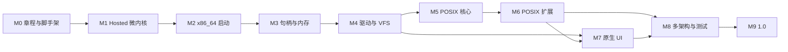

# 路线图

状态：**设计中** · 上级：[总体架构](architecture.md)

本文定义 M0–M9 里程碑、退出标准、决策门与风险。节奏由退出标准决定，以可演示的纵向切片推进。

---

## 1. 排序原则

1. **先 Hosted，后裸机**：内核与 IPC 在确定性模拟器中先跑通。
2. **先内核机制，后服务器**：TCB、VSpace、HandleTable、Endpoint、Notification、Frame 优先。
3. **先 Root Server，后全栈**：Root Server、Device Manager、VFS、POSIX 依次接入。
4. **VFS 先行**：ext2/tmpfs/devfs/procfs 通过 VFS 统一；POSIX Server依赖 VFS。
5. **POSIX 分层**：先文件/进程，后线程/信号/套接字。
6. **可选服务**：HolyFS 文件系统、HolyDoc、UI 在 POSIX 核心之后接入。
7. **多架构收尾**：x86_64 纵向切片完成后抽 HAL，验证 AArch64/RISC-V。

---

## 2. 里程碑总览

| 里程碑 | 主题 | 关键产物 | 决策门 |
| --- | --- | --- | --- |
| M0 | 章程、架构、脚手架 | 文档、workspace、CI、xtask、Hosted stub | G0：架构批准 |
| M1 | Hosted 微内核 | TCB、VSpace、HandleTable、Endpoint、Notification、Frame | G1：内核对象冻结 |
| M2 | x86_64 启动 | Limine、BootInfo、Root Server、IPC | — |
| M3 | 句柄与内存 | Handle duplicate/close、COW、SMP、调度 | G2：句柄模型冻结 |
| M4 | 用户态驱动与 VFS | DeviceGrant、virtio、VFS、ext2/tmpfs/devfs/procfs | G3：VFS 接口冻结 |
| M5 | POSIX 核心 | POSIX Server、musl、hk-abi/hk-crt、fork/exec/wait、文件 | G4：POSIX ABI 冻结 |
| M6 | POSIX 扩展 | pthreads、信号、pipe、AF_UNIX、mmap | — |
| M7 | 原生 UI | Display Server、HolyDoc、Console、输入 | — |
| M8 | 多架构与测试 | AArch64/RISC-V、POSIX 套件、性能 | G5：平台抽象冻结 |
| M9 | 1.0 | 硬化、fuzz、发布镜像、真机 | G6：1.0 |

---

## 3. M0 — 章程、架构、脚手架

### 交付

- 章程、总体架构、内存、执行、服务器、VFS、POSIX、UI、平台、工程、路线图、术语、ADR。
- Cargo workspace；全部目标可编译（允许空实现）。
- `xtask`：`build`、`run`、`test`、`lint`、`docs`、`budget`。
- CI：`fmt`、`clippy`、`build-matrix`、`host-test`、`docs`、`deny`、`budget`。
- `hk-platform-hosted` stub：BootInfo、初始化、退出协议。
- 许可证确认。

### 退出标准

1. Hosted、x86_64、AArch64 三个目标构建成功。
2. `cargo xtask lint` 与 CI 全绿。
3. 架构文档评审通过；ADR-0001 至 0008 已接受。

---

## 4. M1 — Hosted 微内核

### 交付

- `hk-hal`：CPU、MMU、IRQ、Timer、SMP、Console、DMA。
- `hk-kernel`：TCB、VSpace、HandleTable、Endpoint、Notification、Frame、Untyped。
- `hk-ipc`：send/recv/call/reply、Notification、句柄传递。
- `hk-handle`：HandleTable、duplicate/close、IPC 转移。
- Hosted 模拟器：虚拟 CPU、虚拟时钟、虚拟 VSpace。
- Root Server stub：加载服务器、分配句柄、IPC 回环。
- Native Task：VSpace+HandleTable+TCB(s)+Arena 的用户态封装；窗口由 Display Server 管理。

### 退出标准

1. Hosted 启动 Root Server，两个服务器通过 Endpoint 完成 call/reply。
2. Handle duplicate/close 与 IPC 转移测试通过。
3. VSpace 映射/解除映射/COW 单元测试通过。
4. 确定性模拟：固定种子回放一致。
5. 内核 panic dump 可复现。

---

## 5. M2 — x86_64 启动

### 交付

- `platforms/x86_64-qemu`：链接脚本、启动汇编、Limine、ISO。
- BootInfo 适配、早期串口、GDT/IDT、APIC、定时器、帧缓冲文本。
- Root Server ELF 加载、初始 Handle 分配。
- 用户态服务器 IPC 回环；Device Manager stub。
- QEMU smoke 框架。
- Native Task 视图：任务名、Arena、子 Task、窗口列表。
- HolyShell 基础：`tasks`、`services`、`mounts`、`help`。
- HolyShell Session：Native Task、Session Namespace、`use`/`load`。

### 退出标准

1. QEMU 启动内核与 Root Server。
2. Root Server 启动两个用户态服务并完成 IPC。
3. 帧缓冲与串口输出正常。
4. 故意触发内核 panic/页错误，dump 完整。
5. 启动时间预算记录。

---

## 6. M3 — 句柄与内存

### 交付

- HandleTable、duplicate/close、IPC 转移。
- Untyped retype、Frame 共享、VSpace 映射、COW、Fault Endpoint。
- SMP 启动、per-CPU、IPI、抢占调度、tickless。
- 用户态线程创建/退出、通知与等待。
- HandleTable 审计与 trace。

### 退出标准

1. 2/4 核 SMP 启动；跨核 IPC 与唤醒正常。
2. COW fork 原型在 Hosted 与 QEMU 通过。
3. Handle close 后旧引用失效。
4. 上下文切换 ≤ 1 µs；IPC call/reply ≤ 2 µs（QEMU 记录）。
5. 服务器崩溃后 Root Server 可关闭句柄并重启 stub。

---

## 7. M4 — 用户态驱动与 VFS

### 交付

- Device Manager：PCI/DTB 枚举、DeviceGrant、驱动启动。
- virtio-blk/input/net 驱动；IRQ → Notification。
- VFS Server：挂载表、路径解析、dentry/inode 缓存、FileHandle、页缓存。
- ext2、tmpfs、devfs、procfs 后端。
- Block Driver 与 VFS 的 Endpoint 接口。
- VFS 重启与后端恢复。

### 退出标准

1. 挂载 ext2 根镜像，读写文件，重启后数据保留。
2. tmpfs/devfs/procfs 挂载与访问正常。
3. VFS 崩溃后重启，在途请求返回 `EIO`，新请求恢复。
4. 驱动崩溃后 Device Manager 重启驱动。
5. VFS 1 MiB 顺序读 ≥ 100 MiB/s。

---

## 8. M5 — POSIX 核心

### 交付

- POSIX Server：PID 表、fd 表、进程组、会话、cwd/root。
- musl 移植：C 运行时、stdio、malloc、pthreads；`hk-abi` 提供 syscall shim 与头文件；`hk-crt` 提供启动、TLS、signal trampoline、ELF 加载；`hk-libc` 薄兼容层。
- ELF 加载器与动态链接。
- `fork`/`exec`/`wait`/`exit`；文件 `open`/`read`/`write`/`stat`/`readdir`/`rename`/`unlink`。
- `/sbin/init`、`/bin/sh`、基础 coreutils；`posix` 兼容入口。
- Console Service 与 POSIX 终端基础。

### 退出标准

1. QEMU 启动到 HolyShell；`posix sh` 可用。
2. `posix sh` 执行 `ls`、`cat`、`echo`、重定向与管道。
3. 静态与动态链接 C 程序运行；musl 作为兼容环境主 libc。
4. `fork` + `exec` `/bin/true` ≤ 5 ms。
5. POSIX 文件测试子集通过。

---

## 9. M6 — POSIX 扩展与网络

### 交付

- pthreads：create/join/mutex/cond/rwlock/key/TLS。
- 信号：sigaction、kill、sigprocmask、trampoline。
- pipe、FIFO、AF_UNIX、共享内存、信号量。
- `mmap`/`mprotect`/`brk`。
- `select`/`poll`、`termios`、`isatty`。
- Network Server：virtio-net、IPv4/IPv6、ARP/NDP、TCP/UDP、DHCP、DNS。
- POSIX socket API：socket/bind/listen/accept/connect/send/recv/getaddrinfo。
- 原生 Socket Handle 与 `net` 命令。
- POSIX 测试套件扩展到进程/线程/信号/IPC/网络。

### 退出标准

1. 多线程 C/C++ 程序运行。
2. 信号 handler 与 `sigreturn` 正常。
3. pipe/socket 测试通过；`select`/`poll` 正常。
4. `mmap` 文件映射与共享内存测试通过。
5. QEMU `ping`、TCP 连接、DNS 查询、DHCP 租约成功。
6. POSIX 测试子集通过率达到里程碑目标。

---

## 10. M7 — 原生 UI

### 交付

- Display Server：帧缓冲、窗口、合成器、输入焦点。
- Console Service 与 POSIX 终端。
- HolyDoc Server：解析、布局、渲染、链接、`@exec`。
- sRGB 真彩色 + 主题、可缩放字体（8×16 位图回退）、窗口切换。
- 原生欢迎页与文档浏览。
- Debug Server：Task/资源视图、trace、`hk-dbg`、符号化栈回溯。
- 服务器热重启与应用热替换原型。
- Workbench：编辑/浏览/构建/运行/调试一体化。
- Toolchain Server：系统内构建、编译期执行、隐藏链接步骤。
- Checkpoint Server：Native Task 快照与恢复。
- HolyFS Core：extent、checksum、双超级块、页缓存、VFS Backend、POSIX inode、整文档 API。
- Sprite/Font 编辑器、Home/Once 启动文档。

### 退出标准

1. QEMU 启动到图形 Console 与 HolyShell。
2. HolyDoc 链接跳转、`@exec` 结果嵌入。
3. 多窗口、焦点、键盘/鼠标正常。
4. Display Server 崩溃后重启，Console 重连。
5. 帧缓冲全屏重绘 ≤ 8 ms。
6. HolyFS `H:` 挂载、POSIX 文件操作、整文档读写、快照与重启恢复。

---

## 11. M8 — 多架构与测试

### 交付

- `hk-platform-aarch64`、`hk-platform-riscv64` 与 QEMU 启动目录。
- AArch64/RISC-V 的 Root Server、VFS、POSIX、Network、HolyFS 全栈。
- POSIX 测试套件扩展；VFS/ELF/驱动/网络/HolyFS fuzz。
- 性能基准与预算复核。
- 服务器重启矩阵（含 Network Server、HolyFS）。
- HolyFS COW 事务、GC、check/repair、scrub、性能优化与主根启动。

### 退出标准

1. 4 个目标通过同一套 `boot/ipc/memory/irq/vfs/net/holyfs/posix/restart` 测试。
2. AArch64/RISC-V 上 HolyShell 与 `posix` coreutils 运行。
3. POSIX 测试子集在 x86_64 与 AArch64 通过。
4. 服务器崩溃/重启矩阵通过。
5. QEMU 以 HolyFS 为 `/` 启动并运行 POSIX 测试子集。
6. 性能预算达标或记录例外 ADR。

---

## 12. M9 — 1.0

### 交付

- 硬化：fuzz 语料库、回归、长时间压力、故障注入矩阵。
- 文档：用户手册、libc 参考、VFS 指南、移植指南、故障排查。
- 发布镜像：x86_64 ISO、AArch64/RISC-V 镜像、Hosted 模拟器。
- 主流 x86_64 UEFI 真机验证。
- 安全/可靠性审计：`unsafe`、依赖、句柄回收、服务器重启。

### 退出标准

1. 所有里程碑退出标准成立。
2. conformance 在 Tier 1 + Tier 2 全绿；Tier 3 至少一台真机启动到 HolyShell。
3. 72 小时 SMP + 服务器重启 + VFS 故障注入：零死锁、零数据损坏、零未处理 panic。
4. POSIX 测试套件达到公开目标；应用回归通过。
5. 内核行数 ≤ 50,000；构建可复现。
6. 文档完整；发布镜像与校验和齐全。

---

## 13. 风险与应对

| 挑战 | 影响 | 应对 |
| --- | --- | --- |
| 微内核 IPC 性能 | POSIX 应用变慢 | 快速路径、共享 Frame、批处理、基准门禁 |
| POSIX Server 复杂 | 进度拖延 | 分层实现：文件/进程 → 线程/信号 → 网络 |
| VFS 与后端一致性 | 数据损坏 | 单元 + 故障注入 + 后端重启测试 |
| `fork`/COW 语义 | 兼容性问题 | 早期原型、POSIX 测试、页错误跟踪 |
| 服务器重启状态恢复 | 应用中断 | 明确 EIO 语义、重连协议、会话恢复策略 |
| 多架构移植 | 范围扩大 | Tier 分层、x86_64 纵向切片优先 |
| libc 兼容范围 | 应用覆盖需要提升 | POSIX 测试套件 + 应用回归 + 增量接口 |
| 内核可信基 | 安全风险 | 最小内核、句柄模型、`unsafe` 审计 |

---

## 14. 当前状态

- 已完成：M0 脚手架（workspace、`xtask`、CI、`hk-hal`、`hk-test`、Hosted 平台与退出协议）、全部设计文档与 ADR。
- 当前代码：`crates/hk-hal`、`crates/hk-test`、`crates/hk-platform-hosted`、`platforms/hosted`、`xtask`。
- 下一步：M1 Hosted 微内核（TCB、VSpace、HandleTable、Endpoint、Notification、Frame）。

---

## 15. 相关文档

- [章程](charter.md)
- [总体架构](architecture.md)
- [服务器](servers.md)
- [VFS](vfs.md)
- [POSIX 与 libc](posix.md)
- [工程策略](engineering.md)
