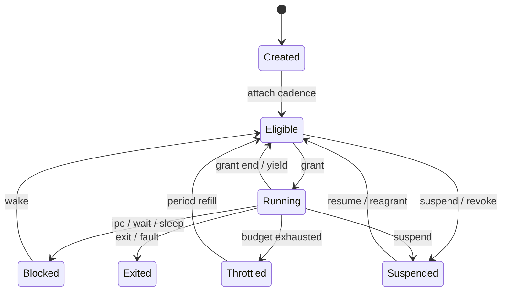

# Holy Cadence Model（HCM）

状态：**已接受** · 关联：[ADR-0017](adr/0017-holy-cadence.md) · 上级：[总体架构](architecture.md)

实现状态：对象面（`hk-cadence`）、内核 Task/Cadence/Meter 对象与 Beat 类别队列已落地；Tempo 策略服务、lending、tickless、亲和与 checkpoint 集成仍在推进，逐项状态见 §12。

Holy Cadence Model 是 HolyKernel 的原生调度契约。它把 CPU 时间表达为与内存同级的显式资源：**Task 持有 Cadence，内核执行 Cadence，Tempo 授予 Cadence，Meter 记录 Cadence。**

---

## 1. 目标

1. **Task 是调度主体。** 公平、预算、计量与快照都以 Native Task 为单位；TCB 是 Task 内的执行单元。
2. **契约显式。** 类别、权重、预算、周期、截止期、延迟目标、亲和性与借贷策略全部写在 Cadence 中。
3. **策略在用户态。** Tempo Server 决定授予、拆分、调整、准入与撤销；内核只执行契约。
4. **可观察。** Meter 是唯一计量来源；调度决策进入 trace；任务管理器读取同一份 Meter。
5. **可恢复。** checkpoint 保存契约身份与计量水位；服务器重启后由 Root/Tempo 重新授予。
6. **确定性。** Hosted 模拟器用虚拟时钟驱动 Beat，相同种子与输入产生相同调度 trace。
7. **空闲即空闲。** 每 CPU 有 idle TCB；没有 Eligible Task 时 CPU 执行 `hlt`。

---

## 2. 原生对象面

| 概念 | 定义 | 所有者 |
| --- | --- | --- |
| **Task** | 调度主体：Cadence + Meter + TCB(s) + 父子关系 + 可运行状态 | 内核调度层 / Root、Tempo（授予面） |
| **Cadence** | 时间契约 Handle：类别、权重、预算、周期、截止期、延迟目标、亲和性、借贷策略、父契约、epoch | Root / Tempo |
| **Meter** | 计量 Handle：消耗、等待、节流、超限、迁移、切换、虚拟进度 | Root / Tempo / Debug |
| **Tempo Server** | 用户态策略服务：创建、拆分、调整、准入、撤销 | Root Server |
| **Beat** | 每 CPU 调度核心：类别队列、Grant、定时器、抢占、idle、负载均衡 | 内核 |
| **Grant** | 内核内部执行许可：某 Task 在某 CPU 上可运行的时间片 | Beat |

`Cadence` 与 `Meter` 是 Handle 对象，拥有 Rights、epoch 与配额。`Grant` 留在 Beat 内部，作为记账单位。

---

## 3. 铸造链与授予

```mermaid
flowchart LR
    ROOT["Root Server<br/>初始 Cadence 池"] -->|create / split| TEMPO["Tempo Server<br/>策略与准入"]
    TEMPO -->|grant| CAD["Cadence"]
    CAD -->|attach| TASK["Native Task"]
    TASK -->|TCB(s)| TCB["执行单元"]
    TASK -->|charge| METER["Meter"]
    BEAT["Beat<br/>每 CPU"] -->|Grant| TASK
```

- Root Server 持有初始 **Cadence 池**，按服务清单把契约授予 Tempo 与核心服务。
- Tempo 创建、拆分与调整普通服务契约，执行 Realtime 准入，处理撤销与回收。
- Task 启动时由 Root/Tempo 附加 Cadence；子 Task 默认继承父契约的收窄份额。
- 每一步只收窄 Rights；Handle 转移是唯一授权方式。
- Cadence 可以拆分为子契约，子契约预算总和不超过父契约。
- 撤销通过 epoch 完成：Root/Tempo 递增 Cadence epoch，旧 Handle 失效，Task 进入 `Suspended` 并由 Tempo 重新授予。

### 3.1 默认授予

| 服务角色 | 默认 Cadence |
| --- | --- |
| Root Server | `Latency { weight: 4096, latency: 1ms }` |
| Tempo Server | `Latency { weight: 2048, latency: 1ms }` |
| Display / Input / Console | `Realtime { budget: 3ms, period: 16ms, deadline: 8ms }` |
| VFS / HolyFS / VirtIO | `Latency { weight: 3072, latency: 4ms }` |
| Network / POSIX / Checkpoint / Debug | `Latency { weight: 2048, latency: 4ms }` |
| Toolchain / 后台任务 | `Throughput { weight: 1024 }` |
| 普通服务 | 父 Task 契约的收窄份额 |
| idle TCB | `Idle`，每 CPU 一个 |

具体数值由服务清单与 Tempo 策略决定；上表定义 1.0 的初始基线与角色分类。

---

## 4. Rights 与 ABI

### 4.1 Rights

| 对象 | READ | WRITE | TRANSFER | ADMIN |
| --- | --- | --- | --- | --- |
| `Cadence` | 查询类别、权重、预算、周期、截止期、亲和性、Meter | 在父契约范围内调整 weight/budget/latency | 转移契约 | 创建、拆分、撤销、设置 lending |
| `Meter` | 读取计量 | — | — | 重置、设置水位 |

- 普通 Task 持有自身 Cadence 的 READ 与自身 Meter 的 READ。
- WRITE 授予 Tempo 与父 Task；ADMIN 授予 Root/Tempo。
- Task 的类别、预算与亲和性只能由 Tempo 在父契约范围内修改。

### 4.2 ABI

进程与线程段 `0x00–0x0F` 保留：

| 调用 | 语义 |
| --- | --- |
| `SYS_SLEEP(ticks)` | 休眠指定调度 tick，进入 Beat 的 deadline 队列 |
| `SYS_YIELD` | 当前 TCB 让出剩余 Grant；Task 保持 `Eligible` |
| `SYS_CADENCE_INFO(handle, out)` | 查询契约 |
| `SYS_CADENCE_UPDATE(handle, params)` | 在父范围内修改契约 |
| `SYS_CADENCE_SPLIT(parent, params, out)` | 派生子契约 |
| `SYS_CADENCE_REVOKE(handle)` | 撤销契约 |
| `SYS_METER_INFO(handle, out)` | 查询计量 |
| `SYS_TASK_ATTACH_CADENCE(task, cadence)` | Root/Tempo 为 Task 附加契约 |

Task、Cadence、Meter 都使用统一 Handle 表示；Rust 客户端库提供零成本类型包装。

---

## 5. 调度模型

### 5.1 两级调度

1. **Task 级**：Beat 在所有 Eligible Task 之间选择下一个 Grant。
2. **TCB 级**：Task 获得 Grant 后，其可运行 TCB 轮转使用该 Grant；任务阻塞时切换下一个 TCB。

公平、预算与计量都记在 Task 上，同一 Task 的 TCB 共享同一份 Cadence 与 Meter。

### 5.2 类别

| 类别 | 选择算法 | 用途 |
| --- | --- | --- |
| `Realtime` | EDF + CBS（预算/周期） | 显示刷新、音频、输入 |
| `Latency` | 带虚拟截止期的加权公平队列 | 终端、窗口、文件服务 |
| `Throughput` | 加权虚拟时间（WFQ/stride） | 编译、索引、后台任务 |
| `Idle` | 每 CPU idle TCB | 无 Eligible Task 时执行 `hlt` |

选择顺序：`Realtime` → `Latency` → `Throughput` → `Idle`。

### 5.3 虚拟时间

```text
weight_ref = 1024
slice(task) = clamp(BASE_SLICE * weight_ref / weight, MIN_SLICE, MAX_SLICE)
charge(task, dt) = dt * weight_ref / weight
virtual_pass += charge
```

- `Latency` 类维护 `virtual_deadline = virtual_pass + latency_budget`；Beat 选择最小虚拟截止期。
- `Throughput` 类选择最小 `virtual_pass`。
- `Realtime` 类维护 `period_start`、`budget_left` 与 `absolute_deadline`；Beat 选择最早截止期，用 CBS 规则补充预算。
- 同类内长期 CPU 份额与 `weight` 成正比；误差上界由 `MAX_SLICE` 与抢占延迟决定。

### 5.4 预算与 Throttled

- `budget > 0` 表示硬预算：Task 在一个 `period` 内消耗超过 `budget` 后进入 `Throttled`。
- `Throttled` 的 Task 从类别队列移除；下一个周期由 Beat 重新入队并补充预算。
- `budget = 0` 表示纯权重共享，Task 在同类内按 `weight` 长期获得份额。
- 预算用尽、周期恢复与超限事件写入 Meter 与 trace。

### 5.5 状态机



- Task 状态：`Created / Eligible / Running / Blocked / Throttled / Suspended / Exited`。
- TCB 状态：`Created / Eligible / Running / Blocked / Exited`；TCB 随 Task 一起节流与挂起。

### 5.6 唤醒与抢占

- `wake` 与 `activate` 完成后调用 `resched` 判定：新 Task 的类别或键值优先于当前 Task 时设置 `need_resched`。
- 目标在其他 CPU 时发送 reschedule IPI。
- 抢占检查点：系统调用返回、定时器中断返回、IPI 返回。
- 当前 Task 的 Grant 到期、进入 `Throttled`、阻塞或退出时立即重新选择。
- 唤醒延迟由 Beat 的一次性定时器与 IPI 决定。

### 5.7 Tickless Beat

每 CPU 一个 Beat：

- 类别队列：`realtime` 最小堆、`latency` 最小堆、`throughput` 最小堆、idle TCB。
- 当前 Grant：`task`、`tcb`、`grant_end`、`budget_left`。
- 一次性定时器：编程到 `grant_end`、下一个虚拟截止期、下一个周期补充、下一个 sleep/IPC 超时的最早者。
- 全局时间源：平台单调时钟；Hosted 平台使用虚拟时钟。
- 全局 deadline 队列承载 sleep、IPC 超时与周期补充；Beat 将本地一次性定时器指向该 CPU 的最近事件。
- idle TCB 执行 `hlt`；IPI 或定时器中断唤醒 CPU。

### 5.8 亲和性与负载均衡

- `affinity: CpuMask` 是硬约束；`migratable` 决定 Task 是否参与迁移。
- 唤醒时优先选择亲和集合内的空闲 CPU。
- 空闲 CPU 从其他 Beat 拉取 `Eligible` 且 `migratable` 的 Task。
- 负载度量包含权重、可运行 TCB 数与缓存热度；迁移记录写入 Meter 与 trace。
- 迁移保持 Cadence、Meter 与 TCB 归属；迁移成本计入 Meter。

### 5.9 阻塞、sleep 与超时

- Endpoint、Notification、futex、sleep、IPC 超时统一表达为 Task 的 `Blocked` 状态与唤醒条件。
- sleep 与 IPC 超时进入全局 deadline 队列；到期由 Beat 唤醒对应 Task。
- Endpoint 等待队列按 Cadence 类别与虚拟键值排序；同一类别内保持 FIFO。
- 取消、退出与撤销会清理等待队列与 lending frame。

---

## 6. Lending：caller pays

`call` 进入服务端时，内核建立 lending frame：

1. 服务端 TCB 取得调用方 Cadence 与服务端 Cadence 中更强的一个作为有效契约。
2. 服务端执行时间记入调用方 Meter，并计入调用方 Cadence 预算。
3. 服务端自身预算持续生效；调用方预算耗尽时，服务端继续完成当前调用，调用方进入 `Throttled`。
4. `reply`、超时、调用方退出或服务端退出时弹出 lending frame，恢复服务端原契约。
5. lending 深度由双方 Cadence 的 `lending.max_depth` 约束；默认深度 2。
6. Realtime 调用方的借贷遵守同样的深度与预算规则；Tempo 可以按服务关闭 lending。

Lending 把服务时延反转与时间计费统一为一个显式机制：调用方为服务时间付费，服务端获得调用方的时延保障。

---

## 7. Meter 与可观察性

Meter 字段：

| 字段 | 含义 |
| --- | --- |
| `consumed` | 实际获得 CPU 的时间 |
| `waited` | Eligible 但尚未获得 Grant 的时间 |
| `throttled` | 预算耗尽次数 |
| `overruns` | 超过 Realtime 截止期或 Latency 目标的次数 |
| `migrations` | 跨 CPU 迁移次数 |
| `switches` | 上下文切换次数 |
| `virtual_pass` | 同类公平队列中的虚拟进度 |
| `last_cpu` | 最近运行的 CPU |

可观察面：

- `TaskInfo` 暴露 Cadence 与 Meter 快照。
- trace 记录；`enqueue`、`dequeue`、`dispatch`、`preempt`、`block`、`wake`、`throttle`、`refill`、`lend`、`return`、`migrate`、`overrun`。
- Holy 命令：`cadence <task>`、`meter <task>`、`tempo`、`admit <task>`、`revoke <task>`；准入/撤销走 `TEMPO_ADMIT`/`TEMPO_REVOKE`，内核用 `SYS_TASK_ATTACH_NAMED`/`SYS_TASK_REGRANT_NAMED` 按任务名执行。
- 任务管理器性能页直接读取 Cadence/Meter，展示契约、份额、预算、等待与节流。

---

## 8. Checkpoint 与恢复

快照包含：

- Task 身份、父子关系与 TCB 列表；
- Cadence 的类别、权重、预算、周期、截止期、延迟目标、亲和性、lending 策略与父契约身份；
- Meter 水位与 `virtual_pass`；
- TCB 现场与阻塞原因。

恢复流程：

1. Tempo 重新准入 Realtime 契约并重授 Cadence；
2. `virtual_pass` 按当前同类平均值重定基；
3. 预算周期从恢复时刻开始；
4. Task 进入 `Eligible`；
5. Meter 从水位继续累计。

恢复失败的契约回退到父契约；父契约缺失时由 Tempo 授予默认 `Throughput` 契约。

---

## 9. 安全

- Cadence 与 Meter 是权限对象；创建、拆分、撤销与 lending 配置需要 ADMIN。
- 普通 Task 读取自身契约与计量；调整权重、预算、类别与亲和性需要 Tempo 授权。
- 预算与 Realtime 准入限制 CPU 资源滥用。
- 子 Task 继承父契约的收窄份额；父 Task 退出时 Tempo 收回或提升子契约。
- 所有授予、撤销、节流、借贷与迁移进入 trace 与 Meter。

---

## 10. Hosted 与确定性

- Hosted 平台提供虚拟时钟、确定性 IPI 与可注入定时器事件。
- Beat 的队列、lending 栈、Meter 与迁移决策保持确定性；相同种子产生相同 trace。
- 测试覆盖：份额比例、预算与周期、唤醒抢占、IPI 竞态、lending 深度与超时、亲和性与迁移、idle 0% CPU、checkpoint 恢复。

---

## 11. 保证

1. Task 持有有效 Cadence 后才能进入 `Eligible`。
2. 同类内长期 CPU 份额与 `weight` 成正比。
3. 同一 Task 的 TCB 共享 Cadence 与 Meter；一个 TCB 同时只在一个 CPU 上运行。
4. Realtime Task 通过 Tempo 准入后获得截止期保证。
5. 预算类 Task 在一个周期内消耗不超过 `budget`；超额进入 `Throttled`。
6. 唤醒延迟由一次性定时器与 reschedule IPI 决定。
7. Lending 有界、可恢复，调用方为服务时间付费。
8. 空闲 CPU 运行 idle TCB 并执行 `hlt`。
9. Meter 单调、可审计，调度决策可回放。
10. checkpoint 恢复后重建契约身份、亲和性与预算周期。

---

## 12. 实现状态

| 层 | 状态 | 落点与边界 |
| --- | --- | --- |
| `hk-cadence` | 已实现 | 共享契约：Cadence/Meter、类别、权重、虚拟时间数学、亲和性、借贷策略、预算池与固定长度快照；只依赖 `hk-base` |
| `hk-kernel` | 已实现 | Task 一等对象（Cadence/Meter 句柄）；Beat 四类队列、Grant、EDF/CBS 键、WFQ 虚拟时间、预算与 `Throttled`、周期补充；trace 记录 spawn/dispatch/block/wake/exit |
| `hk-runtime` | 已实现 | Task 创建与契约继承、fork/线程共享 Task、Meter 记账、契约时钟推进 |
| `hk-catalog` | 已实现 | 服务默认 Cadence 的单一来源；镜像只携带角色 |
| `hk-syscall` | 已实现 | `SYS_CADENCE_INFO/UPDATE/SPLIT/REVOKE`、`SYS_METER_INFO`、`SYS_TASK_ATTACH_CADENCE`、`SYS_CADENCE_SELF` 编号与内核分派；`handle = 0` 表示当前 Task |
| `hk-server-tempo` | 已实现 | `servers/tempo`：在 Root 授予的初始契约池内派生收窄子契约，支持自准入与按名准入/撤销重授予；用户态 Shell 提供 `cadence`/`meter`/`tempo`/`admit`/`revoke`，`smoke --mode tempo` 覆盖全链路 |
| Tickless | 已实现 | 周期 tick 保留为 watchdog/统计；Grant 结束、预算补充与 sleep 到期按契约微秒编程一次性 LAPIC 唤醒（`next_deadline` 取最早者） |
| 亲和与迁移 | 已实现 | 每 CPU Beat；入队按亲和性与加权负载选核；空闲 CPU 从最忙 Beat 窃取可迁移 Task；跨核运行计入 `Meter.migrations`。缓存热度模型仍待补 |
| Lending | 已实现 | `call` 期间服务端 TCB 压入 lending frame，类别/队列键/时间片取调用方与服务端更强的一个；执行时间同时记入调用方 Meter 与预算，`reply`/退出时弹栈 |
| Checkpoint | 已实现 | 快照写入 Cadence/Meter 水位；恢复时按契约描述重建 Task 并回填 Meter |
| Idle TCB | 已实现 | 每个在线 CPU 常驻一个 Idle 类 TCB；真实任务为空时先尝试窃取，仍无工作才选中 idle，宿主据此 `hlt`；Idle 不计入 `runnable` |
| `hk-sim` | 已实现 | 虚拟时钟、量子计费与确定性重放；覆盖 WFQ 2:1 份额、Realtime 优先、预算节流与周期补充 |

实现约定：

- Cadence 的预算、周期、截止期与延迟目标使用固定 1 MHz 契约时基（1 tick = 1 µs），与平台硬件 tick 频率无关。
- Beat 的队列键：实时类为绝对截止期，低延迟类为虚拟截止期，吞吐类为虚拟进度；同键按入队顺序轮转。
- 一个 Task 的多个 TCB 共享同一份 Cadence/Meter；计量与预算记在 Task 上。
- 每次调度决策后扫描当前 Grant、预算补充与 sleep 期限，取最早者编程一次性唤醒；周期 tick 只负责 watchdog 与统计，不承担 deadline 精度。

---

## 13. 验收

- 空闲系统 CPU 用户态占用为 0%；idle TCB 占满空闲时间。
- 同类两个 Task 的权重比为 2:1 时，1 秒窗口内 CPU 份额误差 ≤ 2%。
- Realtime Task 在准入后满足截止期；超限事件写入 Meter 与 trace。
- Latency 或 Realtime Task 唤醒到运行的延迟在 QEMU 上 ≤ 100µs。
- 预算耗尽后 Task 进入 `Throttled`，下一周期自动恢复。
- Lending 深度、caller-pays 与超时恢复通过 Hosted 回放。
- 亲和性与迁移在 4 核 QEMU 上通过；迁移事件可观测。
- checkpoint/restore 后 Cadence、Meter 与 TCB 状态一致。

唤醒延迟实测（`smoke --mode wakeup`，64 次 `SYS_SLEEP(1)`，从到期到任务恢复运行）：

| 构建 | min | avg | max |
| --- | --- | --- | --- |
| x86_64 QEMU release（单次） | 102 µs | 193 µs | 565 µs |
| x86_64 QEMU debug（4 次） | 55–164 µs | 151–420 µs | 289–764 µs |

QEMU 的定时器虚拟化与调度路径使 release 平均值仍高于 100 µs 目标；debug 多轮抖动明显（平均 151–420 µs）。该区间作为当前基线，后续优化一次性定时器路径与唤醒 IPI 后再收紧；探针在平均超过 2 ms 时失败。

Realtime 的契约、类别与对象面随 1.0 定义；EDF/CBS 的硬保证与 Tempo 准入在 M11 验收。Latency、Throughput 与 Idle 构成 1.0 的调度基线。
