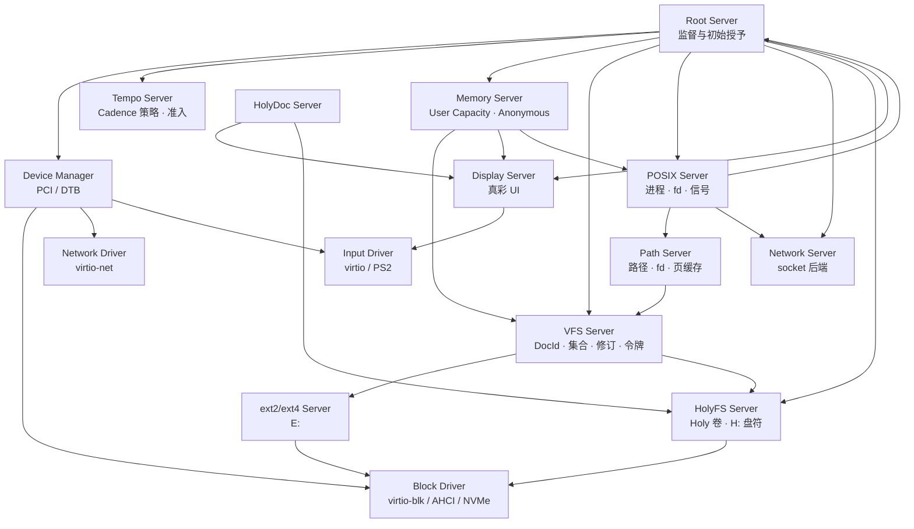
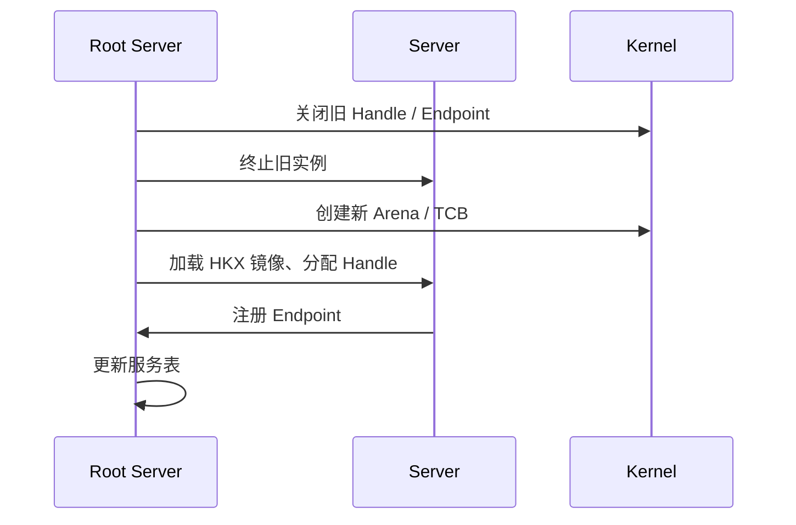

# 用户态服务器

状态：**设计中** · 上级：[总体架构](architecture.md)

HolyKernel 的内核只提供机制；服务器承载策略。本文描述 Root Server、Memory Server、设备管理、驱动、VFS、文件系统、POSIX、网络与显示服务，以及服务监督与句柄分配。

---

## 1. 服务器全景



---

## 2. 服务清单

```rust
pub struct ServiceManifest {
    pub name: Name,
    pub elf: DocPath,             // 服务器镜像路径
    pub args: Vec<String>,
    pub handles: Vec<HandleSpec>, // 初始 Handle 需求
    pub endpoints: Vec<EndpointSpec>,
    pub cadence: CadenceSpec,     // 类别、权重、预算、周期、截止期、亲和性、lending
    pub depends_on: Vec<Name>,
    pub restart: RestartPolicy,   // Always | OnFailure | Never
}
```

- Root Server 读取服务清单，按依赖顺序启动服务器。
- 每个服务 Task 拥有独立的 Arena、HandleTable、Endpoint 与最小 Handle 集合。
- 服务通过 Endpoint 暴露接口；客户端通过 Handle 获取服务入口。
- 服务清单声明初始 `Capacity`、`Frame`、`Capability` 与 `Cadence` 需求；Root Server 按清单授予收窄后的 Handle 与 Cadence。
- 服务清单由 bootloader 作为模块提供；运行时可从 VFS 加载更新版本。

---

## 3. Root Server

- 启动时获得初始 Capacity、Cadence、HandleTable、Endpoint 与设备句柄。
- 持有 System / User / Dma / Gpu 顶层 Capacity 与初始 Cadence 池；按服务清单拆分并转移收窄后的 Capacity/Frame/Capability Handle 与 Cadence Handle。Memory Server 取得 User Capacity 子集，驱动取得 Dma/Gpu Capacity 子集，普通服务取得 TaskImage/Anonymous/栈 Region。
- 解析服务清单，创建服务器 Task/TCB，附加 Cadence，按原生任务镜像的 Task 清单加载并分配 Handle；Capability 决定设备授权，Symbol 注册到 Debug Server。
- 维护服务表：Task、Cadence、Meter、状态、重启次数、Endpoint、Handle。
- 维护每 Task/服务器的 Handle 配额、使用量与峰值；异常增长触发告警。
- 监督服务器：按 `RestartPolicy`（Never / OnFailure / Always）在退出后重启，关闭旧句柄并重新分配；`hk-server-device` 与 `hk-server-virtio` 默认为 Always。
- Root Server 按自身 Cadence 运行；监督循环由 Beat 调度，服务重启由退出事件与 Cadence 预算驱动。
- 提供管理接口：`start`、`stop`、`restart`、`status`、`list`。
- 热替换：`replace <服务> <镜像>` 终止未在 CPU 上执行的任务，用另一原生镜像启动同名服务；服务表与设备授权保留，端点和句柄重新分配，客户端按端点变化重连。
- 检查点：`checkpoint <任务>` 暂停非当前任务，捕获寄存器、Arena 用量与用户页内容（零页省略），序列化为版本化快照并释放原 Arena；`restore-checkpoint <任务>` 在同一任务槽按快照重建 Arena 与 TCB。默认快照保存在 Root 内存；`checkpoint.disk` 启用 `H:/Checkpoints` 分块落盘与读回，`checkpointsrv` 冒烟验证磁盘保存/恢复。持有设备、共享 Frame、COW Region 或线程的任务暂不支持。
- Root Server 自身崩溃时，内核按配置停机或重启。

### 3.1 Tempo Server

- 已实现 `servers/tempo`：Root Server 按服务清单授予带硬预算的初始契约池（`TEMPO_POOL`，Realtime 4096、8 ms/16 ms），Tempo 在池内派生收窄子契约，把句柄降权为 READ|WRITE 后随回复转移给调用方。
- 调用方用 `SYS_TASK_ATTACH_CADENCE(task = 0, cadence)` 把子契约附加到自己；Tempo 自检服务 `hk-server-tempo-test` 覆盖“申请 → 附加 → 读回权重 → 按名准入/撤销重授予”，`smoke --mode tempo` 验证。
- 特权调用方可以用 `TEMPO_ADMIT`/`TEMPO_REVOKE` 按任务名请求准入或撤销重授予；Tempo 通过 `SYS_TASK_ATTACH_NAMED`/`SYS_TASK_REGRANT_NAMED` 在池内派生并附加契约。
- 准入执行父契约范围校验、子契约预算总和限制与 Realtime EDF 密度账本（`budget/deadline` 累计不超过 1.0）；Checkpoint/Shell 恢复后通过 `TEMPO_READMIT` 触发 Tempo 重新准入。完整响应时间可调度性分析仍以密度判据为保守近似。
- 读取 Meter、按负载调整权重与预算、服务重启/热替换/检查点恢复时重新授予 Cadence 仍在后续阶段。
- Holy 命令 `cadence <task>`、`meter <task>`、`tempo`、`admit <task>`、`revoke <task>` 已接入用户态 Shell：只读视图经 Root 控制通道，准入/撤销经 Tempo 协议。
- Tempo 崩溃由 Root Server 重启；重启后按服务清单重新授予初始池。

### 3.2 Memory Server

- Root Server 从 System 的 User 窗口按需切出子集授予 Memory Server（句柄 `0x5001`）；初始只切一个页窗口，分配不足时 `Capacity::grow` 继续从 System 扩窗。
- `MEMORY_ALLOC` 按能力类型分配并返回 Capability；匿名能力绑定自身为 Provider。
- `MEMORY_FRAME` 从授予的 User Capacity 分配 Frame 并转移句柄；客户端用 `SYS_FRAME_MAP` 映射，解除 Region 时自动归还 Capacity。
- 缺页请求 `PROVIDER_FAULT` 通过 `SYS_CAPACITY_ALLOC` 分配 Frame，`PROVIDER_PROVIDE` 返回 Frame 句柄；内核取得归属并装入能力页，回收时归还 Capacity。
- 启动自检覆盖 `CAPACITY_INFO`、`CAPACITY_ALLOC`、`FRAME_INFO`、`FRAME_PIN`、`FRAME_SHARE`、`FRAME_RELEASE` 与 `CAPACITY_FREE`。
- 内存授权由 Handle 与 Rights 决定；任何持有 Capacity/Capability 的服务使用同一组 HMP 对象操作。

---

## 4. Device Manager

- 枚举 PCI（ECAM）或 DTB 设备。
- 为每个设备创建 `DeviceGrant`：MMIO 范围、DMA 窗口、IRQ；virtio 设备的 grant 通过 IPC 移交给独立的 virtio 驱动服务。Device Manager 已生成 BAR/IRQ/capability 描述，通过 `SYS_DEVICE_GRANT_CREATE` 创建内核对象，并用 `SYS_DEVICE_MAP` 映射 MMIO，`SYS_CAPABILITY_CREATE` 创建 DeviceAllocation 能力并用 `SYS_DMA_MAP_CAPABILITY` 绑定授权 IOMMU 域，`SYS_DMA_SYNC` 维护缓存一致性、`SYS_IRQ_BIND` 绑定通知。
- 服务镜像通过 `.hk_service` 段声明角色（`hk_image::ServiceRole`），构建期写入 Native Task 记录，启动器据此生成 `ServiceSpec`；Device Manager 通过启动清单授予的设备授权工厂句柄创建 DeviceGrant；DMA 窗口在授权关闭或任务退出时归还，IRQ 路由按引用计数解绑。
- 按设备类别启动驱动：块、网络、输入、显示。独立 `hk-server-virtio` 驱动服务同时承载小块设备：virtio-blk（容量查询、读、写与 flush）、virtio-rng（启动自检与熵源请求）与 virtio-console（字节流读写与宿主回显自检）；同一服务按 `(授权, BAR)` 缓存 MMIO，并在每次设备操作前切回对应授权。Block Server 保留 RAM disk 后端与块协议。
- Device Manager 常驻并等待驱动的设备授权申请（`DEVICE_REQUEST`），驱动重启后重新枚举并下发 DeviceGrant。
- MSI：`hk-driver-virtio` 已实现 PCI MSI capability 编程（32/64 位地址、逐向量屏蔽、单消息使能与 INTx 关闭），布局推导有宿主单测；内核提供 `SYS_MSI_BIND`：只记录通知目标，不建立 IOAPIC 路由。网络驱动优先尝试 MSI，失败自动回退 INTx。QEMU 的 virtio-pci 只暴露 MSI-X capability（实测能力表为 `0x11` 加若干 virtio 能力），所以当前实测走 INTx，MSI 留给支持它的设备。
- MSI-X：表编程、virtio 队列向量路由与 INTx 关闭已实现（`msix` 模块），但在 QEMU virtio-net 上启用后目标向量被高频重复投递、DHCP 超时，因此服务不启用；下一步用专用向量并核对 `virtio_notify` 与中断次数的对应关系。
- 维护设备树与驱动绑定；设备移除时关闭 Handle。
- 通过 Endpoint 向 VFS 与 POSIX Server报告设备状态。

---

## 5. 驱动

| 驱动 | 设备 | 接口 |
| --- | --- | --- |
| **Block Server** | RAM disk 与块协议服务 | Block Endpoint：read/write/flush/capacity |
| **virtio 驱动** | virtio-blk / virtio-rng / virtio-console | Block Endpoint；熵源请求；控制台字节流 |
| **AHCI** | SATA 块设备 | Block Endpoint；中断驱动、32 命令槽、Frame 直接 PRDT |
| **NVMe** | NVMe 块设备 | Block Endpoint；rdif-block 控制器/队列桥 |
| **USB** | xHCI HID | `crab-usb` xHCI 后端；boot keyboard/mouse 经 Input 协议转发 |
| **virtio-net** | 网络设备 | Net Endpoint：tx/rx |
| **virtio-input** | 键盘/鼠标 | Input Endpoint |
| **PS/2** | 键盘/鼠标 | Input Endpoint |
| **Framebuffer** | 显示 | Display Endpoint |

- 驱动运行在用户态；通过 DeviceGrant 映射 MMIO，从 Dma Capacity 分配 Frame，绑定 IRQ。
- 中断通过 IRQHandler → Notification 交付驱动线程。
- virtio-blk 完成走中断：驱动实现 `AsyncBlockDevice::ack_interrupt` 读取并清除设备中断状态，服务用 `serve_with_wait` 在有在途请求时等待通知，空闲时轮询；IRQ 绑定失败时自动回退轮询。
- 驱动崩溃后由 Device Manager 或 Root Server 重启；设备状态重新初始化。

---

## 6. VFS 与文件系统

- **VFS Server**：Holy 原生命名空间；盘符、DocId、集合、修订、文档令牌；不维护路径或 fd。
- **Path Server**：路径、目录、dentry、文件句柄与页缓存；为 POSIX 客户端提供 `/disk`、`/tmp`、`/dev`、`/proc` 投影，是原生 VFS 与路径后端之间的兼容层。
- **ext2/ext4 Server**（`hk-server-ext4`）：独立挂载 ext4，以 Holy 协议向 VFS 提供 `E:`；目录、inode、权限位。
- **HolyFS Server**：HolyKernel 原生文件系统；`H:` 盘符与文档对象。
- **tmpfs/devfs/procfs**：VFS 进程内建的合成后端，分别提供 `/tmp`、`/dev`、`/proc`；不单独起服务。
- VFS 通过 Holy 协议与 ext4、HolyFS 两个独立服务通信；Path Server 通过 Holy 客户端把 VFS 盘符投影为路径，再通过 `VFS_ATTACH`/共享 Frame 服务 POSIX 客户端。
- `hk-server-ext4` 通过 virtio 驱动服务的 Block Endpoint 挂载 ext4（`rsext4`）为 E:，`hk-server-holyfs` 提供 H:/I:；VFS 只聚合远程后端并内建 T:/D:/P:。Path Server 不直接访问块设备，只把这些盘符投影到 `/` 或 `/disk`、`/tmp`、`/dev`、`/proc`。

详见 [VFS](vfs.md)。

---

## 7. Compatibility Server 与 POSIX

Compatibility Server 是用户态 supervisor：按应用声明选择 POSIX、Linux 或 Harmony personality，并为每个应用配置 Native Task/Arena、rootfs、命名空间与 Handle 配额。

### 7.1 POSIX Personality

- 维护 PID 表、父子关系、进程组、会话、fd 表、信号状态。
- 处理 `fork`/`exec`/`wait`、`kill`、`sigaction`、`pthread_create` 等请求。
- 通过 VFS 执行文件操作；通过 Network Server 创建 socket。
- 通过内核 Handle 创建/操作 Arena、TCB、Region 与 Frame。
- POSIX Personality 运行在内核可信基之外；崩溃后 Root Server 重启，POSIX 应用按策略恢复或终止。

### 7.2 Linux Personality

- 未修改的 Linux ELF 走 `syscall` 入口，由 Linux ABI 实现转发；支持 `ld-linux`、glibc 静态/动态、musl 动态与 `/proc`/`/sys`/vDSO。
- glibc 与 musl 分属不同 libc 域；glibc `.so` 由 glibc 进程加载，musl `.so` 由 musl 进程加载。
- 图形应用通过 Wayland Server / XWayland 接入 surface/seat；Framebuffer 授权由 Display 持有。

### 7.3 Harmony Personality

- 复用 OpenHarmony standard-system 用户态：`init`、`samgr`、`appexecfwk`、ArkUI、Render Service、Window Manager、`dsoftbus`。
- 通过 KAL 适配 Holy 的 POSIX/Linux syscall；通过 HDI 适配 display/input/storage/network 到 Holy surface/seat、VFS 与 Network。
- 这是源码级移植：`.hap` 由 Harmony personality 承载，表面经 HDI 进入 Holy surface/seat，与 Wayland/X11 表面并列。

详见 [POSIX 与 libc](posix.md)、[应用兼容](compat.md) 与 [ADR-0015](adr/0015-compatibility-server.md)。

---

## 8. Network Server

- 管理网络设备与协议栈；支持 IPv4/IPv6、TCP/UDP、DHCP、DNS、loopback、AF_UNIX。
- 向 POSIX Server 提供 socket 后端：`socket`、`bind`、`connect`、`send`、`recv`、`poll`。
- 网络驱动通过 Net Endpoint 提供收发队列；数据使用共享 Frame。
- 共享 Frame 收发环：驱动分配并登记 DMA 帧，RX 直接 DMA 到共享帧、TX 由协议栈写入后零拷贝提交；`net.zerocopy` 启用。
- 原生 Socket Handle：`hk-proto::socket` 客户端提供 open/connect/send/recv/close、UDP 收发与 DNS 解析；Network Server 处理请求；`hk-server-netsock` 用户态自检。
- 状态查询：`hk-server-netstat` 是独立用户态客户端，向 Network Server 发送 `NET_STATUS_REQUEST`/`NET_ARP_REQUEST`，打印 MAC、IPv4/前缀、网关、Socket 数、收发计数、路由视图、ARP 邻居与原生配置（DHCP/地址/网关/DNS/MTU）；`net` 命令在两种 shell 下语义一致。
- TLS/Wi-Fi/USB 网卡属于后续版本；详见 [网络](network.md)。

---

## 9. HolyFS Server

- 独立用户态服务 `hk-server-holyfs`；直接通过 Block Endpoint 挂载 Holy 卷，以 `H:`、`I:` 盘符提供原生文档命名空间。
- 原生 VFS 通过远程 Holy 后端连接该服务；Path Server 再把 VFS 的 `H:`、`I:` 投影到 `/disk`、`/disk-I`。VFS 不再内嵌 HolyFS。
- 对象模型：卷、文档、修订、集合、标签、快照；文档由集合项、标签与快照保活。
- 原生操作：`Stage`/`WriteRange`/`Commit`/`Read`/`Append`、`Bind`/`Unbind`/`Relocate`、`Checkout`/`Seal`/`Prune`、`Snapshot`/`Restore`/`Forget`、`Grant`/`Revoke`。
- 通过 Block Endpoint 访问存储；全元数据 COW、checksum、双超级块。原生客户端直接向 `hk-server-holyfs` 发送 Holy 协议请求，并可按块服务动态 `Attach`/`Detach` 盘符。
- POSIX 兼容环境的根文件系统为 ext4/ext2；HolyFS 作为 Holy 卷服务。
- 详见 [HolyFS](holyfs.md)。

---

## 10. Display Server 与 HolyDoc

- **Display Server**：合成器；原生 surface、Wayland/XWayland 与 Harmony HDI 表面进入同一场景图；帧缓冲、窗口、输入、sRGB 真彩色 + 主题、可缩放字体（8×16 位图回退）。窗口显示、最小化、还原、关闭与缩放换表面时切换 Surface 的 scanout 驻留（`SYS_CAPABILITY_SCANOUT`）：驻留开启即固定，驻留期间拒绝解除固定，关闭时一并解除。
- **HolyDoc Server**：活文档渲染、链接、代码块、表单。
- **Workbench**：编辑、浏览、构建、运行、调试一体化应用。已落地 `hk-server-workbench`：surface/window 三栏窗口，左侧加载 `H:` 文档树，中间整篇读写 Holy 文档并支持保存，底部输出构建统计、`@exec` 运行结果与异常回溯；`smoke --mode workbench` 验证。
- **Toolchain Server**：系统内编译/链接/打包/缓存。
- **Compatibility Server**：按应用选择 POSIX/Linux/Harmony personality，管理 rootfs、命名空间与配额。
- **Wayland Server / XWayland**：Linux Wayland/X11 客户端适配到 surface/seat。
- **Harmony Server**：OpenHarmony standard-system 用户态 + KAL/HDI 适配。
- **Checkpoint Server**：`hk-server-checkpoint` 提供 SAVE/RESTORE/LIST 协议，委托 Root 控制保存与恢复 Native Task；`hk-server-checkpoint-test` 自检客户端验证保存、恢复与列表。
- **Debug Server**：分页 Task/资源/trace 视图、System Capacity 快照与最近异常回溯；内核只保存内核符号，异常现场作为 `FAULT_EVENT` 投递给订阅端点（不在内核保存），服务符号经 Root 按地址按需查询，符号化与回溯过滤在用户态（`hk-debug`）完成；`hk-server-dbg` 客户端输出同样的视图。
- **HolyShell**：默认命令行；Holy 命令、结构化管道、脚本。
- **Console Service**：纯终端数据面，只做行编辑、回显、UTF-8/宽字符与按行交付；不解析命令。用户态 Shell 未启动时保留输入行，收到读行请求后再交付。
- **Shell 分层**：`hk-shell` 只提供命令解析、格式化与 `ShellHost`/`ShellIo` 契约，保持零依赖。内核态 shell 直接使用平台 runtime/loader，负责文本模式与恢复；用户态 `hk-server-shell` 通过 `ShellIo` 访问 Console，通过 Root Server 控制 ABI（`SYS_ROOT_CONTROL`/`SYS_ROOT_RESULT`）执行 `tasks`、`services`、`start`、`restart` 与脚本读取，`mounts` 作为用户态宿主扩展通过 VFS 只读查询挂载表，不进入 `hk-shell` 核心命令表，也不链接 `hk-runtime`/`hk-root-server`。两类 Shell 共享解析/格式化，但能力与权限边界独立；Console 不承担第三套命令。
- **POSIX Bridge**：`posix` 入口；连接 POSIX Server 与兼容工具。
- POSIX 应用通过终端/控制台接口使用文本界面；原生应用通过 Display Endpoint 使用窗口。
- 显示服务崩溃后由 Root Server 重启；窗口与输入状态重新建立。

详见 [HolyDoc 与 UI](ui.md)。

---

## 11. 服务重启与句柄回收



- 重启时关闭旧 Handle，防止旧实例继续访问资源。
- 客户端持有旧 Endpoint 时收到 `DeadEndpoint`；重新连接新实例。
- VFS、POSIX、Network 等有状态服务需要恢复策略：重建句柄、重新打开文件、重新绑定 socket。
- Root Server 记录重启次数与最后错误，供诊断。

---

## 12. 保证

1. 服务器运行在用户态，拥有独立 Arena 与最小 Handle 集合。
2. 服务器通过 Endpoint 通信；客户端通过 Handle 获取入口。
3. Root Server 维护服务表、初始 Capacity/Cadence 授予与重启策略。
4. 每个服务的内存对象都是 Capacity/Frame/Region/Capability；内存授权由 Handle 与 Rights 决定。
5. 每个服务 Task 持有 Cadence 与 Meter；Tempo Server 授予与调整普通契约，Root Server 决定初始授予。
6. 服务器重启后，Tempo 重新授予 Cadence 并重置 Meter 水位。
7. 驱动通过 DeviceGrant 访问 MMIO/DMA/IRQ。
8. VFS 是 POSIX 文件语义的统一入口；文件系统以服务器形式接入。
9. POSIX Server 维护进程、fd 与信号；VFS 维护挂载与文件句柄。
10. 服务器崩溃后 Root Server 关闭旧句柄，新实例重新注册 Endpoint。
11. 服务器清单与 Handle/Cadence 需求可审计。
12. 每个服务器有 trace、Meter 与健康状态。
13. 服务器策略与文件系统逻辑位于用户态；内核提供机制。

---

## 13. 测试策略

| 层级 | 测试 |
| --- | --- |
| Hosted 单元 | 服务清单解析、Handle 分配、Cadence 授予、Endpoint 注册、重启状态机 |
| Hosted 模拟 | 服务器崩溃/重启、句柄回收、Cadence 重授、客户端重连、VFS/POSIX 恢复 |
| QEMU | Root/Tempo 启动全栈、驱动 probe、VFS 挂载、HolyShell、`posix`、`cadence`/`meter` |
| 故障注入 | 驱动崩溃、VFS 崩溃、POSIX 崩溃、Network 超时、Tempo 重启 |
| 基准 | 启动时间、服务器重启时间、IPC 延迟、VFS 吞吐、调度份额 |

---

## 14. 相关文档

- [总体架构](architecture.md)
- [网络](network.md)
- [VFS](vfs.md)
- [HolyFS 文件系统](holyfs.md)
- [权限模型](permissions.md)
- [POSIX 与 libc](posix.md)
- [HolyDoc 与 UI](ui.md)
- [平台与启动](platforms.md)
- [工程策略](engineering.md)
