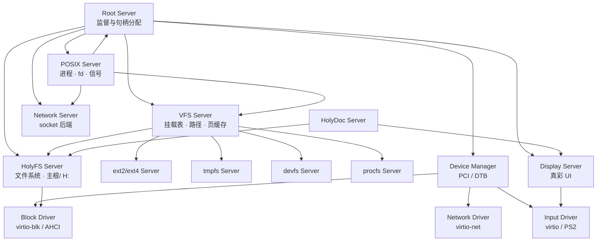
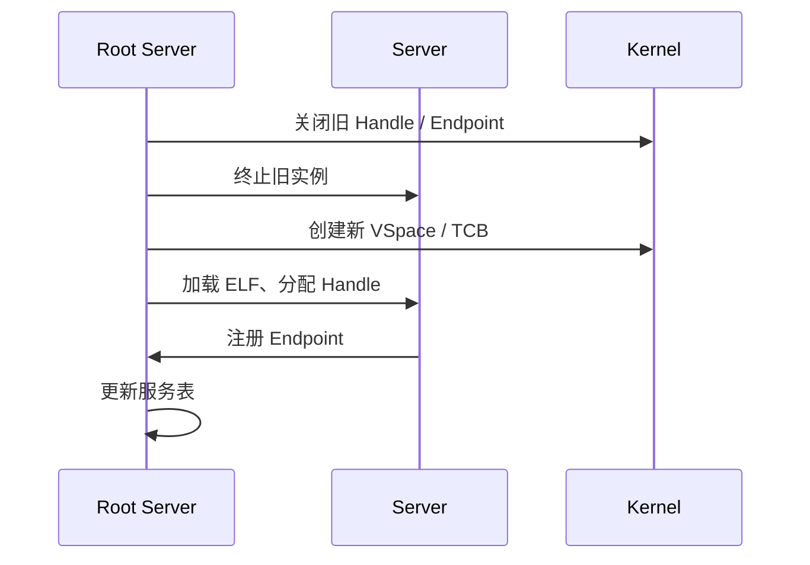

# 用户态服务器

状态：**设计中** · 上级：[总体架构](architecture.md)

HolyKernel 的内核只提供机制；服务器承载策略。本文描述 Root Server、设备管理、驱动、VFS、文件系统、POSIX、网络与显示服务，以及服务监督与句柄分配。

---

## 1. 服务器全景



---

## 2. 服务清单

```rust
pub struct ServiceManifest {
    pub name: Name,
    pub elf: DocPath,             // 服务器镜像路径
    pub args: Vec<String>,
    pub handles: Vec<HandleSpec>, // 初始 Handle 需求
    pub endpoints: Vec<EndpointSpec>,
    pub depends_on: Vec<Name>,
    pub restart: RestartPolicy,   // Always | OnFailure | Never
}
```

- Root Server 读取服务清单，按依赖顺序启动服务器。
- 每个服务 Task 拥有独立的 VSpace、HandleTable、Endpoint 与最小 Handle 集合。
- 服务通过 Endpoint 暴露接口；客户端通过 Handle 获取服务入口。
- 服务清单由 bootloader 作为模块提供；运行时可从 VFS 加载更新版本。

---

## 3. Root Server

- 启动时获得初始 Untyped、HandleTable、Endpoint 与设备句柄。
- 解析服务清单，创建服务器 VSpace/TCB，加载 ELF，分配 Handle。
- 维护服务表：PID、状态、重启次数、Endpoint、Handle。
- 维护每 Task/服务器的 Handle 配额、使用量与峰值；异常增长触发告警。
- 监督服务器：崩溃后按 `restart` 策略重启，关闭旧句柄，重新分配。
- 提供管理接口：`start`、`stop`、`restart`、`status`、`list`。
- Root Server 自身崩溃时，内核按配置停机或重启。

---

## 4. Device Manager

- 枚举 PCI（ECAM）或 DTB 设备。
- 为每个设备创建 `DeviceGrant`：MMIO 范围、DMA 窗口、IRQ；Device Manager 已生成 BAR/IRQ/capability 描述，通过 `SYS_DEVICE_GRANT_CREATE` 创建内核对象，并用 `SYS_DEVICE_MAP` 映射 MMIO。
- 按设备类别启动驱动：块、网络、输入、显示。
- 维护设备树与驱动绑定；设备移除时关闭 Handle。
- 通过 Endpoint 向 VFS 与 POSIX Server报告设备状态。

---

## 5. 驱动

| 驱动 | 设备 | 接口 |
| --- | --- | --- |
| **virtio-blk** | 块设备 | Block Endpoint：read/write/flush |
| **AHCI** | SATA 块设备 | Block Endpoint |
| **virtio-net** | 网络设备 | Net Endpoint：tx/rx |
| **virtio-input** | 键盘/鼠标 | Input Endpoint |
| **PS/2** | 键盘/鼠标 | Input Endpoint |
| **Framebuffer** | 显示 | Display Endpoint |

- 驱动运行在用户态；通过 DeviceGrant 映射 MMIO、分配 DMA Frame、绑定 IRQ。
- 中断通过 IRQHandler → Notification 交付驱动线程。
- 驱动崩溃后由 Device Manager 或 Root Server 重启；设备状态重新初始化。

---

## 6. VFS 与文件系统

- **VFS Server**：挂载表、路径解析、dentry/inode 缓存、文件句柄、页缓存。
- **ext2/ext4 Server**：POSIX 根文件系统；目录、inode、权限位。
- **HolyFS Server**：POSIX + 整文档文件系统；可作 `/` 主根或 `H:` 盘符。
- **tmpfs Server**：内存文件系统；`/tmp`、运行时文件。
- **devfs Server**：`/dev` 设备节点；转发到设备 Endpoint。
- **procfs Server**：`/proc` 进程信息；从 POSIX Server 获取数据。
- VFS 与后端通过 Endpoint RPC 通信；数据使用共享 Frame。

详见 [VFS](vfs.md)。

---

## 7. POSIX Server（兼容环境）

- 维护 PID 表、父子关系、进程组、会话、fd 表、信号状态。
- 处理 `fork`/`exec`/`wait`、`kill`、`sigaction`、`pthread_create` 等请求。
- 通过 VFS 执行文件操作；通过 Network Server 创建 socket。
- 通过内核 Handle 创建/操作 VSpace、TCB、Frame。
- POSIX Server 是可信基的一部分；崩溃后 Root Server 重启，POSIX 应用按策略恢复或终止。

详见 [POSIX 与 libc](posix.md)。

---

## 8. Network Server

- 管理网络设备与协议栈；支持 IPv4/IPv6、TCP/UDP、DHCP、DNS、loopback、AF_UNIX。
- 向 POSIX Server 提供 socket 后端：`socket`、`bind`、`connect`、`send`、`recv`、`poll`。
- 网络驱动通过 Net Endpoint 提供收发队列；数据使用共享 Frame。
- TLS/Wi-Fi/USB 网卡属于后续版本；详见 [网络](network.md)。

---

## 9. HolyFS Server

- 用户态文件系统；实现 VFS Backend，可挂载为 `/` 主根、`/home` 或其他挂载点。
- 原生命名空间通过 `H:` 盘符访问同一 Volume；`H:` 与 VFS 挂载点共享数据。
- POSIX 视图：inode、`mode`/`uid`/`gid`、硬链接、符号链接、稀疏文件、原子 `rename`、`fsync`。
- 原生视图：整文档、压缩、Tags、Links、快照。
- 通过 Block Endpoint 访问存储；COW、checksum、双超级块。
- 由服务清单选择根文件系统：HolyFS 或 ext4/ext2。
- 详见 [HolyFS](holyfs.md)。

---

## 10. Display Server 与 HolyDoc

- **Display Server**：帧缓冲、窗口、输入、sRGB 真彩色 + 主题、可缩放字体（8×16 位图回退）。
- **HolyDoc Server**：活文档渲染、链接、代码块、表单。
- **Workbench**：编辑、浏览、构建、运行、调试一体化应用。
- **Toolchain Server**：系统内编译/链接/打包/缓存。
- **Checkpoint Server**：Native Task/Server 快照与恢复。
- **Debug Server**：符号化栈回溯、Task/资源视图、`hk-dbg`。
- **HolyShell**：默认命令行；Holy 命令、结构化管道、脚本。
- **POSIX Bridge**：`posix` 入口；连接 POSIX Server 与兼容工具。
- POSIX 应用通过终端/控制台接口使用文本界面；原生应用通过 Display Endpoint 使用窗口。
- 显示服务崩溃后由 Root Server 重启；窗口与输入状态重新建立。

详见 [HolyDoc 与 UI](ui.md)。

---

## 11. 服务重启与句柄回收



- 重启时关闭旧 Handle，防止旧实例继续访问资源。
- 客户端持有旧 Endpoint 时收到 `DeadEndpoint`；重新连接新实例。
- VFS、POSIX、Network 等有状态服务需要恢复策略：重建句柄、重新打开文件、重新绑定 socket。
- Root Server 记录重启次数与最后错误，供诊断。

---

## 12. 保证

1. 服务器运行在用户态，拥有独立 VSpace 与最小 Handle 集合。
2. 服务器通过 Endpoint 通信；客户端通过 Handle 获取入口。
3. Root Server 维护服务表与重启策略。
4. 驱动通过 DeviceGrant 访问 MMIO/DMA/IRQ。
5. VFS 是 POSIX 文件语义的统一入口；文件系统以服务器形式接入。
6. POSIX Server 维护进程、fd 与信号；VFS 维护挂载与文件句柄。
7. 服务器崩溃后 Root Server 关闭旧句柄，新实例重新注册 Endpoint。
8. 服务器清单与 Handle 需求可审计。
9. 每个服务器有 trace 与健康状态。
10. 服务器策略与文件系统逻辑位于用户态；内核提供机制。

---

## 13. 测试策略

| 层级 | 测试 |
| --- | --- |
| Hosted 单元 | 服务清单解析、Handle 分配、Endpoint 注册、重启状态机 |
| Hosted 模拟 | 服务器崩溃/重启、句柄回收、客户端重连、VFS/POSIX 恢复 |
| QEMU | Root Server 启动全栈、驱动 probe、VFS 挂载、HolyShell、`posix` |
| 故障注入 | 驱动崩溃、VFS 崩溃、POSIX 崩溃、Network 超时 |
| 基准 | 启动时间、服务器重启时间、IPC 延迟、VFS 吞吐 |

---

## 14. 相关文档

- [总体架构](architecture.md)
- [网络](network.md)
- [VFS](vfs.md)
- [HolyFS 文件系统](holyfs.md)
- [权限模型](permissions.md)
- [POSIX 与 libc](posix.md)
- [HolyDoc 与 UI](ui.md)
- [平台与启动](platforms.md)
- [工程策略](engineering.md)
