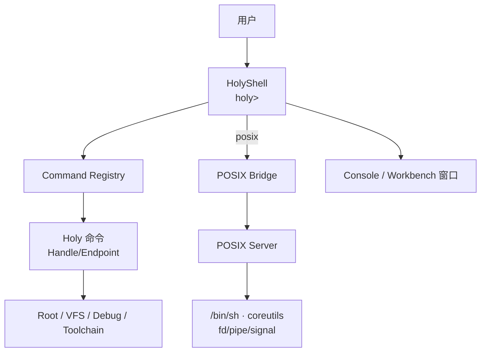

# HolyShell 与 Holy 命令

状态：**设计中** · 上级：[总体架构](architecture.md)

HolyShell 是原生命令行与脚本环境。**Holy 命令是主路径**；POSIX shell、coreutils 与 fd/pipe/signal 通过兼容环境提供。原生 shell 在 POSIX Server 启动前即可使用，恢复模式也使用它。

---

## 1. 目标与范围

### 目标

1. **原生优先**：HolyShell 与 Holy 命令是默认命令行体验。
2. **Handle 驱动**：原生命令通过 Handle 与 Endpoint 访问服务。
3. **结构化输出**：命令返回记录/表格/树，支持类型化管道。
4. **原生优先**：HolyShell 与原生命令独立运行；POSIX 环境按需启动。
5. **POSIX 兼容**：`posix` 命令进入兼容环境；`/bin/sh`、coreutils、fd/pipe/signal 由 POSIX Server 提供。
6. **Workbench 集成**：HolyShell 在 Workbench/Console 窗口中运行，支持真彩色与主题。
7. **脚本化**：`.hsh` 脚本使用 Holy 命令、结构化变量与控制流。
8. **可恢复**：系统故障时，原生 shell 提供恢复命令。

### 构件

- **HolyShell**：命令行解析、命令注册表、结构化管道、脚本执行。
- **Command Registry**：原生命令元数据（名称、用法、所需 Handle、输出 schema）。
- **Native Commands**：`tasks`、`services`、`handles`、`mounts`、`build`、`run`、`debug` 等。
- **POSIX Bridge**：`posix` 命令；启动 POSIX session 或运行 `/usr/bin/<cmd>`。
- **Console Service**：终端显示与输入；原生模式与 POSIX 模式共用窗口。
- **Workbench**：内置 HolyShell 面板与命令输出视图。

---

## 2. 架构



- HolyShell 解析命令行，查询 Command Registry，调用原生命令。
- 原生命令返回结构化记录；HolyShell 渲染为表格/树/文档。
- `posix` 命令进入兼容环境；POSIX 命令使用 fd、pipe、signal。
- 两种模式共享同一个 Console 窗口；协议与权限模型各自独立。

---

## 3. HolyShell

```text
holy> tasks
ID  Name          State    TCBs  Arena
7   Workbench     Running  3     2.1 MiB
8   VFS           Running  2     512 KiB

holy> services
Name        State    Restarts  Endpoint
VFS         Running  0         ep:0x21
POSIX       Running  0         ep:0x2a

holy> docs list
H:/System/Guide.hd
H:/System/Commands.hd

holy> build H:/Apps/Hello
build ok · 1.2 s · H:/System/Apps/Hello
```

- 提示符：`holy>`；可配置主题与提示符。
- 命令：`<verb> [args]`；参数使用结构化值（字符串、路径、ID、Handle 名称）。
- 输出：表格、树、文档、键值；可选 JSON 供脚本使用。
- 管道：`tasks | filter state=Running | sort name`，传递结构化记录。
- 历史、补全、别名、主题；补全来源是 Command Registry 与 VFS。
- `help <command>` 打开 HolyDoc 帮助页。

### 3.1 会话模型

HolyShell 会话是一个 **Native Task**：

- 每个会话拥有自己的 **Session Namespace**：命令、变量、别名、当前 Task、cwd/root、主题、输出格式。
- 会话创建时从父 Task 继承基础命名空间；Root Server/Command Registry 提供系统命令。
- 多个会话 = 多个 Native Task；Workbench 可打开多个终端面板。
- 会话结束回收命名空间、历史与临时资源；系统服务保持运行。
- 恢复模式启动一个最小会话，只加载 `tasks`、`services`、`mounts`、`restore`、`help`。

### 3.2 即时执行

- 命令行是会话命名空间的 **REPL**：输入 → 解析 → 查找命令 → 调用。
- 内置命令是会话命名空间中的函数；外部 Holy 命令是原生应用，通过 Command Registry 发现。
- `use`/`load` 把 HolyDoc 或 HolyShell 脚本求值进当前会话命名空间；构建步骤由 Toolchain Server 按需处理。
- 命令输出是结构化记录，可渲染为表格/树/HolyDoc，也可保存为文档。
- 错误链接到源码或 HolyDoc；Debug Server 可定位到 Task、TCB 与文档。
- Task 消息：`Ping`、`Stats`、`Suspend`、`Resume`、`Checkpoint`，通过 Endpoint 授权。

```text
holy> use H:/Scripts/Deploy.hsh
holy> let app = build H:/Apps/Hello
holy> tasks app
holy> debug app
```

---

## 4. Holy 命令

| 命令 | 作用 |
| --- | --- |
| `tasks` | 列出 Native Task/TCB、状态、Arena、子 Task |
| `services` | 列出服务器、Endpoint、健康与重启次数 |
| `handles` | 列出当前 Task 的 Handle |
| `endpoints` | 列出 Endpoint/Notification |
| `mounts` | 查看 VFS 挂载表 |
| `docs` | 列出/搜索 HolyDoc |
| `open` | 打开文档/窗口 |
| `edit` | 编辑源码或 HolyDoc |
| `build` | 调用 Toolchain Server 构建 |
| `run` | 运行原生应用或指定 POSIX 程序 |
| `debug` | 连接 Debug Server；栈回溯、符号、checkpoint |
| `snapshot` / `restore` | Checkpoint Server 快照/恢复 |
| `trace` | 打开/关闭 trace，查看事件 |
| `theme` | 切换显示主题 |
| `posix` | 进入 POSIX 兼容环境 |
| `help` | 打开 HolyDoc 帮助 |

- 命令是原生应用或内置函数；元数据注册到 Command Registry。
- 每个命令声明所需 Handle；HolyShell 只授予最小集合。
- 命令输出 schema 用于补全、脚本与 Workbench 渲染。
- 命令可在 Workbench 中以按钮/表单形式呈现。

---

## 5. 结构化管道与脚本

```text
holy> tasks | filter state=Running | sort name | table
holy> services | filter restarts>0 | docs
holy> handles | filter rights~write
```

- 管道传递类型化记录；脚本使用类型化值。
- 过滤器/排序/表格是内置命令；也可由原生应用提供。
- `.hsh` 脚本：

```text
let app = "H:/Apps/Hello"
build $app
if status.ok {
    run $app
}
```

- 脚本使用 Holy 命令、结构化变量与少量控制流；语法保持小而可读。
- POSIX 脚本通过 `posix sh script.sh` 运行。

---

## 6. POSIX 兼容

```text
holy> posix sh
$ ls -l /home
$ grep -r needle /src
$ exit

holy> posix ls -l /home
holy> run /usr/bin/ls -l /home
```

- `posix` 启动 POSIX session 或执行单条 POSIX 命令。
- POSIX 命令使用 fd/pipe/signal；由 POSIX Server 管理。
- POSIX 环境可选；`posix` 会检查环境状态并返回明确错误。
- 原生 shell 通过 Handle 启动 POSIX Server（若被授权）。
- POSIX `/bin/sh`、coreutils、编译器属于兼容环境；原生命令集由 Holy 命令提供。

---

## 7. 终端与 Workbench

- HolyShell 运行在 Workbench 的终端面板或独立 Console 窗口。
- 原生模式：真彩色、主题、结构化表格/树、可点击文档链接。
- POSIX 模式：Terminal 语义、`termios`、256/真彩色 SGR。
- 两种模式共享输入/输出通道；模式切换由 `posix`/`exit` 完成。
- 恢复模式：初始化失败时启动 HolyShell，提供 `tasks`、`services`、`mounts`、`restore`。

---

## 8. 启动顺序

```text
Kernel
  → Root Server
    → Console / Display
    → HolyShell（原生主路径）
    → VFS / Debug / Toolchain
    → POSIX Server（可选兼容环境）
      → /sbin/init（PID 1）
```

- HolyShell 在 POSIX Server 之前可用。
- POSIX Server 可选；启用时提供 `/bin/sh` 与 coreutils。
- `/sbin/init` 是 POSIX 环境的 init；原生启动由 Root Server 与服务清单管理。

---

## 9. 保证

1. HolyShell 与 Holy 命令是默认命令行体验。
2. 每个 HolyShell 会话是一个 Native Task，拥有独立 Session Namespace。
3. 内置命令是会话命名空间中的函数；外部 Holy 命令是原生应用。
4. `use`/`load` 在当前会话命名空间中求值；构建步骤由 Toolchain Server 按需处理。
5. 原生命令通过 Handle/Endpoint 访问服务。
6. POSIX 命令通过 POSIX Server 运行，使用 fd/pipe/signal。
7. HolyShell 与原生命令独立运行；POSIX 环境按需启动。
8. 结构化管道传递记录；POSIX 管道传递字节流。
9. Command Registry 是原生命令的发现入口。
10. 命令输出可保存为 HolyDoc；错误可链接到源码/文档。
11. `posix` 是兼容环境入口；`/bin/sh` 是兼容 shell。
12. 恢复模式使用 HolyShell 最小会话。

---

## 10. 测试策略

| 层级 | 测试 |
| --- | --- |
| Hosted 单元 | 命令行解析、Session Namespace、Command Registry、结构化管道、`use`/`load` |
| Hosted 模拟 | 原生命令调用、会话隔离、POSIX bridge、恢复模式、主题输出 |
| QEMU | HolyShell 启动、`tasks/services/mounts`、`posix sh` |
| POSIX 兼容 | `/bin/sh`、coreutils、pipe、signal |
| 故障注入 | POSIX Server 停止后原生命令继续工作 |
| 基准 | 命令启动、管道吞吐、补全响应、脚本执行 |

---

## 11. 相关文档

- [总体架构](architecture.md)
- [服务器](servers.md)
- [POSIX 与 libc](posix.md)
- [HolyDoc 与 UI](ui.md)
- [Holy 原生体验](experience.md)
- [工程策略](engineering.md)
