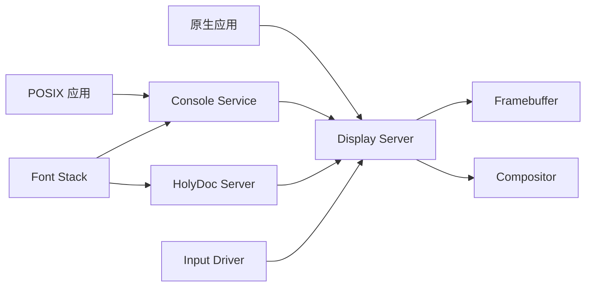
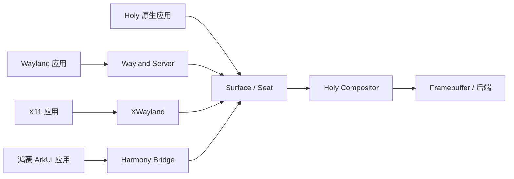
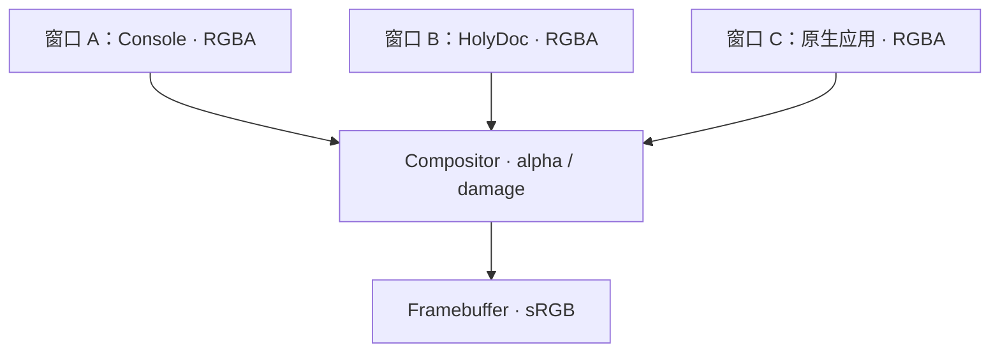
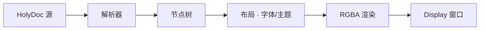

# HolyDoc 与 UI

状态：**设计中** · 上级：[总体架构](architecture.md)

里程碑：原生 UI 在 **M6** 先行交付；surface/seat 抽象在 M6 收尾，Linux Wayland/XWayland 与鸿蒙 HDI 在兼容层稳定后接入，详见 [ADR-0015](adr/0015-compatibility-server.md)；POSIX 终端在 **M7** 接入。

UI 是可选原生服务：**Display Server** 管理帧缓冲、窗口与输入，**HolyDoc Server** 渲染活文档。界面采用现代真彩色：32 位 RGBA、sRGB、主题、alpha 合成与可缩放字体；文本优先与串口回退继续保留。Display 同时是 surface/seat 合成器：原生窗口直接接入，Linux Wayland/X11 与鸿蒙应用通过独立适配器接入。

---

## 1. 目标与范围

### 目标

1. **真彩色**：32 位 RGBA、sRGB、16.7M 色、alpha 混合。
2. **主题化**：light/dark、强调色、语义色、高对比度与色盲友好主题。
3. **可缩放字体**：TrueType/OpenType + 字体缓存；8×16 位图字体作为控制台回退。
4. **多窗口客户端**：客户端可创建多个窗口；Display Server 管理焦点、z 序、装饰与输入。
5. **HolyDoc**：可链接、可执行、可嵌入的活文档；支持富文本、图片、表单与代码执行结果。
6. **POSIX 终端**：控制台/终端接口与 `termios` 后端；支持 256 色/真彩色 SGR。
7. **最小权限**：Display Server 只获得 Framebuffer 与 Input DeviceGrant。
8. **可重启**：Display Server 崩溃后由 Root Server 重启；客户端重连。
9. **可降级**：文本回退使用串口/VGA 文本模式。
10. **多来源合成**：原生 surface、Wayland、XWayland 与鸿蒙 ArkUI 表面进入同一场景图。
11. **统一 seat**：焦点、键盘、指针、触摸、剪贴板与拖放由兼容层统一映射。

### 构件

- **Display Server**：帧缓冲、窗口、合成器、主题、输入焦点。
- **HolyDoc Server**：文档解析、布局、渲染、链接。
- **Console Service**：POSIX 终端/控制台接口。
- **Font Stack**：TrueType/OpenType 解析、栅格化、缓存；位图回退。
- **Input Driver**：virtio-input / PS/2。
- **Framebuffer Driver**：BootInfo 帧缓冲或设备驱动。
- **Surface/Seat 协议**：buffer、damage、commit、输入区域、焦点与剪贴板；原生与外来表面共用。
- **Wayland Server / XWayland**：Linux Wayland 应用与 X11 应用适配。
- **Harmony Bridge**：OpenHarmony 图形/窗口 HDI 到 Holy surface/seat 的适配。

### 已落地

- 帧缓冲访问通过 `SYS_FRAMEBUFFER_INFO` / `SYS_FRAMEBUFFER_MAP` 只授权给 `hk-server-display`；映射地址由内核在任务自动窗口内选择并返回，显示服务不再使用固定地址。
- 窗口表面使用共享 Frame：客户端绘制后经句柄转移交给显示服务，由显示服务映射并合成，不复制整块表面。
- 合成器绘制桌面渐变、标题栏与窗口，并回读窗口首像素校验；焦点窗口标题栏高亮。
- 窗口带圆角与柔和投影：标题栏顶部和窗口底部按半径裁剪，投影按缩放后的边距绘制并混合桌面/下层窗口；窗口 damage 区域同步扩展，移动、缩放、关闭与焦点切换不会残留影边。
- 深/浅两套调色板由启动 token `theme=light` 选择（默认深色）；窗口、任务栏、光标与悬停高亮统一从当前主题取色。
- 多窗口按槽位维护 z 序；按 Tab、点击窗口或任务栏按钮切换焦点，标题栏与任务栏按钮高亮。客户端提交表面只重绘内容，不改变焦点；`desktop` 模式让 Console 最后创建以获得初始焦点。
- 标题栏右侧提供关闭按钮：点击后回收共享表面与句柄、从任务栏移除按钮，并向客户端发送 `DISPLAY_CLOSE`。
- 窗口四边与四角均可缩放：拖动边缘调整单边、拖动角落同时调整两边；右下角为焦点窗口显示可见把手；最小尺寸、屏幕边界与任务栏上方区域受限。缩放结束、最大化与还原后，Display 通过 `DISPLAY_RESIZE` 通知客户端新的内容尺寸，客户端重建同尺寸表面并经 `WINDOW_RESIZE` 交回；待处理的通知会在客户端每次提交帧后补发，避免提交等待期间丢失。合成器按 1:1 拷贝客户端表面，表面尚未跟进时正文以窗口背景填充。
- 标题栏提供最小化、最大化/还原按钮：最小化保留任务栏按钮，点击任务栏恢复；最大化铺满任务栏上方区域并保存原几何。
- 启动 token `ui.scale=2` 将标题栏/任务栏字体、控件布局与光标位图放大 2 倍，窗口内容随客户端新表面尺寸 1:1 合成。
- HolyDoc：HolyDoc 指令解析（`@title`、`@heading`、`@link`、`@bullet`、`@code`、`@exec`）、自动换行布局、滚动与历史返回；内置欢迎页与帮助页作为无卷回退，链接可点击跳转；Display 通过 `DISPLAY_CLICK_AT` 提供窗口内点击坐标。`smoke --mode holydoc` 验证解析、执行、跳转、返回与渲染。
- HolyDoc 启动落在欢迎页：欢迎页展示版本、民用时间、系统 tick 与文档清单，并提供文档索引与帮助页；`i` 打开索引，`t` 打开标签页，`w` 回到欢迎页，`[`/`]` 或 Backspace 前后翻阅历史；`n`/`N` 选择链接、Enter 打开，方向键、PageUp/PageDown、Home/End 与鼠标滚轮滚动，底部状态栏显示按键提示与滚动百分比。
- 文档浏览：HolyDoc 启动时按 `H:` 盘符枚举根集合，把集合成员与子集合递归加载为文档页；内容文档整篇读入，集合页把成员显示为 DocPath 链接。文档标题取自 `@title` 指令，链接在文档集内解析并可直接跳转。没有卷时使用内置欢迎页与帮助页。
- HolyDoc 文档由文本与内联指令组成：`@title`、`@heading`、`@link`、`@bullet`、`@code` 与 `@exec`；正文按 8×16 位图字体排版，ASCII 半宽、汉字全宽。
- HolyDoc 标签：启动时读取 H: 卷标签表，文档页追加所属标签；`H:/Tags` 按标签分组列出成员，按 `t` 打开，`@exec tags` 输出标签列表。
- `desktop` 启动模式装载 virtio-blk 驱动与 VFS，并以 `vfs.fs=holyfs` 挂载 `H:` 卷；`cargo xtask run --target x86_64-qemu --ui` 会把 `docs/holy` 的文档播种到 `build/run-holy.img`。
- Debug Server：调试窗口分页展示概览、任务、服务、trace、统计与最近一次用户异常回溯；`1`-`6` 切换视图，`j`/`k`、`u`/`d`、方向键与 PageUp/PageDown 滚动，`r` 刷新，`q` 或关闭退出。异常页显示故障现场与符号化栈帧。`smoke --mode debug` 验证分页读取、渲染与符号解析。
- Display 以非零码退出时由 Root Server 重启；Console 检测 Display 端点变化，解除旧表面映射并重建窗口。`smoke --mode displayrestart` 验证重启与重连。
- 窗口标题由 `DISPLAY_SET_TITLE` 设置，显示服务用 8×16 位图字体绘制到标题栏，并回读像素确认文字已渲染。
- Surface/Seat 协议：`SURFACE_CREATE`/`SURFACE_DAMAGE`/`SURFACE_COMMIT`/`SURFACE_DESTROY` 与 `WINDOW_CREATE` 把表面与窗口分离；damage 在表面坐标裁剪并合并，提交时只重绘受影响区域；`SURFACE_SET_INPUT_REGION` 控制正文命中，`SURFACE_SET_CURSOR` 声明该表面的光标形状，标题栏与装饰始终由服务端处理；`SEAT_FOCUS` 统一焦点，`SEAT_SET_CLIPBOARD`/`SEAT_GET_CLIPBOARD` 提供剪贴板。指针在窗口正文内移动时经 `DISPLAY_POINTER` 把窗口内坐标发给对应客户端，离开时发 `DISPLAY_POINTER_LEAVE`；事件按悬停窗口路由，不依赖焦点。所有原生客户端统一走 surface/window 两段式创建与表面提交。`smoke --mode display` 验证局部 damage、焦点与剪贴板。
- Workbench 走同一 surface/window 协议：三栏布局展示 `H:` 文档树、编辑器与输出面板；文档经 Holy 协议整篇读写，键盘支持方向键、Home/End、Delete 编辑与 Ctrl+S 保存，Ctrl+B 统计构建、Ctrl+R 运行 `@exec`、Ctrl+D 读取异常回溯；鼠标可命中文档树与编辑器定位。`smoke --mode workbench` 验证打开、保存、构建、运行、调试与清理。
- 合成按窗口矩形做 damage 区域重绘，背景与上层窗口在同一区域重新合成，不重画整屏；所有绘制先写入离屏后备缓冲，damage 合并后一次性提交帧缓冲，避免中间状态闪烁。
- Display 启动 2 秒后连续做 3 次全屏合成 + present 并取最小值，输出 `full redraw min`；QEMU 1280×800 桌面（含窗口与投影）实测约 3.0–3.3 ms，满足 M6 的 ≤8 ms 目标。
- 输入自检阶段由内核控制台提供键盘字节，显示服务按焦点经 IPC 转发给客户端（消息携带窗口编号）；后续由 Input Driver/DeviceGrant 取代。`smoke --mode display` 注入 Tab 与按键验证。
- Console 服务发现 Display 后创建 640×432 终端窗口，用 8×16 位图字体渲染网格并提交合成；支持 SGR 16/256/真彩色与粗体/暗淡/下划线/反显，以及光标定位和行列擦除。它只负责行编辑、回显与按行交付，不包含命令解析。桌面交互命令由用户态 `hk-server-shell` 接管：Shell 通过 PING/PONG 握手确认 Console 已进入接收循环，再写入提示符并逐行执行。
- 用户态 `hk-server-input` 通过带索引的 DeviceGrant 申请接管多个 virtio-input 设备（键盘 + 平板），分别绑定 IRQ 通知、解码 evdev 键码与绝对坐标，把按键/指针事件发给 Display。`smoke --mode inputdriver/pointer` 验证。
- 输入驱动把 Shift/Ctrl/Alt 与方向键、PageUp/PageDown、Home/End、Insert/Delete 解码为 ANSI 序列，消费端用 `hk_proto::input::Decoder` 还原成按键；滚轮经 `INPUT_WHEEL` 上报，Display 按焦点转发 `DISPLAY_WHEEL`。
- 底部任务栏显示各窗口标题按钮；按钮按焦点高亮，点击即提升并聚焦对应窗口。窗口创建与拖动均限制在任务栏上方，任务栏始终合成在最上层。
- 指针系统使用 virtio-tablet 绝对坐标：Display 把 0..=0x7FFF 归一化到屏幕像素（0x7FFF 映射到最后一个有效像素）并按 z 序命中任务栏、标题栏按钮、缩放边、标题栏与窗口正文。光标按命中切换形状（箭头、手形、移动、左右/上下/两种对角缩放与文本），位图随 `ui.scale` 放大、带 1 像素投影，并在屏幕边缘整体夹紧，不画出屏幕。悬停标题栏按钮与任务栏按钮时显示主题高亮，只重绘受影响的小块区域。标题栏双击切换最大化/还原；按下先清空拖动/缩放状态，靠近窗口边缘优先缩放，标题栏按下开始拖动，移动时按旧/新矩形重绘并限制在任务栏上方；正文点击才向客户端发送 `DISPLAY_CLICK`。正文指针移动与离开事件按悬停窗口路由，光标形状优先采用表面通过 `SURFACE_SET_CURSOR` 声明的值。`smoke --mode pointer` 验证悬停形状、拖拽、缩放、任务栏切换、最大化/最小化、正文指针事件与点击。
- 终端模式下键盘事件由 Display 按焦点转发给 Console，Console 完成行编辑、回显与按行回复。`smoke --mode terminal` 注入输入验证。
- 终端使用增量 UTF-8 解码与 `char` 网格，中文按双宽字形占两格；渲染先清背景再画字形，末尾绘制光标。提示符由 Shell 写入；Console 暂存尚未被读行请求取走的整行，避免启动期输入丢失。

---

## 2. 架构



- Display Server 运行在用户态，持有 Framebuffer 与 Input 的 DeviceGrant。
- POSIX 应用通过 Console Service 使用终端；Console 输出字符、属性与真彩色。
- HolyDoc Server 把文档节点树渲染为 RGBA 图层。
- Font Stack 提供可缩放字体与位图回退；字体缓存按 (family, size, weight) 索引。
- 输入事件由 Input Driver 通过 Notification/Endpoint 交给 Display Server。

### 2.1 多来源合成（路线）



- Display 消费 surface/seat；外来应用通过适配器提交缓冲，Framebuffer 授权由 Display 持有。
- Wayland 与 XWayland 依赖 POSIX/Linux ABI；X11 通过 XWayland 接入。
- Harmony Bridge 对接 OpenHarmony 的 Render Service/Window Manager/HDI，表面经 HDI 进入 Holy surface。
- 各适配器是独立服务，受 Handle、配额与能力声明约束；崩溃只影响对应适配器。
- 当前 M6 已落地原生 surface/seat；Wayland/XWayland 与 Harmony 适配器在兼容层成熟后接入。

---

## 3. 显示模型

- 默认分辨率 1920×1080；最低 1024×768；支持启动时选择。
- 帧缓冲优先 32 位 RGBA；24 位 RGB 回退；sRGB 色彩空间。
- 后续支持 10-bit/HDR；1.0 聚焦 sRGB。
- 窗口缓冲区为 32 位 RGBA；合成器执行 alpha 混合与裁剪。
- 支持窗口阴影、圆角、半透明材质；由主题控制。
- 合成器使用脏矩形 + 可选 vsync；全屏应用可直接写入帧缓冲。



### 3.1 颜色模型

```rust
pub struct Color {
    r: u8, g: u8, b: u8, a: u8,
}

pub struct Theme {
    background: Color,
    surface: Color,
    text: Color,
    muted: Color,
    accent: Color,
    success: Color,
    warning: Color,
    error: Color,
    border: Color,
    shadow: Color,
}
```

- 主题由语义 token 组成；组件通过 token 取色。
- 内置 Light、Dark、HighContrast、ColorBlindSafe。
- 应用可提供主题；Display Server 负责合成与对比度检查。
- 支持渐变、半透明与图像 alpha；HolyDoc 颜色指令使用 token 或 RGBA。

---

## 4. 字体与排版

- 默认 UI 字体：可缩放无衬线；代码字体：等宽。
- 支持 TrueType/OpenType；字体缓存与子集化；缺字形时回退。
- 控制台回退：8×16 位图字体，覆盖纯帧缓冲与内置字体环境。
- 字号按逻辑像素定义；支持 100%、125%、150%、200% 缩放。
- 行高、字距、基线由 Font Stack 计算；HolyDoc 布局使用逻辑像素。
- 复杂文本整形、双向文本、连字属于后续版本。

---

## 5. 窗口与输入

```rust
pub struct Window {
    id: WindowId,
    client: Endpoint,
    rect: Rect,
    buffer: RgbaBuffer,
    title: String,
    theme: ThemeId,
    flags: WindowFlags,
}
```

- 客户端可创建多个窗口；窗口由客户端创建/销毁。
- Display Server 管理焦点、z 序、移动/缩放、标题栏、阴影与装饰。
- 窗口缓冲区为 RGBA；合成器按 alpha 混合。
- Workbench 使用多窗口：编辑器、HolyDoc、调试面板、构建输出各自独立。
- 输入事件：键盘、鼠标、滚轮、触摸、焦点、窗口关闭。
- 快捷键由 Display Server 处理：切换窗口、全屏、关闭。
- 统一 seat 由 surface 协议暴露；Wayland/XWayland 与 Harmony Bridge 把各自输入映射到同一焦点与剪贴板。
- POSIX Console Service 将终端输入转换为 `termios` 事件。

---

## 6. HolyDoc

HolyDoc 是活文档格式：文本 + 内联指令，解析为节点树。

```text
@title("HolyKernel POSIX 指南")
@heading(1, "进程")
POSIX 应用通过 @code("fork()") 创建子进程。

@link("docs:posix", "POSIX 与 libc")
@exec { 2 + 3 * 4 }
@form {
  field(name: "path", label: "文档路径", type: text)
  button("打开", action: OpenDoc)
}
```

- 节点：Text、Heading、Code、Exec、Link、Color、List、Image、Form、Table。
- 颜色使用主题 token 或 RGBA；支持渐变与 alpha。
- 链接目标：文档、符号、POSIX 路径、服务 Endpoint。
- `@exec` 通过 HolyDoc Server 的沙箱执行器运行；默认显示“执行”按钮。
- 图片支持 PNG/JPEG/自有无损格式；SVG 后续版本。
- 文档可嵌入其他文档；代码块语法高亮使用主题色。



---

## 7. 终端

- **HolyShell 是默认终端**：原生命令、结构化输出、真彩色与主题。
- Console Service 提供原生终端与 POSIX 兼容终端两种模式。
- POSIX 模式：`/dev/console`、`/dev/tty`、`termios`、行规程、256/真彩色 SGR。
- POSIX shell 与 coreutils 通过 `posix` 入口运行；POSIX Server 可选。
- 多窗口对应多个终端会话；原生会话与 POSIX 会话分别管理。

---

## 8. 启动与降级

- Root Server 启动 Display Server；Display Server 获取 Framebuffer/Input DeviceGrant。
- Console Service 先以原生模式启动并连接 Display Server 的窗口；POSIX Server 在 M7 接入终端模式。
- 原生应用可启动 HolyDoc 欢迎页与 Workbench。
- 文本回退：Console Service 使用串口/VGA 文本输出；POSIX 应用保持可用。
- 字体回退：8×16 位图字体。
- Display Server 崩溃后，Root Server 重启；Console 客户端重连并恢复文本缓冲。

---

## 9. 可访问性与国际化

- 高对比度主题、色盲友好主题、可缩放字体、键盘导航。
- UTF-8 文本；缺字形回退；复杂文本整形、双向文本、连字属于后续版本。
- 屏幕阅读器接口属于后续版本；先提供结构化可访问性树。
- 主题对比度检查；关键文本满足可读性阈值。

---

## 10. 保证

1. Display Server 与 HolyDoc Server 运行在用户态。
2. 帧缓冲使用 sRGB；窗口缓冲区为 32 位 RGBA。
3. 主题由语义 token 组成；组件通过 token 取色。
4. 客户端可创建多个窗口；窗口由 Display Server 管理。
5. 输入事件通过 Endpoint/Notification 交付。
6. POSIX 应用通过 Console Service 使用终端。
7. HolyDoc 链接指向文档、符号、POSIX 路径或服务 Endpoint。
8. 文本回退：Console 使用串口/VGA 文本后端。
9. 字体回退：8×16 位图字体。
10. 原生服务只获得必要的 DeviceGrant 与 Endpoint。

---

## 11. 测试策略

| 层级 | 测试 |
| --- | --- |
| Hosted 单元 | HolyDoc 解析、布局、主题 token、颜色转换、字体缓存 |
| Hosted 模拟 | RGBA 合成、alpha 混合、脏矩形、输入事件、重启重连 |
| QEMU | 帧缓冲 32/24 位、窗口、字体、键盘/鼠标、POSIX 终端 |
| 快照测试 | HolyDoc 渲染到 RGBA 的黄金图像 |
| fuzz | HolyDoc 解析器、表单、图片解码、字体解析 |
| 基准 | 1920×1080 RGBA 合成、文本滚动、字体栅格化、HolyDoc 布局 |

---

## 12. 相关文档

- [总体架构](architecture.md)
- [服务器](servers.md)
- [Holy 原生体验](experience.md)
- [POSIX 与 libc](posix.md)
- [VFS](vfs.md)
- [平台与启动](platforms.md)
- [工程策略](engineering.md)
