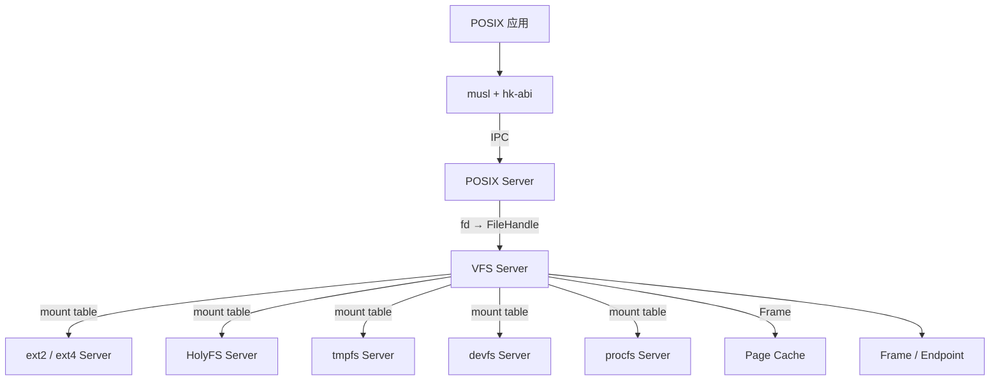
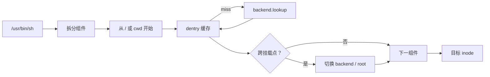

# VFS 虚拟文件系统

状态：**VFS Server 原型已运行，缓存与客户端接口已接入** · 上级：[总体架构](architecture.md)

已实现 `crates/hk-vfs`：路径规范化、挂载表、dentry 缓存、4 KiB 页缓存、文件句柄、`Backend` 契约与 tmpfs 后端；IPC 已具备 `SYS_SEND_DATA`/`SYS_RECV_DATA` 字节载荷；VFS 协议支持 open/close、按偏移读写、truncate、unlink、mkdir、mount/umount 与分块传输，客户端使用固定缓冲 `VfsClient`；页缓存为有界 LRU；已挂载 tmpfs、devfs、procfs；1 MiB 顺序读测试在宿主约 725 MiB/s。重启持久化仍待 ext2/块设备后端。

VFS 运行在用户态，是 POSIX 文件语义与具体文件系统之间的中间层。POSIX Server通过 VFS 访问 ext2/ext4、HolyFS、tmpfs、devfs 与 procfs；内核只提供 Frame、Endpoint 与 Handle。

HolyFS 是一等文件系统后端，可挂载为 `/` 主根或 `H:` 盘符；同一份数据同时提供 POSIX 视图与整文档 API。详见 [HolyFS](holyfs.md)。

---

## 1. 目标与范围

### 目标

1. **统一路径空间**：挂载表、路径解析、`.`/`..`、符号链接、相对路径。
2. **文件抽象**：inode、dentry、open file description、文件句柄、目录项缓存。
3. **多文件系统后端**：ext2/ext4、HolyFS、tmpfs、devfs、procfs；后端以服务器形式接入。
4. **POSIX 语义**：`open`/`read`/`write`/`stat`/`readdir`/`rename`/`unlink`/`fsync`/`truncate`。
5. **页缓存**：文件数据以 Frame 共享；POSIX Server与用户进程零拷贝读取。
6. **权限检查**：POSIX Server传入凭证；VFS 与文件系统后端执行属主/权限位检查。
7. **可重启**：VFS 重启后从挂载表与文件系统后端恢复；打开句柄按策略重建。
8. **可观察**：挂载表、缓存命中、路径解析、后端 RPC 都有 trace。

### 构件

- **VFS Server**：挂载表、路径解析、dentry/inode 缓存、文件句柄、页缓存。
- **FS Backend**：ext2/ext4、HolyFS、tmpfs、devfs、procfs 等服务器。
- **Mount**：`(device, target, fstype, flags)`。
- **Dentry**：路径组件到 inode 的映射。
- **Inode**：文件元数据与后端节点句柄。
- **OpenFile**：打开文件描述；偏移、flags、引用计数。
- **FileHandle**：POSIX Server持有的 VFS 句柄。

---

## 2. 架构



- POSIX Server维护 fd 表；每个 fd 指向 VFS 的 `FileHandle`。
- VFS 维护挂载表与路径缓存；每个挂载点绑定一个 FS Backend Endpoint。
- FS Backend 提供 `lookup`、`create`、`read`、`write`、`readdir`、`stat` 等操作。
- 数据通过共享 Frame 传输；VFS 与后端只传 Frame Handle 与元数据。

---

## 3. 挂载表

```rust
pub struct Mount {
    pub target: PathBuf,       // "/", "/dev", "/proc", "/tmp"
    pub fstype: FsType,        // Ext2 | Ext4 | HolyFS | Tmpfs | Devfs | Procfs
    pub backend: Handle<Endpoint>,
    pub flags: MountFlags,     // ReadOnly | NoExec | NoSuid
    pub root: NodeId,
}
```

- Root Server 或 POSIX Server 通过 VFS 的 `mount` 接口建立挂载。
- 挂载表由 VFS 维护；POSIX Server的 `mount`/`umount` 转发到 VFS。
- 初始挂载：`/`（ext2/ext4 或 HolyFS，由镜像选择）、`/dev`（devfs）、`/proc`（procfs）、`/tmp`（tmpfs）。
- 挂载点支持嵌套；路径解析跨越挂载边界。
- 只读挂载拒绝写操作。

---

## 4. 路径解析



- 路径解析从进程的 root 与 cwd 开始；POSIX Server提供。
- 每个组件先查 dentry 缓存，再调用后端 `lookup`。
- 符号链接按深度限制解析；循环返回 `ELOOP`。
- `.` 与 `..` 由 VFS 处理；`..` 跨越挂载点时回到挂载点父目录。
- 权限检查使用 POSIX Server传入的 `uid`/`gid`/`groups`。

---

## 5. 文件句柄与 fd

```rust
pub struct OpenFile {
    inode: NodeId,
    offset: AtomicU64,
    flags: OpenFlags,
    refs: AtomicUsize,
}

pub struct FileHandle {
    id: u64,
    open: Arc<OpenFile>,
}
```

- POSIX Server的 fd 表把 `fd` 映射到 `FileHandle`。
- `dup`/`dup2` 复制 fd 条目，共享同一个 `OpenFile`。
- `O_APPEND` 在写入时由 VFS 原子更新偏移。
- `fcntl` 的 flags 由 POSIX Server与 VFS 协作。
- 关闭最后一个 fd 时释放 `FileHandle`；后端收到 `release`。

---

## 6. VFS 与后端接口

```rust
pub enum VfsRequest {
    Lookup { parent: NodeId, name: Name },
    Create { parent: NodeId, name: Name, mode: Mode },
    Read { node: NodeId, offset: u64, len: u32, frame: Handle<Frame> },
    Write { node: NodeId, offset: u64, len: u32, frame: Handle<Frame> },
    ReadDir { node: NodeId, offset: u64, frame: Handle<Frame> },
    Stat { node: NodeId },
    Truncate { node: NodeId, len: u64 },
    Rename { from: NodeId, to: NodeId },
    Unlink { parent: NodeId, name: Name },
    Fsync { node: NodeId },
}
```

- 请求通过 FS Backend Endpoint 发送；响应携带状态与元数据。
- 大块数据使用共享 Frame；VFS 只传 Handle。
- 后端实现 ext2/ext4、HolyFS、tmpfs、devfs、procfs 的各自语义。
- 后端崩溃时，VFS 将挂载标记为离线；Root Server 重启后端。

---

## 7. 页缓存

- VFS 维护 inode → Frame 的页缓存。
- 读：命中直接映射 Frame；未命中调用后端读取。
- 写：写回缓存；`fsync` 刷回后端。
- 缓存页以 Frame Handle 共享给 POSIX Server与用户进程。
- 缓存上限与回收策略由 VFS 配置；内存压力通过 Frame 回收通知。

---

## 8. devfs 与 procfs

- **devfs**：设备节点目录；每个节点映射到 Device Manager 的设备对象。
- **procfs**：进程信息；POSIX Server提供 PID、状态、fd、命令行等数据。
- 两者以 FS Backend 形式注册到 VFS；路径语义与普通文件一致。
- 设备文件操作由 VFS 转发到对应设备服务器 Endpoint。

---

## 9. 重启与恢复

- VFS 重启后从 Root Server 获取挂载配置，重新连接 FS Backend。
- POSIX Server保留 fd 表；VFS 重启后按 `(path, flags, offset)` 重建 `FileHandle`。
- 在途请求返回 `EIO`；POSIX Server 将错误传递给应用。
- FS Backend 重启后，VFS 重新执行 `mount` 与根节点查找。
- Root Server 记录 VFS 与后端重启次数。

---

## 10. 保证

1. VFS 与路径解析运行在用户态；内核提供 Frame、Endpoint 与 Handle。
2. 每个挂载点绑定一个 FS Backend Endpoint。
3. 路径解析跨越挂载点；`..` 语义保持一致。
4. 文件数据通过 Frame 共享；VFS 与后端传递 Handle。
5. POSIX fd 表由 POSIX Server维护；VFS 维护 `FileHandle`。
6. 权限检查使用进程凭证；VFS 与后端共同执行。
7. VFS 重启后从挂载表与后端恢复；在途请求返回 `EIO`。
8. 只读挂载拒绝写操作与元数据修改。
9. 页缓存以 Frame 引用计数管理。
10. 所有 VFS RPC 有 trace 与错误码。

---

## 11. 测试策略

| 层级 | 测试 |
| --- | --- |
| Hosted 单元 | 路径解析、dentry 缓存、挂载表、fd/OpenFile、页缓存 |
| Hosted 模拟 | ext2/ext4/HolyFS/tmpfs/devfs/procfs 后端、VFS 重启、后端崩溃 |
| POSIX 集成 | `open/read/write/stat/readdir/rename/unlink`、`dup`、`O_APPEND`、硬链接/符号链接 |
| QEMU | ext2/ext4 或 HolyFS 根镜像、挂载、读写、重启恢复 |
| fuzz | 路径、挂载表、RPC 消息、后端响应 |
| 基准 | 路径解析、缓存命中、顺序读写、VFS RPC 延迟 |

---

## 12. 相关文档

- [总体架构](architecture.md)
- [服务器](servers.md)
- [POSIX 与 libc](posix.md)
- [HolyFS 文件系统](holyfs.md)
- [内存模型](memory.md)
- [工程策略](engineering.md)
