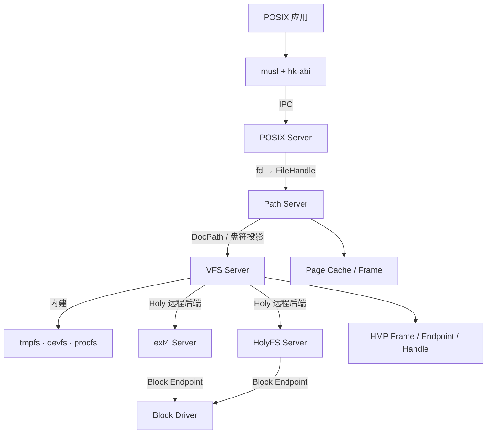

# VFS 与 Path Server

状态：**现行** · 上级：[总体架构](architecture.md) · 关联：[服务器](servers.md)、[HolyFS](holyfs.md)、[POSIX 与 libc](posix.md)

HolyKernel 把文件访问拆成两个用户态服务：**VFS Server** 维护 Holy 原生命名空间与文件系统后端，**Path Server** 维护路径、fd、dentry 与页缓存，并把盘符投影为 POSIX 风格路径。

---

## 1. 职责

| 服务 | 职责 |
| --- | --- |
| **VFS Server**（`hk-server-vfs`） | 盘符、`DocId`、集合、修订、文档令牌；聚合 ext4 与 HolyFS 的远程 Holy 后端，内建 tmpfs/devfs/procfs；不直接访问块设备 |
| **Path Server**（`hk-server-path`） | 路径解析、`.`/`..`、符号链接、dentry/inode、文件句柄、页缓存；把盘符投影为 `/`、`/disk`、`/tmp`、`/dev`、`/proc` |
| **FS Backend** | ext4（`hk-server-ext4`，`rsext4`）、HolyFS（`hk-server-holyfs`）、tmpfs/devfs/procfs（VFS 内建）；统一到 `hk-fs::Backend` 与 `PathBackend` 契约 |
| **Block Driver** | 通过 Block Endpoint 提供 virtio-blk；ext4 与 HolyFS 服务各自挂载自己的卷 |

- VFS 暴露文档身份、集合、修订、偏移读写与文档令牌。
- Path Server 做路径与 fd 投影，持有 dentry/inode 与页缓存。
- ext4 由独立 `hk-server-ext4` 挂载并通过 Holy 协议提供 `E:`；VFS 以远程后端接入。
- tmpfs、devfs、procfs 由 VFS 进程内注册为 `T:`、`D:`、`P:`，不单独起服务。
- HolyFS 由独立 `hk-server-holyfs` 提供 `H:`/`I:`；VFS 同样通过远程 Holy 后端访问。

---

## 2. 架构



- POSIX Server 维护 fd 表；fd 指向 Path Server 的 `FileHandle`。
- Path Server 解析路径、维护 dentry/inode 与页缓存，把请求投影到 VFS 盘符。
- VFS 只维护盘符与后端句柄；ext4 与 HolyFS 都由独立服务通过 Block Endpoint 访问 virtio-blk。
- 数据通过共享 Frame 传输；Path Server 与 VFS 传递 Frame Handle 与元数据。
- 原生 Holy 客户端直接访问 VFS 或 HolyFS，路径语义由客户端自行处理。

---

## 3. 盘符与路径投影

| 盘符 | 后端 | 默认路径投影 |
| --- | --- | --- |
| `E:` | ext4（`hk-server-ext4`，virtio-blk，`rsext4`） | `vfs.root=ext4` 时映射 `/`；默认映射 `/disk` |
| `T:` | tmpfs | 默认映射 `/` 与 `/tmp` |
| `D:` | devfs | `/dev` |
| `P:` | procfs | `/proc` |
| `H:` | HolyFS（`hk-server-holyfs`） | `/disk` |
| `I:` | HolyFS（`hk-server-holyfs`） | `/disk-I` |

- 投影规则由 Path Server 在启动时读取 boot cmdline 决定。
- 默认 `T:` 作为根；`vfs.root=ext4` 时 `E:` 作为根。
- Path Server 只投影盘符，挂载表由 VFS 持有。
- 挂载点支持嵌套；路径解析跨越盘符边界。

---

## 4. VFS 协议

```rust
pub struct Request<'a> {
    pub op: u8,
    pub path: &'a str,
    pub arg0: u64,
    pub arg1: u64,
    pub data: &'a [u8],
}
```

操作码：

| 操作 | 语义 |
| --- | --- |
| `OP_OPEN` / `OP_CLOSE` | 打开/关闭文档或文件 |
| `OP_READ` / `OP_WRITE` | 按偏移读写 |
| `OP_STAT` | 查询文档或文件元数据 |
| `OP_TRUNCATE` / `OP_UNLINK` | 截断/删除 |
| `OP_LIST` | 枚举集合成员 |
| `OP_MKDIR` | 创建集合 |
| `OP_MOUNTS` / `OP_UMOUNT` | 查询/卸载 |
| `OP_SYNC` | 刷写后端 |
| `OP_READ_BUFFER` / `OP_WRITE_BUFFER` | 通过共享 Frame 读写 |

- 请求头为 `op(1) + kind(1) + text_len(2) + arg0(8) + arg1(8)`，后接路径与载荷；VFS 的 `kind` 恒为 0。
- `VFS_ATTACH`/`VFS_DETACH` 建立或解除共享 Frame 映射。
- `hk-proto-client` 的 `VfsClient` 提供 `open`、`close`、`read`、`write`、`stat`、`truncate`、`unlink`、`readdir`、`mkdir`、`mounts`、`umount`、`sync`、`read_buffer`、`write_buffer`；收发缓冲在首次请求时分配。
- 响应状态由 `STATUS_OK`、`STATUS_NOT_FOUND`、`STATUS_INVALID`、`STATUS_PERMISSION`、`STATUS_IO` 等表达。

---

## 5. 文件句柄与页缓存

- Path Server 的 `FileHandle` 由 `(DocId, 修订, 偏移, flags)` 组成；POSIX fd 表引用它。
- `dup`/`dup2` 共享同一个打开文件描述；`O_APPEND` 在写入时原子更新偏移。
- 页缓存按 `(实例, DocId, 修订)` 索引，使用有界 LRU；写入产生新修订后自动失效。
- 大块顺序读写直接走后端；共享 Frame 用于客户端缓冲与零拷贝路径。
- 动态设备节点（`null`/`zero`/`console`）绕过页缓存。

---

## 6. 重启与重连

- VFS 或 Path Server 退出后由 Root Server 按重启策略重启。
- 客户端通过 `SYS_SERVICE_ENDPOINT` 解析当前端点；服务重启后新请求自动重连。
- 在途请求通过 `SYS_RECV_DATA_FROM` 绑定旧端点；服务退出时返回空响应并映射为 `EIO`。
- Path Server 重启后从 VFS 重新读取盘符，按策略重建文件句柄与页缓存。
- ext4 或 HolyFS 重启后 VFS 的远程后端按服务名重新握手，`E:`/`H:`/`I:` 继续可用。
- VFS 不持有块设备句柄，ext4 驱动重启不会牵动 VFS 的地址空间。

---

## 7. 保证

1. VFS 是 Holy 原生命名空间的入口；Path Server 是 POSIX 路径与 fd 的投影层。
2. 盘符、`DocId`、集合、修订与文档令牌由 VFS 维护。
3. Path Server 持有路径、dentry、文件句柄与页缓存，通过 VFS 访问后端。
4. ext4 由独立服务通过 Block Endpoint 挂载，VFS 只经 Holy 远程后端访问；页缓存与共享 Frame 减少拷贝。
5. 服务重启后客户端按端点变化重连，在途请求明确失败。
6. 挂载表、缓存命中、路径解析与后端请求都有 trace。

---

## 8. 测试策略

| 层级 | 测试 |
| --- | --- |
| Hosted 单元 | 盘符投影、DocId 解析、修订与页缓存失效、协议编解码 |
| Hosted 模拟 | VFS/Path 重启重连、在途请求失败、HolyFS 远程后端 |
| QEMU | ext4 服务挂载、`/tmp`/`/dev`/`/proc` 投影、HolyFS `H:`/`I:`、`OP_SYNC` 落盘 |
| 故障注入 | VFS 退出、Path 退出、Block 退出、ext4 退出、HolyFS 退出 |
| 基准 | 1 MiB 顺序读写、页缓存命中、共享 Frame 零拷贝 |
